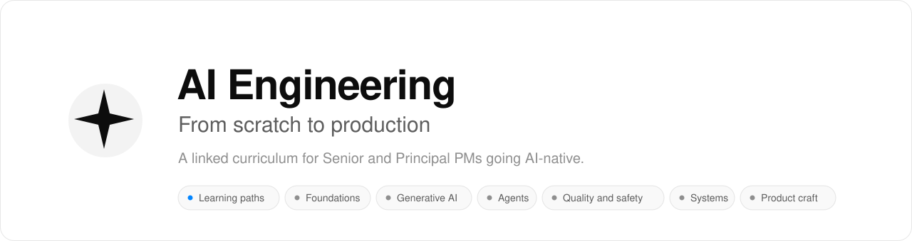

<picture>
  <source media="(prefers-color-scheme: dark)" srcset="./assets/banner-dark.svg">
  
</picture>

 

**[Live site](https://aakashagg123.github.io/gatsby/)** · **[Learning paths by role](./learning-paths/README.md)** · **[Knowledge graph](https://aakashagg123.github.io/gatsby/graph/)** · **[Reading order](./SUMMARY.md)** · **[Glossary](./GLOSSARY.md)** · **[Design system](./design-system/README.md)**

---

> **This is a curriculum for the product leaders who own AI features — not just the engineers who build them.**
> It teaches the engineering discipline underneath production AI systems — how learned models work, inference, retrieval, agents, evaluation, safety, and cost — through the lens of the decisions a **Senior or Principal PM** has to make. Every lesson pairs the real mechanics with a **🎯 For the product leader** briefing: why it matters to the product, what it changes in your decisions, the sharp question to ask your eng team, and the product risk if you ignore it. Many lessons also carry a short, runnable example, so an engineer can check every claim.

 

## Choose your path

Pick the role closest to yours. Each path is an ordered list of lessons across the tracks below, with checkpoints, skip-ahead rules and a week-by-week plan. Times are rough estimates.

| Path | Who it is for | Outcome | Length |
| :-- | :-- | :-- | :-- |
| [Senior PM](./learning-paths/senior-product-manager.md) | A product manager with several years of experience who is starting to own AI features | Lead an AI feature end to end: choose the approach, set the quality bar, price it, and judge the risk. | about 17 hours |
| [AI Product Lead](./learning-paths/ai-product-lead.md) | A product leader who owns an AI product line or a team of PMs shipping AI features | Set direction for grounding, memory, agents, safety and cost, and review a design with engineering. | about 26 hours |
| [AI Engineer](./learning-paths/ai-engineer.md) | A software engineer who builds AI-powered systems | Build, test and run a retrieval-backed, tool-using agent, and explain how it fails. | about 76.5 hours |
| [AI Engineering Lead](./learning-paths/ai-engineering-lead.md) | An engineering manager or tech lead who runs a team that builds AI systems | Review AI architecture, set quality and safety standards, control cost, and work well with product. | about 37 hours |

Not sure where to start? Read the [paths overview](./learning-paths/README.md).

 

## Who this is for

<table>
<tr>
<td width="33%" valign="top">

### The AI-native PM
You own an AI feature and keep hitting the gap between an impressive demo and something you can actually ship, price, and stand behind. You want to **lead the conversation**, not nod along in it.

</td>
<td width="33%" valign="top">

### The Principal scoping a bet
You're deciding fine-tune vs. RAG, build vs. buy, what to put in the SLA, and what "AI quality" even means on the roadmap. You need the **tradeoffs and their costs**, named plainly.

</td>
<td width="33%" valign="top">

### The engineer who wants the map
You know the pieces but want them connected — caching to isolation, prefill to cost, evals to drift — as **one discipline**, with the failure modes that tie them together.

</td>
</tr>
</table>

> If you've ever had a JSON parse error take down a workflow, a retrieval index go quietly stale, an agent loop run up a bill, or a cache serve one customer's data to another — this curriculum is the prevention you wish had been on the roadmap.

 

## Curriculum map

Each module is a folder of cross-linked markdown, readable directly on GitHub. Prefer a designed reading experience? Every module also ships as a **[rendered HTML edition](./html/index.html)**.

<table>
<tr>
<td width="50%" valign="top">

### [`00` · Foundations](./content/00-foundations/README.md)
*The mindset shift from "writing prompts" to "engineering systems."*

- [Harness engineering, not just prompt engineering](./content/00-foundations/harness-engineering.md)
- [Context engineering, not just long prompts](./content/00-foundations/context-engineering.md)
- [Shipping LLM systems as infrastructure, not demos](./content/00-foundations/infra-not-demos.md)

</td>
<td width="50%" valign="top">

### [`01` · Inference internals](./content/01-inference-internals/README.md)
*What happens between your request and the tokens that come back.*

- [Prompt caching vs. semantic caching](./content/01-inference-internals/prompt-vs-semantic-caching.md)
- [KV cache: eviction, reuse, memory pressure](./content/01-inference-internals/kv-cache-management.md)
- [Prefill vs. decode latency](./content/01-inference-internals/prefill-vs-decode.md)
- [Continuous batching & paged attention](./content/01-inference-internals/batching-and-paged-attention.md)
- [Speculative decoding vs. quant vs. distillation](./content/01-inference-internals/speculative-quantization-distillation.md)
- [Quantization formats: INT8/INT4/FP8/AWQ/GPTQ](./content/01-inference-internals/quantization-formats.md)

</td>
</tr>
<tr>
<td width="50%" valign="top">

### [`02` · Reliable outputs & tool use](./content/02-reliable-outputs/README.md)
*Making models produce things downstream systems can trust.*

- [Structured output: validation, repair, fallback](./content/02-reliable-outputs/structured-output.md)
- [Function calling, tool contracts, idempotency](./content/02-reliable-outputs/function-calling.md)
- [Agent guardrails: loop, tool & token budgets](./content/02-reliable-outputs/agent-guardrails.md)
- [Model routing & degraded-mode UX](./content/02-reliable-outputs/model-routing.md)

</td>
<td width="50%" valign="top">

### [`03` · RAG & retrieval](./content/03-rag/README.md)
*Grounding models in your data — and proving they used it.*

- [RAG architecture: chunking → reranking → freshness](./content/03-rag/rag-architecture.md)
- [Retrieval evals: recall, grounding, citations](./content/03-rag/retrieval-evals.md)

</td>
</tr>
<tr>
<td width="50%" valign="top">

### [`04` · Evals & observability](./content/04-evals-observability/README.md)
*You cannot operate what you cannot measure.*

- [Evals: golden sets, adversarial, LLM-as-judge](./content/04-evals-observability/evals.md)
- [Observability: traces, tokens, latency, drift](./content/04-evals-observability/observability.md)
- [Cost attribution per feature, tenant & journey](./content/04-evals-observability/cost-attribution.md)

</td>
<td width="50%" valign="top">

### [`05` · Safety & multi-tenancy](./content/05-safety-multitenancy/README.md)
*Keeping tenants, users, and data out of each other.*

- [Safety: injection, leakage, permission boundaries](./content/05-safety-multitenancy/safety-engineering.md)
- [Multi-tenant isolation & cache contamination](./content/05-safety-multitenancy/multi-tenant-isolation.md)

</td>
</tr>
<tr>
<td width="50%" valign="top">

### [`06` · Strategy & tradeoffs](./content/06-strategy-tradeoffs/README.md)
*Picking the right tool, and naming the cost of every choice.*

- [Fine-tuning vs. ICL vs. RAG vs. distillation](./content/06-strategy-tradeoffs/finetune-vs-icl-vs-rag.md)
- [Latency / quality / cost / reliability tradeoffs](./content/06-strategy-tradeoffs/inference-stack-tradeoffs.md)
- [Production failure modes & how to prevent them](./content/06-strategy-tradeoffs/production-failure-modes.md)

</td>
<td width="50%" valign="top">

### [Reading experience](./design-system/README.md)
*The same curriculum, in a designed reading experience.*

- Built on **OpenAI's Apps SDK UI** design system, set in **Google Sans**, in light and dark.
- Reader settings for font, size and margins. A glossary sidebar. A [knowledge graph](https://aakashagg123.github.io/gatsby/graph/).
- Pre-rendered from the markdown, so it never drifts. Open `html/index.html` locally, or use the [live site](https://aakashagg123.github.io/gatsby/).

</td>
</tr>
</table>

 

## Beyond AI Engineering: the craft tracks

The AI Engineering modules above teach the *stack*. Twenty-seven further tracks teach the *craft* around it. Each is a standalone folder of cross-linked lessons in the same house style (TL;DR → 🎯 briefing → mechanics → failure modes → checklist), each with a rendered HTML edition on the [live site](https://aakashagg123.github.io/gatsby/).

### Start here

| Track | What it teaches | Start here |
| :-- | :-- | :-- |
| [**Learning paths**](./learning-paths/README.md) **New** | The tracks in order for four roles: senior product manager, AI product lead, AI engineer and AI engineering lead. Each path gives the lessons to read, what to skip, a time estimate and a checkpoint per stage. | [Choose your path](./learning-paths/README.md) |

### Foundations: how learned models work

| Track | What it teaches | Start here |
| :-- | :-- | :-- |
| [**Machine learning**](./machine-learning/README.md) **New** | What a learned system is, what it learns from, how it learns, how to trust its score, which model family to pick, and how to keep it working after launch. Runnable code in every lesson. | [Plan](./MACHINE_LEARNING_ROADMAP.md) |
| [**Tensors**](./tensors/README.md) **New** | What the objects every model works on are, what they cost in memory and compute, why shape errors are silent, and how a library gets the gradient for free. Runnable code in every lesson. | [Plan](./TENSORS_ROADMAP.md) |
| [**Convolutional networks**](./cnns/README.md) **New** | How a vision model sees, what resolution and depth cost, when to reuse a pre-trained or foundation model, and why vision features break in production. Runnable code in three lessons. | [What computer vision does](./cnns/what-computer-vision-does.md) |

### Generative AI

| Track | What it teaches | Start here |
| :-- | :-- | :-- |
| [**Generative AI: the big picture**](./generative-ai/README.md) | What makes AI "generative," the five modalities, why output is probabilistic, the four-layer product stack, and build vs. buy vs. fine-tune. Opens the [Generative AI family](./GENERATIVE_AI_ROADMAP.md). | [What makes AI "generative"?](./generative-ai/what-is-generative-ai.md) |
| [**LLMs**](./llms/README.md) | Tokens, the context window, the jagged frontier, prompting, sampling, choosing a model, and the order to reach for prompting, RAG, or fine-tuning. | [What an LLM actually is](./llms/what-is-an-llm.md) |
| [**Prompt engineering**](./prompt-engineering/README.md) | The craft of writing input a model will reliably act on — from ChatGPT productivity patterns, through few-shot and chain-of-thought, into the prompts that drive Claude Code and other coding agents. 10 lessons. | [What prompt engineering actually is](./prompt-engineering/what-prompt-engineering-actually-is.md) |
| [**Context engineering**](./context-engineering/README.md) | Treat what the model gets to see as a product decision — instructions, retrieval, memory, and live state, spec'd, governed, and evaluated with the same rigor as the output it produces. | [What is context engineering, for a product leader?](./context-engineering/what-is-context-engineering.md) |
| [**Memory & context**](./memory-and-context/README.md) | Memory as a product decision, the three shapes it takes (session, user, organizational), how memories are written and kept, the designs for reading them back, and the trust failures it has to be designed against. | [Memory as a product decision](./memory-and-context/memory-as-a-product-decision.md) |
| [**RAG & vector databases**](./rag-vector-databases/README.md) | Grounding models in your data — when to use RAG and when not to, embeddings, vector databases, chunking, retrieval quality, the alternatives, and a hands-on build with Claude Code, pgvector and Pinecone. Runnable code. | [When to use RAG](./rag-vector-databases/when-to-use-rag.md) |
| [**Knowledge graphs**](./knowledge-graphs/README.md) | Treat what the company knows as a product — entities and ontologies, the construction pipeline, GraphRAG, governance, and the business case, in product-leader language. | [What is a knowledge graph?](./knowledge-graphs/what-is-a-knowledge-graph.md) |
| [**APIs & integrations**](./api-integrations/README.md) | The request/response contract, authentication, rate limits, streaming, retries, structured output, webhooks, and fitting a model call into a real system. | [The request/response contract](./api-integrations/the-request-response-contract.md) |

### Agents

| Track | What it teaches | Start here |
| :-- | :-- | :-- |
| [**Tool calling**](./tool-calling/README.md) | The line where an AI product stops talking and starts doing: what tool calling is, designing a tool contract worth trusting, and keeping the permission and blast-radius boundary around it real. | [What tool calling is](./tool-calling/what-tool-calling-is.md) |
| [**AI agents**](./ai-agents/README.md) | The loop behind every agent, how much autonomy a task actually needs, what keeps it reliable across many steps, the economics that decide whether it's worth building, how to run it safely, and how to choose one. 5 lessons. | [What an agent is, and how much autonomy it needs](./ai-agents/what-an-agent-is-and-how-much-autonomy-it-needs.md) |
| [**Agentic workflows**](./agentic-workflows/README.md) | Choosing a workflow pattern, when more than one agent earns its cost, and what it takes to make a workflow durable enough to own end to end. | [Choosing a workflow pattern](./agentic-workflows/choosing-a-workflow-pattern.md) |
| [**Agentic AI**](./agentic-ai/README.md) | What agents actually are — the loop, tools, memory, planning — and the reliability, security, and economics that turn demos into products. Opens with a knowledge graph. | [What is an agent?](./agentic-ai/what-is-an-agent.md) |

### Quality, safety and cost

| Track | What it teaches | Start here |
| :-- | :-- | :-- |
| [**Evaluation & observability**](./evaluation-and-observability/README.md) | Why the eval set is the product spec for a non-deterministic system, and the order to actually build the eval and observability stack in. | [Why eval investment is the job](./evaluation-and-observability/why-eval-investment-is-the-job.md) |
| [**AI security & guardrails**](./ai-security-and-guardrails/README.md) | Jailbreak, injection, extraction, and poisoning are four different attacks. A defense you have not attacked is a guess. Governance only counts once it becomes compliance evidence a regulator or buyer can check. | [The threat model, and guardrails as architecture](./ai-security-and-guardrails/the-threat-model-and-guardrails.md) |
| [**Cost optimization**](./cost-optimization/README.md) | Which lever fixes which cost driver, the build-vs-buy breakeven done as arithmetic, and the FinOps practice that turns attribution into governance before the invoice, not after. | [The cost stack, and the build-vs-buy breakeven](./cost-optimization/the-cost-stack-and-the-build-vs-buy-breakeven.md) |
| [**Access control**](./access-control/README.md) | Who may do what, and where that is decided: authentication vs authorization, OAuth and tokens, RBAC, ABAC, relationship-based access, Keycloak, and access control for AI agents. 8 lessons. | [Authentication, authorization and the access-control model](./access-control/authentication-authorization-and-the-access-control-model.md) |

### Systems and hands-on builds

| Track | What it teaches | Start here |
| :-- | :-- | :-- |
| [**System design**](./system-design/README.md) | How real systems are designed at scale — from rate limiters to stock exchanges — with the architecture, tradeoffs, and failure modes that shape product decisions. 28 systems across 8 lessons. | [Foundations & framework](./system-design/foundations-and-framework.md) |
| [**Harness engineering**](./harness-engineering/README.md) | Build a coding agent's harness from scratch — loop, tools, context, permissions, subagents, evals — in 10 hands-on phases. | [Roadmap](./harness-engineering/ROADMAP.md) |
| [**Flowable**](./flowable/README.md) | Process automation from scratch — build a token engine, wait states, and a job executor by hand, then run real BPMN on Flowable. Concept-first for PMs, build layer for engineers. | [Roadmap](./flowable/ROADMAP.md) |

### Product craft

| Track | What it teaches | Start here |
| :-- | :-- | :-- |
| [**Product sense**](./product-sense/README.md) | The five habits under great product judgment — behaviour, empathy, strategy, communication, domain — and how they bend for AI products. | [Motivation & behaviour](./product-sense/motivation-and-behaviour.md) |
| [**Technical product sense**](./technical-product-sense/README.md) | How systems are actually built — request paths, APIs, data, latency, reliability, tech debt — at the altitude a PM needs to lead technical conversations. | [How systems are built](./technical-product-sense/how-systems-are-built.md) |
| [**Technical product management**](./technical-product-management/README.md) | The operating craft: discovery, specs, prioritization, working with engineering, metrics, launches — and the AI-products capstone. | [The technical PM role](./technical-product-management/the-technical-pm-role.md) |
| [**First principles & the polymath mind**](./first-principles/README.md) | Reasoning from fundamentals instead of by analogy, and building the mental-model range to do it well. | [What first-principles thinking is](./first-principles/what-is-first-principles.md) |

 

## How each lesson is built

Every lesson follows the same shape, so you always know where to look:

| Section | What it gives you |
| :-- | :-- |
| **TL;DR** | The one-paragraph version. |
| 🎯 **For the product leader** | Why it matters · what it changes in your decisions · the question to ask eng · the product risk if ignored. |
| **Mental model → Mechanics** | How to think about it, then how it actually works. |
| **Tradeoffs & decisions** | When to use what, and the cost of each choice. |
| **Failure modes** | How it breaks in production. |
| **Under the hood** | For engineers: real code or a worked mechanism. In the foundation modules it runs on the Python standard library and ends in `assert` lines. |
| **Worked example** | Numbers you can check. Invented data is labelled as invented. |
| **Practitioner checklist** | What to verify before you ship. |
| **Related lessons** | Cross-links — the *linked* part of this repository. |
| **Sources** | Primary sources with an "as of" date, and a review stamp. A track's recap ends with a **Test yourself** quiz. |

 

## The reading experience

The site is one static page set, built from the markdown. It uses **OpenAI's Apps SDK UI** as its design system, with **Google Sans** as the default typeface. The tokens and component CSS are the SDK's own files, vendored unchanged, and a lint step keeps it that way.

- **Light and dark.** A toggle on every page, and it follows your system until you choose.
- **Reader settings.** Font, text size and margins, saved in your browser.
- **A glossary sidebar.** Click an underlined term for a plain-language explanation, an example, and the lesson that develops it.
- **A knowledge graph** of every page and its cross-links.
- **Built for phones.** A chapter menu, a home button, and a layout that holds at 390 px. Scrolling stays native.

Read [`design-system/README.md`](./design-system/README.md) before changing how anything looks.

 

## Threads — follow one concern across the whole stack

The modules are ordered, but the real value is in the cross-links. Pull any thread:

- **Caching & cost**[Prompt vs. semantic caching](./content/01-inference-internals/prompt-vs-semantic-caching.md) → [KV cache](./content/01-inference-internals/kv-cache-management.md) → [Multi-tenant cache safety](./content/05-safety-multitenancy/multi-tenant-isolation.md) → [Cost attribution](./content/04-evals-observability/cost-attribution.md)
- **Reliability**[Structured output](./content/02-reliable-outputs/structured-output.md) → [Function calling](./content/02-reliable-outputs/function-calling.md) → [Agent guardrails](./content/02-reliable-outputs/agent-guardrails.md) → [Production failure modes](./content/06-strategy-tradeoffs/production-failure-modes.md)
- **Latency**[Prefill vs. decode](./content/01-inference-internals/prefill-vs-decode.md) → [Batching & paged attention](./content/01-inference-internals/batching-and-paged-attention.md) → [Speculative decoding & quantization](./content/01-inference-internals/speculative-quantization-distillation.md) → [Stack tradeoffs](./content/06-strategy-tradeoffs/inference-stack-tradeoffs.md)
- **Quality**[Context engineering](./content/00-foundations/context-engineering.md) → [RAG architecture](./content/03-rag/rag-architecture.md) → [Retrieval evals](./content/03-rag/retrieval-evals.md) → [Evals](./content/04-evals-observability/evals.md)
- **Which tool?**[Fine-tune vs. ICL vs. RAG vs. distillation](./content/06-strategy-tradeoffs/finetune-vs-icl-vs-rag.md) → [RAG architecture](./content/03-rag/rag-architecture.md) → [Model routing](./content/02-reliable-outputs/model-routing.md)

And five threads that cross track boundaries — the same concern, followed from craft to stack:

- **Evals, end to end**[Taste becomes evals](./product-sense/product-sense-for-ai.md) → [Eval-driven development](./technical-product-management/tpm-for-ai-products.md) → [Trajectory evals for agents](./agentic-ai/reliability-and-evals.md) → [The eval stack](./content/04-evals-observability/evals.md)
- **Context, end to end**[Context engineering](./content/00-foundations/context-engineering.md) → [Context & memory in agents](./agentic-ai/context-and-memory.md) → [Technical sense for AI systems](./technical-product-sense/technical-sense-for-ai.md)
- **Cost, end to end**[Latency, scale & performance](./technical-product-sense/latency-scale-performance.md) → [Agent unit economics](./agentic-ai/agentic-ai-as-a-product.md) → [Cost attribution](./content/04-evals-observability/cost-attribution.md) → [Stack tradeoffs](./content/06-strategy-tradeoffs/inference-stack-tradeoffs.md)
- **Trust, end to end**[Trust under non-determinism](./product-sense/product-sense-for-ai.md) → [Agent UX](./agentic-ai/agentic-ai-as-a-product.md) → [Safety & governance](./agentic-ai/safety-security-and-governance.md) → [Safety engineering](./content/05-safety-multitenancy/safety-engineering.md)
- **Reasoning, end to end**[First-principles method](./first-principles/the-method.md) → [Mental models](./first-principles/mental-models-latticework.md) → [Planning & reasoning in agents](./agentic-ai/planning-and-reasoning.md)

 

## Where to start

<table>
<tr>
<td valign="top"><strong>Know your role?</strong></td>
<td>Follow the matching <a href="./learning-paths/README.md">learning path</a>.</td>
</tr>
<tr>
<td valign="top"><strong>New to how models learn?</strong></td>
<td>Read <a href="./machine-learning/README.md">Machine learning</a>, then <a href="./tensors/README.md">Tensors</a>, then <a href="./cnns/README.md">Convolutional networks</a>. Each has runnable code and a self-test.</td>
</tr>
<tr>
<td valign="top"><strong>New to the AI engineering stack?</strong></td>
<td>Read <a href="./content/00-foundations/README.md">Foundations</a> top to bottom, then follow the <a href="./SUMMARY.md">reading order</a>.</td>
</tr>
<tr>
<td valign="top"><strong>Scoping a specific bet?</strong></td>
<td>Jump to <a href="./content/06-strategy-tradeoffs/finetune-vs-icl-vs-rag.md">Fine-tune vs. ICL vs. RAG vs. distillation</a> and the <a href="./content/06-strategy-tradeoffs/inference-stack-tradeoffs.md">latency / quality / cost tradeoffs</a>.</td>
</tr>
<tr>
<td valign="top"><strong>Prepping a launch review?</strong></td>
<td>Use <a href="./content/06-strategy-tradeoffs/production-failure-modes.md">Production failure modes</a> as your pre-launch checklist.</td>
</tr>
<tr>
<td valign="top"><strong>Want to learn with an agent?</strong></td>
<td>Read <a href="./machine-learning/learning-and-doing-ml-with-claude-code.md">Learning and doing ML with Claude Code</a>.</td>
</tr>
<tr>
<td valign="top"><strong>Want the glossary first?</strong></td>
<td>Skim the <a href="./GLOSSARY.md">Glossary</a> — every term links to where it's developed.</td>
</tr>
</table>

 

## Keeping it accurate

Most errors in a curriculum like this are claims that were true once. So the repository has a standard, and a way to measure it.

- [`CONTENT_FRAMEWORK.md`](./CONTENT_FRAMEWORK.md) sets readability targets, sourcing rules, review stamps with a freshness cadence, an overlap gate for new lessons, and a required **independent fact-check** before a module ships.
- [`WRITING-STYLE.md`](./WRITING-STYLE.md) sets the plain-English rules: short sentences, one idea each, active voice.
- `python3 scripts/check_module.py <track>` scores a track against the framework. `python3 scripts/check_links.py` verifies every relative link.

 

---

<strong>Project scaffold &amp; build</strong>

 

The learning material is plain markdown, so no build step is needed to read it.

- **Flat tracks** (`agentic-ai/`, `machine-learning/`, `tensors/`, and so on) are rendered by [`scripts/build_standalone.py`](./scripts/build_standalone.py) through a thin config per track (`scripts/build_<track>.py`) into committed `<track>-html/` folders. The AI engineering modules in [`content/`](./content/) are rendered by [`scripts/build_html.py`](./scripts/build_html.py) into [`html/`](./html/). Pre-rendering needs Python 3 and the `markdown` package.
- **Phased tracks** (`harness-engineering/`, `flowable/`) are copied as they are, with a lightweight viewer written next to every markdown file.
- The **combined site** is assembled by [`scripts/build_site.py`](./scripts/build_site.py), which also builds the knowledge graph and the glossary, and is published to GitHub Pages by [`.github/workflows/pages.yml`](./.github/workflows/pages.yml) on every push to `master`.
- **Styling** lives in [`design-system/`](./design-system/) and is generated into one `assets/ds.css`. Page generators emit markup only. `python3 scripts/check_design_system.py` rejects literal colours and edits to the vendored SDK files.
- **The banner** is generated by [`scripts/build_banner.py`](./scripts/build_banner.py) from the same tokens, in a light and a dark version.
- Before a commit, run `python3 scripts/check_links.py` and `python3 scripts/check_design_system.py`. See [`CLAUDE.md`](./CLAUDE.md) for the full checklist, including how to add a track.

 
Educational content. Use it, fork it, teach from it.

