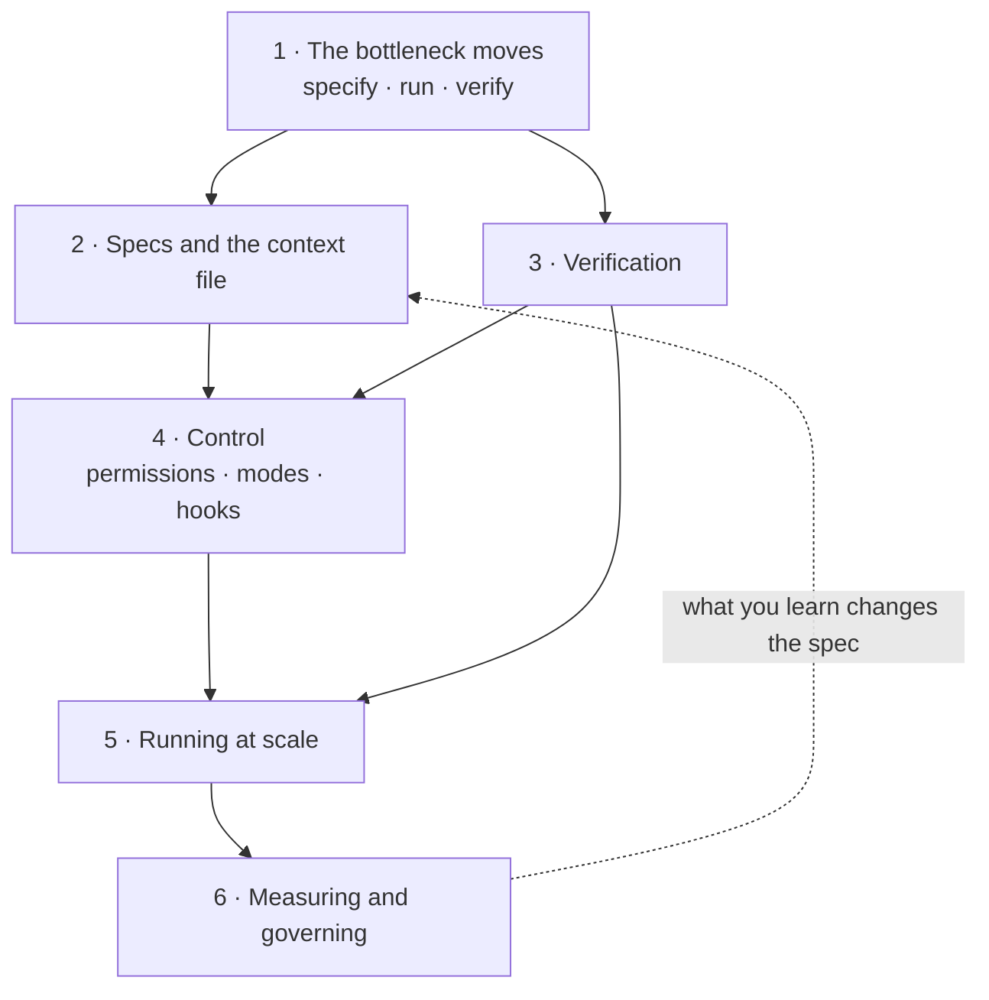

# AI-assisted development for the product and technology leader

*Part of the [craft tracks](../README.md). It builds on [agentic AI](../agentic-ai/README.md), [tool calling](../tool-calling/README.md) and [evaluation and observability](../evaluation-and-observability/README.md).*

A coding agent reads your repository, edits files, runs commands and reports back. Teams that use one well ship faster. Teams that use one badly ship the same bugs faster, and review more code than before.

The tool is the easy part. The work that changes is around it. Someone must **specify** the task so the agent can finish it. Someone must **verify** the result, because the agent will say it is done when it is not. Someone must **control** what the agent may touch. And someone must **measure** the outcome in a way that does not fool them.

This module covers those four jobs for the leader who sets the rules. It does not teach one tool's menus. The examples follow Claude Code, because its documentation is public and specific, and the ideas carry to other coding agents.

Every lesson has two layers. The body is for the leader who decides. A short **Under the hood** section is for the engineer who builds. It points to code that runs on the Python standard library and ends in `assert` lines. One file is a real Stop-hook script you can copy. The others are small models of cost, review time, permission rules and metrics, with invented numbers.

**A note on scope and freshness.** Coding agents change every few weeks. Settings, modes and prices in this module come from the Claude Code documentation as read in 2026-10. The *ideas* hold longer than the *names*. Check the documentation before you copy a setting.

## Where the depth lives

| If you want the full depth on | Read |
| --- | --- |
| How an agent loop works | [Agentic AI](../agentic-ai/README.md) and [AI agents](../ai-agents/README.md) |
| How agents call tools and servers | [Tool calling](../tool-calling/README.md) |
| What goes into the context and how it fills | [Context engineering](../context-engineering/README.md) |
| Writing evals and checks | [Evaluation and observability](../evaluation-and-observability/README.md) |
| Prompt injection, secrets and least privilege | [AI security and guardrails](../ai-security-and-guardrails/README.md) |
| Token prices, caching and budgets | [Cost optimization](../cost-optimization/README.md) |
| Why a long session costs more | [Generating text and the KV cache](../transformers/generating-text-and-the-kv-cache.md) |

## The knowledge graph



Read it as a loop. When an agent writes the code, the scarce steps become **specifying** and **verifying**. The **context file** carries the spec across sessions. **Verification** turns "done" into a fact. **Control** limits the harm when the agent is wrong. **Scale** multiplies all of it. **Measurement** tells you whether it worked, and feeds back into the spec.

## The lessons

1. [When an agent writes the code: where the bottleneck goes](./when-an-agent-writes-the-code.md) — a model of time per task, and why checks beat speed.
2. [Specs and the context file](./specs-and-the-context-file.md) — what to write once so every session starts well.
3. [Verification is the product](./verification-is-the-product.md) — tests, hooks and the rule that "done" must be checked.
4. [Control: permissions, modes and hooks](./control-permissions-modes-and-hooks.md) — what a rule stops, and what it does not.
5. [Running at scale: sessions, subagents and fan-out](./running-at-scale.md) — context cost, parallel work and the review queue.
6. [Measuring and governing](./measuring-and-governing.md) — metrics that do not mislead, costs, and a policy that fits on a page.

Then the [recap and real-world examples](./recap.md), with a self-test.

## Run the code

Every example is in `ai-assisted-development/code/`. Run them all with one command.

```bash
python3 ai-assisted-development/code/test_examples.py
```

The files are `lesson1_bottleneck.py` through `lesson6_metrics.py`, plus `stop_gate.py`, a Stop-hook script you can register. A passing file checks the direction of each claim, such as strong checks beating a faster agent. Run a file to see every quoted number printed.
