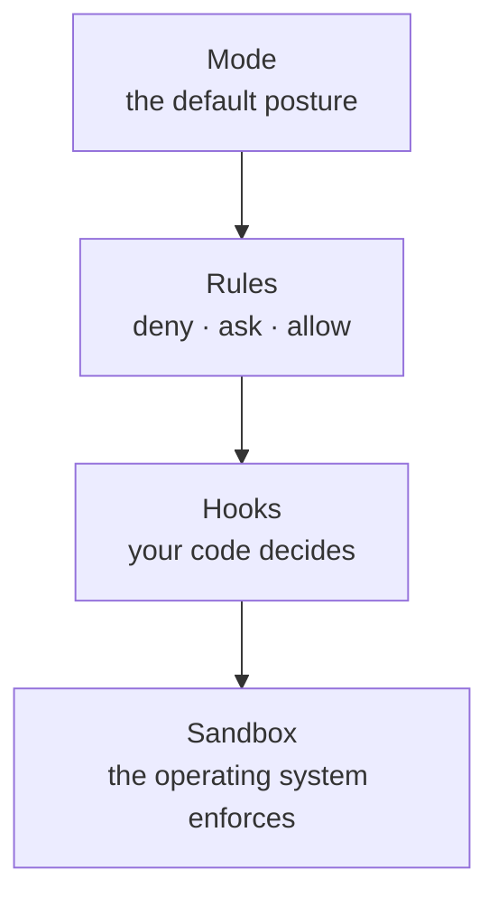

# Control: permissions, modes and hooks

*Part of [AI-assisted development for the product and technology leader](./README.md)*

*Last reviewed: 2026-10 · Volatility: fast*

## TL;DR

An agent with a shell can do what you can do. It can read secrets, delete files and call the network. Control is how you decide what it may do alone, what needs a yes, and what is never allowed.

Claude Code gives three layers. **Permission modes** set the overall posture: ask for everything, auto-approve edits, plan without editing, let a classifier decide, or skip checks. **Permission rules** allow, ask or deny specific tools and commands. **Hooks** run your own code at set points and can block an action.

One fact matters more than the rest. A rule on a shell command matches the command *as written*. A rule that denies `curl` does not deny `/usr/bin/curl` or `sh -c 'curl …'`. The documentation says so. Rules are guardrails for honest mistakes. They are not a security boundary. For that you need an operating-system sandbox, a container, or a machine with nothing to lose.

> 🎯 **For the product leader**
>
> **Why it matters** — Control decides your worst day. A coding agent with write access to production credentials is an incident waiting for a prompt injection.
>
> **What it changes in your decisions** — You set a default posture per environment, require a sandbox for unattended work, and keep secrets out of reach. You treat a rule as a seatbelt, not a wall.
>
> **Ask your eng team** — *"What can the agent do without asking, what can it reach on the network, and what would a malicious instruction in a file be able to do?"*
>
> **Risk if ignored** — A bypass mode left on in a shared environment. A deny rule everyone thinks is a wall.

## The mental model: three nested controls



Each layer catches what the one above lets through. Only the last one does not depend on how the agent writes its command.

## Mechanics

### Permission modes

Per the Claude Code documentation, the modes are: **default** (manual: asks before edits and commands), **acceptEdits** (auto-approves file edits), **plan** (reads only, proposes a plan), **auto** (a classifier approves routine actions and blocks risky ones), **dontAsk** (only pre-approved tools run), and **bypassPermissions** (no checks). Shift+Tab cycles the common ones. Use bypass only in an isolated container with no secrets.

### Rules: deny, then ask, then allow

Rules are checked in order: deny first, then ask, then allow. The first match wins. So a broad deny beats a narrow allow. Rules can name tools (`Read`, `Edit`, `Bash`) and patterns (`Bash(npm test *)`, `Read(src/*)`).

### What a rule does not stop

A shell rule matches text. Different text that does the same thing is a different command. Wrapping, absolute paths, flags placed differently and nested shells can all dodge a pattern. Treat denies as a way to stop the agent from doing a thing by accident, and as input to the approval prompts.

### Hooks for what must always happen

A **PreToolUse** hook sees the action before it runs and can block it, for example by refusing any edit to `tests/` or any command containing a production host. Hooks run your code, so they can inspect the real arguments. They are deterministic, which a prompt line is not.

### Sandboxes and isolation

For unattended or risky work, run the agent in a sandbox: a container or virtual machine with only the repository mounted, no production credentials and a limited network. Git worktrees give each agent its own copy of the files. The sandbox is what makes a bypass mode acceptable.

### Third-party servers and prompt injection

Tools from MCP servers extend what the agent can do, and each one is code you chose to trust. The agent also reads files, web pages and tickets that anyone may have written. A hostile instruction in that text can try to steer it. Least privilege limits the damage. See [AI security and guardrails](../ai-security-and-guardrails/README.md).

## Tradeoffs and decisions

- **Prompts vs. flow.** Each approval prompt costs attention. Too many and people click through them.
- **Auto vs. manual.** Auto saves interruptions and gives some control to a classifier.
- **Allowlist vs. denylist.** A denylist misses things. An allowlist of safe commands is safer and more work.
- **Shared settings vs. personal.** Project settings give every engineer the same floor. Personal settings let people loosen it, unless an organization policy forbids.

## Failure modes

- **Deny rule mistaken for a wall.** The agent runs the same command a different way.
- **Bypass mode in a real environment.**
- **Secrets in reach.** The agent reads `.env` and prints it in a log.
- **Approval fatigue.** Engineers approve everything.
- **Unvetted MCP server.** A tool that exfiltrates data.
- **Agent edits its own guardrails.** Settings and hook files left writable.

## Under the hood

The file is `ai-assisted-development/code/lesson4_permissions.py`. It is a simplified model of the evaluator: deny, then ask, then allow, first match wins, and a Bash rule matches the command text with a wildcard. It is not Claude Code's own code.

```python
def decide(tool, target, deny=(), ask=(), allow=(), default="ask"):
    for label, rules in (("deny", deny), ("ask", ask), ("allow", allow)):
        if any(matches(r, tool, target) for r in rules):
            return label
    return default
```

## Worked example: one deny rule and five ways around it

*The rules and commands are invented. The results come from `ai-assisted-development/code/lesson4_permissions.py`.*

With `Bash(curl *)` in the deny list:

| Command | Result |
| --- | --- |
| `curl https://example.com` | deny |
| `/usr/bin/curl https://example.com` | ask (the rule did not match) |
| `sh -c 'curl https://example.com'` | ask |

With `Bash(git push *)` denied and `Bash(git push origin main)` allowed, `git push origin main` is denied, because deny is checked first. And `git -C . push origin main` falls through to ask.

So the deny rule worked on one form and missed the others. In the model, a miss lands on "ask", which is safe when a person reads the prompt. With auto-approval or unattended runs, a miss may run. This is why unattended work needs a sandbox.

## Practitioner checklist

- [ ] Do we have a default mode per environment, written down?
- [ ] Is bypass mode limited to an isolated container with no secrets?
- [ ] Do project settings deny reads of secrets and edits to tests and hook files?
- [ ] Do we treat rules as guardrails and use a sandbox for unattended runs?
- [ ] Is every MCP server reviewed before it is added?
- [ ] Does the agent run with the least network and credential access it needs?
- [ ] Do we watch for approval fatigue?

## Related lessons

- [Verification is the product](./verification-is-the-product.md) — hooks that check.
- [Running at scale](./running-at-scale.md) — control across many agents.
- [AI security and guardrails](../ai-security-and-guardrails/README.md) — injection and least privilege.
- [Access control](../access-control/README.md) — who may do what.
- [Tool calling](../tool-calling/README.md) — how tools and servers are called.

## Sources

- Claude Code documentation, *Configure permissions*, code.claude.com/docs/en/permissions, read 2026-10: the deny, ask, allow order, first match winning, and the limits of Bash rules.
- Claude Code documentation, *Permission modes*, code.claude.com/docs/en/permission-modes, read 2026-10: the modes and Shift+Tab cycling.
- Claude Code documentation, *Hooks reference*, code.claude.com/docs/en/hooks, read 2026-10: PreToolUse and blocking.
- The rules, commands and results are invented. They come from `ai-assisted-development/code/lesson4_permissions.py`, a simplified model. This module's sources were not re-opened after the first reading, and its fact-check is pending.
