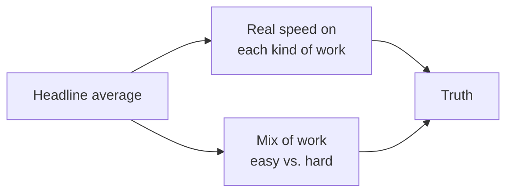

# Measuring and governing

*Part of [AI-assisted development for the product and technology leader](./README.md)*

*Last reviewed: 2026-10 · Volatility: fast*

## TL;DR

Every vendor says its agent makes developers faster. Your question is whether yours does, and at what cost and risk. The honest answer comes from a few outcome metrics, read with care.

Pick metrics that measure delivery, not activity: lead time from start to production, change failure rate, rework within 30 days, and review time per change. Lines of code and pull-request counts measure activity, and an agent inflates both.

Then watch for **mix shifts**. When agents take the easy work, the average cycle time falls, even if hard work got no faster. The headline can point up while the truth is flat or down. Compare like with like: split by difficulty, by team and by kind of change.

Governing is the other half. A short policy covers which tools are approved, which data may reach them, what must be reviewed by a person, and who owns the context file and the settings.

> 🎯 **For the product leader**
>
> **Why it matters** — You will be asked for the return on this spend. A bad metric gives a confident wrong answer.
>
> **What it changes in your decisions** — You baseline before you roll out. You report outcomes split by task type. You tie the policy to the metrics, not to opinion.
>
> **Ask your eng team** — *"Compared with before, for the same kind of work: lead time, change failure rate, rework and review time?"*
>
> **Risk if ignored** — A dashboard that shows a 3× gain while rework doubles on the hard changes.

## The mental model: a rate and a mix



An average mixes two things: how fast each kind of work is done, and how much of each kind there is. Agents change both. Split the average to see which moved.

## Mechanics

### Outcome metrics

- **Lead time.** From first commit or ticket start to running in production.
- **Change failure rate.** The share of changes that cause a failure or rollback.
- **Rework.** The share of changes that need a fix within 30 days.
- **Review time.** Reviewer time per change, and queue wait.
- **Cost per accepted change.** Tokens and seats over changes that stayed merged.

These follow the delivery metrics popularized by the DORA research. Use them as a set. A gain in one with a loss in another is the signal.

### Baselines and comparisons

Measure before rollout. Compare the same team or the same kind of work. Randomized rollouts, where some teams start later, give the cleanest comparison. Controlled studies exist: one found developers finished a task faster with an assistant. Another found experienced developers on familiar codebases were slower, despite expecting to be faster. Results depend on the task, the people and the tools.

### Perception versus measurement

Developers feel faster when the tool removes tedious work, and that feeling is real value. It is not a measurement of delivery. Collect both and do not confuse them.

### A policy on one page

- Approved tools, and who adds new ones.
- Data rules: what may go to a model, and what may never.
- Review rules: which changes need a human, such as security, payments, migrations.
- Settings and context-file ownership.
- Cost limits and who sees the report.
- An incident path: how to report and review an agent mistake.

### Skills and training

Skill with these tools varies a lot between engineers. Share what works: good context files, hooks and specs. Run a short internal guide.

## Tradeoffs and decisions

- **Few metrics vs. many.** A few, read together, beat a wall of charts.
- **Speed vs. quality.** Make the goal explicit: faster at equal quality.
- **Central policy vs. team choice.** A shared floor, with room above it.
- **Seat cost vs. usage cost.** Track both.

## Failure modes

- **Measuring activity.** Commits and lines rise.
- **Simpson's paradox.** The mix of work hides the real rates.
- **No baseline.**
- **Survivor bias.** Only counting tasks the agent finished.
- **Goodhart's law.** A target turns into a game.
- **A policy nobody can find.**

## Under the hood

The file is `ai-assisted-development/code/lesson6_metrics.py`. It holds a table of invented pull requests by difficulty and by group, and computes the blended average and the per-difficulty rates.

```python
def summarize(rows):
    n = sum(r[2] for r in rows)
    return dict(prs=n, cycle=sum(r[2] * r[3] for r in rows) / n, rework=sum(r[2] * r[4] for r in rows) / n)
```

It asserts that the headline gain is above 3 times while the hard work improved by under 25% and its rework doubled.

## Worked example: a 3× headline that is a mix shift

*The data is invented. The numbers come from `ai-assisted-development/code/lesson6_metrics.py`.*

| Group | PRs | Mean cycle time | Rework |
| --- | --- | --- | --- |
| Before | 200 | 23.0 h | 7.5% |
| With agent | 350 | 7.1 h | 9.7% |

The headline says 3.2 times faster, with more output. Now split by difficulty.

| Work | Before | With agent |
| --- | --- | --- |
| Easy: cycle time, rework | 6.0 h, 5% | 3.0 h, 8% |
| Hard: cycle time, rework | 40.0 h, 10% | 32.0 h, 20% |

Easy work got twice as fast. Hard work got 20% faster, and its rework doubled. And the mix moved: easy work went from 50% of pull requests to 86%. Most of the 3.2 times is the mix. The agent did help, mostly on easy work. On hard work, the cost is hidden in rework. A leader who read only the first table would expand to hard work and be surprised.

## Practitioner checklist

- [ ] Did we measure a baseline before rollout?
- [ ] Do we report lead time, failure rate, rework, review time and cost together?
- [ ] Do we split results by difficulty and type of work?
- [ ] Do we compare like with like, or use a staged rollout?
- [ ] Do we ask developers, and also measure?
- [ ] Is there a one-page policy with an owner?
- [ ] Do we review agent-caused incidents?

## Related lessons

- [Running at scale](./running-at-scale.md) — cost and review capacity.
- [Evaluation and observability](../evaluation-and-observability/README.md) — measuring AI systems.
- [Product sense](../product-sense/README.md) — judging a claim before you act on it.
- [Technical product management](../technical-product-management/README.md) — delivery metrics.
- [AI security and guardrails](../ai-security-and-guardrails/README.md) — the data side of the policy.

## Sources

- Forsgren, Humble and Kim, *Accelerate*, 2018, and the DORA reports (dora.dev): lead time, deployment frequency, change failure rate and time to restore.
- Peng et al., *The Impact of AI on Developer Productivity: Evidence from GitHub Copilot*, 2023 ([arxiv.org/abs/2302.06590](https://arxiv.org/abs/2302.06590)): a controlled trial with a faster task time.
- METR, *Measuring the Impact of Early-2025 AI on Experienced Open-Source Developer Productivity*, 2025 ([arxiv.org/abs/2507.09089](https://arxiv.org/abs/2507.09089)): experienced developers were slower with AI tools on their own repositories.
- Claude Code documentation, *Manage costs effectively*, code.claude.com/docs/en/costs, read 2026-10: usage tracking.
- The pull-request data is invented. It comes from `ai-assisted-development/code/lesson6_metrics.py`. Study results are quoted from memory and were not re-opened. This module's fact-check is pending.
