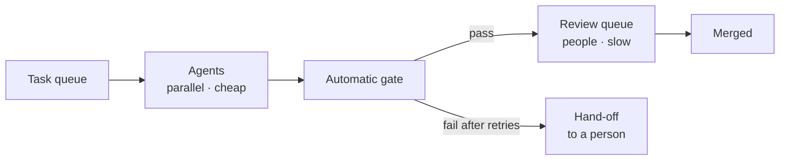

# Running at scale: sessions, subagents and fan-out

*Part of [AI-assisted development for the product and technology leader](./README.md)*

*Last reviewed: 2026-10 · Volatility: fast*

## TL;DR

One agent in one session is a tool. Many agents on many tasks is a system, with its own costs and queues.

Three facts shape it. First, a session's **context** fills as it runs, and each turn re-reads it. A long session on unrelated work costs more and works worse than several fresh sessions. Clear the context between unrelated tasks. Second, **subagents** run in their own context and return a summary, which keeps noisy research out of the main session. Third, **fan-out**, running the same job over many items, multiplies cost and also multiplies the review queue.

The arithmetic is simple. Retries raise the success rate and the bill. More accepted work means more review hours. The limit on throughput is usually the humans who check the output, not the agents.

> 🎯 **For the product leader**
>
> **Why it matters** — Scale is where agent cost stops being a rounding error and where review becomes the bottleneck.
>
> **What it changes in your decisions** — You budget by task, not by seat. You size the review team before you launch a batch. You design batches with a hand-off for failures.
>
> **Ask your eng team** — *"For a batch of 200 tasks: expected cost, expected pass rate, how many go to a person, and how many review hours?"*
>
> **Risk if ignored** — A batch that finishes overnight and leaves a week of review. Or a bill that surprises finance.

## The mental model: a factory with a quality desk



Workers are cheap and parallel. The review desk is not. A factory is limited by its slowest station.

## Mechanics

### Context and session cost

Each turn re-reads the whole history, plus new tokens. Prompt caching makes the re-read cheap, but not free: at a cache-read price of 0.1 of normal input, history still adds up. The same task sequence run as one long session costs about 2.8 times as much input as five fresh sessions, in the model below. Use `/clear` between unrelated tasks. Use a summary (`/compact`) when you must continue.

The documentation reports that enterprise cost averages about $13 per developer per active day, $150 to $250 per month, and under $30 per active day for 90% of users. Use it as a rough anchor, then measure your own pilot.

### Subagents

A subagent has its own context window, system prompt, tools and permissions. Use one for work that would flood the main session with output you will not need again, such as searching a large codebase or reading logs. The main session sees only the summary. Subagents are not free: they send their own requests and count toward your usage.

### Headless and batch runs

`claude -p "prompt"` runs a single task without the interactive screen. Flags such as `--allowedTools` pre-approve tools, and `--output-format` gives structured output. Add `--bare` for scripted calls, which skips auto-discovery of hooks, skills and settings. Without it, a headless run loads the project's hooks and servers as an interactive one would. Run unattended jobs in a sandbox ([lesson 4](./control-permissions-modes-and-hooks.md)).

### Worktrees

A git worktree gives an agent its own copy of the files on its own branch. Several agents can work in parallel without overwriting each other. Merging is still a human decision.

### Fan-out arithmetic

For `N` tasks with pass chance `p` per attempt and up to `k` attempts: expected attempts per task are `1 + (1-p) + … + (1-p)^(k-1)`. The share left for a person is `(1-p)^k`. Each accepted task needs review time.

## Tradeoffs and decisions

- **One long session vs. many short ones.** Long sessions keep context and cost more. Short ones restart cold.
- **Retries vs. hand-off.** Retries cost money and rescue tasks. Past a point, a person is cheaper.
- **Parallelism vs. merge conflicts.** More agents, more overlap.
- **Automation vs. review capacity.** Output you cannot review is a liability.

## Failure modes

- **The giant session.** One session carries a day of unrelated work.
- **Runaway loops.** An agent retries a hopeless task all night.
- **Review debt.** Hundreds of unreviewed changes.
- **Hidden cost.** Subagent and retry costs missing from the estimate.
- **Merge storms.** Parallel branches that touch the same files.
- **Unattended access.** A headless job with broad credentials.

## Under the hood

The file is `ai-assisted-development/code/lesson5_scale.py`. `session_cost` adds a turn's cached history and new tokens. `fanout` computes cost, accepted tasks, hand-offs and review hours.

```python
def fanout(tasks, p_success, max_attempts, cost_per_attempt, review_minutes):
    p_fail_all = (1 - p_success) ** max_attempts
    for k in range(1, max_attempts + 1):
        reach = (1 - p_success) ** (k - 1)
        attempts += reach
        done += reach * p_success
    ...
```

## Worked example: a long session and a batch of 200

*The prices and rates are invented. The numbers come from `ai-assisted-development/code/lesson5_scale.py`.*

**Session cost.** With a 20,000-token base, 8,000 new tokens per turn, $3 per million input tokens and a 0.1 cache-read price: a 20-turn session costs $1.06 of input. Five unrelated tasks of 20 turns each, run in one 100-turn session, cost $14.88. Run as five fresh sessions, they cost $5.28.

**Batch.** 200 tasks, 70% pass chance per attempt, $1.50 per attempt, 6 review minutes per accepted task.

| Policy | Cost | Accepted | To a person | Review hours |
| --- | --- | --- | --- | --- |
| One attempt | $300 | 140 | 60 | 14 |
| Up to 3 attempts | $417 | 195 | 5 | 19 |

Retries add $117 and rescue 55 tasks, about $2 each. That is cheap against a person's hour. They also add 5 hours of review. The agents were never the constraint.

## Practitioner checklist

- [ ] Do we clear or summarize context between unrelated tasks?
- [ ] Do we budget cost per task, with retries and subagents included?
- [ ] Is there a cap on attempts and a defined hand-off to a person?
- [ ] Have we sized review hours before launching a batch?
- [ ] Do parallel agents work in separate worktrees?
- [ ] Do unattended jobs run in a sandbox with narrow credentials?
- [ ] Do we track cost per accepted change?

## Related lessons

- [Verification is the product](./verification-is-the-product.md) — the gate before the review queue.
- [Measuring and governing](./measuring-and-governing.md) — cost and quality metrics.
- [Generating text and the KV cache](../transformers/generating-text-and-the-kv-cache.md) — why history is re-read.
- [Cost optimization](../cost-optimization/README.md) — caching and budgets.
- [Agentic workflows](../agentic-workflows/README.md) — orchestrating many steps.

## Sources

- Claude Code documentation, *Manage costs effectively*, code.claude.com/docs/en/costs, read 2026-10: the averages of about $13 per developer per active day and $150 to $250 per month, and under $30 per active day for 90% of users.
- Claude Code documentation, *Run Claude Code programmatically*, code.claude.com/docs/en/headless, read 2026-10: `-p`, `--allowedTools`, `--output-format` and `--bare`.
- Claude Code documentation, *Create custom subagents*, code.claude.com/docs/en/sub-agents, read 2026-10: separate context windows, and `isolation: worktree`.
- The prices, token counts and pass rates are invented. They come from `ai-assisted-development/code/lesson5_scale.py`. The 0.1 cache-read price matches most Claude models; some newer models charge less. This module's sources were not re-opened after the first reading, and its fact-check is pending.
