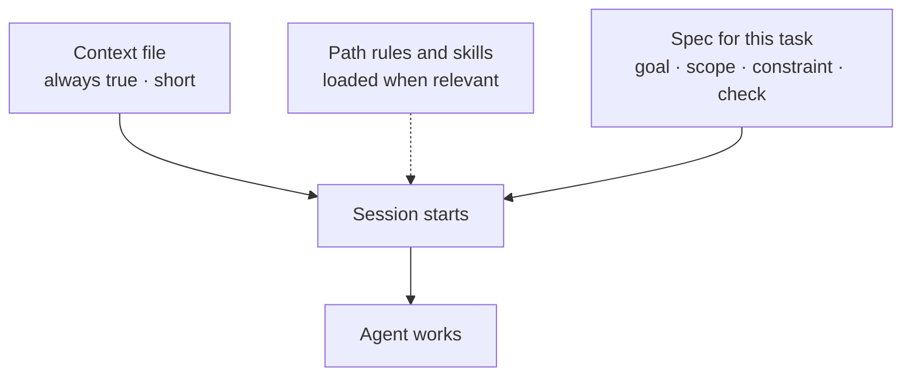

# Specs and the context file

*Part of [AI-assisted development for the product and technology leader](./README.md)*

*Last reviewed: 2026-10 · Volatility: fast*

## TL;DR

An agent starts every session knowing nothing about your project. Two things fix that. A **spec** tells it what to do in this task. A **context file** tells it what is always true about the project. In Claude Code the context file is called `CLAUDE.md`. Other tools use similar files.

A good spec has four parts: the goal, the scope (which files and which not), the constraint that matters, and **how the agent can check its own work**. The last part is the one that most changes the result.

A good context file is short. The documentation says to aim for under 200 lines. It loads into every session, so each line costs tokens every time, and a long file lowers how well the agent follows it. Put in what the agent cannot work out from the code: build and test commands, naming rules that differ from the default, and traps. Leave out what it can read for itself.

> 🎯 **For the product leader**
>
> **Why it matters** — The context file is the cheapest lever on agent quality. It is also shared by every engineer, so a bad line costs the whole team.
>
> **What it changes in your decisions** — You treat the file as reviewed code, with an owner. You ask for specs that include a check. You move rarely needed instructions out of the file.
>
> **Ask your eng team** — *"Who owns the context file, when was it last pruned, and what is the test command it gives the agent?"*
>
> **Risk if ignored** — A 600-line file nobody reads, with contradictions the agent resolves at random. Four times the token cost of a lean file, and worse results.

## The mental model: a briefing for a capable stranger

Picture a skilled contractor who joins your team each morning with no memory of yesterday. You hand them two documents. One is the standing brief: how we build, test and name things. The other is today's job card. Neither can be long, or the contractor skims.



## Mechanics

### What goes in the file

Per the Claude Code documentation, include things the agent cannot infer: commands to build, test and lint, style rules that differ from defaults, repository etiquette such as branch names, and known traps. Leave out what the code already says, long explanations, and advice that cannot be tested, such as "write clean code".

### Keep it short, and move the rest

The file loads in every session. Splitting it into imported files helps organization but does **not** cut the context cost, because imported files load at launch too. To cut cost, move content that matters for only part of the codebase into path-scoped rules, which load only when the agent touches matching files. Move multi-step procedures into **skills**, which load when needed or when you call them.

### The spec for one task

A useful spec answers four questions.

| Part | Example |
| --- | --- |
| Goal | "Add a retry to the invoice email sender." |
| Scope | "Only `billing/email.py` and its tests. Do not change the queue." |
| Constraint | "Retries must not send duplicates. Use the existing idempotency key." |
| Check | "`pytest billing -x` must pass, and add a test that fails without the fix." |

For large or unclear work, use **plan mode** first. The agent reads and proposes a plan, and cannot edit until you approve it. The documented flow is explore, plan, implement, then commit.

### Specs from product people

A product leader can write specs that engineers and agents both use. Put the user problem, the acceptance examples and the out-of-scope list in the ticket. Examples with expected outputs double as tests.

## Tradeoffs and decisions

- **Short file vs. complete file.** Every line costs tokens in every session. Include only what changes behaviour.
- **Shared vs. personal.** The project file is for the team. Personal preferences belong in a user-level file.
- **Rules vs. enforcement.** A line in the file is advice. A hook enforces ([lesson 4](./control-permissions-modes-and-hooks.md)). Put must-never rules in hooks or permissions.
- **Emphasis.** Shouting works on one or two lines. On ten, it works on none.

## Failure modes

- **Bloat.** The file grows with every incident and is never pruned.
- **Contradictions.** One line says tabs and another says spaces. The agent picks one.
- **Describing the code.** A line that says what a file contains goes stale on the next commit.
- **Vague advice.** "Be careful with the database" cannot be followed or checked.
- **No command.** The agent cannot find out how to run the tests, so it guesses or skips them.
- **A spec with no check.** The agent finishes when it feels finished.

## Under the hood

The file is `ai-assisted-development/code/lesson2_context_file.py`. It is a small lint for a context file, with rules taken from the documentation's advice. It flags vague lines, duplicates, lines that describe the code, too much emphasis, contradictions, a missing command and excess length.

```python
def lint(text, max_lines=200):
    ...
    if any(v in body for v in VAGUE):
        findings.append(("vague advice", l))
    if body in seen:
        findings.append(("duplicate", l))
    ...
```

A second function prices the file: lines times tokens per line, times sessions, developers and days.

## Worked example: a sample file and its price

*The file and prices are invented. The numbers come from `ai-assisted-development/code/lesson2_context_file.py`.*

**The lint.** An 11-line sample file gets seven findings: three vague lines ("Write clean code", "Follow best practices", "Be careful with the database"), one duplicate, one line that describes the code, one warning for four shouted words, and one contradiction (tabs and spaces both required).

**The price.** Assume 14 tokens per line, 40 sessions per developer per day, 25 developers and 22 working days, at $3 per million input tokens.

| File | Tokens added per session | Cost per month, no cache | Cost per month, cache reads at 0.1× |
| --- | --- | --- | --- |
| 150 lines | 2,100 | $139 | $14 |
| 600 lines | 8,400 | $554 | $55 |

The dollar figures are small beside salaries. The cost that matters is attention. A longer file lowers adherence, so the larger loss is in quality, not in the bill.

## Practitioner checklist

- [ ] Is the context file under about 200 lines, and does it name build, test and lint commands?
- [ ] Does it hold only what the agent cannot work out from the code?
- [ ] Is it free of duplicates, contradictions and untestable advice?
- [ ] Are rarely needed rules in path-scoped rules or skills?
- [ ] Do must-never rules live in hooks or permissions, not only in prose?
- [ ] Do task specs name a way to check the result?
- [ ] Does the file have an owner and a pruning date?

## Related lessons

- [When an agent writes the code](./when-an-agent-writes-the-code.md) — why the spec matters more.
- [Verification is the product](./verification-is-the-product.md) — the check named in the spec.
- [Context engineering](../context-engineering/README.md) — what belongs in a context window.
- [Prompt engineering](../prompt-engineering/README.md) — writing clear instructions.
- [Cost optimization](../cost-optimization/README.md) — caching and token budgets.

## Sources

- Claude Code documentation, *How Claude remembers your project* (memory), code.claude.com/docs/en/memory, read 2026-10: the target of under 200 lines, what to include, imports not reducing context cost, and path-scoped rules.
- Claude Code documentation, *Extend Claude with skills*, code.claude.com/docs/en/skills, read 2026-10: skills for procedures that do not belong in the always-loaded file.
- Claude Code documentation, *Permission modes*, code.claude.com/docs/en/permission-modes, read 2026-10: plan mode.
- The sample file, the token counts and the prices are invented. They come from `ai-assisted-development/code/lesson2_context_file.py`. The cache-read multiplier of 0.1 matches most Claude models; some newer models differ. This module's sources were not re-opened after the first reading, and its fact-check is pending.
