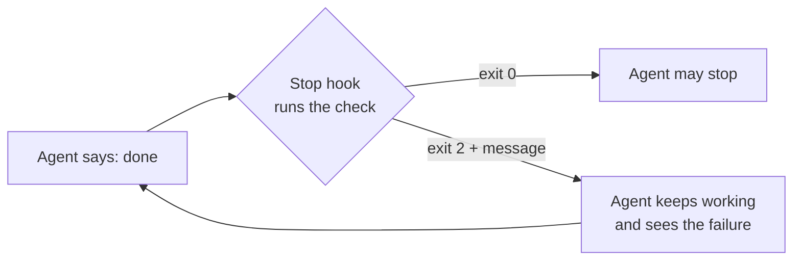

# Verification is the product

*Part of [AI-assisted development for the product and technology leader](./README.md)*

*Last reviewed: 2026-10 · Volatility: fast*

## TL;DR

A coding agent reports success in words. Words are not evidence. The agent may say "all tests pass" without running them, or fix a test by weakening it. If the only check is the agent's own summary, you have no check.

The fix is to move the check out of the agent's judgment and into a command that exits with a pass or a fail. Tests, type checks, linters and builds all work. Then make the agent run that command before it may stop. In Claude Code, a **Stop hook** does this: a script that runs when the agent tries to finish, and can refuse.

The result is a small contract. The agent is done when the check passes, not when it feels done. The rest of the work, which includes review, becomes a smaller job: confirming that the check tests the right thing.

> 🎯 **For the product leader**
>
> **Why it matters** — Verification decides whether agent speed turns into delivered value or into rework. Teams with fast, trusted checks get large gains. Teams without them get plausible-looking bugs.
>
> **What it changes in your decisions** — You invest in test speed and reliability as a product feature. You require a runnable check on every agent task. You review the check, not just the diff.
>
> **Ask your eng team** — *"What command proves a change works, how long does it take, and does the agent have to run it before it stops?"*
>
> **Risk if ignored** — Green summaries over red builds. Tests rewritten to pass. A release process that trusts a sentence.

## The mental model: the agent's word versus an exit code



An exit code cannot be argued with. The hook gives the agent the failure text and sends it back to work.

## Mechanics

### What counts as a check

A good check is fast, deterministic and meaningful. Fast: the agent will run it many times. Deterministic: a flaky test teaches the agent to ignore failures. Meaningful: it fails when the behaviour is wrong. A type check and a linter catch some errors. Tests catch behaviour. A test written before the change, from the acceptance examples, is the strongest.

### The Stop hook

Per the Claude Code hooks documentation, a hook is a command that runs at a point in the agent's life. Hooks are deterministic: they run every time, unlike a line in the context file. A Stop hook runs when the agent finishes a turn. It can block the stop by exiting with code 2 and writing a reason to stderr, or by returning JSON with `"decision": "block"` and a `reason`. Claude Code then keeps the agent working and shows it the reason.

Two guards matter.

- **`stop_hook_active`.** The hook input carries this flag when the agent is already continuing because of a Stop hook. A good script exits 0 when it is set, so a check that cannot be fixed does not trap the agent.
- **A block cap.** The documentation describes a cap on consecutive blocks, eight by default, after which Claude Code lets the agent stop.

### Review still matters

A passing check does not mean the right change. Review the diff for scope, for deleted or weakened tests, and for changes to the check itself. Protect test files and the check command with permissions ([lesson 4](./control-permissions-modes-and-hooks.md)), so the agent cannot edit the referee.

### Independent checks

Where a second pair of eyes helps, use a fresh session or a subagent to review the change. A reviewer with no memory of the writing has no stake in it. It is still a model, and it still errs.

## Tradeoffs and decisions

- **Check time vs. coverage.** A full suite is slow. A fast subset runs in the hook, and the full suite runs in CI.
- **Hook vs. CI.** A hook gives the agent feedback in seconds. CI is the final gate for everyone.
- **Strict vs. loose.** A strict gate stops bad work and also stops good work on a flaky test.
- **Agent-written tests.** Useful, and weak if the same session writes the code and its only test. Require some tests from the spec.

## Failure modes

- **Trust in the summary.** "All tests pass" with no run.
- **Weakened checks.** The agent deletes a failing test or loosens an assertion.
- **Flaky gate.** A test that fails at random sends the agent into a loop.
- **A loop with no exit.** A hook that always blocks, with no `stop_hook_active` guard.
- **Slow gate.** A 20-minute check the agent runs on every turn.
- **Checking the wrong thing.** The gate passes and the feature is wrong.

## Under the hood

Two files. `ai-assisted-development/code/stop_gate.py` is a real hook script. It reads the event from stdin, runs `GATE_COMMAND`, and exits 0 or 2.

```python
event = json.load(sys.stdin)
if event.get("stop_hook_active"):
    return 0
result = subprocess.run(command, shell=True, capture_output=True, text=True)
if result.returncode == 0:
    return 0
sys.stderr.write(f"The check `{command}` failed (exit {result.returncode}). Fix it before you finish.\n{tail}\n")
return 2
```

To use it, register the script under `hooks.Stop` in `.claude/settings.json`. Check the hooks reference for the current format. `lesson3_verification.py` runs the script as Claude Code would, with a passing and a failing command, and simulates the block cap.

## Worked example: a gate that holds, and a loop that ends

*The commands are stand-ins. The numbers come from `ai-assisted-development/code/lesson3_verification.py`.*

| Situation | Hook result |
| --- | --- |
| Check passes | exit 0, the agent stops |
| Check fails | exit 2, and the agent receives "The check … failed (exit 1). Fix it before you finish." |
| Check fails on re-entry (`stop_hook_active` set) | exit 0, no trap |

The turn loop, simulated: if the agent fixes the problem after 2 blocks, it stops with the check passing. If it never fixes it, the cap ends the loop after 8 blocks with the check still failing. That last case is the dangerous one. Count how often your gate hits the cap. Each hit is a task that needs a person.

## Practitioner checklist

- [ ] Is there one command that proves a change works, and does it run in seconds?
- [ ] Is the agent required to run it before stopping?
- [ ] Is the check deterministic, with flaky tests quarantined?
- [ ] Are test files and the check command protected from agent edits?
- [ ] Does the hook handle `stop_hook_active`?
- [ ] Do we count tasks that hit the block cap?
- [ ] Does review look at deleted or weakened tests?

## Related lessons

- [Control: permissions, modes and hooks](./control-permissions-modes-and-hooks.md) — protecting the check.
- [Running at scale](./running-at-scale.md) — what the gate does across many tasks.
- [Evaluation and observability](../evaluation-and-observability/README.md) — checks that measure quality.
- [Agentic AI](../agentic-ai/README.md) — agents that act on their own reports.
- [Tool calling](../tool-calling/README.md) — how a hook sits beside tool calls.

## Sources

- Claude Code documentation, *Hooks reference* and *Automate workflows with hooks*, code.claude.com/docs/en/hooks and /hooks-guide, read 2026-10: deterministic hooks, the Stop event, exit code 2 and the JSON `decision` form, the `stop_hook_active` input and the cap on consecutive blocks.
- The commands, the turn loop and the counts are invented stand-ins. They come from `ai-assisted-development/code/stop_gate.py` and `lesson3_verification.py`. The cap of eight is the documented default as read in 2026-10 and may change. This module's sources were not re-opened after the first reading, and its fact-check is pending.
