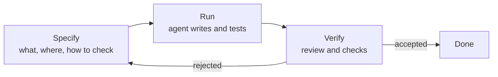

# When an agent writes the code: where the bottleneck goes

*Part of [AI-assisted development for the product and technology leader](./README.md)*

*Last reviewed: 2026-10 · Volatility: fast*

## TL;DR

A coding task has three steps: say what you want, get the code, check it. For a person, the middle step takes most of the time. An agent makes the middle step cheap. It does not make the other two cheap.

So the work moves. **Specifying** gets more important, because the agent builds exactly what you describe and nothing you meant. **Verifying** gets more important, because the agent can produce a lot of plausible code fast, and some of it is wrong.

A team that buys faster generation and leaves the checks alone gets a small gain. A team that also strengthens the checks gets a large one. In the model below, a strong check gives 3.5 times the speed of working by hand. A weak check gives 2 times. An agent that is infinitely fast, with weak checks, gives only 2.2 times.

> 🎯 **For the product leader**
>
> **Why it matters** — The pitch says "the agent writes code ten times faster". Your delivery speed depends on the slowest step, and that step is now review and rework.
>
> **What it changes in your decisions** — You fund tests, fast builds and review practice before you fund more seats. You expect the gain to show up in lead time and defects, not in lines of code.
>
> **Ask your eng team** — *"Of the time a task takes now, how much is specifying, running and reviewing? Which step grew?"*
>
> **Risk if ignored** — Review becomes the queue. Engineers approve code they did not read, because there is too much of it. Defects reach users faster.

## The mental model: three steps and a retry loop



Time is the sum of three steps, repeated whenever a result is rejected. An agent shrinks the run step. The retry loop is where the saving leaks away. Each rejection costs another specify and another review.

## Mechanics

### The time model

Let one task have a specify time, a run time and a review time. Let `p` be the chance an attempt is rejected. The expected number of attempts is `1 / (1 - p)`. Each extra attempt costs a re-specification, another run and another review.

By hand, the invented task takes 20 minutes to specify, 240 to code and 30 to review: 290 in total. With an agent, specifying takes longer (40 minutes, because you must be precise), running takes 10 and review takes 60 (there is more code to read). With a 30% rejection rate, the expected time is 146 minutes.

### Three levers

- **Faster agent.** Cut run time to zero and the total only falls to 132 minutes.
- **Stronger checks.** Tests and automated checks cut review to 25 minutes and the rejection rate to 15%. The total falls to 84 minutes.
- **Both.** An instant agent with strong checks takes 72 minutes.

Verification is the larger lever, because review and retry dominate once the run is cheap.

### Why specifying is harder than it looks

A person who codes fills gaps as they go. An agent fills gaps too, but with guesses, and it does not tell you which parts were guesses. A good spec names the goal, the files in scope, the constraint that matters, and **how to check the result**. The last item is the one most often missing. [Lesson 2](./specs-and-the-context-file.md) covers it.

## Tradeoffs and decisions

- **Speed vs. checking.** Each unchecked step is borrowed time. It comes due as rework or as a defect.
- **Small tasks vs. large ones.** Small tasks have cheap reviews and cheap retries. Large tasks give the agent room to drift.
- **Who reviews.** The author of the prompt knows the intent. A second reader catches what the author expects to see.
- **Where to invest first.** Fast tests, a reliable build and clear module boundaries help every task. A smarter model helps some.

## Failure modes

- **Counting output.** Lines or pull requests per week go up. Value does not.
- **Rubber-stamp review.** Reviews get shorter as volume grows.
- **Agent-written tests that check nothing.** The agent writes a test that passes by construction.
- **A weak check treated as a strong one.** "It compiles" is not "it works".
- **Unowned retries.** The agent loops on a failing task and spends money.

## Under the hood

The file is `ai-assisted-development/code/lesson1_bottleneck.py`. It is the whole model.

```python
def agent_time(spec=40, run=10, review=60, p_fail=0.3, respec=15):
    attempts = 1 / (1 - p_fail)
    return spec + (run + review) * attempts + respec * (attempts - 1)
```

The file runs the four cases and asserts that strong checks give a speedup at least 1.4 times that of weak checks.

## Worked example: the same agent, two check regimes

*The minutes are invented. The numbers come from `ai-assisted-development/code/lesson1_bottleneck.py`.*

| Case | Minutes per accepted task | Speedup over by hand |
| --- | --- | --- |
| By hand | 290 | 1.0× |
| Agent, weak checks | 146.4 | 1.98× |
| Agent, strong checks | 83.8 | 3.46× |
| Instant agent, weak checks | 132.1 | 2.19× |
| Instant agent, strong checks | 72.1 | 4.02× |

Read the third and fourth rows together. Making the agent infinitely fast moves the weak-check case by only 0.2 times. Strengthening the checks moves it by 1.5 times. Your numbers will differ. The pattern is the point: find the step that dominates, and fix that one.

## Practitioner checklist

- [ ] Do we know our time split across specify, run and review, for a sample of real tasks?
- [ ] Is there an automated check that fails when the change is wrong?
- [ ] Do we track the rejection rate of agent output?
- [ ] Is review time per change measured, and has it grown?
- [ ] Do we measure defects and lead time, not lines written?

## Related lessons

- [Specs and the context file](./specs-and-the-context-file.md) — the specify step.
- [Verification is the product](./verification-is-the-product.md) — the verify step.
- [Agentic AI](../agentic-ai/README.md) — the loop the agent runs.
- [Evaluation and observability](../evaluation-and-observability/README.md) — checks as a discipline.
- [Technical product management](../technical-product-management/README.md) — owning delivery.

## Sources

- Claude Code documentation, *Common workflows* and *Best practices*, code.claude.com/docs, read 2026-10: the explore, plan, implement and commit flow, and the advice to give the agent a way to check its own work.
- Peng et al., *The Impact of AI on Developer Productivity: Evidence from GitHub Copilot*, 2023 ([arxiv.org/abs/2302.06590](https://arxiv.org/abs/2302.06590)): a controlled trial in which developers with the assistant finished a task faster.
- The minutes, the rejection rates and every number from the model are invented. They come from `ai-assisted-development/code/lesson1_bottleneck.py`. This module's sources were not all re-opened during the build, and its fact-check is pending.
