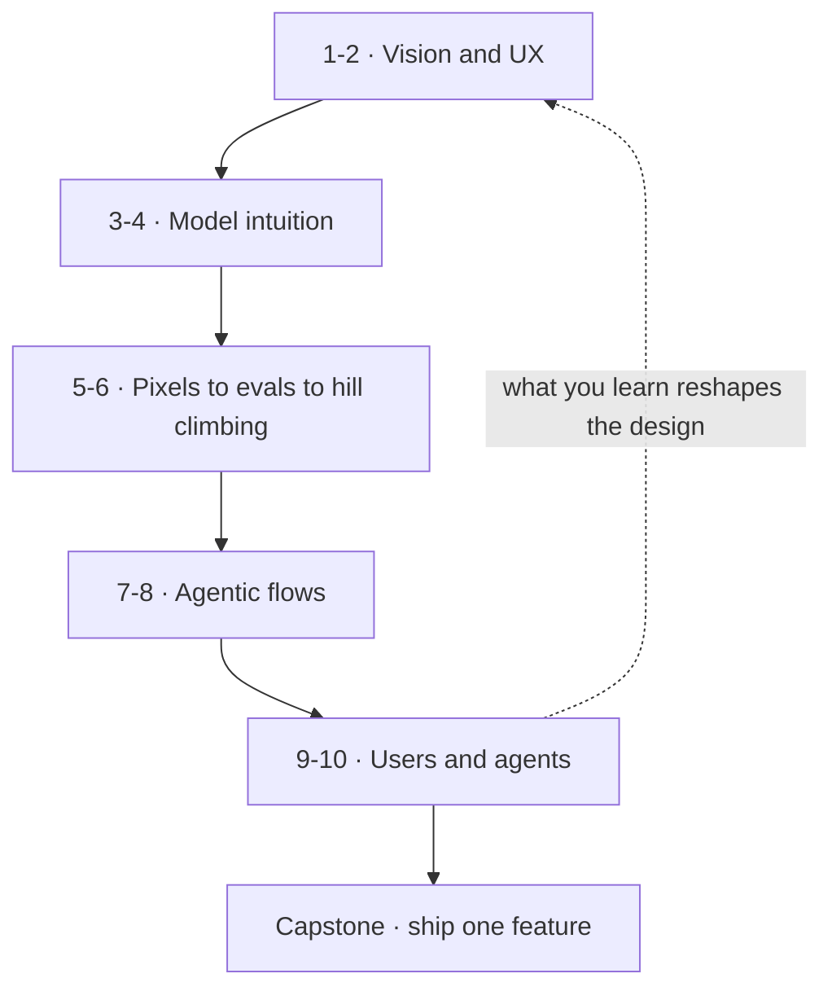

# Building AI-native products

*Part of the [craft tracks](../README.md). It builds on [generative AI](../generative-ai/README.md), [LLMs](../llms/README.md), [agentic AI](../agentic-ai/README.md) and [evaluation and observability](../evaluation-and-observability/README.md).*

Most software has a fixed flow. The user clicks, the system does one thing, and you can test it. An AI-native product works differently. The user states a goal in their own words. The model answers in a way that is different each time. Sometimes it acts for the user. You cannot list every path in advance.

Building that kind of product takes five skills. This track teaches them in order, with two lessons for each. The first lesson of a pair builds **judgement**: what good looks like, and why. The second lesson is **practice**: a method, a fill-in template and a worked teardown you can copy.

1. **Vision and opinionated UX design.** Balance what a language model can do with what users need, in interactions that are open-ended and conversational.
2. **Model intuition.** Know which model to use, how to prompt, and where the limits are.
3. **From pixels to evals to hill climbing.** Link interface decisions to measurable model quality, and improve it step by step.
4. **Agentic flows.** Design systems that take actions, keep context and stay safe.
5. **Deep user understanding for agent interactions.** Learn how people really behave when an agent works for them.

You build one feature across the whole track. Each practice lesson ends with a **capstone step**. By the end you have a feature plan with a launch gate.

**A note on scope.** The track teaches the product craft. It does not repeat the engineering basics that other modules cover in full. It links to them instead. The products in the teardowns are **invented**. They are composites made for teaching, so they have no company facts to check. The track has no runnable code. Its practice artifacts are templates and worksheets.

## Where the depth lives

| If you want the full depth on | Read |
| --- | --- |
| How to write a good prompt | [Prompt engineering](../prompt-engineering/README.md) |
| What models can and cannot do | [Capabilities and the jagged frontier](../llms/capabilities-and-the-jagged-frontier.md) and [Choosing a model](../llms/choosing-a-model.md) |
| Why AI output varies | [Probabilistic software](../generative-ai/probabilistic-software.md) |
| Building the eval stack | [Evaluation and observability](../evaluation-and-observability/README.md) |
| How agents work and how far to trust them | [Agentic AI](../agentic-ai/README.md) and [AI agents](../ai-agents/README.md) |
| Threats, guardrails and red-teaming | [AI security and guardrails](../ai-security-and-guardrails/README.md) |
| Running interviews and reading users | [User research](../product-sense/user-research.md) |
| Running a launch or an experiment | [Technical product management for AI](../technical-product-management/tpm-for-ai-products.md) |

## The knowledge graph

Read it as a loop. **Vision** says what the feature is for. **Model intuition** says what the model can really do. **Evals** show whether it does it. **Agentic design** adds actions and the controls around them. **User research** shows what happens when real people use it, and sends you back to the design.

## The lessons

1. [Designing for ambiguity](./designing-for-ambiguity.md) — judgement for AI product design: ambiguous input, opinionated defaults and uncertainty as a design material.
2. [Practice: the AI feature spec](./ux-practice-the-ai-feature-spec.md) — a one-page spec and an interaction-pattern library.
3. [Model intuition](./model-intuition.md) — judgement about what models do well, badly and not at all.
4. [Practice: probing and choosing models](./model-intuition-practice.md) — a probe worksheet and a bake-off template.
5. [From pixels to evals](./from-pixels-to-evals.md) — judgement for linking interface choices to model quality.
6. [Practice: hill climbing](./hill-climbing-in-practice.md) — an eval set, an error-analysis loop and a hill-climb log.
7. [Designing agentic flows](./designing-agentic-flows.md) — judgement for tools, autonomy and failure modes.
8. [Practice: the agent spec and risk register](./agentic-flows-practice.md) — a spec, a risk register and an approval design.
9. [How users behave with agents](./how-users-behave-with-agents.md) — judgement about delegation, trust and reliance.
10. [Practice: researching agent interactions](./researching-agent-interactions.md) — methods and an interview guide that fit agents.
11. [Capstone: ship one AI-native feature](./capstone-ship-one-ai-native-feature.md) — assemble the plan and the launch gate.

Then the [recap and real-world examples](./recap.md), with a self-test.
