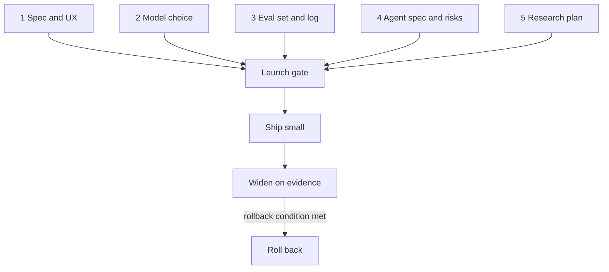

# Capstone: ship one AI-native feature

*Part of [Building AI-native products](./README.md)*

*Last reviewed: 2026-10 · Volatility: fast*

## TL;DR

Each practice lesson gave you one artifact. Together they are the plan for shipping a feature: a spec, a model choice, an eval set and log, an agent spec with a risk register, and a research plan. This capstone puts them in order, checks that they agree with each other and ends with a **launch gate**: a short list of conditions that must be true before you ship, before you widen and when you roll back.

The point is to see the five skills as one system. The spec sets the job. Model intuition says what is possible. Evals show whether it works. The agent design bounds what it can do. User research shows what happens when real people use it. A gap in any one of them shows up in the others.

> 🎯 **For the AI product leader**
>
> **Why it matters** — Most AI launches fail in the joints between skills: a great model with no evals, a clever agent with no research, a polished UI over a weak model. The capstone checks the joints.
>
> **What it changes in your decisions** — You review a feature by its whole plan, and you hold the launch until each skill has evidence. You set widening and rollback conditions in advance.
>
> **Ask your team** — *"Which of the five skills has the weakest evidence today, and what would we do about it before launch?"*
>
> **Risk if ignored** — A launch that is strong in four skills and fails on the fifth, in public.

## The mental model: five skills, one gate



## Mechanics

### Step 1: assemble the plan

Put the artifacts on one page each, in order.

1. **Spec** from [lesson 2](./ux-practice-the-ai-feature-spec.md).
2. **Model decision record** from [lesson 4](./model-intuition-practice.md).
3. **Eval set, tally and hill-climb log** from [lesson 6](./hill-climbing-in-practice.md).
4. **Agent spec, risk register and approval cards** from [lesson 8](./agentic-flows-practice.md).
5. **Research plan and findings** from [lesson 10](./researching-agent-interactions.md).

### Step 2: check the joints

Read across the artifacts and look for mismatches.

| Joint | Question |
| --- | --- |
| Spec and evals | Does every spec example appear in the eval set? Does the quality bar match the eval's definition of pass? |
| Model and evals | Was the model chosen on the same inputs and rubric that the evals use? |
| Evals and agent | Do the agent's bad-day scenarios exist as eval cases? |
| Agent and research | Do the approval cards match what research says users read? |
| Research and spec | Did each finding change the spec, the evals or the register? |
| All and cost | Are cost per use and latency within the targets in the spec? |

### Step 3: write the launch gate

A gate has three parts, each with numbers.

- **Ship** (to a small group): the quality bar is met on the holdout, no must-not-fail case fails, limits and kill switch work in the sandbox, and the register has no open high-impact risk without a control.
- **Widen** (to more users): after a set period, quality signals hold, severe incidents are zero, approval and edit rates are in range, and research shows no sign of over-reliance.
- **Roll back**: any severe incident, a quality signal below a floor, cost or latency beyond a limit, or a finding of harm.

### Step 4: plan the first month

Name an owner for each check. Set dates for the first readout, the first eval refresh and the first research round after launch. Decide who can pull the kill switch without asking.

## Tradeoffs and decisions

- **Ship early vs. complete evidence.** Small releases give real data. Skipping the gate gives incidents.
- **One gate vs. staged gates.** One for each stage keeps decisions honest.
- **Owner per check vs. a team.** A named owner acts. A team waits.
- **Perfect plan vs. useful plan.** A plan that is one page per artifact is enough.

## Failure modes

- **Plan in pieces.** Artifacts that disagree with each other.
- **Gate as ritual.** Conditions without numbers.
- **No rollback rule.** Rollback needs a debate during an incident.
- **No owner.** Nobody runs the first-month checks.
- **Evidence from the team only.** No outside users before widening.

## Under the hood

The template is the **launch gate**.

```text
FEATURE:                         OWNER:                        DATE:
Joints checked (✓ / gap):  spec↔evals ___  model↔evals ___  evals↔agent ___  agent↔research ___  research↔spec ___  cost ___
SHIP to ___ users if:   holdout ≥ ___%   must-not-fail = 0   limits tested ___   no open high risk ___
WIDEN after ___ weeks if:  quality ≥ ___%   severe incidents = 0   edit rate ___–___%   no over-reliance signal
ROLL BACK if:  any severe incident / quality < ___% / cost > $___ / latency p95 > ___ s / harm finding
Kill switch: owner ___   can pull without asking: yes / no
First-month checks: readout ___  eval refresh ___  research round ___
```

## Worked example: Relay Assist goes to ten agents

*Relay is invented. All details are made up for teaching.*

The Relay team assembled its five artifacts and found three gaps. The spec's must-not-fail cases were not all in the eval set, so they added four. The refund agent's "crash repeats a refund" scenario had a control but no test, so they ran it. And research showed that agents skimmed the approval card, so they added the order id in bold at the top.

The gate read: **Ship** to 10 agents if holdout is at least 85%, none of 12 must-not-fail cases fails and the sandbox bad-day tests pass. **Widen** to all agents after two weeks if light-edit rate is between 50% and 80% (very high may mean skimming), there are no severe incidents, and a diary round shows no new over-reliance. **Roll back** on any wrong refund, a holdout score under 80%, p95 latency over 3 seconds, or cost over $6 per 1,000 drafts. The support lead owned the kill switch and could pull it alone. After two weeks, the light-edit rate was 88%, which was above the range. The team widened only after adding the random-confirmation step from the research round.

> **Capstone step 6.** Fill in the launch gate for your own feature. Run the joints check. Write down the weakest skill and what you will do about it.

## Practitioner checklist

- [ ] Are all five artifacts on one page each and in order?
- [ ] Were the six joints checked, with gaps listed?
- [ ] Does the gate have numbers for ship, widen and roll back?
- [ ] Does each check have an owner and a date?
- [ ] Can someone pull the kill switch without asking?
- [ ] Is the weakest skill named, with a plan?

## Related lessons

- [Practice: the AI feature spec](./ux-practice-the-ai-feature-spec.md)
- [Practice: probing and choosing models](./model-intuition-practice.md)
- [Practice: hill climbing](./hill-climbing-in-practice.md)
- [Practice: the agent spec and risk register](./agentic-flows-practice.md)
- [Launches, rollouts and migrations](../technical-product-management/launches-rollouts-and-migrations.md) — general launch craft.

## Sources

- This lesson combines the artifacts of the earlier lessons. Their sources are listed there.
- Relay and its gate are invented for teaching. This track's fact-check is pending.
