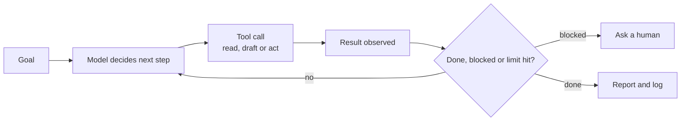

# Designing agentic flows

*Part of [Building AI-native products](./README.md)*

*Last reviewed: 2026-10 · Volatility: fast*

## TL;DR

An agentic flow is a system where a model does more than answer. It chooses a step, uses a tool, reads the result and decides what to do next, until the job is done or it stops. Anthropic draws a useful line: **workflows** run models and tools along code paths you define in advance, and **agents** let the model direct its own process and tool use. Most products need a workflow. A few need an agent. Pick the simplest one that works.

From the product seat, four questions shape the design. **What can it do?** The tools you give it define its power and its risk. **What does it know?** The context it keeps decides how well it plans. **How much freedom does it get?** Autonomy should grow as trust is earned. **What happens when it fails?** Agents compound errors, so plan for stops, checkpoints and human review.

> 🎯 **For the AI product leader**
>
> **Why it matters** — An agent that acts can help users a great deal, and it can also do harm at machine speed. The design decides which one you get.
>
> **What it changes in your decisions** — You choose workflow over agent unless the task is open-ended. You decide which actions are read-only, which need approval and which are never allowed. You add limits on steps and spend.
>
> **Ask your team** — *"What is the worst thing this agent can do with the tools it has, and what stops it?"*
>
> **Risk if ignored** — An agent that repeats a payment, deletes the wrong thing or runs up cost overnight.

## The mental model: a loop with a leash

An agent loops: look, decide, act, observe. The leash is the set of controls around that loop: which tools it can reach, how far it can go without asking, and when it must stop.



## Mechanics

### Workflow or agent

Use a **workflow** when you can write the steps in advance: they are predictable, cheaper and easier to test. Use an **agent** when the number of steps is unknown and the path cannot be fixed. Anthropic's advice is to find the simplest solution and increase complexity only when it demonstrably improves outcomes. For many tasks, one well-built model call with good context is enough.

### Tools define power

Each tool is a capability you grant. Sort tools by what they can do to the world.

| Class | Example | Default |
| --- | --- | --- |
| **Read** | Look up an order | Allow |
| **Draft** | Write a reply the user can edit | Allow |
| **Act, reversible** | Tag a ticket | Allow with a log |
| **Act, costly or irreversible** | Issue a refund, send an email | Approval, or tight limits |
| **Never** | Delete accounts | Do not grant |

Tools also need good design. Write each tool's description as carefully as a prompt, with examples and clear limits, and make mistakes hard by design, for example by requiring exact identifiers.

### Context and memory

An agent plans from what it can see. Give it the task, the relevant records and the results of earlier steps, and keep irrelevant material out. Long sessions fill the context window and weaken planning. Save progress outside the context so a run can resume. See [context engineering](../context-engineering/README.md).

### Levels of autonomy

Treat autonomy as a ladder the product climbs with evidence.

1. **Suggest.** The agent proposes. The user does everything.
2. **Act with approval.** The agent prepares the action. The user approves each one.
3. **Act and notify.** The agent acts within limits and tells the user.
4. **Act silently.** The agent acts and logs. Use only for low-risk, well-measured actions.

### Guardrails and stops

Set hard limits: a maximum number of steps, a spend cap per run, a time limit and an allow-list of tools. Let the agent pause for human feedback at checkpoints or when it is blocked. Add a kill switch. Test in a sandbox before real data. Record every step.

### Failure modes of agents

Errors compound: a small mistake in step 2 shapes steps 3 to 8. Agents can loop, repeat a paid action, misread a tool result or follow instructions hidden in the data they read. [AI security and guardrails](../ai-security-and-guardrails/README.md) covers the threats.

## Tradeoffs and decisions

- **Workflow vs. agent.** Predictability against flexibility.
- **Autonomy vs. oversight.** Speed against safety.
- **More tools vs. fewer.** Power against risk and confusion.
- **Long runs vs. short ones.** Capability against compounding error and cost.
- **Approval prompts vs. flow.** Safety against fatigue.

## Failure modes

- **An agent where a workflow would do.** Cost and risk with no benefit.
- **Over-powered tools.** One tool can do too much.
- **No stop.** The agent loops until the budget is gone.
- **Repeated side effects.** A crash replays a paid action.
- **Silent autonomy too soon.** Actions run unwatched before there is evidence they are safe.
- **Hidden instructions.** Text in a page or file steers the agent.
- **Approval fatigue.** Users click yes without reading.

## Under the hood

The template is the **tool and autonomy table**. Fill it in for each tool.

```text
Tool | What it does | Class (read / draft / act-reversible / act-irreversible) | Autonomy level (1–4) | Limit | Needs approval? | Undo?
```

```text
RUN LIMITS
Max steps: ___   Max spend per run: $___   Max time: ___   Allowed tools: ___
Stop and ask a human when: ___
Kill switch owner: ___   Log kept for: ___
```

## Worked example: Relay gets a refund tool

*Relay is invented. All details are made up for teaching.*

Agents asked Relay to go beyond drafting: "just issue the refund". The team listed tools. `lookup_order` is read-only. `draft_reply` writes a draft. `tag_ticket` is reversible. `issue_refund` moves money. `send_message` reaches the customer.

They chose a **workflow with one agentic step**. The fixed path was: look up the order, check the refund policy, draft a reply and propose a refund. The model chose the content, and the code chose the order of steps. `issue_refund` started at autonomy level 2: Relay prepares the refund and the support agent approves it with one click. Limits: at most 8 steps and $0.50 of model spend per ticket; refunds capped at $30 for any future level 3; no deletes of any kind. A run that cannot find the order stops and asks the agent. After four weeks of data, if approvals of small refunds were 98% unedited, the team would consider level 3 for refunds under $30 only.

## Practitioner checklist

- [ ] Could a fixed workflow do this job?
- [ ] Is every tool classified, with an autonomy level and a limit?
- [ ] Are irreversible actions behind approval or tight caps?
- [ ] Are step, spend and time limits set, and a kill switch named?
- [ ] Does progress survive a crash without repeating paid actions?
- [ ] Is every run logged, step by step?
- [ ] Was the flow tested in a sandbox first?
- [ ] Is there a plan to raise autonomy only with evidence?

## Related lessons

- [Practice: the agent spec and risk register](./agentic-flows-practice.md) — write the spec.
- [What an agent is and how much autonomy it needs](../ai-agents/what-an-agent-is-and-how-much-autonomy-it-needs.md) — the concepts.
- [When not to build an agent](../ai-agents/when-not-to-build-an-agent.md) — the case for workflows.
- [Safety, security and governance](../agentic-ai/safety-security-and-governance.md) — controls in depth.
- [GenAI and agent platforms](../system-design/genai-and-agent-platforms.md) — how the platform side works.

## Sources

- Anthropic, "Building effective agents", anthropic.com/engineering/building-effective-agents, 2024-12-19, read 2026-10: workflows vs. agents, the advice to find the simplest solution, human checkpoints, stopping conditions such as a maximum number of iterations, sandboxed testing, and careful tool design (the agent-computer interface). The page notes that much of its tooling description has changed since December 2024.
- Relay and its tools and limits are invented for teaching. This track's fact-check is pending.
