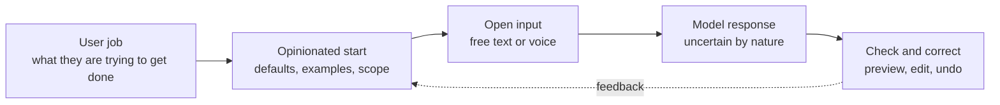

# Designing for ambiguity

*Part of [Building AI-native products](./README.md)*

*Last reviewed: 2026-10 · Volatility: fast*

## TL;DR

In classic software, the designer decides every step. The user picks from a menu, and the system does what the menu says. In an AI-native product, the user says what they want in free text, and the model decides how to respond. The input is ambiguous. The output is uncertain. The design job changes from drawing fixed flows to shaping a space of possible conversations.

Good design here has four moves. **Start from the user's job**, not from the model's power. **Be opinionated**: choose defaults, scope and a point of view, instead of offering a blank box that says "ask me anything". **Design for being wrong**: show uncertainty, make correction cheap and keep the user in control. And **match the interface to the task**: chat suits open exploration, and a button, a form or a suggestion suits a task with a known shape.

> 🎯 **For the AI product leader**
>
> **Why it matters** — A blank chat box hands the design work to the user. Most users do not know what to ask, what the system can do or how to fix a bad answer. The products that win make those decisions for them.
>
> **What it changes in your decisions** — You decide what the feature will not do. You choose defaults and starting points. You treat latency, uncertainty and undo as part of the design, not as engineering details.
>
> **Ask your team** — *"What does a new user see in the first ten seconds, what does the system do when it is unsure, and how does a user undo a wrong result?"*
>
> **Risk if ignored** — A demo that delights and a product that confuses. Users who try it twice, get one bad answer and stop trusting it.

## The mental model: a funnel of intent

Think of every request as a cloud of possible meanings. The interface narrows the cloud in stages: by what it offers, by what it asks and by what it shows back. A good design narrows quickly and cheaply, and leaves the user in charge of the last step.



## Mechanics

### Start from the job, then fit the model

List the jobs users hire your product for. Then ask, for each one, whether a language model is the right tool. A model is good at open-ended text, summaries, drafts and fuzzy matching. It is a poor fit for exact arithmetic, strict rules and anything where one wrong answer is costly and cannot be checked. [Capabilities and the jagged frontier](../llms/capabilities-and-the-jagged-frontier.md) shows where the edges are.

### Be opinionated

An opinionated product makes choices the user would otherwise have to make.

- **Scope.** Say what the feature is for and what it is not for.
- **Defaults.** Pick the tone, length and format that fit the job.
- **Starting points.** Offer examples and suggested actions, so the user is not facing a blank box.
- **A point of view.** The product prefers one way of doing the job and makes it easy.

### Choose the interface for the task

| Task shape | Better interface |
| --- | --- |
| Open exploration, unclear goal | Conversation |
| Repeated task with a known shape | A button, a form or a template that calls the model behind the scenes |
| Editing something that exists | In-place suggestions the user accepts or rejects |
| A decision with consequences | A preview and a confirmation step |
| Background work | A status view and a summary at the end |

### Design uncertainty on purpose

The model will sometimes be wrong, and it will sound sure. Plan for it. Microsoft's guidelines for human-AI interaction name several practices that apply directly: make clear what the system can do, make clear how well it can do it, support efficient correction, scope services when in doubt, and make clear why the system did what it did.

- **Show what it knows.** Cite sources, show the input it used, say when it is guessing.
- **Make correction cheap.** One click to edit, regenerate or undo.
- **Degrade gracefully.** When the system is unsure, ask a short question or narrow the task, instead of guessing.

### Treat latency as design

A model can take seconds to answer. Stream the answer so the user sees progress. Show what the system is doing. Offer a fast first result and a better one later. A wait with no feedback feels like failure.

## Tradeoffs and decisions

- **Open vs. guided.** A blank box has the widest reach and the highest failure rate. Guided starts are narrower and succeed more often.
- **Chat vs. direct manipulation.** Chat is flexible and slow. Buttons are fast and fixed.
- **Confidence vs. honesty.** Hiding uncertainty feels smooth until the first error.
- **Personality vs. predictability.** A strong voice can delight and can mislead.
- **Speed vs. quality.** A smaller model answers faster. A larger one answers better.

## Failure modes

- **The blank box.** Users do not know what to ask.
- **Capability theatre.** A demo that shows the best case and hides the limits.
- **Chat for everything.** A task with a clear shape forced through conversation.
- **Silent errors.** A wrong answer that looks right, with no cue to check.
- **No undo.** The model acts and the user cannot reverse it.
- **Wait with no feedback.** The user leaves before the answer arrives.

## Under the hood

This lesson's template is the **ambiguity audit**. Fill it in for one feature.

```text
Feature:
User job (one sentence):
What the model is good at here:        What it is bad at here:
What we will NOT do (scope):
Starting point the user sees first:
Three ways the input can be ambiguous:
  1.
  2.
  3.
For each: ask, assume or scope down?
How the user sees uncertainty:
How the user corrects a wrong result (steps):
How the user undoes an action:
Wait time (p50, p95) and what the user sees meanwhile:
```

## Worked example: Relay, an invented support copilot

*Relay is an invented product used throughout this track. It helps support agents at a mid-size online retailer. It is a teaching composite, not a real company.*

Relay's first prototype was a chat box in the corner of the ticket screen: "Ask Relay anything." In testing, agents typed things like "help" and "what do I say". The answers were long and general. Few agents tried it twice.

The team ran an ambiguity audit. The job was narrow: **draft a first reply to a customer ticket**. The model was good at tone and structure and weak at policy details. So the team made three changes.

- **Scope.** Relay does one thing at first: draft a reply. It does not answer policy questions.
- **Starting point.** When an agent opens a ticket, a draft is already there, with a one-line reason: "Drafted from the customer's message and the order history."
- **Uncertainty and correction.** Any sentence that states a policy is underlined, with a link to the source paragraph. If no source is found, the sentence is marked "check this". One click regenerates the draft, and one keystroke undoes an edit.

The chat box stayed, as a secondary tool for open questions. The primary path was a pre-made draft the agent could accept, edit or discard.

## Practitioner checklist

- [ ] Is the user's job written in one sentence?
- [ ] Do we know where the model is weak for that job?
- [ ] Is there a stated scope, including what we will not do?
- [ ] Does the user see a starting point, not a blank box?
- [ ] Is each ambiguity handled by asking, assuming or narrowing, on purpose?
- [ ] Is uncertainty shown, and is correction one step?
- [ ] Is every action reversible, or confirmed first?
- [ ] Is the wait designed, with streaming or progress?

## Related lessons

- [Practice: the AI feature spec](./ux-practice-the-ai-feature-spec.md) — turn this audit into a spec.
- [Model intuition](./model-intuition.md) — know where the model is weak.
- [Probabilistic software](../generative-ai/probabilistic-software.md) — why the output varies.
- [Product sense for AI](../product-sense/product-sense-for-ai.md) — judgement about what to build.
- [Context engineering](../context-engineering/README.md) — giving the model what it needs to be right.

## Sources

- Saleema Amershi et al., *Guidelines for Human-AI Interaction*, CHI 2019, and Microsoft's HAX Toolkit design library (microsoft.com/en-us/haxtoolkit/library), read 2026-10: the 18 guidelines, including "Make clear what the system can do", "Make clear how well the system can do what it can do", "Support efficient correction", "Scope services when in doubt" and "Make clear why the system did what it did".
- Google, *People + AI Guidebook* (pair.withgoogle.com/guidebook): not re-opened, because the page could not be read as text.
- Relay, the retailer and every detail in the worked example are invented for teaching. This track's fact-check is pending.
