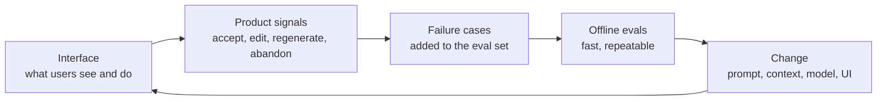

# From pixels to evals

*Part of [Building AI-native products](./README.md)*

*Last reviewed: 2026-10 · Volatility: fast*

## TL;DR

In an AI product, the screen and the model are linked. A change to the interface changes what users do, which changes what the model sees and how good the result is. A change to the model changes what the interface should show. You need a chain that connects **pixels** (what the user sees and does) to **evals** (measurements of model quality), so that each side can improve the other.

Two kinds of measurement make the chain. **Offline evals** run the model on a fixed set of cases, and tell you quickly whether a change helped. **Product signals** come from real use: whether users accept, edit, regenerate or abandon. Classic A/B tests help, and they fall short alone. Output is probabilistic, so the same input can give different answers, and a small gain on a small test is hidden by noise. You need both kinds, and a habit of going from one to the other: this is **hill climbing**.

> 🎯 **For the AI product leader**
>
> **Why it matters** — Without evals, every change is an argument. With them, you can improve a product step by step, and you can tell a real gain from luck.
>
> **What it changes in your decisions** — You design the interface to produce signals you can use. You fund the eval set as part of the feature. You decide with numbers that include their uncertainty.
>
> **Ask your team** — *"Which user action tells us the model was right, which tells us it was wrong, and how do those show up in our eval set?"*
>
> **Risk if ignored** — A product that is "improved" for months with no proof, or that drifts worse while a dashboard says it is fine.

## The mental model: two loops that feed each other



The fast loop runs offline, many times a day. The slow loop runs through real users, over days. Each cycle adds failures to the eval set, so the set keeps matching what users really do.

## Mechanics

### Product signals are weak labels

A user's action says something about quality, with caution.

| Signal | What it suggests | Caution |
| --- | --- | --- |
| Accepts with no edit | The output was good enough | Users may accept without reading |
| Edits lightly | Mostly good | The edit shows what was wrong |
| Edits heavily | Weak output | Or the user wanted something different |
| Regenerates | Unhappy with this answer | The next answer may not be better |
| Abandons | The feature failed, or the user changed their mind | Hard to tell which |
| Thumbs up or down | Direct opinion | Few users give it, and it is biased |

Treat signals as clues. They point at cases to inspect, and they do not replace a rubric.

### Offline evals

An eval is a set of inputs, a way to run the system and a way to score each output. Scoring can be exact match, a check rule, a human rating, or a model acting as judge. Start with the cheapest scoring that works, and check any model-judge against human ratings. [Evaluation and observability](../evaluation-and-observability/README.md) covers the stack.

### Why classic A/B tests fall short

An A/B test compares behaviour between two groups of users. It remains the best test of real value. For AI features it has limits.

- **Noise per case.** The same input can give different outputs, so each result has variance.
- **Small effects.** Prompt tweaks move quality by a few points, and a test needs many users to see that.
- **Slow.** A test takes days or weeks, and you need many changes per day.
- **Hidden failures.** Averages hide rare severe errors.

An offline eval is fast and controlled, and it can miss what users really do. So use the eval to choose what to test, and the A/B test to confirm what ships.

### Noise in a small eval

A pass rate on a small set has an error band. With 200 cases and a true pass rate of 80%, a rough 95% band is about plus or minus 5.5 points. A change from 80% to 82% on that set is inside the noise. To see small gains, use more cases, or run both versions on the same cases and compare the pairs.

### Pixels in the loop

Interface choices change the signals. A visible "regenerate" button makes regeneration easy, so a rise in regenerations may mean the button works, not that quality fell. An "edit" mode creates edit data. Design the screen so that the signals you need are easy to capture and hard to misread.

## Tradeoffs and decisions

- **Offline speed vs. real-world fit.** Offline evals are fast and can drift from real use.
- **Human vs. model judging.** Humans are slow and trusted. Model judges are fast and need checking.
- **Wide vs. deep sets.** Wide sets catch variety. Deep sets on one failure catch regressions.
- **Signals vs. rubric.** Signals show what users do. A rubric shows what you want.

## Failure modes

- **Metrics that move with the UI.** A redesign changes the signal, not the quality.
- **Small-sample wins.** Celebrating a 2-point gain on 100 cases.
- **A frozen eval set.** The set no longer matches real use.
- **Teaching to the test.** The prompt is tuned on the eval cases until the score means little.
- **Unchecked model judge.** The judge prefers long answers.
- **Average-only reporting.** A rare harmful failure is lost in the mean.

## Under the hood

The template is the **signal-to-eval map**. Fill it in for each user action in your feature.

```text
User action:                       Where captured (event name):
What it suggests (good / bad / unclear):
How we confirm (sample and read n = ___ cases per week):
Goes into the eval set as:         input ___  expected ___  failure cause ___
Chance this signal misleads (why):
```

## Worked example: Relay reads its own signals

*Relay is invented. All numbers are made up for teaching.*

In the first week, 61% of drafts were sent with no edit. The team was pleased. Then a reviewer read 40 of the no-edit drafts and found 6 with a wrong detail that the agent had not noticed. So "no edit" was partly "did not look". The team added a rule to its signal-to-eval map: *no-edit sends are sampled weekly and read.* Those 6 cases went into the eval set, labelled "wrong order detail".

Heavy edits were more useful. The team read 30 and found 11 where the agent replaced the whole opening. The cause was tone: drafts began too formally. That became a fix and a test case. The team now tracks the offline pass rate daily and the real-world "light edit" rate weekly. A prompt change that lifted the offline rate from 80% to 82% on 200 cases was **not** treated as a win, because the noise band is about 5.5 points. They added 400 cases before comparing again.

## Practitioner checklist

- [ ] Is every user action mapped to a signal, with a caution about its limits?
- [ ] Is there an offline eval set that includes real failures?
- [ ] Are no-edit and thumbs-up cases sampled and read, not trusted?
- [ ] Is the noise band known for each comparison?
- [ ] Is any model judge checked against human ratings?
- [ ] Is the offline eval used to pick changes, and an A/B test used to confirm them?
- [ ] Is the eval set refreshed from production failures?

## Related lessons

- [Practice: hill climbing](./hill-climbing-in-practice.md) — the working loop.
- [Practice: the AI feature spec](./ux-practice-the-ai-feature-spec.md) — where the first examples come from.
- [Why eval investment is the job](../evaluation-and-observability/why-eval-investment-is-the-job.md) — the case for evals.
- [Building the eval stack in the right order](../evaluation-and-observability/building-the-eval-stack-in-the-right-order.md) — the engineering view.
- [Metrics and experimentation](../technical-product-management/metrics-and-experimentation.md) — classic A/B testing.

## Sources

- Hamel Husain, writing on evals for LLM products (hamel.dev): the practice of reading failures and building evals from them. Not re-opened.
- The 95% band is the normal approximation: 1.96 × √(0.8 × 0.2 ÷ 200) ≈ 5.5 points. It is a rough guide.
- Relay and its numbers are invented for teaching. This track's fact-check is pending.
