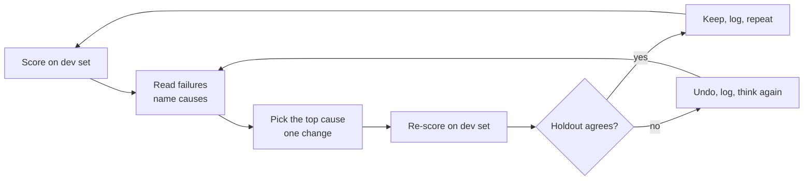

# Practice: hill climbing

*Part of [Building AI-native products](./README.md)*

*Last reviewed: 2026-10 · Volatility: fast*

## TL;DR

**Hill climbing** is the loop that turns an eval set into a better product. You score the current version. You read the failures and name their causes. You pick the most common cause and make one change aimed at it. You score again on the same set. If the score rose, and a fresh set agrees, you keep the change. Then you repeat.

The loop is simple. Four habits make it work. **Read failures by hand**, because the cause is in the text. **Change one thing at a time**, so you know what helped. **Keep a log**, so you can see what you tried. And **protect a holdout set**, so you do not climb a hill that exists only in your test.

> 🎯 **For the AI product leader**
>
> **Why it matters** — Most AI quality gains come from many small, measured steps, not from one big rewrite. The team that climbs faster and more honestly wins.
>
> **What it changes in your decisions** — You ask to see the log, not only the latest score. You fund time for reading failures. You insist on a holdout set and on noise bands.
>
> **Ask your team** — *"What were the last five changes, what did each do to the score and to the holdout, and what is the biggest failure cause now?"*
>
> **Risk if ignored** — A score that rises on the team's test and does not rise for users, because the test was tuned until it meant nothing.

## The mental model: climb, then check on fresh ground



The dev set is where you climb. The holdout is where you check that you are still on real ground.

## Mechanics

### Build the eval set

Start from the examples in your spec. Add real failures from production and from user signals. Aim for 100 cases to begin, and more later. Label each case with a failure category when it fails, so you can count. Split the set into a **dev set**, which you look at and tune on, and a **holdout set**, which you score rarely and never tune on. A common split is 70% and 30%.

### The error-analysis loop

1. Run the system on the dev set. Record pass or fail per case.
2. Read at least 30 failures in full.
3. Name the cause of each one in a few words. Group them.
4. Count the groups. The largest group is your target.
5. Choose the cheapest fix for that cause: a prompt line, better context, a tool or a model change.
6. Make one change. Re-run. Compare on the same cases.

### Compare fairly

Use the same cases and the same scoring each time. Compare pairs: which cases flipped from fail to pass and which flipped from pass to fail. A change that fixes 10 cases and breaks 8 is not an improvement of 2. Read the broken ones. Check the noise band before you believe a small gain.

### Guard against overfitting your own eval

Each time you look at the dev set and change the prompt, you fit the prompt to that set a little. After many rounds the dev score is flattering. The holdout shows the truth. If the dev score rises and the holdout does not, you are overfitting. Refresh the dev set with new production cases, and keep the holdout fixed for a longer period.

### Keep the log

Record each step: what you changed, why, the dev score before and after, the holdout score, the cases that flipped each way and the cost or latency change. The log is the team's memory and a way to stop repeating failed ideas.

## Tradeoffs and decisions

- **More cases vs. more reading.** A bigger set gives smoother scores. Reading failures gives causes. You need both.
- **Dev score vs. holdout.** Chase the dev set for speed. Trust the holdout for decisions.
- **One change vs. a batch.** Single changes teach more. Batches save time and hide causes.
- **Automated judge vs. reading.** Judges scale. Reading finds the surprises.

## Failure modes

- **No holdout.** Every number is a flattering one.
- **Peeking.** The holdout is checked so often it becomes a dev set.
- **Averaging away the dangerous cases.** The rare severe failure is not tracked on its own.
- **Moving the goalposts.** The rubric changes to make the score rise.
- **Gains that cost too much.** Quality rises while latency or cost breaks the budget.
- **A stale set.** Users have changed and the cases have not.

## Under the hood

Three templates.

```text
EVAL SET SHEET
Case id | Source (spec / production / signal) | Input | Expected | Group (dev/holdout) | Category if failing
```

```text
FAILURE TALLY (dev set, run on ___)
Cause                        | Count | Share | Example case ids | Cheapest fix
 1)
 2)
Target for this round: ___
```

```text
HILL-CLIMB LOG
Step | Change (one thing) | Dev before → after | Holdout | Fixed (n) / Broken (n) | Cost / latency | Keep?
```

## Worked example: five rounds on Relay

*Relay is invented. All numbers are made up for teaching.*

The team built an eval set of 200 cases and split it into 140 dev and 60 holdout. The starting version scored 62% on dev and 60% on holdout.

| Step | Change | Dev | Holdout | Notes |
| --- | --- | --- | --- | --- |
| 1 | Baseline | 62% | 60% | Top cause: missing policy facts (31 of 53 fails) |
| 2 | Add policy retrieval | 71% | 68% | Fixed 17, broke 4 |
| 3 | Rewrite opening to be less formal | 74% | 70% | Tone failures down |
| 4 | Add "ask a question when order data is missing" | 79% | 73% | Awkward cases up |
| 5 | Add 12 worked examples to the prompt | 88% | 74% | Dev jumped, holdout barely moved |

Step 5 was the warning. Twelve new examples were close to dev cases, so the prompt had partly memorized the dev set. The team removed the examples that matched dev cases, refreshed the dev set with 40 new production cases, and rescored. Dev fell to 80% and holdout rose to 77%. That was the honest number. The log kept the lesson: *check the holdout on every step, and never copy dev cases into the prompt.*

> **Capstone step 3.** Build an eval set from your spec examples. Split dev and holdout. Run one round of the loop on your feature and fill in the tally and the log.

## Practitioner checklist

- [ ] Is there a dev set and a protected holdout?
- [ ] Are at least 30 failures read in full each round?
- [ ] Is each change a single change?
- [ ] Is the comparison paired, with fixed and broken counts?
- [ ] Is the noise band known?
- [ ] Is the log kept, with the holdout score on each line?
- [ ] Are severe failures tracked on their own?
- [ ] Is the dev set refreshed from production?

## Related lessons

- [From pixels to evals](./from-pixels-to-evals.md) — the judgement behind this loop.
- [Practice: probing and choosing models](./model-intuition-practice.md) — picking the model to climb with.
- [Building the eval stack in the right order](../evaluation-and-observability/building-the-eval-stack-in-the-right-order.md) — the engineering view.
- [When prompts fail](../prompt-engineering/when-prompts-fail.md) — reading failures.
- [Evaluating context quality](../context-engineering/evaluating-context-quality.md) — evals for retrieval.

## Sources

- Hamel Husain, writing on evals and error analysis for LLM products (hamel.dev): reading traces and grouping failures. Not re-opened.
- Relay, its eval set and every number are invented for teaching. This track's fact-check is pending.
