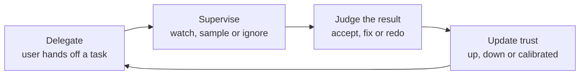

# How users behave with agents

*Part of [Building AI-native products](./README.md)*

*Last reviewed: 2026-10 · Volatility: fast*

## TL;DR

People do not use an agent the way they use a button. A button does one known thing. An agent does something that depends on judgement, and the user must decide how far to trust it. That changes behaviour in predictable ways. Users **delegate** tasks and then check, or fail to check. They form a **mental model** of what the agent can do, and it is often wrong. Their **trust** swings: too high after a few good results, too low after one bad one.

The aim is **calibrated trust**: the user relies on the agent about as much as it deserves. Two errors are common. **Over-reliance** means accepting output without checking it. **Under-reliance** means ignoring a good agent, or redoing its work. Research on automation has described both for decades. Your product can nudge users toward the middle, through what it shows, what it asks and how it fails.

> 🎯 **For the AI product leader**
>
> **Why it matters** — Even a very good agent fails if users trust it too little to use it, or too much to catch its mistakes. Behaviour decides the real outcome.
>
> **What it changes in your decisions** — You study how people supervise, not only how they start. You design what the agent shows about its own confidence and work. You track behaviours such as checking, editing and overriding.
>
> **Ask your team** — *"When the agent is wrong, how often do users notice, and what do they do next?"*
>
> **Risk if ignored** — A product that is accurate on paper and either unused or blindly trusted.

## The mental model: delegation, supervision, calibration



Each cycle changes how the user delegates next time. A product shapes the loop through its signals: previews, sources, confidence cues, progress views and easy ways to correct.

## Mechanics

### How users delegate

Users choose tasks to hand off by risk and by effort. They start with low-risk tasks and test the agent. If it does well, they hand off more. They often delegate vague goals and expect the agent to fill in the details, so clarifying questions help. Some users never delegate the tasks where the agent would help most, because they do not know it can do them.

### Mental models

A mental model is the user's picture of what the agent knows and can do. It is built from the first few interactions and from what the product says. A model that is too generous ("it knows everything about my account") leads to over-reliance. One that is too narrow ("it only writes emails") leads to missed value. The interface shapes the model: it shows scope, sources and limits.

### Trust is calibrated, or it is not

Trust moves with experience. A run of good results raises trust, sometimes past what the agent deserves. One memorable failure can drop it sharply. The aim is a trust level that matches reliability on each kind of task. Lee and See's work on automation names the goal "appropriate reliance". Parasuraman and Riley described misuse (over-reliance) and disuse (under-reliance). Both fit agents.

### Supervision behaviours

When a user supervises an agent, a few patterns appear.

- **Spot-checking.** Reading a sample. Good, if the sample is random and the user stays alert.
- **Rubber-stamping.** Approving without reading. Common when the agent is usually right.
- **Redoing.** Repeating the agent's work to be sure. It removes the benefit.
- **Intervening early.** Stopping the agent when it looks off. Needs visible progress.
- **Complacency.** Attention fades as the agent proves reliable, just when a rare error hurts most.

### What the product can do

- **Show the work.** Sources, steps and inputs let users check quickly.
- **Make errors visible.** Mark uncertain parts. Do not hide failures.
- **Vary scrutiny with risk.** Ask for closer review on high-impact actions.
- **Give honest feedback on reliability.** "Correct on 92% of past tickets of this type" calibrates better than a confident tone.
- **Keep users able to do the task.** Skills fade when the agent does everything.

### Human-AI collaboration patterns

Users work with agents in a few recurring ways: the agent as an **assistant** (the user drives), as a **delegate** (the agent drives, the user checks), and as a **collaborator** (both iterate). Each needs different controls. An assistant needs fast suggestions. A delegate needs reports and checks. A collaborator needs shared state and easy back-and-forth.

## Tradeoffs and decisions

- **Show more vs. clutter.** Visible work builds trust and adds noise.
- **Friction vs. attention.** Some friction keeps users alert, and too much sends them away.
- **Confident tone vs. calibrated tone.** Confidence feels good and fails badly.
- **Automation vs. skill retention.** Doing more for the user can weaken their ability to catch errors.

## Failure modes

- **Over-reliance.** Users send agent output unread.
- **Under-reliance.** Users redo or ignore good output.
- **Trust cliffs.** One visible error ends use.
- **Complacency.** Review quality falls as the agent improves.
- **Wrong mental model.** Users expect abilities the agent does not have.
- **Hidden failures.** The agent fails quietly, so users never learn its limits.

## Under the hood

The template is the **trust and supervision map**. Fill it in for each task your agent does.

```text
Task:                         Risk if wrong (L/M/H):
What users believe the agent can do (from interviews / copy):
What it can really do (from evals):          Gap:
Expected supervision: spot-check / rubber-stamp / redo / watch live
What we show: sources ___ steps ___ confidence cue ___ past accuracy ___
How a wrong result becomes visible:
Signals to track: edit rate ___ override rate ___ time to approve ___ undo rate ___
Over-reliance risk (H/M/L) and control:        Under-reliance risk (H/M/L) and control:
```

## Worked example: Relay agents learn to trust a draft

*Relay is invented. The numbers and quotes are made up for teaching.*

Relay's team studied how support agents used drafts. Within three weeks, two patterns appeared. Some agents sent 95% of drafts unedited, and a reviewer found a wrong order detail in 4% of those. Other agents rewrote every draft from scratch and saved no time.

The map showed the gap. Agents believed Relay "knows the order system". In fact, it only saw the fields passed to it. The team made three changes. A **source line** under each factual sentence let agents check in seconds. A **confidence cue** marked drafts that used missing data. And a weekly note showed each agent how often their edits fixed a real error: "In 11 of the 300 drafts you sent, we later found a wrong detail." Rubber-stamping fell from 95% to 71%, and the rewrite-everything agents began to accept clean drafts. The team also kept a rule: refund approvals are never summarized. Each shows the full card, because complacency around money is costly.

## Practitioner checklist

- [ ] Do we know what users believe the agent can do, from interviews, not from our copy?
- [ ] Is the gap between belief and ability written down?
- [ ] Does the interface show sources, steps and uncertainty?
- [ ] Do we track edit, override, undo and time to approve?
- [ ] Is high-risk review kept deliberate, with more scrutiny for more impact?
- [ ] Do users get feedback on the agent's real accuracy?
- [ ] Do we watch for complacency over time, not only at launch?

## Related lessons

- [Practice: researching agent interactions](./researching-agent-interactions.md) — methods for finding these behaviours.
- [Designing agentic flows](./designing-agentic-flows.md) — the controls the user sees.
- [User research](../product-sense/user-research.md) — the general craft.
- [Cognitive empathy](../product-sense/cognitive-empathy.md) — seeing the product as the user does.
- [Agentic AI as a product](../agentic-ai/agentic-ai-as-a-product.md) — the product view of agents.

## Sources

- Raja Parasuraman and Victor Riley, *Humans and Automation: Use, Misuse, Disuse, Abuse*, Human Factors, 1997. Not re-opened.
- John Lee and Katrina See, *Trust in Automation: Designing for Appropriate Reliance*, Human Factors, 2004. The publisher's page could not be read, so this was not re-opened.
- Saleema Amershi et al., *Guidelines for Human-AI Interaction*, CHI 2019, and the HAX Toolkit library, read 2026-10: guidelines such as "Make clear how well the system can do what it can do" and "Make clear why the system did what it did".
- Relay and the behaviours, quotes and numbers above are invented for teaching. This track's fact-check is pending.
