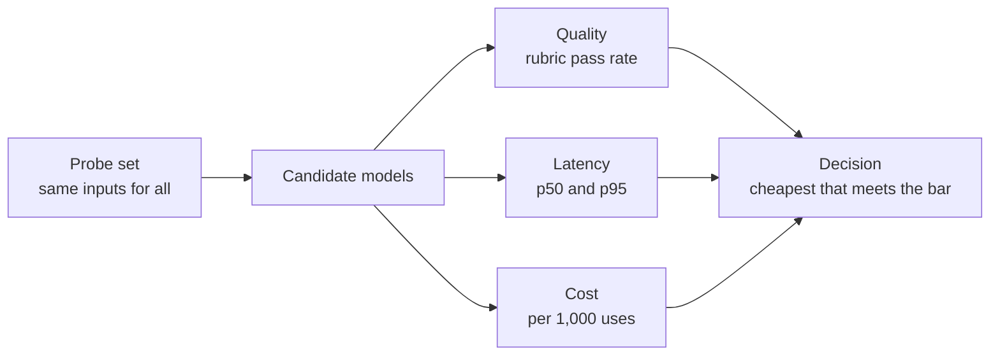

# Practice: probing and choosing models

*Part of [Building AI-native products](./README.md)*

*Last reviewed: 2026-10 · Volatility: fast*

## TL;DR

You build model intuition by running small, careful experiments. This lesson gives you two: a **probe**, which finds where a model fails on your task, and a **bake-off**, which compares candidate models on quality, speed and cost with the same inputs. Both take a day or two, need no code and give you evidence you can show a team.

The rules are simple. Use real inputs. Use the same inputs for every model. Score with a written rubric, before you look at the outputs. Record the cause of each failure. Then choose the cheapest option that meets your quality bar, and write down what would make you change your mind.

> 🎯 **For the AI product leader**
>
> **Why it matters** — Model choice sets your unit cost, your latency and your quality. A choice made on a hunch becomes expensive to undo.
>
> **What it changes in your decisions** — You ask for a bake-off before you commit to a vendor or a model size. You set the quality bar first, so the result is a decision and not a debate.
>
> **Ask your team** — *"Which models did we try on the same inputs, with which rubric, and what did each cost per thousand uses?"*
>
> **Risk if ignored** — A model chosen because it won a benchmark, then dropped after launch because it is too slow or costs too much.

## The mental model: the same test, three numbers

Give every candidate the same test. Measure three numbers: quality, latency and cost. Then read them against your constraints, not against each other.



## Mechanics

### Step 1: build the probe set

Collect 40 to 60 real inputs. Split them into easy, typical and awkward. Include the cases that worry you. Do not tune your prompt on these cases and then judge on them. Keep a fresh set aside.

### Step 2: write the rubric first

For each case, define a pass. Use two or three yes-or-no checks rather than a score out of ten. For example: "uses the real order status", "does not promise a refund", "under 120 words". Binary checks are easier to apply the same way each time.

### Step 3: run and score

Run each model with the same prompt and the same inputs. Score blind if you can: hide which model wrote which output. Record the pass or fail and a failure cause for each fail.

### Step 4: measure speed and cost

Measure time to the first token and time to the full answer, at the median and at the 95th percentile. Count input and output tokens. Multiply by the price. Express cost per 1,000 uses.

### Step 5: decide

Write the constraints first: the quality bar, the latency the user will tolerate and the cost per use the business can pay. Pick the cheapest model that meets all three. If none does, decide whether to change the task, the prompt or the context, not only the model.

### Step 6: set the re-test

Models update. Note a date to re-run the bake-off, and re-run it whenever a vendor retires or replaces a model.

## Tradeoffs and decisions

- **Sample size vs. effort.** 50 cases catch big gaps. Small differences need more.
- **Blind vs. open scoring.** Blind scoring is fairer and takes more setup.
- **One prompt vs. a tuned prompt per model.** A shared prompt is fair. A tuned one shows each model's best.
- **Average vs. worst case.** A model that is fine on average and awful on one case type may be unfit.

## Failure modes

- **Cherry-picked cases.** The probe set is the team's favourite examples.
- **Moving rubric.** The pass rule shifts after seeing the outputs.
- **Prompt tuned on the test.** The score is inflated.
- **Median only.** A fine average hides a bad 95th percentile.
- **Price list, not real use.** Cost computed from list prices, not from real token counts.
- **One-off decision.** The result is never re-checked.

## Under the hood

Two templates. Fill in the first before you run anything.

```text
PROBE SHEET
Task:                         n = ___  (easy ___ / typical ___ / awkward ___)
Rubric (yes/no checks):  1) ___   2) ___   3) ___
Pass = all checks yes.    Must-not-fail cases: ___
```

```text
BAKE-OFF TABLE
Constraints: quality bar ___%   p95 latency ≤ ___ s   cost ≤ $___ per 1,000
Model | Pass rate | Must-not-fail | p50 / p95 latency | Cost per 1,000 | Top failure causes
  A   |           |               |                   |                |
  B   |           |               |                   |                |
  C   |           |               |                   |                |
Decision:                         Why:
What would change my mind:        Re-test date:
```

## Worked example: the Relay bake-off

*Relay is invented. All numbers are made up for teaching.*

Constraints, set before the run: pass rate at least 80%, no failures on the 8 "must not promise" cases, 95th percentile latency under 3 seconds, and cost under $6 per 1,000 drafts.

| Model | Pass rate | Must-not-fail | p50 / p95 latency | Cost per 1,000 | Top failure cause |
| --- | --- | --- | --- | --- | --- |
| A (mid-size) | 78% | 8 of 8 pass | 1.4 s / 2.1 s | $4.10 | Missing policy facts |
| B (large) | 85% | 8 of 8 pass | 3.1 s / 4.8 s | $19.00 | Slow and costly |
| C (small) | 64% | 5 of 8 pass | 0.5 s / 0.9 s | $0.60 | Promised refunds |

Model C failed the must-not-fail rule, so it was out. Model B met the quality bar and missed both the latency and the cost limits. Model A was close: 78% against a bar of 80%. The team did not switch to B. It added policy retrieval to A, re-ran, and reached 84%, inside every constraint. The decision record said: *Use A with retrieval. Revisit if A's pass rate on the monthly re-test falls below 80%, or if a vendor retires A.*

> **Capstone step 2.** Run a probe on your feature's task. Fill the probe sheet and the bake-off table for at least two models. Add the decision and the "what would change my mind" line to your spec.

## Practitioner checklist

- [ ] Are there 40 or more real inputs, split into easy, typical and awkward?
- [ ] Was the rubric written before the run, with yes-or-no checks?
- [ ] Do all models see the same inputs and the same prompt?
- [ ] Are failure causes recorded?
- [ ] Are p50 and p95 latency and cost per 1,000 uses measured?
- [ ] Were constraints set before the results?
- [ ] Is there a decision record and a re-test date?

## Related lessons

- [Model intuition](./model-intuition.md) — the judgement behind these experiments.
- [Practice: the AI feature spec](./ux-practice-the-ai-feature-spec.md) — where the examples come from.
- [Hill climbing in practice](./hill-climbing-in-practice.md) — improving the winner step by step.
- [Choosing a model](../llms/choosing-a-model.md) — what to compare.
- [Cost optimization](../cost-optimization/README.md) — turning tokens into money.

## Sources

- Anthropic, "Building effective agents", anthropic.com/engineering/building-effective-agents, 2024-12-19, read 2026-10: the advice to find the simplest solution and add complexity only when it improves outcomes.
- Relay, the models A, B and C and every number are invented for teaching. This track's fact-check is pending.
