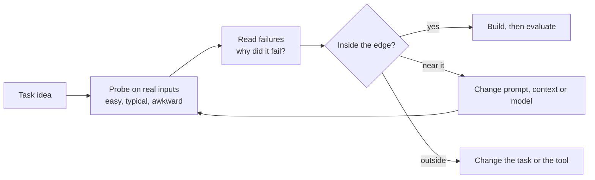

# Model intuition

*Part of [Building AI-native products](./README.md)*

*Last reviewed: 2026-10 · Volatility: fast*

## TL;DR

Model intuition is a feel for what a model will do before you run it. It tells you which task is easy, which is risky and which is out of reach. It tells you which model to try first, how a change in wording will shift the output, and when the problem needs a different tool. It is the knowledge that separates a competent AI PM from one who is still guessing.

It is not magic. It comes from three habits: **probing** many models on your own tasks, **reading the failures** closely, and **tracking the trade-offs** between quality, speed and cost. Capabilities are uneven, so a model can do something hard and fail at something that looks easy. That is the *jagged frontier*. You learn where it runs for your product by testing, not by reading a leaderboard.

> 🎯 **For the AI product leader**
>
> **Why it matters** — Every feature rests on a bet about what the model can do. A wrong bet costs months. A right bet gives a product competitors cannot copy by adding a button.
>
> **What it changes in your decisions** — You test a task on real inputs before you promise it. You choose models by task, not by brand. You keep a short list of "what this model cannot do" and update it.
>
> **Ask your team** — *"On our real inputs, where does each model fail, and how did you find out?"*
>
> **Risk if ignored** — A roadmap built on a capability that works in a demo and fails on live data.

## The mental model: a jagged edge, mapped by probing

Picture the set of tasks as a landscape. The model's ability is a ragged coastline, not a smooth line. Some hard tasks sit inside it. Some easy-looking tasks sit outside. You find the coast by walking along it with test cases.



## Mechanics

### What models do well and badly

Models are strong at language tasks with fuzzy boundaries: drafting, summarizing, rewriting, classifying, extracting, translating and explaining. They are weaker at exact arithmetic without a tool, long chains of strict logic, facts they were not trained on, and tasks where one tiny error ruins the result. They can sound sure when wrong. [Capabilities and the jagged frontier](../llms/capabilities-and-the-jagged-frontier.md) goes deeper.

### The three dials: quality, speed, cost

A larger model usually answers better, slower and at a higher price. A smaller one is faster and cheaper and fails sooner on hard cases. A model choice is a position on those three dials, set by the product. A reply drafted while an agent waits must be fast. An overnight report can be slow. See [Choosing a model](../llms/choosing-a-model.md).

### Prompt, retrieve or tune

When a model falls short, there are three levers, in this order of cost:

1. **Prompt and examples.** Cheap and fast. Fixes format, tone and many mistakes.
2. **Retrieval and context.** Give the model the facts it lacks. Fixes missing knowledge.
3. **Tuning.** Change the model itself. Fixes consistent behaviour, and costs the most.

[Prompting vs. RAG vs. fine-tuning](../llms/prompting-vs-rag-vs-finetuning.md) covers the decision in depth.

### Reading failures

A failure has a cause. Common ones: the model lacked a fact, it misread the instruction, the context was too long or messy, the task needed a tool, or the question had no clear answer. Naming the cause tells you the fix. "The model is bad" tells you nothing.

### Models change

New versions arrive often, and behaviour shifts. A prompt that worked on one model may fail on the next. Keep your probe set, and rerun it on every new model.

## Tradeoffs and decisions

- **Best model vs. right model.** The strongest model may be too slow or costly for the job.
- **One model vs. several.** Routing easy cases to a cheap model saves money and adds complexity.
- **Prompting vs. tuning.** Prompts are quick to change. Tuning gives stable behaviour and is slower to redo.
- **Leaderboard vs. your data.** A public score says little about your inputs.

## Failure modes

- **Demo bias.** Choosing from five hand-picked prompts.
- **Brand loyalty.** Using one vendor for every task.
- **Treating fluency as correctness.** A smooth answer is not a true one.
- **Ignoring cost until the bill.** Quality tested at one price and shipped at another.
- **No re-test.** A model update changes behaviour and nobody notices.
- **Fixing the wrong layer.** Tuning a model to fix a retrieval bug.

## Under the hood

The template for this lesson is the **model boundary log**. Keep one per feature.

```text
Task:                                   Date:       Model + version:
Probe inputs (n = ___): easy ___  typical ___  awkward ___
Pass rate by group:   easy ___%  typical ___%  awkward ___%
Failure causes (count):
  missing fact ___   misread instruction ___   too much context ___
  needs a tool ___   no clear answer ___      other ___
Fix tried:             Prompt / context / model / tool / change the task
Result after fix:
"This model cannot do ..." (update the running list):
Re-test due:
```

## Worked example: Relay finds its edge

*Relay is invented. All numbers are made up for teaching.*

The Relay team probed a mid-size model on 60 real tickets: 20 easy, 25 typical and 15 awkward. Pass rates were 95%, 72% and 33%. The failures sorted into four causes: 9 missing policy facts, 6 misread instructions, 4 wrong order details and 3 where the right answer was "ask the customer".

This told the team three things. The model was fine for easy and typical tickets, so the feature was viable. Policy facts were the biggest gap, so retrieval would help more than a bigger model. And for awkward tickets, the right design was to ask a question, not to guess. They added policy retrieval and an "ask first" rule. A re-run lifted typical tickets to 84% and awkward ones to 53%. They wrote a one-line limit into the spec: *Relay does not handle multi-order disputes.*

## Practitioner checklist

- [ ] Have we probed on real inputs, not demo prompts?
- [ ] Are failures sorted by cause?
- [ ] Do we know the quality, speed and cost position of each candidate?
- [ ] Did we try prompt and context fixes before tuning?
- [ ] Is there a written list of what the model cannot do?
- [ ] Is the probe set re-run on every model change?

## Related lessons

- [Practice: probing and choosing models](./model-intuition-practice.md) — run the probe and the bake-off.
- [Capabilities and the jagged frontier](../llms/capabilities-and-the-jagged-frontier.md) — the idea in depth.
- [Choosing a model](../llms/choosing-a-model.md) — comparing candidates.
- [Prompt engineering](../prompt-engineering/README.md) — the working skill.
- [Variants and reading a model card](../transformers/variants-and-reading-a-model-card.md) — what a spec sheet tells you.

## Sources

- Fabrizio Dell'Acqua et al., *Navigating the Jagged Technological Frontier*, Harvard Business School working paper, 2023: the term and the evidence that capability is uneven. Not re-opened.
- Anthropic, "Building effective agents", anthropic.com/engineering/building-effective-agents, 2024-12-19, read 2026-10: the advice to start with the simplest solution and to optimize single calls with retrieval and examples before adding complexity.
- Relay and its numbers are invented for teaching. This track's fact-check is pending.
