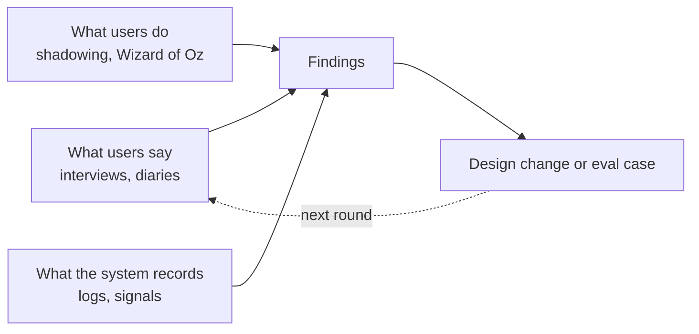

# Practice: researching agent interactions

*Part of [Building AI-native products](./README.md)*

*Last reviewed: 2026-10 · Volatility: fast*

## TL;DR

You cannot learn how people supervise an agent by asking what they like. Stated opinions and real behaviour differ most for tools that act for the user. The research has to watch what people do: what they hand off, what they check, what they undo, and when they stop trusting the output. It also has to look at the agent's own record, because the logs show behaviour at a scale no interview can.

This lesson gives you five methods that suit agents. **Log analysis** shows what happens at scale. **Shadowing and think-aloud sessions** show why. **Wizard-of-Oz tests** let you try an agent before you build it. **Diary studies** show trust over weeks. **Structured interviews** probe mental models and past incidents. You get an interview guide, a research plan and a findings template to reuse.

> 🎯 **For the AI product leader**
>
> **Why it matters** — Agent products fail at the edges of behaviour: over-trust, abandoned delegation and quiet errors. Surveys miss those. Targeted research finds them before launch, and again after.
>
> **What it changes in your decisions** — You plan research in rounds: before the build, in a sandbox, in early release and in steady use. You make the logs part of the research. You turn every finding into a change or a test case.
>
> **Ask your team** — *"What did we see users do, not say, when the agent was wrong?"*
>
> **Risk if ignored** — A launch based on what users said they would do, followed by behaviour no one planned for.

## The mental model: say, do and record

Three sources of evidence answer different questions. What users **say** shows beliefs and wishes. What users **do**, watched live, shows habits and surprises. What the system **records** shows scale and rare events. Use all three, and trust agreement between them.



## Mechanics

### Log analysis

Sample real sessions and read them. Look for: tasks users hand off, tasks they redo, edits after the agent's output, undo and override actions, abandoned runs and repeated attempts at the same goal. Pair numbers with reading: count the pattern, then read ten cases. Respect privacy: de-identify, and limit who reads.

### Shadowing and think-aloud

Watch users work with the agent on real tasks, and ask them to say what they are thinking. Notice where they check, where they hesitate, what they ignore and what surprises them. Do not help. Note the moments when the agent was wrong and whether the user noticed.

### Wizard of Oz

A person plays the agent behind the scenes while the user believes, or knows, it is automatic. Kelley used the method in the 1980s. It lets you test the interaction design, the pacing and the trust questions before the model exists, or while it is still weak. Be clear on the ethics: tell participants afterwards, and never test anything with real consequences.

### Diary studies

Ask a small group to record each use for two to four weeks: the task, how they checked, what went wrong and how they felt. Diaries show how trust changes with time, which a single session cannot.

### Interviews that fit agents

Ask about **specific past episodes**, not general opinions. "Tell me about the last time the agent got something wrong" teaches more than "Do you trust it?" Ask what they believed it could do, what they checked and why, and what would make them stop using it. Probe the edges: money, customers, privacy.

### From finding to action

A finding is only useful if it leads somewhere. For each one, write the behaviour, the evidence, the cause and the response: a design change, an eval case, a risk-register entry or a change to the copy. Add failure episodes to the eval set from [lesson 6](./hill-climbing-in-practice.md).

## Tradeoffs and decisions

- **Depth vs. scale.** Interviews give why. Logs give how much.
- **Realism vs. control.** Live work is realistic and messy. Lab tasks are clean and artificial.
- **Early vs. late.** Wizard-of-Oz tests are cheap and early. Logs need a live product.
- **Privacy vs. insight.** The best data is the most sensitive. Collect the least that answers the question.

## Failure modes

- **Asking opinions about behaviour.** "Would you trust it?" tells you little.
- **Leading questions.** The agent is described as clever, then rated.
- **Only happy users.** Early adopters are not the market.
- **One-off research.** Trust changes, and a single study goes stale.
- **No follow-through.** Findings sit in a deck.
- **Over-collecting.** Logs kept without a purpose or a limit.

## Under the hood

Three templates.

```text
INTERVIEW GUIDE (45 min)
1  Warm-up: your role, a typical day with tickets (5)
2  Last time the agent helped: walk me through it (10)
3  Last time it got something wrong: what happened, how did you find out? (10)
4  What do you think it can and cannot do? How do you know? (5)
5  What do you check before you send, and why? What do you skip? (10)
6  What would make you stop using it? What would you hand off if it were better? (5)
Probes: "show me", "what did you expect", "what happened next". Do not describe the agent as accurate.
```

```text
RESEARCH PLAN
Question to answer:             Decision it informs:
Method(s): logs / shadow / Wizard of Oz / diary / interviews
Who (n, roles, experience):     When (round: pre-build / sandbox / early release / steady state)
Data and privacy limits:        Owner:         Date of readout:
```

```text
FINDING
Behaviour seen:            Evidence (n, where):       Cause (our guess):
Response: design change / eval case / risk entry / copy        Owner / due:
```

## Worked example: Relay's three rounds

*Relay is invented. All findings and numbers are made up for teaching.*

**Round 1, before the build: Wizard of Oz.** Two team members drafted replies by hand and showed them in the reply box as "Relay drafts". Five support agents worked normally for two days. Finding: agents read the first line, then skimmed. They did not check order numbers. Response: a risk entry for "wrong detail unnoticed" and a design change to underline facts.

**Round 2, early release: logs and shadowing.** Of 1,200 drafts, 61% were sent unedited. The team read 40 of them. Six held a wrong detail. In shadowing, agents said they "trust the order bit because it's from the system". Response: the source line and the weekly sampling rule from the earlier lessons.

**Round 3, steady state: a diary study.** Eight agents kept a diary for three weeks. Two wrote that they stopped reading drafts after the second week. One wrote: "It's been right so many times that I just hit send." Response: a design change that varies the check. A random 1 in 20 drafts gets a "please confirm the order number" step, and the interview guide gained a question about complacency.

> **Capstone step 5.** Fill in a research plan for your feature. Write your interview guide using the template and plan one of each: a before-build test, an early-release log review and a diary.

## Practitioner checklist

- [ ] Is there a written question and a decision it informs?
- [ ] Does the plan mix say, do and record?
- [ ] Do interviews ask about specific past episodes?
- [ ] Is there a Wizard-of-Oz or sandbox test before launch?
- [ ] Are logs sampled and read, with privacy limits?
- [ ] Is there a diary or a repeat round to see trust change?
- [ ] Does every finding have a response and an owner?
- [ ] Do failure episodes go into the eval set?

## Related lessons

- [How users behave with agents](./how-users-behave-with-agents.md) — what to look for.
- [Practice: hill climbing](./hill-climbing-in-practice.md) — turning findings into eval cases.
- [User research](../product-sense/user-research.md) — the general method.
- [Communication](../product-sense/communication.md) — sharing findings.
- [Running an agent in production](../ai-agents/running-an-agent-in-production.md) — logs and monitoring.

## Sources

- John F. Kelley, *An iterative design methodology for user-friendly natural language office information applications*, ACM Transactions on Office Information Systems, 1984: the Wizard-of-Oz method. Not re-opened.
- Saleema Amershi et al., *Guidelines for Human-AI Interaction*, CHI 2019, and the HAX Toolkit library, read 2026-10: the guidelines that user research should check against.
- Relay, its studies, findings and numbers are invented for teaching. This track's fact-check is pending.
