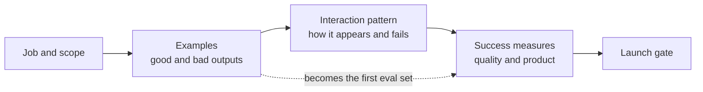

# Practice: the AI feature spec

*Part of [Building AI-native products](./README.md)*

*Last reviewed: 2026-10 · Volatility: fast*

## TL;DR

A classic spec lists screens and rules. An AI feature spec must say more, because the behaviour is not fixed. It needs the user's job, the scope, the input the model gets, what a good and a bad output look like, how uncertainty and errors appear, and how the feature will be measured. Without these, engineers and designers each fill the gaps with their own guesses.

This lesson gives you a one-page **AI feature spec** and a small **interaction-pattern library** to reuse. It then walks through a teardown of the Relay draft-reply feature.

> 🎯 **For the AI product leader**
>
> **Why it matters** — The spec is where vague ambition becomes testable behaviour. A feature with no written definition of "good" cannot be evaluated, and it cannot be argued about fairly.
>
> **What it changes in your decisions** — You write down examples of good and bad outputs before the build. You treat "what happens when the model is wrong" as a required section. You review the spec with design, engineering and support together.
>
> **Ask your team** — *"Show me five real inputs and the exact output we would accept for each, and three outputs we would reject."*
>
> **Risk if ignored** — A launch where nobody can say whether the feature works, and a backlog of "the model feels off" bugs.

## The mental model: a spec with examples at its centre

Specs for AI features work best when built around **examples**. A written rule such as "be polite and accurate" is open to many readings. Ten real inputs, each with an accepted and a rejected output, are not. The examples become the first test set.



## Mechanics

### The one-page AI feature spec

1. **Job and user.** Who is doing what, in one sentence.
2. **Scope.** What the feature does, and what it does not do.
3. **Inputs.** What the model sees: the user's text, other context, tools. Where each piece comes from.
4. **Examples.** At least 10 real inputs, each with an accepted output, and at least 3 rejected outputs with the reason.
5. **Interaction pattern.** How the result appears: suggestion, draft, preview, action. How the user accepts, edits, rejects and undoes.
6. **Uncertainty and failure.** What the user sees when the model is unsure or wrong. What the system does when the model times out or refuses.
7. **Quality bar.** The pass rate on the examples that is good enough to ship, and what counts as a pass.
8. **Product measures.** What you will watch after launch: acceptance, edits, time saved, complaints.
9. **Risks and limits.** Cost per use, latency, privacy, safety, and what you will not log.
10. **Launch gate.** The conditions to ship, to widen and to roll back.

### A small interaction-pattern library

| Pattern | Use when | Watch for |
| --- | --- | --- |
| **Suggest** | The user is already working and the model offers a next step | Interrupting at the wrong moment |
| **Draft** | The output is text the user will edit | Users sending drafts unread |
| **Preview and confirm** | The action has consequences | Confirm fatigue |
| **Explain and cite** | The user must trust a claim | Citations that do not support the claim |
| **Ask a question** | The input is ambiguous | Asking too many questions |
| **Progressive disclosure** | The model has more to say than fits | Hiding what the user needs |
| **Undo and history** | The model changes something | Undo that is not truly complete |

### Writing good examples

Take real inputs from logs, tickets or interviews. Include easy, typical and awkward cases. For each, write the output a careful expert would accept. Add the rejected outputs that worry you most: confident but wrong, correct but rude, correct but too long. Note the reason, because the reason turns into an eval criterion. [Evals](./from-pixels-to-evals.md) uses the same set.

## Tradeoffs and decisions

- **Specific vs. flexible.** A tight spec is testable. A loose one gives the model room, and it is hard to test.
- **More examples vs. time.** Ten examples start the work. Fifty make it solid.
- **Quality bar vs. launch date.** A high bar delays launch. A low one ships risk.
- **Spec as a contract vs. a living page.** AI specs change as you learn. Version them.

## Failure modes

- **Rules with no examples.** "Be helpful" cannot be tested.
- **Only happy-path examples.** The spec ignores the cases that break.
- **No failure design.** Nobody wrote what the user sees when the model is wrong.
- **Spec by committee.** Everyone adds a requirement, and nothing is prioritized.
- **Frozen spec.** The model, the data and the users change, and the page does not.

## Under the hood

Copy this template. It is the spec in plain text.

```text
AI FEATURE SPEC                                  version / date:
1  Job and user:
2  Scope — does:                               does NOT:
3  Inputs (source of each):
4  Examples (≥10)         input | accepted output | notes
   Rejected outputs (≥3)  input | bad output | why rejected
5  Pattern (suggest / draft / preview / explain / ask):
   Accept: ___  Edit: ___  Reject: ___  Undo: ___
6  When unsure: ___   When wrong: ___   On timeout or refusal: ___
7  Quality bar (pass rate, definition of pass):
8  Product measures after launch:
9  Cost per use / latency target / privacy limits / not logged:
10 Launch gate — ship if: ___  widen if: ___  roll back if: ___
```

## Worked example: the Relay draft-reply spec

*Relay is invented. The numbers and examples are made up for teaching.*

**Job and user.** A support agent opens a ticket and needs a good first reply fast.

**Scope.** Relay drafts a reply from the customer's message and the order history. It does not decide refunds. It does not answer questions about policy that it cannot source.

**Inputs.** The customer's message, the last three messages in the thread, the order record, and the matching help-centre paragraphs from search.

**Examples (three of twelve).**

| Input | Accepted output | Notes |
| --- | --- | --- |
| "Where is my order? It's been 9 days." | Apologizes once, states the carrier status from the order record, gives the next step and a date | Must use the real status |
| "I was charged twice" | Confirms the two charges from the record, says a refund request is being raised, no promise of timing | Must not promise a date |
| "Your product ruined my sofa!!!" | Acknowledges, asks for photos, offers a call | Tone: calm, no blame |

**Rejected outputs.** A reply that promises a refund the policy does not allow (confident and wrong). A reply that quotes the wrong order number (correct tone, wrong fact). A 300-word reply to a two-line message (too long).

**Pattern.** Draft. It appears in the reply box. The agent edits and sends. Policy statements are underlined with a source. A statement with no source is marked "check this".

**Quality bar.** At least 85% of the 60-case test set pass the rubric, and none of the "must not promise" cases fail.

**Product measures.** Share of drafts sent with light edits, time to first reply, and customer satisfaction on assisted tickets.

**Launch gate.** Ship to 10 agents if the quality bar is met. Widen to all agents if, after two weeks, light-edit rate is above 50% and complaints are flat. Roll back if a "must not promise" failure reaches a customer.

> **Capstone step 1.** Write your own feature's spec using the template. Keep it. You will add an eval set, a model choice, an agent design and a research plan to it in the next lessons.

## Practitioner checklist

- [ ] Is the job one sentence, and the scope explicit?
- [ ] Are there at least 10 real examples with accepted outputs?
- [ ] Are there rejected outputs with reasons?
- [ ] Is the interaction pattern chosen, with accept, edit, reject and undo?
- [ ] Does the spec say what happens when the model is wrong or slow?
- [ ] Is the quality bar a number, with a definition of pass?
- [ ] Is the launch gate written, with a rollback condition?
- [ ] Is the spec versioned and reviewed by design, engineering and support?

## Related lessons

- [Designing for ambiguity](./designing-for-ambiguity.md) — the judgement behind this spec.
- [From pixels to evals](./from-pixels-to-evals.md) — turning these examples into an eval set.
- [Specs, PRDs and RFCs](../technical-product-management/specs-prds-and-rfcs.md) — the general spec craft.
- [Context as a spec-able requirement](../context-engineering/context-as-a-spec-able-requirement.md) — specifying what the model sees.
- [Prompts in production](../prompt-engineering/prompts-in-production.md) — keeping prompts and specs in step.

## Sources

- Saleema Amershi et al., *Guidelines for Human-AI Interaction*, CHI 2019, and the HAX Toolkit library (microsoft.com/en-us/haxtoolkit/library), read 2026-10: the patterns for correction, dismissal and scoping when in doubt.
- Relay, its examples, thresholds and numbers are invented for teaching. This track's fact-check is pending.
