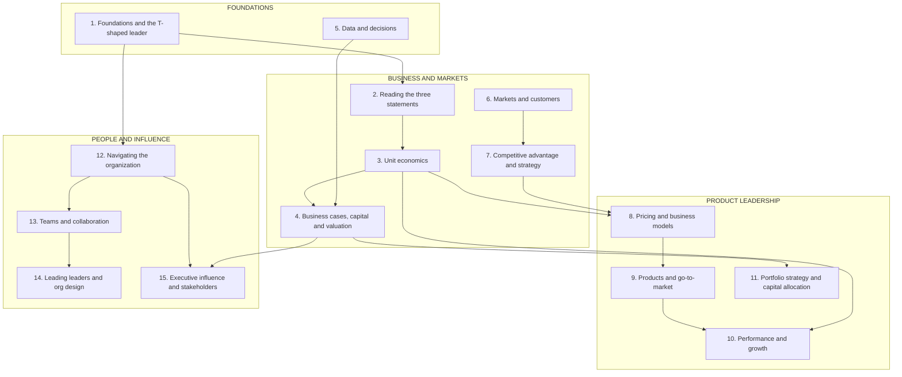

# Business acumen for the product leader

*A standalone module: money, markets, organizations and influence, for Group PMs, Heads of Product and vice presidents (VPs) of Product.*

Product leaders are promoted for product judgement. Above Group PM level, they are judged on business results. The decisions change. You approve bets, set targets, design teams, set prices and argue for money at the executive table. Each of those decisions is made in the language of the business: cash, margin, risk, market position and organizational power.

This module teaches that language, and how to use it to decide. It is written for Group Product Managers, Heads of Product and VPs of Product. Every lesson ties its ideas to six domains: **FinTech, Payments, Lending, eCommerce, InsurTech and Retail**. The domain examples use public disclosures of real companies, such as their annual reports and company blogs. Each lesson's invented worked example is labelled as invented.

Start with the **<a href="assessment.html">interactive self-assessment</a>**. It scores you on the fifteen lessons, draws a radar chart of your strengths, and builds a two-week improvement plan from your largest gaps.

**A note on scope.** This module covers business judgement. Neighbouring modules cover the craft. Metric trees and experiments live in [Technical product management](../technical-product-management/README.md). Infrastructure cost lives in [Technical product sense](../technical-product-sense/README.md). Payment and ledger systems live in [System design](../system-design/README.md). Precision, recall and model measurement live in [Machine learning](../machine-learning/README.md). This module links to them and does not repeat them.

## Where the depth lives

| If you want the full depth on | Read here first | Then go deeper in |
| --- | --- | --- |
| The three statements, cash and float | [The language of money](./the-language-of-money.md) | [Transactional and financial systems](../system-design/transactional-and-financial.md), for how ledgers and payouts record it |
| Contribution margin, payback and lifetime value | [Unit economics](./unit-economics.md) | [The economics of infrastructure](../technical-product-sense/economics-of-infrastructure.md), for the cost of goods sold hidden in infrastructure |
| NPV, hurdle rates, funding and valuation | [Business cases, capital and valuation](./business-cases-and-valuation.md) | [Portfolio strategy and capital allocation](./portfolio-strategy-and-allocation.md), for staged bets |
| Base rates, thresholds and model risk | [Data and decisions](./data-and-decisions.md) | [Measuring a model](../machine-learning/measuring-a-model.md), for precision, recall and the confusion matrix |
| Metric trees, instrumentation and A/B tests | [Performance and growth](./performance-and-growth.md) | [Metrics and experimentation](../technical-product-management/metrics-and-experimentation.md) |
| OKRs, scoring frameworks and roadmaps at team level | [Portfolio strategy and capital allocation](./portfolio-strategy-and-allocation.md) | [Prioritization and roadmaps](../technical-product-management/prioritization-and-roadmaps.md) |
| How payment systems, ledgers and wallets work | [Unit economics](./unit-economics.md) | [Transactional and financial systems](../system-design/transactional-and-financial.md) |
| Domain expertise as product intuition | [Foundations](./foundations-and-assessment.md) | [Domain expertise](../product-sense/domain-expertise.md) |
| Artifacts and storytelling for influence | [Executive influence](./executive-influence-and-stakeholders.md) | [Communication](../product-sense/communication.md) |
| Running a launch end to end | [Products and go-to-market](./products-and-marketing.md) | [Launches, rollouts and migrations](../technical-product-management/launches-rollouts-and-migrations.md) |
| Breadth and depth as a learning strategy | [Foundations](./foundations-and-assessment.md) | [Becoming a polymath](../first-principles/becoming-a-polymath.md) |

## The knowledge graph

Read it in four clusters. **Foundations:** diagnose yourself, and learn to decide under uncertainty. **Business and markets:** how money is measured, what one unit earns, how a bet is valued, and where to compete. **Product leadership:** how to price, how to go to market, how to measure performance, and how to fund a portfolio. **People and influence:** the organization, teams, leaders and the executive table. The same four clusters colour the self-assessment's radar chart.

The order is money first. The first four lessons give you the numbers that every later lesson uses.

## The lessons

1. [**Foundations: business acumen and the T-shaped leader**](./foundations-and-assessment.md) — breadth, domain depth, each domain's first unit-economics question, and how to diagnose your gaps.
2. [**The language of money: reading the three statements**](./the-language-of-money.md) — the income statement line by line, revenue recognition, the balance sheet, working capital, float and free cash flow.
3. [**Unit economics: from one transaction to a cohort**](./unit-economics.md) — contribution margin layers, acquisition cost, cohort payback, lifetime value, and unit waterfalls for each domain.
4. [**Business cases, capital and valuation**](./business-cases-and-valuation.md) — NPV, IRR, hurdle rates, how lenders and insurers fund themselves, the counterfactual, scenarios and how the company is valued.
5. [**Data and decisions**](./data-and-decisions.md) — base rates, threshold economics, the value of information, forecasting in ranges and model governance.
6. [**Markets and customers: segments, sizing and positioning**](./markets-and-strategy.md) — bottom-up sizing, segmentation, positioning, competitor teardowns and the growth matrix.
7. [**Competitive advantage and strategy**](./competitive-advantage-and-strategy.md) — the five competitive forces as a method, profit pools, seven sources of advantage, network effects and how to structure a strategy.
8. [**Pricing and business models**](./monetization-and-business-models.md) — value metrics, willingness to pay, elasticity, the price waterfall, regulated pricing and the business-model table.
9. [**Products and go-to-market**](./products-and-marketing.md) — go-to-market motions, sales capacity, attribution versus incrementality, make-buy-partner and intellectual property.
10. [**Performance and growth**](./performance-and-growth.md) — growth accounting, gross and net retention, vintage curves, loss development and targets with guardrails.
11. [**Portfolio strategy and capital allocation**](./portfolio-strategy-and-allocation.md) — horizons, staged funding, correlated bets, the option to expand, acquisitions and sunsets.
12. [**Navigating the organization**](./navigating-the-organization.md) — who holds which lever, the planning and budget cycle, how Risk decides, and stakeholder mapping.
13. [**Teams and collaboration**](./teams-and-collaboration.md) — team types, interaction modes, the cost of a handoff, operating cadence and decision rights.
14. [**Leading leaders and org design**](./leading-leaders-and-org-design.md) — the org-design process, the cost of a reorg, the general-manager model, leveling and calibration.
15. [**Executive influence and stakeholders**](./executive-influence-and-stakeholders.md) — the executive narrative, how the board works, and negotiation in numbers.

Each lesson has a **🎯 For the product leader** briefing, a labelled worked example, examples across the six domains, and an "Under the hood" section with a formula or template.

**📌 Close out the module:** [Recap & real-world examples](./recap.md), which ends with a self-test. Then re-take the <a href="assessment.html">self-assessment</a> to see what moved.
