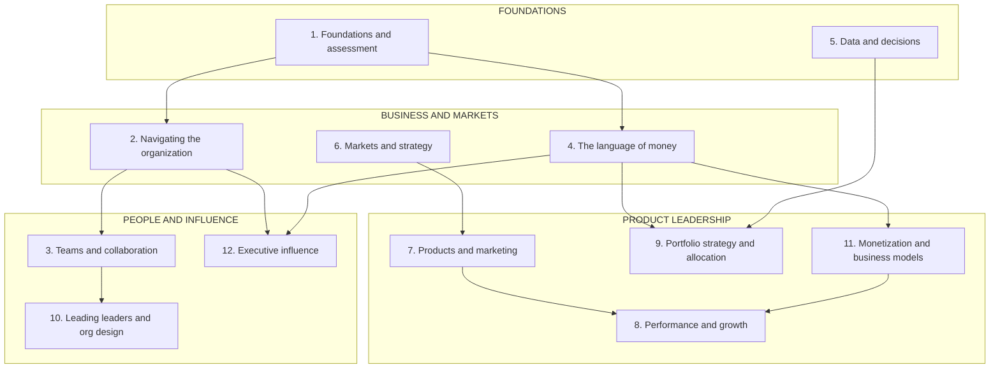

# Business acumen for the product leader

*A standalone module: money, markets, organizations and influence, for Group PMs, Heads of Product and VPs of Product.*

Product leaders are promoted for product judgement. Above Group PM level, they are judged on business results. The decisions change. You approve bets, set targets, design teams, set prices and argue for money at the executive table. Each of those decisions is made in the language of the business: cash, margin, risk, market position and organizational power.

This module teaches that language, and how to use it to decide. It is written for Group Product Managers, Heads of Product and VPs of Product. Every lesson ties its ideas to six domains: **FinTech, Payments, Lending, eCommerce, InsurTech and Retail**. The domain examples use public disclosures of real companies, such as their annual reports and company blogs. Each lesson's invented worked example is labelled as invented.

Start with the **<a href="assessment.html">interactive self-assessment</a>**. It scores you on the twelve lessons, draws a radar chart of your strengths, and builds a two-week improvement plan from your largest gaps.

**A note on scope.** This module covers business judgement. Neighbouring modules cover the craft. Metric trees and experiments live in [Technical product management](../technical-product-management/README.md). Infrastructure cost lives in [Technical product sense](../technical-product-sense/README.md). Payment and ledger systems live in [System design](../system-design/README.md). This module links to them and does not repeat them.

## Where the depth lives

| If you want the full depth on | Read |
| --- | --- |
| Metric trees, instrumentation and A/B tests | [Metrics and experimentation](../technical-product-management/metrics-and-experimentation.md) |
| Scoring frameworks and roadmaps at team level | [Prioritization and roadmaps](../technical-product-management/prioritization-and-roadmaps.md) |
| The cost of goods sold hidden in infrastructure | [The economics of infrastructure](../technical-product-sense/economics-of-infrastructure.md) |
| How payment systems, ledgers and wallets work | [Transactional and financial systems](../system-design/transactional-and-financial.md) |
| Domain expertise as product intuition | [Domain expertise](../product-sense/domain-expertise.md) |
| Artifacts and storytelling for influence | [Communication](../product-sense/communication.md) |
| Running a launch end to end | [Launches, rollouts and migrations](../technical-product-management/launches-rollouts-and-migrations.md) |
| Breadth and depth as a learning strategy | [Becoming a polymath](../first-principles/becoming-a-polymath.md) |

## The knowledge graph

Read it in four clusters. **Foundations:** diagnose yourself, and learn to decide under uncertainty. **Business and markets:** how the company makes money, how money is measured, and where to compete. **Product leadership:** what to build, how to price it, how to measure it, and how to fund a portfolio. **People and influence:** teams, leaders and the executive table. The same four clusters colour the self-assessment's radar chart.

## The lessons

1. [**Foundations: business acumen and the T-shaped leader**](./foundations-and-assessment.md) — breadth, domain depth and how to diagnose your gaps.
2. [**Navigating the organization**](./navigating-the-organization.md) — how the company makes money, formal and informal power, sponsors and conflict.
3. [**Teams and collaboration**](./teams-and-collaboration.md) — structures, operating rhythms and decision rights.
4. [**The language of money**](./the-language-of-money.md) — the three statements, margins, discounted cash flow and the business case.
5. [**Data and decisions**](./data-and-decisions.md) — deciding under uncertainty, the decision matrix and portfolio priorities.
6. [**Markets and strategy**](./markets-and-strategy.md) — segments, positioning, the five competitive forces, SWOT and the growth matrix.
7. [**Products and marketing**](./products-and-marketing.md) — the offer, make-buy-partner, go-to-market, the 4 Ps and intellectual property.
8. [**Performance and growth**](./performance-and-growth.md) — KPIs, the balanced scorecard and the metrics that move profit.
9. [**Portfolio strategy and allocation**](./portfolio-strategy-and-allocation.md) — near, next and future horizons, staged bets and sunsets.
10. [**Leading leaders and org design**](./leading-leaders-and-org-design.md) — managing managers, structures, spans and the system-mirrors-the-org principle.
11. [**Monetization and business models**](./monetization-and-business-models.md) — pricing, packaging, six business models and unit economics.
12. [**Executive influence**](./executive-influence-and-stakeholders.md) — narrative, the board, alignment and negotiation.

Each lesson has a **🎯 For the product leader** briefing, a labelled worked example, examples across the six domains, an "Under the hood" section with a formula or template, and a Sources list.

**📌 Close out the module:** [Recap & real-world examples](./recap.md), which ends with a self-test. Then re-take the <a href="assessment.html">self-assessment</a> to see what moved.
