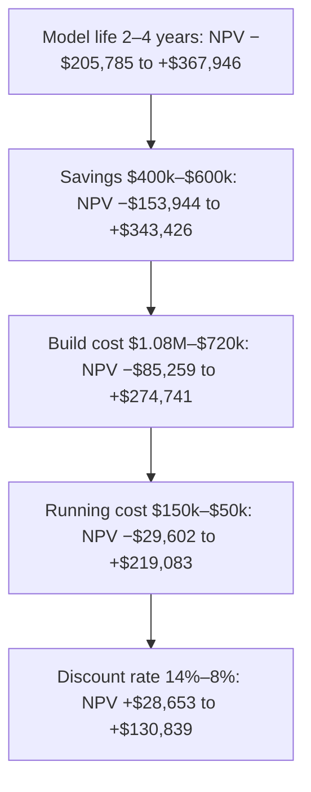

# Business cases, capital and valuation

*Part of [Business acumen for the product leader](./README.md)*

## TL;DR

A **business case** asks for money for one bet. It shows what the bet costs, what it returns, when, and how sure you are. Finance judges it with a few tools. **Net present value** (NPV) says whether the bet earns more than the company's cost of money. **Internal rate of return** (IRR) states the same bet as a yearly return. **Payback** says how long until you get the money back. A **sensitivity table** says which assumption the case rests on.

Behind those tools sit two bigger questions. Where does the money come from, and what does it cost? For a lender, a bank or an insurer, that question shapes the product itself. And how does the market value the company? A dollar of recurring gross profit can add many dollars to the company's value. A dollar of one-off revenue adds about a dollar.

The core tradeoff is precision against honesty. A single-number case looks confident and breaks at the first hard question. A case with a counterfactual, a range, a tornado and a staged plan looks less certain and wins more often. This lesson gives you the tools to build that second kind.

> 🎯 **For the product leader**
>
> **Why it matters** — Every serious bet is approved in the CFO's language. "This adds $2 million of gross profit a year, pays back in 18 months, and still works if adoption is 30% lower" gets funded. "Users love it" does not.
>
> **What it changes in your decisions** — You state the counterfactual before the benefit. You rank bets by NPV and use IRR to communicate. You find the one input that can flip the case, and you stage the bet to measure it first. In regulated domains, you count the cost of funding and capital as a product cost.
>
> **Ask your team** — *"Which single input, if it moved to the edge of its range, turns this case negative, and how do we measure it before we commit the full budget?"*
>
> **Risk if ignored** — A case built on volume that would have happened anyway, or on a discount rate Finance does not use. Finance finds the hole, and your credibility goes with it.

## Decision rules in this lesson

- Rank bets by NPV. Use IRR and payback to communicate, not to choose.
- Use the discount rate Finance gives you. Ask for a higher hurdle for riskier bets, not a lower one for your favourite.
- Every case states its counterfactual: what happens if we do nothing.
- Build a tornado before you build the product. Stage the bet to measure the top bar first.
- Report expected NPV across scenarios, not only the base case.
- In lending and insurance, count funding cost and capital as product costs.
- Value a bet by the durable gross profit it adds, not by the revenue it books.

## Mental model: a business case is a price for a stream of cash

Think of a bet as buying a rental flat. You pay a price today. You collect rent for some years. You would only pay up to the value of that rent, discounted at the return you could earn elsewhere. A riskier flat, in a weaker area, must offer a higher return to be worth the same price. If you are unsure of the rent, you would rent it out for a short trial before you buy.

A business case works the same way. The build cost is the price. The yearly net cash is the rent. The discount rate is the return you could earn elsewhere at that risk. NPV is the gap between what the rent is worth and what you pay. A pilot is the trial let.

**Where the analogy breaks.** A flat's rent is fairly stable and does not depend on you. A product bet's "rent" depends on execution, competitors and customer behaviour. It also has a life: a fraud model decays as fraudsters adapt. And a product bet has options a flat lacks. You can stage it, expand it or stop it. [Portfolio strategy and capital allocation](./portfolio-strategy-and-allocation.md) values those options.

## Mechanics

### Budgets, forecasts and business cases

Three documents get confused.

- A **budget** is the plan: what each team may spend and what it must deliver. It is set once a year and rarely changes.
- A **forecast** is the current best guess of where the year will land. It changes every month or quarter.
- A **business case** asks for money for one bet. It shows costs, benefits, timing, risks and NPV.

A business case that wins approval must then find room in the budget. [Navigating the organization](./navigating-the-organization.md) covers how an ask gets into the plan.

### Time value of money, present value and NPV

A dollar today is worth more than a dollar next year. You could invest today's dollar and earn a return. So future cash must be **discounted** to compare it with cash today.

- **Present value (PV)** of a future cash flow = cash ÷ (1 + r)^t, where r is the discount rate and t is years from now.
- **Net present value (NPV)** = the sum of the present values of all cash flows, minus the investment today. A positive NPV means the bet earns more than the discount rate.
- The **discount rate** is usually set by Finance. It reflects the company's cost of capital and the risk of the bet.

**How to compute it.** $400,000 received in three years, at 10%, is worth $400,000 ÷ 1.1³ = $300,526 today. The factor 1 ÷ 1.1³ = 0.7513 is the **discount factor**.

**Domain application.** In lending, the same maths prices a loan. A loan's value to the lender is the present value of its expected payments, net of expected losses, at the lender's cost of funds. In insurance, it values claims paid years after the premium.

**Decision rule.** When two bets compete for one budget, compare their NPVs at the same discount rate.

**The common misreading.** "The bet returns $1.2 million over three years against $900,000 of cost, so it makes $300,000." It makes less. Cash in year 3 is worth about three-quarters of cash today at 10%.

### Payback and discounted payback

**Payback period** is how long until cumulative cash returns equal the investment. It is simple, and boards under cash pressure like it.

It has two flaws. It ignores everything after payback. And simple payback ignores the time value of money. **Discounted payback** fixes the second flaw. It uses present values instead of raw cash.

**How to compute it.** A bet costs $900,000 and returns $400,000 a year.

- **Simple payback:** $900,000 ÷ $400,000 = 2.25 years.
- **Discounted payback at 10%:** present values are $363,636, $330,579 and $300,526. After two years the total is $694,215. The remaining $205,785 takes 205,785 ÷ 300,526 = 0.68 of year 3. Discounted payback is **2.68 years**.

**Decision rule.** Use payback as a constraint, not a goal. "NPV-positive and pays back inside 24 months" is a sound rule when cash is tight. "Shortest payback wins" kills long-lived bets.

**The common misreading.** "It pays back in 2.25 years, so it is a good bet." A bet can pay back and still have a negative NPV, if its life ends soon after.

### IRR and when it misleads

**Internal rate of return** (IRR) is the discount rate at which NPV is exactly zero. It answers: what yearly return does this bet earn? If IRR is above the hurdle rate, NPV is positive at that rate.

**How to compute it.** There is no closed formula. You search for the rate. A spreadsheet's IRR function does it. The code in Under the hood does it by bisection. For a bet that costs $900,000 and returns $400,000 a year for three years, IRR is about **15.9%**.

Executives like IRR because a percentage is easy to compare with a hurdle. It misleads in three ways.

1. **Scale blindness.** IRR ignores size. Take two one-year bets at a 10% cost of capital. A small one costs $100,000 and returns $140,000: IRR 40%, NPV $27,273. A large one costs $1 million and returns $1.2 million: IRR 20%, NPV $90,909. The small bet has the higher IRR. The large bet creates more than three times the value. If you can fund both, do both. If you must choose one, choose the large one.
2. **Multiple answers.** When cash flows change sign more than once, there can be two IRRs. Take a bet that costs 100, returns 230 next year, then needs 132 the year after. A wind-down or a clawback can look like this. NPV is zero at both 10% and 20%. "The IRR" has no single meaning.
3. **The reinvestment assumption.** IRR implicitly assumes each year's cash is reinvested at the IRR itself. A 40% IRR on a short bet assumes you can keep finding 40% bets. You usually cannot.

**Domain application.** In lending, the yield on a loan is an IRR. It is the rate that equates the loan amount with its payments. A loan's quoted rate looks like an IRR but ignores losses and funding cost. The lender's real return is far lower.

**Decision rule.** Rank by NPV, communicate with IRR. Quote IRR next to NPV, never alone.

**The common misreading.** "Bet A has a higher IRR, so it is better." It may be smaller, shorter or riskier. Check NPV.

### Cost of capital and hurdle rates

The **cost of capital** is the return the company's investors expect. It is the company's cost of money. A bet that earns less than this destroys value, even if it is profitable on paper.

**How it works.** A company is funded by equity and debt. The **weighted average cost of capital** (WACC) blends their costs by their shares.

**WACC = (equity share × cost of equity) + (debt share × cost of debt × (1 − tax rate))**

Debt is cheaper, because lenders are paid first and interest is usually tax-deductible. Equity is dearer, because shareholders are paid last and bear the most risk. The cost of equity is usually estimated as a risk-free interest rate plus a premium for the risk of the company's shares.

**How to compute it.** An illustrative company is 70% equity at 12% and 30% debt at 7%, with a 25% tax rate. All inputs assumed.

- Equity part: 0.70 × 12% = 8.40%.
- Debt part: 0.30 × 7% × (1 − 0.25) = 1.575%.
- WACC = **9.97%**, so about 10%.

A **hurdle rate** is the minimum return Finance requires for a bet. It starts from WACC. Finance often adds a premium for riskier bets. One common pattern, with illustrative numbers:

| Bet type | Illustrative hurdle |
| --- | --- |
| Cost saving or improvement in the core business | WACC, about 10% |
| New product in an existing market | WACC plus 3 to 5 points |
| New market or new business model | WACC plus 10 points or more |

**Who sets the rate.** Finance or Treasury sets it. You do not pick it. Ask for it before you build the case.

**Domain application.** An unprofitable fintech funded by venture equity has a high cost of capital. Its investors expect venture-level returns. A profitable bank funded by deposits has a much lower one. The same product bet can be worth building at the bank and not at the fintech.

**Decision rule.** Use one risk adjustment, not two. If your cash flows are already probability-weighted, a large risk premium on the rate counts the same risk twice.

**The common misreading.** "Our money is free. It is already in the bank." Cash on the balance sheet belongs to the shareholders. It has an opportunity cost: the return they could earn elsewhere.

### Funding and capital in regulated businesses

In most software businesses, funding is a company-level question. In lending, banking and insurance, it is a product question. The cost of money and the capital a regulator demands set the product's economics.

#### How lenders fund loans

A lender must find the cash it lends. It has four main sources. Most lenders use more than one.

| Source | How it works | Cost and risk |
| --- | --- | --- |
| **Deposits** | A bank lends out customers' deposits. This needs a bank charter. | Usually the cheapest source. Deposit rates lag market rates. Deposits can leave fast in a panic. |
| **Warehouse facility** | A bank lends against a pool of the lender's loans. It advances only part of each loan's value, often 80% to 90%. The lender funds the rest with its own equity. | Floating rate. The facility has rules on loan quality. If losses rise past a trigger, the bank can stop funding. |
| **Forward flow** | An investor commits to buy loans that meet set criteria, at an agreed price, over a set period. The lender keeps a fee and often keeps servicing. | Moves loans off the balance sheet. The buyer can reprice or walk away when the agreement ends. |
| **Securitization** | The lender sells a pool of loans to a trust. The trust issues bonds in layers, called tranches. Senior tranches are paid first and cost least. The lender usually keeps the riskiest layer. | Cheap at scale. Needs a track record and good markets. US rules generally require the sponsor to keep at least 5% of the credit risk. |

**How cost of funds sets the lending P&L.** Take the $10,000, 36-month loan from [unit economics](./unit-economics.md). Its average balance over three years is about $5,583. (Illustrative; all inputs assumed.)

- Funded by deposits at 3%: funding cost ≈ $5,583 × 3 × 3% = **$502**.
- Funded by a warehouse at 6%: funding cost ≈ $5,583 × 3 × 6% = **$1,005**.

The difference is about $500 per loan. That is a large share of the loan's whole contribution. It is why fintech lenders seek bank charters or bank partners. And it is why a lender's margin moves with market rates. When US rates rose in 2022 and 2023, lenders that relied on capital markets paid more for funding. Loan buyers also demanded higher returns. [The language of money](./the-language-of-money.md#the-balance-sheet) shows one lender's response to that squeeze.

**Decision rule.** In a lending case, price the loan off the marginal cost of the funding source that will actually fund it. Do not use the average cost of funds if growth will come from the most expensive source.

#### Bank capital in plain words

**Capital** is the owners' money that absorbs losses before depositors and creditors lose anything. It is the cushion. Regulators set minimum amounts of capital relative to **risk-weighted assets**. A riskier asset gets a higher weight, so it needs more capital. Most countries base their rules on the international Basel framework, with local changes.

**Why a product leader cares.** Every loan a bank makes uses some of its capital. Capital is expensive equity. So a loan product must earn a return on the capital it uses, not only a margin on the loan.

**How to compute it.** Assume a $10,000 loan with a 100% risk weight, a 10% capital target and a 12% cost of equity. All illustrative. The loan uses $10,000 × 100% × 10% = **$1,000** of capital. Holding that capital costs about $1,000 × 12% = **$120 a year**.

**Decision rule.** In a bank, compare products on return on the capital they use, not on margin alone. A thin-margin, low-risk product can beat a fat-margin, high-risk one.

**The common misreading.** "Capital is cash in a vault." Capital is a source of funding: the owners' stake. It sits on the other side of the balance sheet from the loans.

#### Insurer capital and reinsurance

Insurers must also hold capital against the risk they write. Regulators set risk-based capital requirements. Rating agencies add their own views. The more premium an insurer writes on its own account, the more capital it needs.

**Reinsurance** is insurance for insurers. The insurer (the **cedant**) passes part of its risk to a reinsurer. There are two main forms.

- **Quota share.** The insurer cedes a fixed share of every policy's premium and losses, say 50%. The reinsurer pays a **ceding commission** back, to cover part of the insurer's acquisition and admin costs. Quota share cuts the capital the insurer needs roughly in proportion. It also gives away that share of the profit.
- **Excess of loss.** The reinsurer pays losses above a set **retention**, up to a limit. For example, it pays storm losses between $1 million and $10 million per event. The insurer pays a premium for this cover. Excess of loss protects against a single large event. It does little for capital needs on ordinary claims.

**How to compute it.** An insurer writes $10 million of premium. Losses are 60% of premium. Expenses are 32%. Capital needed is half of net premium. A 50% quota share pays a 30% ceding commission. All inputs illustrative.

| | No reinsurance | 50% quota share |
| --- | --- | --- |
| Net premium kept | $10.0M | $5.0M |
| Net losses | $6.0M | $3.0M |
| Expenses (insurer pays all) | $3.2M | $3.2M |
| Ceding commission received | $0 | $1.5M |
| **Underwriting profit** | **$0.8M** | **$0.3M** |
| Capital needed | $5.0M | $2.5M |
| Return on capital | 16% | 12% |

The quota share gives up $0.5 million of profit to free $2.5 million of capital. That is like renting capital at 0.5 ÷ 2.5 = **20%** a year.

**Decision rule.** Buy quota share when your own capital costs more than its implied cost, as it often does for a young insurer. Buy excess of loss to survive the large event. Do not use quota share to make a loss-making book look smaller.

**The common misreading.** "Reinsurance is a cost line." It is a funding choice. It trades margin for capital and for protection from volatility.

### Incrementality and the counterfactual

A business case is only as good as its counterfactual. The **counterfactual** is what would happen if you did nothing. **Incrementality** is the difference between the world with your bet and the world without it.

**How it goes wrong.** Four effects distort the gap.

- **Baseline drift.** The metric was rising anyway, from seasonality, price or market growth. A before-and-after comparison credits the bet with the drift.
- **Cannibalization.** The bet shifts activity from another product you own. The new product's volume looks large. The company's total barely moves.
- **Halo.** The bet lifts other products, too. A narrow measure misses this gain.
- **The declining do-nothing case.** The baseline is not flat. Without the bet, things get worse: fraud grows, a competitor takes share, a partner leaves. Ignoring this understates the bet.

**How to compute it.** An eCommerce company adds a buy now, pay later (BNPL) option at checkout. In the first year, 50,000 orders of $200 use it: **$10 million** of BNPL sales. The launch deck claims $10 million of new sales. A holdout test shows only 15% of those orders were truly new. The rest would have paid by card. (Illustrative; all inputs assumed: 30% gross margin, BNPL fee 6%, card fee 2.5%.)

- New sales: 15% × $10 million = $1.5 million. Margin after the BNPL fee: $1.5 million × (30% − 6%) = **$360,000**.
- Shifted sales: $8.5 million now pay a 6% fee instead of 2.5%. Extra cost: $8.5 million × 3.5% = **$297,500**.
- **Net gain: $62,500 a year.** Not $10 million of sales. Not even $3 million of margin.

**How to measure it.** The best tool is a randomized holdout: a group that does not get the feature. [Metrics and experimentation](../technical-product-management/metrics-and-experimentation.md) covers test design. When a holdout is impossible, use a matched comparison group or a staggered rollout, and state the weakness.

**Domain application.** Payments: a new routing rule lifts authorization rates during a holiday peak, when rates rise anyway. Lending: a pre-approved offer "converts" customers who would have applied anyway. Insurance: a bundle discount mainly reaches customers who would have bought both policies.

**Decision rule.** Every case states its counterfactual. If it cannot, it is not a case yet.

**The common misreading.** "The feature drove $10 million of sales." It touched $10 million of sales. It drove only the incremental part.

### Scenarios, sensitivity and the tornado

A single-number case hides its risk. Three tools expose it. Use them in this order.

1. **One-at-a-time sensitivity.** Move one input to the low and high end of its plausible range. Keep the others at base. Record NPV at each end.
2. **Tornado.** Draw one bar per input, from its low NPV to its high NPV. Sort the bars with the widest on top. The chart looks like a funnel cloud, hence the name. The top bar is the input your case depends on most.
3. **Scenarios with probabilities.** Build a bear, base and bull case. Each changes several inputs together, as they would move in reality. Give each a probability. **Expected NPV** = the probability-weighted sum.

The tornado tells you what to measure first. The scenarios tell you whether the bet is worth it on average. Expected NPV can be positive while the bear case is negative. That is normal. The question is whether you can afford the bear case, and whether a pilot can rule it out cheaply.

**Decision rule.** Stage the bet so the first stage measures the top bar of the tornado.

**The common misreading.** "The base case is the most likely outcome, so it is enough." The base case is one point. Losses in the bear case are often larger than gains in the bull case.

### How the company is valued

Your bets add up to the company's value. Knowing how investors value the company tells you which bets they reward.

**Enterprise value and equity value.** **Equity value** is what the shares are worth: for a listed company, its market capitalization. **Enterprise value** (EV) is the value of the whole operating business, to all funders. EV = equity value + debt − cash. Example: market capitalization $8 billion, debt $1 billion, cash $2 billion. EV = **$7 billion**. (Illustrative.)

**Multiples.** Investors often value a company as a multiple of one metric.

- **EV ÷ revenue** for companies with little profit yet.
- **EV ÷ gross profit** when revenue is reported gross and margins differ widely, as in payments and marketplaces.
- **EV ÷ EBITDA** for mature, profitable companies. EBITDA is earnings before interest, taxes, depreciation and amortization.
- **Price ÷ earnings** for profitable companies.
- **Price ÷ book value** for banks and insurers, whose balance sheet is the business. A bank that earns a high return on equity trades above its book value.

Multiples change with interest rates and market mood. They can halve in a year. Use any multiple only as an illustration.

**Why recurring gross profit is worth more.** A multiple is a shortcut for discounting future profit. At a 10% discount rate:

- **$1 of gross profit that recurs and grows 3% a year** is worth about $1 ÷ (10% − 3%) = **$14.29** today.
- **$1 of gross profit that recurs but shrinks 10% a year** is worth about $1 ÷ (10% + 10%) = **$5.00**.
- **$1 of one-off gross profit** is worth **$1.00**.

These are simple growing-perpetuity values. They ignore operating costs and tax. The direction is what matters. Durability and growth drive the multiple. That is why investors pay more for subscription and transaction revenue than for one-off sales. It is also why they ask about retention.

**What investors watch, by domain.**

| Domain | What investors watch |
| --- | --- |
| Payments | Volume growth, net take rate, transaction or gross profit growth, merchant retention |
| Lending | Origination growth, revenue after losses and funding, credit performance by vintage, funding cost and access |
| Banking | Return on equity, net interest margin, deposit growth and cost, capital ratios |
| Insurance | Premium growth, combined ratio, reserve adequacy, book value growth |
| eCommerce and marketplaces | GMV, take rate, contribution margin per order, free cash flow |
| Retail | Comparable sales, gross margin, inventory turns, free cash flow |
| Software | Revenue growth, net revenue retention, gross margin, and a heuristic that growth rate plus profit margin should reach about 40% |

**A bet's implied value.** You can translate a bet into company value. Suppose a bet adds $2 million of recurring gross profit a year. Suppose the company trades at an assumed 8 times gross profit. The implied value is about **$16 million**. Use this to explain why a bet matters to the CEO. Do not put it in the business case as the bet's return. The multiple belongs to the market, and the market applies it only to profit it believes will last.

**Decision rule.** Prefer bets that add durable, recurring gross profit over bets that add one-off revenue of the same size.

**The common misreading.** "We doubled revenue, so we doubled the company's value." If the new revenue has thin margins, low retention or is reported gross, the market may value it at a fraction of the core.

## Worked example: a business case for a fraud model

*This example is invented, to show the method. The company and all numbers are illustrative.*

A payments company wants a new fraud model. It costs $900,000 to build (year 0). It costs $100,000 a year to run. The team estimates it saves $500,000 a year in fraud losses and dispute costs. Finance sets a 10% discount rate. The model's life is three years.

**Step 1: net cash per year.** Savings $500,000 − running cost $100,000 = $400,000 a year.

**Step 2: discount each year.**

| Year | Net cash | Discount factor 1 ÷ 1.1^t | Present value |
| --- | --- | --- | --- |
| 1 | $400,000 | 0.9091 | $363,636 |
| 2 | $400,000 | 0.8264 | $330,579 |
| 3 | $400,000 | 0.7513 | $300,526 |
| **Total** | | **2.4869** | **$994,741** |

**Step 3: NPV.** $994,741 − $900,000 = **$94,741**. The case is positive.

**Step 4: payback.** $900,000 ÷ $400,000 = 2.25 years, undiscounted.

**Step 5: sensitivity.** Suppose savings are 20% lower: $400,000 a year. Net cash falls to $300,000. PV = $300,000 × 2.4869 = $746,056. NPV = **−$153,944**. The case flips.

**Step 6: find the break-even.** NPV is zero when net cash × 2.4869 = $900,000. That is net cash of about $361,900, or savings of about $461,900. The case survives only if savings are within about 7.6% of the estimate.

**What the leader does with this.** The case is thin. She proposes a pilot on one merchant segment for one quarter to measure real savings before the full build. That turns a fragile bet into a staged one. See real options in [portfolio strategy and capital allocation](./portfolio-strategy-and-allocation.md).

### Extending the case: IRR, scenarios and a tornado

The steps below extend the same example. All new inputs are assumed.

**Step 7: IRR.** The rate at which $400,000 a year for three years is worth exactly $900,000 is about **15.9%**. It clears the 10% hurdle by about 6 points. Discounted payback is **2.68 years**, against a three-year life. That is a thin margin of safety.

**Step 8: the tornado.** Move each input across an assumed range, one at a time.



| Input | Range (bad to good) | NPV at bad end | NPV at good end | Swing |
| --- | --- | --- | --- | --- |
| Model life | 2 to 4 years | −$205,785 | $367,946 | $573,731 |
| Annual savings | $400,000 to $600,000 | −$153,944 | $343,426 | $497,370 |
| Build cost | $1,080,000 to $720,000 | −$85,259 | $274,741 | $360,000 |
| Running cost | $150,000 to $50,000 | −$29,602 | $219,083 | $248,685 |
| Discount rate | 14% to 8% | $28,653 | $130,839 | $102,186 |

Two lessons jump out. First, the model's life matters more than the savings. Fraudsters adapt, so a model that decays in two years loses money. The team had not discussed life at all. Second, the discount rate matters least. The debate the team expected, over 10% or 12%, does not change the answer.

**Step 9: scenarios.** Savings is the input the team is least sure of. Three assumed scenarios:

| Scenario | Probability | Annual savings | NPV |
| --- | --- | --- | --- |
| Bear | 25% | $350,000 | −$278,287 |
| Base | 50% | $500,000 | $94,741 |
| Bull | 25% | $600,000 | $343,426 |
| **Expected** | | | **$63,655** |

Expected NPV is positive but lower than the base case. The bear case loses more than the bull case gains over base.

**Step 10: value the pilot.** Suppose a one-quarter pilot costs $50,000 and reveals whether savings are in the bear range. The team builds only if they are not. Expected NPV becomes 50% × $94,741 + 25% × $343,426 + 25% × $0 − $50,000 = **$83,227**. This ignores the one-quarter delay. The pilot is worth up to about $19,600 more than building blind. That is the value of the information it buys. [Data and decisions](./data-and-decisions.md) covers how to value information more generally.

**Step 11: check the counterfactual.** The base case assumes fraud losses stay flat without the model. Suppose instead fraud would grow 10% a year. Savings become $500,000, $550,000 and $605,000. NPV rises to **$214,951**. This is a fair point to make. It is also the easiest way to inflate a case. Show the fraud trend data, or leave it out.

**What the leader does now.** She asks for a pilot that measures two things: savings per month, and how fast the model's precision decays. She commits the full build only if the pilot rules out the bear case and shows a life of at least three years. She shows Finance the tornado, so the debate is about life and savings, not the discount rate.

## Tradeoffs and decisions

- **NPV vs. payback.** NPV values the whole life of a bet. Payback rewards fast returns. A board under cash pressure may prefer payback. The cost is passing on long-lived bets.
- **NPV vs. IRR.** IRR is easy to compare with a hurdle. It favours small, fast bets. The cost of ranking by IRR is choosing bets that create less value.
- **Staging vs. speed.** A pilot buys information and lowers risk. It costs time, and a competitor may move first. Stage when the top tornado bar can flip the case. Skip the pilot when being late costs more than being wrong.
- **Cheap funding vs. control.** Forward flow and securitization fund growth without the lender's balance sheet. You give up margin, and the buyer can walk away at renewal. Deposits are cheap. They need a charter and the regulation that comes with it.
- **Capital relief vs. margin.** Quota-share reinsurance lets an insurer grow with less capital. It gives away a share of profit on every policy.
- **Precision vs. honesty.** A case with one precise number looks confident. A case with a range, a tornado and scenarios is more honest and easier to trust.

## Failure modes

- **The single-number case.** No sensitivity. The first question about an assumption sinks it.
- **The missing counterfactual.** A team claims all volume that touched the feature. A holdout later shows a fraction was new. Every later case from that team is discounted.
- **Wrong discount rate.** The team picks a low rate to make NPV positive. Finance uses its own rate, and the case fails.
- **IRR theatre.** A team ranks bets by IRR. A small bet with a 60% IRR beats a large one with a 20% IRR and five times the NPV.
- **Funding mismatch.** A lending product is priced on the average cost of funds. Growth comes from an expensive warehouse line. Margins fall as volume rises.
- **Funding cliff.** A forward-flow agreement ends during a market shock. The buyer does not renew. The lender must cut originations or fund loans on its own balance sheet.
- **The inflated do-nothing case.** A team assumes the business collapses without its bet. Finance asks for the trend data, and there is none.
- **Valuation in the case.** A team adds "implied company value" to its NPV. Finance strikes it out, and the team looks naive.

## Under the hood

The code below reproduces every number in this lesson. Run it with any Python 3.

```python
# Worked example K and the other numbers in this lesson (illustrative, all inputs assumed).

def npv(rate, cash_flows, invest):
    """Present value of yearly cash flows (years 1..n) minus the investment today."""
    return sum(cf / (1 + rate) ** t for t, cf in enumerate(cash_flows, start=1)) - invest

def irr(cash_flows, invest, lo=-0.99, hi=1.0):
    """The rate at which NPV is zero, found by bisection."""
    for _ in range(100):
        mid = (lo + hi) / 2
        lo, hi = (mid, hi) if npv(mid, cash_flows, invest) > 0 else (lo, mid)
    return mid

def discounted_payback(rate, cash_flows, invest):
    cum = 0
    for t, cf in enumerate(cash_flows, start=1):
        pv = cf / (1 + rate) ** t
        if cum + pv >= invest:
            return t - 1 + (invest - cum) / pv
        cum += pv
    return None

BASE = dict(savings=500_000, run_cost=100_000, build=900_000, rate=0.10, life=3)

def case_npv(savings, run_cost, build, rate, life):
    return npv(rate, [savings - run_cost] * life, build)

flows = [400_000] * 3
print(f"Base NPV ${case_npv(**BASE):,.0f}; IRR {irr(flows, 900_000):.1%}; "
      f"discounted payback {discounted_payback(0.10, flows, 900_000):.2f} years")

# 1. Three scenarios with probabilities (savings is the uncertain input)
scenarios = {"bear": (0.25, 350_000), "base": (0.50, 500_000), "bull": (0.25, 600_000)}
expected = 0
for name, (p, s) in scenarios.items():
    v = case_npv(**{**BASE, "savings": s})
    expected += p * v
    print(f"{name:5s} p={p:.2f} savings ${s:,} NPV ${v:,.0f}")
print(f"Expected NPV ${expected:,.0f}")

# 2. A pilot (cost $50,000) that reveals the bear case before the build. Ignores the delay.
with_pilot = sum(p * max(case_npv(**{**BASE, "savings": s}), 0)
                 for p, s in scenarios.values()) - 50_000
print(f"Expected NPV with pilot ${with_pilot:,.0f}")

# 3. Tornado: move one input at a time across its range, sort by swing
ranges = {"savings": (400_000, 600_000), "build": (1_080_000, 720_000),
          "life": (2, 4), "run_cost": (150_000, 50_000), "rate": (0.14, 0.08)}
rows = sorted(((abs(case_npv(**{**BASE, k: hi}) - case_npv(**{**BASE, k: lo})), k,
                case_npv(**{**BASE, k: lo}), case_npv(**{**BASE, k: hi}))
               for k, (lo, hi) in ranges.items()), reverse=True)
for width, k, a, b in rows:
    print(f"tornado {k:9s} ${a:>10,.0f} to ${b:>10,.0f}  swing ${width:,.0f}")

# 4. A declining do-nothing case: fraud losses grow 10% a year without the model
grow = [500_000 * 1.1 ** t - 100_000 for t in range(3)]
print(f"NPV against a growing-fraud baseline ${npv(0.10, grow, 900_000):,.0f}")

# 5. IRR traps: two one-year bets at a 10% cost of capital
for name, invest, back in (("small", 100_000, 140_000), ("large", 1_000_000, 1_200_000)):
    print(f"{name}: IRR {irr([back], invest):.0%}, NPV ${npv(0.10, [back], invest):,.0f}")
mixed = [230, -132]   # invest 100, get 230, then pay 132: two IRRs
print("NPV of mixed flows at 10% and 20%:", round(npv(0.10, mixed, 100), 6), round(npv(0.20, mixed, 100), 6))

# 6. Cost of capital
wacc = 0.70 * 0.12 + 0.30 * 0.07 * (1 - 0.25)
print(f"WACC {wacc:.2%}")

# 7. Incrementality: buy now, pay later at checkout
gmv = 50_000 * 200
incremental, shifted = gmv * 0.15, gmv * 0.85
gain = incremental * (0.30 - 0.06)              # margin minus BNPL fee on new orders
cannibal = shifted * (0.06 - 0.025)             # higher fee on orders that would have used cards
print(f"GMV ${gmv:,.0f}; incremental margin ${gain:,.0f}; extra fees ${cannibal:,.0f}; net ${gain - cannibal:,.0f}")

# 8. Funding: cost of funds on a $10,000, 36-month loan (average balance $5,583)
for label, r in (("deposits 3%", 0.03), ("warehouse 6%", 0.06)):
    print(f"funding via {label}: ${5_583 * 3 * r:,.0f}")

# 9. Quota-share reinsurance on $10M of premium (loss ratio 60%, expenses 32%)
def underwrite(premium, cede=0.0, commission=0.30, loss=0.60, expense=0.32, capital_per_net=0.5):
    net = premium * (1 - cede)
    profit = net - premium * loss * (1 - cede) - premium * expense + premium * cede * commission
    capital = net * capital_per_net
    return profit, capital
p0, c0 = underwrite(10e6)
p1, c1 = underwrite(10e6, cede=0.5)
print(f"no reinsurance: profit ${p0/1e6:.1f}M on capital ${c0/1e6:.1f}M ({p0/c0:.0%})")
print(f"50% quota share: profit ${p1/1e6:.1f}M on capital ${c1/1e6:.1f}M ({p1/c1:.0%})")
print(f"implied cost of the capital released: {(p0 - p1) / (c0 - c1):.0%}")

# 10. Valuation: what $1 of gross profit a year is worth at a 10% discount rate
print(f"$1 growing 3%: ${1 / (0.10 - 0.03):.2f}; $1 decaying 10%: ${1 / (0.10 + 0.10):.2f}; one-off: $1.00")
```

Output:

```text
Base NPV $94,741; IRR 15.9%; discounted payback 2.68 years
bear  p=0.25 savings $350,000 NPV $-278,287
base  p=0.50 savings $500,000 NPV $94,741
bull  p=0.25 savings $600,000 NPV $343,426
Expected NPV $63,655
Expected NPV with pilot $83,227
tornado life      $  -205,785 to $   367,946  swing $573,731
tornado savings   $  -153,944 to $   343,426  swing $497,370
tornado build     $   -85,259 to $   274,741  swing $360,000
tornado run_cost  $   -29,602 to $   219,083  swing $248,685
tornado rate      $    28,653 to $   130,839  swing $102,186
NPV against a growing-fraud baseline $214,951
small: IRR 40%, NPV $27,273
large: IRR 20%, NPV $90,909
NPV of mixed flows at 10% and 20%: -0.0 0.0
WACC 9.97%
GMV $10,000,000; incremental margin $360,000; extra fees $297,500; net $62,500
funding via deposits 3%: $502
funding via warehouse 6%: $1,005
no reinsurance: profit $0.8M on capital $5.0M (16%)
50% quota share: profit $0.3M on capital $2.5M (12%)
implied cost of the capital released: 20%
$1 growing 3%: $14.29; $1 decaying 10%: $5.00; one-off: $1.00
```

## Practitioner checklist

- [ ] Ask Finance for the discount rate and the hurdle for this type of bet before you build the case.
- [ ] Write the counterfactual in one sentence at the top of the case.
- [ ] Show NPV, IRR, simple and discounted payback side by side.
- [ ] Build a tornado. Name the top bar, and say how the first stage will measure it.
- [ ] Show bear, base and bull scenarios with probabilities, and the expected NPV.
- [ ] For a lending product, name the funding source for the next dollar of loans and its cost.
- [ ] For a bank product, state the capital it uses and the return on that capital.
- [ ] For an insurance product, state the reinsurance structure and what it costs in margin.
- [ ] State whether the bet adds recurring or one-off gross profit.

## Related lessons

- [The language of money](./the-language-of-money.md) — the three statements, working capital and free cash flow.
- [Unit economics](./unit-economics.md) — the per-loan, per-policy and per-transaction numbers these cases rest on.
- [Data and decisions](./data-and-decisions.md) — value of information and forecasting with ranges.
- [Portfolio strategy and capital allocation](./portfolio-strategy-and-allocation.md) — staged bets, real options and hurdle rates by horizon.
- [Metrics and experimentation](../technical-product-management/metrics-and-experimentation.md) — holdouts and test design for measuring incrementality.
- [Prioritization and roadmaps](../technical-product-management/prioritization-and-roadmaps.md) — scoring bets at team level.
- [Transactional and financial systems](../system-design/transactional-and-financial.md) — the ledgers that record funding, settlement and reserves.
