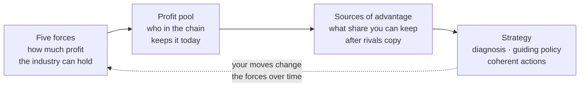
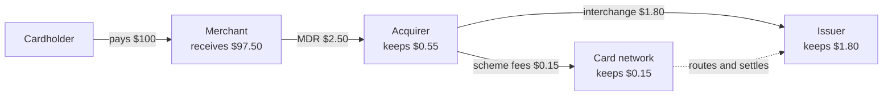
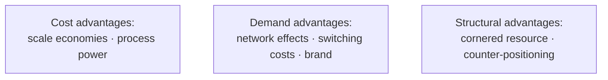
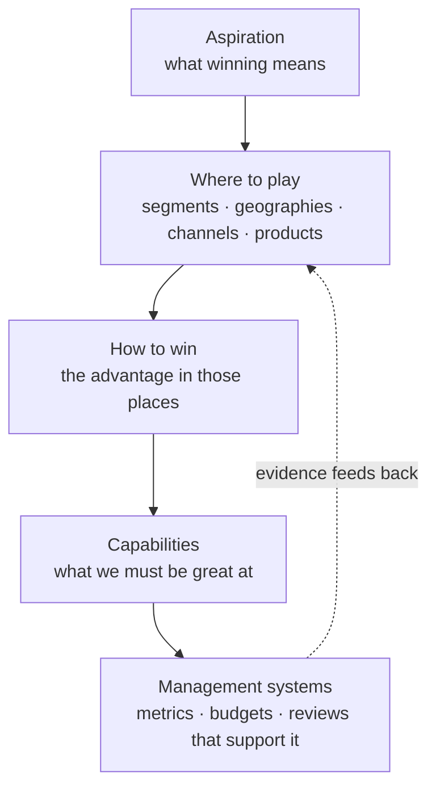

# Competitive advantage and strategy

*Part of [Business acumen for the product leader](./README.md)*

## TL;DR

Some markets leave profit on the table. Others grind every player down to thin margins. The difference is structure, and you can analyse it. This lesson gives you four tools, used in order.

First, the **five competitive forces** tell you how much profit the industry can hold, and which force caps it. Second, the **value chain and profit pool** show who in the chain keeps that profit today. Third, the **seven sources of advantage** tell you whether *you* can keep a share of it once rivals copy you. Fourth, a **strategy** turns all of this into a short set of choices: a diagnosis, a guiding policy, and actions that fit together.

The core tradeoff is focus against optionality. A real advantage comes from committing to a position and refusing the work that does not fit. That refusal costs you revenue you could have had. Without it, you have a list of goals, not a strategy.

The scale matters. In payments, lending and insurance, many products look the same to the customer. A small, durable edge in cost of funds, switching costs or claims handling decides who earns a return and who does not.

> 🎯 **For the product leader**
>
> **Why it matters** — Your roadmap spends capital to build a position. If the position has no barrier, rivals copy it and the margin goes to customers or suppliers. You did the work, and someone else kept the value.
>
> **What it changes in your decisions** — You name the force that caps profit before you size a feature. You state which source of advantage each big bet builds, and the evidence that it is working. You write down what the team will not do this year.
>
> **Ask your team** — *"If our best-funded rival copied this in six months, why would a customer still stay with us? Where would we see that in our data?"*
>
> **Risk if ignored** — Growth without margin. Volume rises while net take rate, spread or underwriting margin falls, because buyers or suppliers hold the power and nothing stops a rival from matching you.

## Decision rules in this lesson

- **Before you enter a market, find the binding force.** Name the one force that caps profit, and the move that would shift it.
- **Follow the margin, not the revenue.** Map the profit pool. The player with the most revenue is often not the one with the most profit.
- **Claim an advantage only with a benefit and a barrier.** You need a lower cost or a higher price, *and* a reason a rival cannot copy it.
- **Prove a network effect with density data.** If value or retention does not rise with network density in your own data, call it scale.
- **Measure switching costs in dollars and weeks.** Compare them with the saving a rival offers. If the saving is bigger, you have no lock-in.
- **A strategy must say what you will not do.** If it excludes nothing, it is a list of goals.
- **Respond to a low-end entrant with a separate unit** when copying the entrant would damage your core business.

## Mental model: the pool, your share, your choices



Think of an industry as a lake of profit. The five forces decide how big the lake is. The value chain decides who has a bucket in it. Your advantage decides how big your bucket is, and whether others can take it. Strategy is the set of choices that grows and protects your bucket.

**Where the model breaks.** The lake is not fixed. A new technology or a new rule can drain it or fill it in a year. A real-time payment scheme, an interchange cap, or a new licence type changes the forces. So run the analysis again when the rules change, not once.

## Mechanics

### The five competitive forces, run as a method

The five forces describe the pressure on profit in an industry. **Rivalry** is how hard current players fight. **Buyer power** is how much customers can push prices down. **Supplier power** is how much your inputs can push costs up. The **threat of new entrants** caps prices, because high profits attract newcomers. The **threat of substitutes** caps prices too, because customers can solve the need another way.

The stronger the forces, the less profit any player keeps. A list of the forces is not an analysis. Run them as a method, in five steps.

**Step 1. Draw the industry boundary.** An industry is a product, a geography and a customer type. "Payments" is not an industry. "Card acquiring for small US restaurants" is. Draw the boundary too wide, and you average away the forces that matter. Draw it too narrow, and you miss the substitutes. A good test: would a customer in this boundary consider the same set of rivals?

**Step 2. List each force's drivers.** Each force has known drivers. Write evidence for each one, not an opinion.

| Force | Drivers to check | What makes the force strong |
| --- | --- | --- |
| **Buyer power** | Buyer concentration, the price as a share of the buyer's costs, switching costs, price transparency, the buyer's ability to build it in-house | Few large buyers, a visible cost line, easy comparison, cheap switching |
| **Supplier power** | Supplier concentration, unique inputs, your cost to switch suppliers, the supplier's option to sell direct | One or two suppliers of a critical input, such as a card network, a sponsor bank or a reinsurer |
| **New entrants** | Scale needed to compete, capital, licences, access to distribution, network effects, expected retaliation | Low licence and capital needs, rented infrastructure, no network effects |
| **Substitutes** | The price and performance of other ways to meet the need, and the buyer's cost to switch to them | A substitute that is cheaper and good enough, such as an account-to-account payment |
| **Rivalry** | Number and balance of rivals, industry growth, fixed costs, exit barriers, how alike the products are | Many equal rivals, slow growth, high fixed costs, identical products |

**Step 3. Quantify where you can.** Numbers turn a debate into a decision. Five measures cover most of it:

- **Concentration.** Compute the Herfindahl–Hirschman Index (HHI): the sum of each player's squared market share in percent. Four acquirers with 30%, 25%, 20% and 15%, plus ten with 1% each, give 900 + 625 + 400 + 225 + 10 = **2,160**. A higher number means fewer, larger players. A higher number usually means calmer rivalry.
- **Price trend.** Track the net price over three years: net take rate, loan spread, or premium per unit of risk. A falling net price with flat costs means a force is taking your margin.
- **Supplier share.** Divide what you pay key suppliers by your gross revenue. In the card example below, the issuer and network keep $1.95 of a $2.50 merchant fee. That is **78%**.
- **Switching cost.** Estimate the customer's cost to switch in dollars and weeks. Compare it with the saving a rival offers.
- **Entry cost.** Estimate the months and capital a newcomer needs: licences, integrations, a minimum book of business.

**Step 4. Find the binding force.** One or two forces usually cap profit. The others matter less right now. To find the binding force, follow the margin. Ask where the value you created over the last three years went. If your net price fell while your customers' prices did not, buyers took it. If supplier fees rose, suppliers took it. If prices fell as new names appeared, entrants and rivalry took it.

**Step 5. Name the move that shifts it.** Each force has typical counter-moves.

| Binding force | Moves that can shift it | What the move costs |
| --- | --- | --- |
| Buyer power | Raise switching costs through integration; target less price-sensitive segments; bundle | Integration work; a smaller target segment |
| Supplier power | Add a second supplier; integrate backward; route volume to cheaper options where rules allow | A second integration; capital; lower volume discounts |
| New entrants | Build scale or network effects; secure licences early | Capital and time before revenue |
| Substitutes | Offer the substitute yourself, or bundle against it | It may cannibalize your own product |
| Rivalry | Differentiate; specialize in a segment; avoid price wars | Revenue from the segments you leave |

**Common misreading 1: growth means attractive.** A fast-growing market can still be unprofitable. Many equal rivals can chase the growth with price cuts.

**Common misreading 2: add up five scores.** A total of five scores hides the one force that matters. One very strong force can cap profit on its own, even if the other four are weak. Name the binding force. Do not average it away.

**Common misreading 3: regulation is a sixth force.** Regulation is not a force. It changes the forces. An interchange cap moves profit from issuers to merchants. A licence requirement raises the barrier to entry. Ask which force each rule changes.

The binding force often follows a pattern by domain. Use this as a starting hypothesis, not an answer:

| Domain and segment | Force that often binds | Why |
| --- | --- | --- |
| **Payments**, small-merchant acquiring | Buyer power and rivalry | Fees are a visible cost line, rivals sell similar flat rates, and switching takes days |
| **Lending**, prime unsecured loans | Supplier power (cost of funds) and rivalry | A lender with cheap deposits can underprice a lender funded by credit lines |
| **InsurTech**, personal lines | Buyer power and supplier power | Comparison sites make price visible; small carriers depend on reinsurance capacity |
| **eCommerce**, marketplaces | Supplier power of traffic sources, and rivalry | Paid search and app stores sell the customer's attention |
| **Retail**, general merchandise | Buyer power and substitutes | Shoppers compare prices online; online channels substitute for the store |

A public example of supplier power: Lemonade's Form 10-K for fiscal 2020 describes how it relies on reinsurance. Under its reinsurance programme, it typically retains a fixed fee, and reinsurers take on much of the risk of excess claims. A young insurer depends on that capacity, so reinsurers hold real power over its economics.

### Value chain and profit pools

A **value chain** lists the steps that deliver a product to a customer, and who performs each step. A **profit pool** is the total profit earned across the chain, split by who earns it. Revenue share and profit share are not the same. A player can touch most of the money and keep little of it.

To map a profit pool, take one unit of the product. List every party that touches it. Write each party's revenue and its variable cost for that unit. The difference is that party's share of the pool. Then ask which force protects each share.

**Card payments.** A card payment involves five parties. The **cardholder** pays. The **issuer** is the cardholder's bank. The **merchant** sells. The **acquirer** is the merchant's payment provider. The **card network** connects issuers and acquirers and sets many of the rules.



*All numbers are illustrative and assumed. Real rates vary by card type, merchant category, country and contract.*

The merchant pays a **merchant discount rate** (MDR): the total fee on a card sale. On a $100 purchase, assume an MDR of 2.5%, or $2.50. The acquirer pays **interchange** of $1.80 to the issuer, and **scheme fees** of $0.15 to the network. The acquirer keeps $0.55. In reality, networks also charge issuers. This sketch shows one fee line to keep the arithmetic simple.

Now subtract each party's assumed variable cost for this payment:

| Party | Revenue | Variable costs (assumed) | Profit | Share of revenue | Share of profit | Margin |
| --- | --- | --- | --- | --- | --- | --- |
| Issuer | $1.80 | Rewards $1.00, fraud $0.10, servicing $0.20 | $0.50 | 72% | 62.5% | 28% |
| Network | $0.15 | Operations $0.05 | $0.10 | 6% | 12.5% | 67% |
| Acquirer | $0.55 | Processing $0.12, fraud and disputes $0.05, sales and support $0.18 | $0.20 | 22% | 25% | 36% |
| **Total** | **$2.50** | | **$0.80** | 100% | 100% | 32% |

Three lessons follow. First, the issuer gets most of the money but spends much of it on rewards to win cardholders. Second, the network earns the smallest fee and the highest margin, because network effects and scale protect it. Third, the acquirer sits in the most crowded part of the chain. Its $0.55 is the part merchants negotiate hardest.

Regulation moves this pool. In the US, Regulation II caps debit interchange for large issuers. It covers debit cards, not credit cards. The EU caps interchange on consumer debit and credit cards. A cap moves profit from issuers toward merchants and acquirers. The details live in [Pricing and business models](./monetization-and-business-models.md). The per-transaction economics live in [Unit economics](./unit-economics.md).

**Lending.** A loan passes through four roles. One company can play all four, or each can be a different firm.

| Role | What it does | How it earns | What it bears |
| --- | --- | --- | --- |
| **Originator** | Markets, underwrites and approves the loan | Origination fees, or a gain when it sells the loan | Acquisition cost; reputation if underwriting is poor |
| **Funder** | Provides the money: deposits, credit lines or investors | Interest above its cost of funds | Credit losses and interest-rate risk |
| **Servicer** | Collects payments and handles customer contact | A servicing fee, often a small share of the balance each year | Operating cost |
| **Collector** | Recovers money from borrowers who fall behind | A share of what it recovers, or the gap between the price it paid for bad debt and what it collects | Recovery risk and conduct risk |

The funder holds the largest pool, because it earns the spread over the life of the loan. It also bears the credit loss. An originator that sells every loan earns less per loan, but it needs far less capital. Where to sit in this chain is a strategic choice. The funding side lives in [Business cases, capital and valuation](./business-cases-and-valuation.md).

**Insurance.** A policy also passes through several roles.

| Role | What it does | How it earns |
| --- | --- | --- |
| **Agent or broker** | Sells the policy and advises the customer | A commission, a share of the premium |
| **Managing general agent (MGA)** | Underwrites and sells on a carrier's behalf, under delegated authority | A commission, sometimes plus a share of underwriting profit |
| **Carrier** | Holds the licence and the capital, and pays claims | Underwriting profit plus investment income on premiums it holds |
| **Reinsurer** | Takes part of the carrier's risk | A share of the premium |

Distribution earns a commission whether claims are high or low. The carrier and reinsurer earn only if claims stay below premium. So distribution can look like the safer business. But it has the weaker barrier, because comparison sites and direct sales compete for the same customer.

**How to use a profit pool.** Ask three questions. Where is the profit today? Which force protects it? What would move it? Some products move a step of the chain to you, such as a move from referral fees to underwriting. That puts you in a different pool, with different risks.

### Seven sources of advantage

A **competitive advantage** lets you earn more than your rivals for a long time. It needs two parts. The **benefit** is a lower cost or a higher price than rivals. The **barrier** is the reason a rival cannot copy the benefit, even when it wants to. A benefit with no barrier is a head start, not an advantage.

There are seven generic sources. Each one creates a benefit through a different mechanism, and each one erodes in a different way.



**1. Scale economies.** *Mechanism:* your fixed costs are spread over more units, so your cost per unit falls. In payments, compliance, fraud teams and network connections are largely fixed. Assume they cost $30 million a year. At 1 billion transactions, that is 3 cents each. A rival with 200 million transactions pays 15 cents each. In insurance, a larger book of policies also makes losses more predictable, so each policy needs less capital as a buffer. *Test:* Does your cost per unit fall with volume? Would a rival need years and heavy losses to reach your volume? *Erosion:* Cloud services and "processing as a service" let small rivals rent scale. The fixed cost turns into a variable cost, and your edge shrinks. *Misreading:* Being big is not the same as having scale economies. If your costs are mostly variable, size does not help.

**2. Network effects.** *Mechanism:* each new user makes the product more valuable to other users. A card network is worth more to cardholders when more merchants accept it, and more to merchants when more people carry it. *Test:* Does retention or value per user rise with network density in your own data? *Erosion:* Customers use several networks at once. Rules force interoperability. The network is local, so a rival can win one city at a time. This source gets its own section below.

**3. Switching costs.** *Mechanism:* the customer would lose money, time or data to move to a rival. So you can charge somewhat more, or keep customers longer, than an equal rival. Switching costs come in three kinds. **Financial:** exit fees, or losing a rate or a reward balance. **Procedural:** new integrations, staff training, data migration. **Relational:** trust in a person or a team. A merchant whose point-of-sale (POS) software, payments and payroll run on one platform faces high procedural costs. A business with direct deposit and bill pay on one account does too. *Test:* Estimate the cost to switch in dollars and weeks. Compare it with the annual saving a rival offers. If the saving is bigger, the switching cost does not hold. *Erosion:* Data portability and open-banking rules. Account-switching services that some countries run for current accounts. Standard APIs that make integrations cheap. *Misreading:* Friction you add on purpose is not an advantage. Customers resent it, and regulators notice it. A good switching cost comes from value the customer has built inside your product.

**4. Brand.** *Mechanism:* customers pay more, or trust you sooner, because of a reputation built over years. In financial services, trust matters more than in most markets, because customers hand over their money or their claims. *Test:* At the same price, do you convert better than an unknown rival? Can you charge a premium and keep retention? *Erosion:* One security breach, a claims scandal or a frozen-funds story can undo years. Comparison sites also reduce a brand to a price on a list. *Misreading:* Awareness is not brand advantage. Many people know a name and still choose on price.

**5. Cornered resource.** *Mechanism:* you have access to something valuable on better terms than rivals. Examples include a bank charter, licences in every US state, an exclusive partner bank deal, proprietary data, or an exclusive distribution deal with a large retailer. A bank charter lets a lender fund loans with deposits, which usually cost less than credit lines. *Test:* Is the resource truly exclusive? Would it still be valuable if a rival had a similar one? *Erosion:* Licences become easier to get. Partner banks sign more fintechs. Contracts expire. Data becomes available from vendors. *Misreading:* A partner deal anyone can sign is not cornered. Ask whether the partner would sign the same deal with your rival next quarter.

**6. Process power.** *Mechanism:* your organisation does something better through many small, linked routines that took years to build. In lending, a collections operation that recovers more per dollar of bad debt is an example. In insurance, a claims team that settles faster with less leakage is another. Rivals can see the result but cannot copy it quickly, because the know-how is spread across people, data and tools. *Test:* Have rivals tried to copy it for two years or more and still fallen short? *Erosion:* Vendors package the process and sell it to everyone. Key staff leave. Automation makes the old routine irrelevant. *Misreading:* A good process that a consultant could document in a month is not process power.

**7. Counter-positioning.** *Mechanism:* a newcomer adopts a model that the incumbent could copy but chooses not to, because copying would damage its existing business. Low-fee index funds against active managers is the classic pattern. A fee-free account against banks that earn overdraft fees is another. A direct-to-consumer insurer against carriers that sell through agents is a third. *Test:* Does the incumbent's best response cost it more than it gains? *Erosion:* The incumbent's old business shrinks until copying becomes cheap. Or the incumbent launches a separate brand with its own cost base. *Misreading:* A cheaper price is not counter-positioning if the incumbent can match it without harm.

| Source | Benefit | Barrier | Strongest in |
| --- | --- | --- | --- |
| Scale economies | Lower cost per unit | Rival needs your volume | Processing, insurance, retail buying |
| Network effects | Higher value per user | Rival needs your network | Card networks, marketplaces, peer-to-peer (P2P) payments |
| Switching costs | Higher price or retention | Customer's cost to move | Merchant software with payments, business banking |
| Brand | Higher price or conversion | Years of trust | Insurance, consumer banking |
| Cornered resource | Lower cost or exclusive access | Exclusivity | Charters, licences, exclusive deals |
| Process power | Lower cost or better product | Hard-to-copy routines | Underwriting, collections, claims |
| Counter-positioning | Lower price or better terms | Incumbent's self-harm if it copies | New models against fee-based incumbents |

**Decision rule.** For each big bet, write which source it builds, the evidence that the source exists today, and the signal that it is eroding. If you cannot name a source, the bet may still be worth doing. But price it as a feature that rivals will match.

### Network effects in depth

Network effects are the most claimed and least proven source of advantage. So test them with care.

**Same-side and cross-side.** A **same-side** (direct) effect means users on one side benefit from more users on the same side. A P2P payment app is more useful when more of your friends use it. A **cross-side** (indirect) effect means one side benefits from more users on the other side. Buyers want more sellers. Merchants want more cardholders. Cross-side networks must grow both sides in balance.

**Local and global.** Many networks are local. A food-delivery marketplace in one city does not help a diner in another city. A P2P app helps only within your circle of contacts. A local network is easier to attack, because a rival can win one city or one community at a time. A card network is more global. A traveller values acceptance in other countries.

**Cold start and the smallest viable network.** A new network has no value at the start, so nobody joins. The fix is to find the **smallest viable network**: the smallest group in which the product is useful on its own. That might be one city, one campus, or one industry's suppliers and buyers. Win that group fully before you expand. Many marketplaces seed the harder side first, often the supply side, with subsidies or with a single-player tool that is useful without the network.

**Multi-homing.** **Multi-homing** means users join several networks at once. Merchants accept several card brands and wallets. Drivers work on two delivery apps. Sellers list on several marketplaces. When multi-homing is cheap, a network effect is a weak barrier. A rival needs only to be good enough to be added, not to replace you.

**Negative network effects.** More users can also make the product worse. **Congestion** happens when too many sellers compete for the same buyers. **Fraud** grows with the network, because a larger network attracts more fraudsters. **Quality dilution** happens when a flood of low-quality sellers drags down the buyer's experience. Each needs a control: ranking, fees, verification or limits.

**Data network effects.** Teams often say "more data makes our model better, so we have a network effect." Two things can break that claim. First, the data must come from usage *and* improve the product for other users. Second, the gain usually plateaus. A fraud model may improve a lot from 1 million to 100 million transactions, then barely move after that. Once a rival reaches the plateau, the advantage stops growing. Treat data as scale or a cornered resource unless you can show the curve is still rising.

**How to measure it.** Plot value or retention against **network density**. Density is how much network a user can reach: contacts on the app, sellers in a category, merchants within a mile. Illustrative data for a P2P app:

| Contacts on the app at day 30 | Share of users (assumed) | 90-day retention (assumed) |
| --- | --- | --- |
| 0 | 40% | 20% |
| 1 to 4 | 35% | 45% |
| 5 or more | 25% | 70% |

Retention rises with density, which supports a same-side effect. Be careful. Engaged users may add contacts *because* they are engaged. So look for a cleaner test, such as comparing cities launched at different times, or users invited by a contact against users who arrived alone. For a marketplace, track **liquidity**: the share of listings that sell, or the share of searches that end in a purchase, by city and category.

**Decision rule.** Invest in a network effect only where you can define the smallest viable network, show value rising with density, and keep multi-homing costly or unattractive. Otherwise, plan for a market where several players coexist.

### Structuring a strategy

A strategy is a set of choices that fit together and give you an advantage. It is not a vision, a goal or a plan. Three structures help.

**The kernel: diagnosis, guiding policy, coherent actions.**

- A **diagnosis** names the crux of the situation: the one or two problems that matter most. *"Our net take rate falls 5 basis points a year because merchants can switch in a week"* is a diagnosis. *"We need to grow"* is not.
- A **guiding policy** is the overall approach to the crux. It rules options out. *"Win where payments are embedded in the merchant's daily software"* rules out competing for every merchant on price.
- **Coherent actions** are a small set of moves that support each other and carry out the policy. Each action makes the others work better.

Watch for four signs of a weak strategy. Fluff: big words with no choices. Goals posing as strategy: "grow 30%". A long list of unrelated initiatives. A diagnosis that avoids the real problem.

**The choice cascade.** A second structure links the strategy to the organisation. It asks five questions in order. Each answer constrains the next.



**Where to play** and **how to win** are the heart of it. They must match. "Small restaurants" (where to play) and "lowest price" (how to win) only fit if you have the lowest cost. "Small restaurants" and "payments built into the restaurant's software" fit if you have the partnerships.

**Fit and trade-offs.** Rivals can copy one activity. They struggle to copy a system of activities that reinforce each other. A lender whose underwriting data, collections process and product design all target one niche is harder to copy than a lender with one clever model. Fit also requires **trade-offs**: things you choose not to do because they would weaken the system. Write them down. "We will not serve merchants that do not use a partner's software" is a real trade-off. It costs revenue. That cost is the sign that it is a choice.

**A one-page strategy.** Use this structure for a product line:

1. **Diagnosis:** the crux, in two sentences, with one number.
2. **Guiding policy:** one sentence that rules options out.
3. **Where to play:** segments, geographies and channels in and out.
4. **How to win:** the source of advantage you will build.
5. **Coherent actions:** three to five, each with an owner.
6. **What we will not do:** at least three items.
7. **Signals:** the metrics that show the advantage is building, and the date of the next review.

### Strategic moves

Four moves come up often in financial and commerce products.

**Bundling and unbundling.** Bundle when customers value the set more than the parts, and when the bundle lowers your cost to serve. Unbundle when a specialist can do one part much better than the bundle does. Fintech first unbundled the bank into single products: payments, loans, savings. Many fintechs now rebundle, because a second product lowers churn and spreads acquisition cost. *Cost:* a bundle is harder to price and can hide a weak product.

**Embedding.** Embedding puts a financial product inside software the customer already uses. Payments inside restaurant or salon software is the common case. Lending at the checkout of a commerce site is another. The software partner owns the customer relationship. You get distribution and higher switching costs. *Cost:* you share revenue with the partner, and you depend on it.

**Platform or pipeline.** A **pipeline** creates value in a line: you build, you sell. A **platform** lets others create value on top of you, through APIs, marketplaces or partner programmes. A platform can build network effects. *Cost:* you give up control of the experience, and you must police quality and fraud.

**Response to a low-end entrant.** A low-end entrant offers a simpler, cheaper product to customers you serve least well. You have four options. **Ignore it** if it serves customers you do not want. **Move upmarket** if your best customers are safe, but know that you are giving up the base. **Launch a separate unit** with its own brand and cost structure if the entrant counter-positions you. **Acquire it** if it is cheaper than building. The worst response is to cut prices in the core business, because that lowers your margin on every existing customer.

## Worked example: strategy for a small-merchant acquirer

*This example is invented, to show the method. The company and all numbers are illustrative, and every input is assumed.*

A US acquirer serves 40,000 small merchants. It processes $8 billion of card volume a year, or total payment volume (TPV). Its net take rate, after interchange and scheme fees, fell from 0.75% to 0.60% over three years. Net revenue is $8 billion × 0.60% = **$48 million**. At 0.75% it would be $60 million, so the fall costs $12 million a year.

**Step 1: draw the boundary.** The industry is card acquiring for small US merchants that sell in person and online. Large merchants are out. They negotiate custom pricing and face different forces.

**Step 2: run the forces.**

- **Buyer power: strong.** Card fees are a visible cost line for a small merchant. Rivals send rate quotes. Switching takes about a week: a new terminal and new bank details.
- **Rivalry: strong.** Many acquirers and payment facilitators sell near-identical flat rates. Concentration in the small-merchant segment is low.
- **Supplier power: medium.** Interchange and scheme fees take 78% of the merchant fee, but they pass through to the merchant. They squeeze the acquirer only when it sells a fixed flat rate.
- **New entrants: medium to strong.** Payment facilitator models let a software company start acquiring without building the whole stack.
- **Substitutes: weak today, rising.** Account-to-account payments matter more online than in store.

**Step 3: find the binding force.** Follow the margin. Merchant prices did not fall, and pass-through costs did not rise much. The 15 basis points went to merchants, through quotes from rivals. Buyer power and rivalry bind.

**Step 4: audit the advantage.** Run the seven sources against evidence:

| Source | Evidence | Verdict |
| --- | --- | --- |
| Scale economies | Processing cost per transaction is in line with rivals; larger rivals are cheaper | None |
| Network effects | No user benefits from other merchants joining | None |
| Switching costs | One week and no exit fee; most churned merchants leave within a month of a rival quote | **Low: the gap** |
| Brand | Unaided awareness low; wins are on price | Weak |
| Cornered resource | Standard sponsor-bank deal; no exclusive data | None |
| Process power | Onboarding in one day; rivals are similar | Weak |
| Counter-positioning | None | None |

**Step 5: write the diagnosis.** *"We are a commoditized acquirer. We lose net take rate because merchants can switch in a week, and every rival sells the same flat rate."*

**Step 6: set the guiding policy.** *"Win where payments are embedded in the software the merchant runs on."* Inside vertical software, payments are part of a system the merchant uses all day. Switching means changing the software, which is costly.

**Step 7: check the economics by segment.** Average TPV per merchant is $8 billion ÷ 40,000 = $200,000 a year, or about $16,667 a month. Compare a direct merchant with one signed through a software partner:

| Per merchant per month (assumed) | Direct | Embedded |
| --- | --- | --- |
| Net take rate | 0.60% | 0.80% |
| Net revenue | $100.00 | $133.33 |
| Revenue share to software partner (30%) | $0 | $40.00 |
| Variable cost to serve | $40.00 | $40.00 |
| **Contribution per month** | **$60.00** | **$53.33** |
| Monthly churn | 2% | 1% |
| Expected life (1 ÷ churn) | 50 months | 100 months |
| Lifetime contribution (undiscounted) | $3,000 | $5,333 |
| Acquisition cost (CAC) | $1,500 | $400 |
| Simple payback | 25 months | 7.5 months |

The embedded merchant earns *less* each month. It is still worth far more, because it stays twice as long and costs far less to acquire. The partner does the selling. This is a simplified, undiscounted view. [Unit economics](./unit-economics.md) shows how to do it with cohorts and discounting.

**Step 8: choose coherent actions.**

1. **Vertical-software partnerships.** Sign three software platforms in salons, restaurants and field services. Offer a 30% revenue share and a one-week integration.
2. **Bundled working-capital loans.** Offer merchant loans repaid from a share of daily card sales. The loan uses the acquirer's sales data for underwriting. It also raises switching costs, because the repayment runs through settlement. Some US states have disclosure laws for small-business financing, so involve Legal early.
3. **Payout speed priced against float.** Offer instant payouts for a fee. Price the fee against the float the company gives up when it pays faster. The float logic lives in [The language of money](./the-language-of-money.md).

Each action reinforces the others. Partners bring merchants. Merchant data improves loan underwriting. Loans and instant payouts make the platform harder to leave.

**Step 9: write what you will not do.** No price matches below 0.55% net for direct merchants. No new countries this year. No large-merchant sales team. These choices cost revenue. The direct book will shrink as merchants leave for price.

**Step 10: set the signals.** Share of new merchants from partners. Churn of embedded merchants against direct. Net take rate by segment. Review in two quarters.

## Tradeoffs and decisions

- **Focus vs. optionality.** A clear position builds an advantage. It costs the revenue from segments you leave, and it makes a pivot slower.
- **Own the step vs. partner for it.** Owning the funding or the risk step earns a larger profit pool. It costs capital and brings credit or insurance risk onto your balance sheet.
- **Embed vs. go direct.** Embedding lowers acquisition cost and raises switching costs. It costs a revenue share, and the partner can switch providers or build payments in-house.
- **Build switching costs vs. customer trust.** Integration raises the cost to leave. Exit fees and data lock-in do too, but they cost goodwill and invite regulation.
- **Open platform vs. controlled product.** A platform can build network effects. It costs control of quality, fraud and the customer experience.
- **Match the low-end entrant vs. let it have the low end.** Matching protects volume. It costs margin on every existing customer.

## Failure modes

- **The feature as moat.** A team calls a feature an advantage. A rival ships it in six months. You see it as rising churn after the rival's launch, and falling win rates in sales.
- **Volume without a pool.** The product grows TPV or loan volume in the part of the chain where buyers or suppliers keep the profit. You see it as rising volume and flat or falling contribution.
- **The imagined network effect.** A pitch claims a network effect. Retention does not rise with density. You see it when a rival with a smaller network grows just as fast.
- **The data plateau.** A team keeps investing in "more data" after model gains flatten. You see it as model metrics that stop improving while data costs grow.
- **Hostile lock-in.** Switching costs come from exit fees and hard-to-export data, not from value. You see it in complaint volume, regulator questions and churn spikes when contracts end.
- **The strategy with no "no".** Every segment and every request stays in scope. You see it as a roadmap that changes every quarter and teams spread across too many bets.
- **Fighting the entrant inside the core.** The incumbent cuts its core price to stop a low-end rival. You see it as margin falling on the whole book while the entrant keeps growing.
- **Ignoring the supplier.** A fintech builds volume on one sponsor bank or one reinsurer. The supplier reprices or exits. You see it as a sudden jump in cost or a forced pause in growth.

## Under the hood

**An advantage audit.** Keep one entry per source you claim. Review it each quarter. The `erosion_signal` field is the most important line, because it tells you when to stop counting on the advantage.

```yaml
product: merchant-acquiring-embedded
review_date: 2027-04
binding_force: buyer_power
advantages:
  - source: switching_costs
    benefit: "Lower churn: embedded merchants churn 1%/month vs 2% direct"
    barrier: "Leaving means changing the merchant's daily software"
    evidence:
      - metric: monthly_churn_embedded
        value: 0.010
      - metric: share_of_churners_citing_price
        value: 0.15
    cost_to_copy: "12-18 months and 3+ software partnerships"
    erosion_signal: "Partner announces own payments, or embedded churn > 1.5%/month for 2 quarters"
    owner: partnerships-lead
  - source: process_power
    benefit: "Merchant loan losses below market"
    barrier: "Underwriting on daily settlement data we hold"
    evidence:
      - metric: loan_loss_rate_vs_benchmark
        value: -0.02
    cost_to_copy: "Needs our settlement data; not available to rivals"
    erosion_signal: "Rivals' loss rates converge within 0.5 points"
    owner: credit-lead
not_doing:
  - "Price matches below 0.55% net for direct merchants"
  - "New countries this year"
  - "Large-merchant sales team"
```

**The numbers in this lesson, reproduced.**

```python
# Profit pool on a $100 card payment (all inputs assumed)
pool = {  # party: (revenue, variable cost)
    "issuer":   (1.80, 1.00 + 0.10 + 0.20),
    "network":  (0.15, 0.05),
    "acquirer": (0.55, 0.12 + 0.05 + 0.18),
}
total_rev = sum(r for r, c in pool.values())
total_profit = sum(r - c for r, c in pool.values())
for party, (rev, cost) in pool.items():
    profit = rev - cost
    print(f"{party:9} revenue {rev/total_rev:5.1%}  profit {profit/total_profit:5.1%}  margin {profit/rev:5.1%}")
print(f"supplier share of MDR: {(1.80 + 0.15) / total_rev:.0%}")   # 78%

# Concentration (HHI): four large players plus ten with 1% each
shares = [30, 25, 20, 15] + [1] * 10
print("HHI:", sum(s ** 2 for s in shares))                       # 2160

# Direct vs embedded merchant (worked example)
monthly_tpv = 8e9 / 40_000 / 12
def merchant(net_take, rev_share, cost, churn, cac):
    revenue = monthly_tpv * net_take
    cm = revenue * (1 - rev_share) - cost
    return round(cm, 2), round(cm / churn), round(cac / cm, 1)
print("direct   (CM/month, lifetime CM, payback months):", merchant(0.006, 0.0, 40, 0.02, 1500))
print("embedded (CM/month, lifetime CM, payback months):", merchant(0.008, 0.3, 40, 0.01, 400))
```

The script prints revenue shares of 72%, 6% and 22%, and profit shares of 62.5%, 12.5% and 25%. It prints an HHI of 2,160. For the direct merchant, it prints a contribution of 60.0 a month, a lifetime contribution of 3000 and a payback of 25.0 months. For the embedded merchant, it prints 53.33, 5333 and 7.5.

## Practitioner checklist

- [ ] Draw the industry boundary for your product: product, geography and customer type.
- [ ] Run the five forces with evidence. Name the binding force and the move that shifts it.
- [ ] Map the profit pool for one unit of your product. Mark where you sit.
- [ ] For each big bet, name the source of advantage, its benefit, its barrier and its erosion signal.
- [ ] If you claim a network effect, show retention or value by network density.
- [ ] Measure switching costs in dollars and weeks, and compare them with a rival's offer.
- [ ] Write a one-page strategy: diagnosis, guiding policy, coherent actions.
- [ ] List at least three things you will not do, and the revenue each one costs.
- [ ] Decide in advance how you will respond to a low-end entrant.
- [ ] Set a review date, and rerun the forces when a rule or technology changes.

## Related lessons

- [Markets and customers: segments, sizing and positioning](./markets-and-strategy.md) — choosing the segment before choosing how to win in it.
- [Unit economics](./unit-economics.md) — per-transaction, per-loan and per-policy economics behind the profit pool.
- [Pricing and business models](./monetization-and-business-models.md) — interchange rules and the business-model table.
- [Business cases, capital and valuation](./business-cases-and-valuation.md) — funding models and how advantage shows up in value.
- [Portfolio strategy and allocation](./portfolio-strategy-and-allocation.md) — funding several strategic bets at once.
- [Transactional and financial systems](../system-design/transactional-and-financial.md) — the ledgers and settlement flows behind a card payment.
- [Prioritization and roadmaps](../technical-product-management/prioritization-and-roadmaps.md) — turning coherent actions into a roadmap.
- [Mental models latticework](../first-principles/mental-models-latticework.md) — reasoning tools for building a diagnosis.

## Sources and notes

- The card profit pool, the lending and insurance chains, the P2P density table, the HHI example and the acquirer worked example are invented and illustrative. Every input is assumed.
- Lemonade, Form 10-K for fiscal 2020 (filed 2021-03): reliance on reinsurance; it typically retains a fixed fee and excess claims are generally offloaded to reinsurers. [Form 10-K](https://www.sec.gov/Archives/edgar/data/1691421/000169142121000024/lmda-20201231.htm). As of 2026-10.
- US debit interchange: Regulation II, 12 CFR 235.3 caps debit interchange; 235.5 exempts issuers with less than $10 billion in assets. [12 CFR 235.3](https://www.law.cornell.edu/cfr/text/12/235.3) and [235.5](https://www.law.cornell.edu/cfr/text/12/235.5) (Cornell Legal Information Institute). As of 2026-10.
- EU interchange: Regulation (EU) 2015/751 caps consumer debit and credit card interchange. [Article 3](https://www.legislation.gov.uk/eur/2015/751/article/3/adopted) and [Article 4](https://www.legislation.gov.uk/eur/2015/751/article/4/adopted). As of 2026-10.
