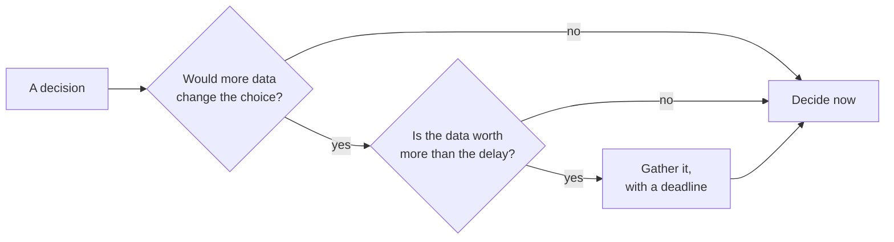

# Data and decisions: deciding well under uncertainty

*Part of [Business acumen for the product leader](./README.md)*

## TL;DR

Senior leaders rarely lack data. They lack time, and the data they have is partial, late or biased. The skill is to decide well **before** the data is complete. That means knowing what kind of data you have, what it cannot show, and when more of it would change the decision.

The core tradeoff is speed against confidence. Waiting for better data lowers the chance of a wrong call. It also delays the value of a right one, and in competitive markets it hands time to rivals. A clear decision rule, a scoring method and a deadline beat another month of analysis.

> 🎯 **For the product leader**
>
> **Why it matters** — In Lending and Insurance, the outcome you care about (a default, a claim) arrives months or years after the decision. In Payments, fraud labels arrive weeks later, when disputes come in. You will always decide on incomplete evidence.
>
> **What it changes in your decisions** — You set a decision date and a "what would change my mind" test before you ask for more analysis. You score portfolio bets with explicit weights, and you check whether the ranking survives a change in weights.
>
> **Ask your team** — *"What result from this analysis would make us choose differently? If none, why are we waiting for it?"*
>
> **Risk if ignored** — Analysis paralysis on reversible calls, and false confidence on irreversible ones built on data that could not see the outcome.

## Mental model: the forecast and the umbrella



You take an umbrella when the forecast says 60% rain. You do not wait to be sure. You weigh the cost of getting wet against the cost of carrying it. Business decisions work the same way. More data has value only if it could change what you do, and only if that value exceeds the cost of waiting.

**Where the analogy breaks.** A weather forecast is calibrated. It has been checked against outcomes for years. Most business estimates are not. Treat your own team's confidence levels as uncalibrated until you have checked them against results.

## Types and sources of data

| Type | What it shows | Its blind spot |
| --- | --- | --- |
| **Behavioural** (clicks, sessions, journeys) | What people do | Why they do it |
| **Transactional** (payments, orders, claims, loans) | What happened, with money attached | What did not happen |
| **Survey and interview** | What people say and feel | What they will actually do |
| **Third-party** (credit bureau files, card-network data, market reports) | Context you cannot see yourself | How it was collected; it may be stale |
| **Experimental** (A/B tests, pilots) | Cause and effect | Long-term effects beyond the test window |
| **Observational** (dashboards, trends) | Patterns over time | Cause; many things change at once |

Data also differs by timing. A **leading indicator** moves before the outcome, such as quote volume before written premium. A **lagging indicator** confirms the outcome after it happens, such as loss ratio. You steer with leading indicators and judge with lagging ones.

## Domain blind spots

Each domain has a structural gap in what its data can show.

- **Lending: you only see outcomes for people you approved.** A lender never learns whether a rejected applicant would have repaid. A model trained only on approved loans can be wrong about the people it rejects. Lenders run small, controlled tests above the cutoff to learn more. This is called **reject inference**.
- **Insurance: losses develop slowly.** Claims for a policy year keep arriving and changing for a long time. In some lines it takes years. Lemonade's public filings show its gross loss ratio moving from 161% in 2017 to 71% in 2020. A young insurer is judging today's pricing by losses that are still coming in.
- **Payments: fraud labels arrive late.** A fraud model sees the transaction now. The proof that it was fraud arrives later, when the cardholder disputes it. Last week's fraud rate is always too low.
- **Retail: seasons and store changes mix together.** A sales rise may be the season, a promotion or a new store. Comparable-sales figures help. Walmart's 10-K counts stores and clubs open for the previous 12 months, and includes eCommerce sales. Its filing also notes that other retailers calculate the measure differently.
- **eCommerce: tests are cheap, long-term effects are not.** You can test a checkout change in a week. You cannot easily test its effect on repeat purchase over a year.
- **FinTech: rules limit what data you may use.** Fair-lending and privacy rules restrict which attributes a credit or pricing decision may use.

Root, an auto insurer, uses driving data from customers' phones as an input to pricing. Its 10-K filings say it chooses not to quote the riskiest drivers. That is a data decision with a business purpose: the company uses data it can collect to decide which customers it wants.

## Turning data into decisions

1. **Write the decision first.** Name the options and the date. Data without a decision is a report.
2. **Ask what would change your mind.** Write the result that would make you choose differently. If no result would, decide now.
3. **Use ranges, not points.** "Adoption between 8% and 15%" is more honest than "12%." It shows where the risk is.
4. **Use expected value for bets with known odds.** Multiply each outcome by its probability, and add them up.
5. **Match the process to reversibility.** Make reversible decisions fast and low in the organization. Give hard-to-reverse decisions more data and a senior owner. See [lesson 3](./teams-and-collaboration.md).
6. **Run a pre-mortem.** Before you commit, imagine it failed a year from now. Ask why. Fix the top two reasons.

## The decision matrix

A **weighted scoring matrix** compares options on several criteria at once.

1. Pick four to six criteria that matter for this decision.
2. Give each a weight. Weights add up to 1.
3. Score each option on each criterion, for example 1 to 5.
4. Multiply each score by its weight and add them up.
5. **Test the weights.** Change them within a reasonable range. If the top option changes, the decision depends on the weights, not the scores. Say so.

The matrix does not make the decision. It makes the reasoning visible, so people argue about weights and scores instead of conclusions.

## Portfolio-level prioritization

At team level, you rank features. At portfolio level, you allocate capacity across teams and bets. Three rules help:

- **Fund outcomes, not feature lists.** Give each team a goal and a budget. Let it choose the features.
- **Compare like with like.** Do not score a core-business fix and a new-market bet on the same scale. Their risk and timing differ. See [lesson 9](./portfolio-strategy-and-allocation.md).
- **Keep a reserve.** Hold some capacity for what you will learn mid-year.

## Avoiding analysis paralysis

- Set a decision date when you start the analysis.
- Agree in advance what level of evidence is enough.
- Separate reversible from hard-to-reverse decisions. Most decisions are reversible.
- Decide, write down why, and set a review date. A recorded decision can be revisited with new facts.

## Worked example: scoring four retail bets

*This example is invented, to show the method. The retailer, the bets and all scores are illustrative.*

A mid-size retailer has budget for one major bet this year. The leadership team scores four options from 1 (low) to 5 (high). For cost, a high score means low cost.

**Step 1: criteria and weights.** Revenue impact 0.35. Strategic fit 0.25. Confidence 0.20. Cost 0.20.

**Step 2: score and weight.**

| Bet | Revenue (0.35) | Fit (0.25) | Confidence (0.20) | Cost (0.20) | Weighted total |
| --- | --- | --- | --- | --- | --- |
| A. Expand buy online, pick up in store | 4 | 5 | 4 | 2 | 1.40 + 1.25 + 0.80 + 0.40 = **3.85** |
| B. Automated markdown pricing | 5 | 3 | 2 | 3 | 1.75 + 0.75 + 0.40 + 0.60 = **3.50** |
| C. Relaunch the loyalty program | 3 | 4 | 3 | 4 | 1.05 + 1.00 + 0.60 + 0.80 = **3.45** |
| D. Upgrade self-checkout | 2 | 2 | 5 | 3 | 0.70 + 0.50 + 1.00 + 0.60 = **2.80** |

Bet A wins.

**Step 3: test the weights.** The CFO argues that revenue matters more and confidence less. New weights: revenue 0.45, fit 0.25, confidence 0.10, cost 0.20.

| Bet | New total |
| --- | --- |
| A | 1.80 + 1.25 + 0.40 + 0.40 = **3.85** |
| B | 2.25 + 0.75 + 0.20 + 0.60 = **3.80** |
| C | 1.35 + 1.00 + 0.30 + 0.80 = **3.45** |
| D | 0.90 + 0.50 + 0.50 + 0.60 = **2.50** |

**Step 4: read the result.** A and B are now almost tied. The decision depends on one question: how much do we value confidence? B has the higher upside and the weaker evidence.

**Step 5: decide.** The team picks A, and funds a small, time-boxed test of B in one region. If the test lifts margin, B gets next year's slot with stronger evidence. The matrix did not decide. It showed the team exactly what it was arguing about.

## Tradeoffs and decisions

- **Speed vs. confidence.** Every week of analysis delays value. The cost of deciding fast is a higher error rate, which is fine for reversible calls.
- **Precision vs. honesty.** A single number is easy to present. A range is more honest and harder to defend in a short meeting.
- **Scoring vs. judgement.** A matrix makes reasoning visible. It can also hide judgement inside the weights. Always show the weight test.
- **Experiments vs. observation.** Experiments show cause. They cost time and traffic, and some decisions cannot be tested, such as a credit policy for a whole market.

## Failure modes

- **Waiting for the lagging indicator.** The team waits for loss data before acting. By then a year of loans is on the books.
- **Survivorship in the data.** A lender studies only approved loans and concludes its cutoff is perfect.
- **Spurious precision.** A score of 3.85 against 3.80 is treated as a clear win.
- **Hidden weights.** Someone tunes the weights until their favourite option wins.
- **Paralysis on reversible calls.** A copy test waits six weeks for a full analysis.

## Under the hood

A weighted score and a weight test, in Python:

```python
bets = {"A": [4, 5, 4, 2], "B": [5, 3, 2, 3], "C": [3, 4, 3, 4], "D": [2, 2, 5, 3]}

def rank(weights):
    totals = {k: round(sum(w * s for w, s in zip(weights, v)), 2) for k, v in bets.items()}
    return sorted(totals.items(), key=lambda kv: -kv[1])

print(rank([0.35, 0.25, 0.20, 0.20]))  # A 3.85, B 3.5, C 3.45, D 2.8
print(rank([0.45, 0.25, 0.10, 0.20]))  # A 3.85, B 3.8, C 3.45, D 2.5
```

Expected value (EV) for a bet with known odds: EV = Σ (probability × value). Use it only when the probabilities are honest estimates, not wishes.

## Practitioner checklist

- [ ] For your next big decision, write the options, the decision date and what would change your mind.
- [ ] Name your domain's data blind spot, and how your team compensates for it.
- [ ] Separate your metrics into leading and lagging indicators.
- [ ] Score your next portfolio choice with a weighted matrix, and run a weight test.
- [ ] Run a 30-minute pre-mortem on your biggest current bet.
- [ ] Find one reversible decision waiting on analysis, and decide it this week.
- [ ] Start a decision record with the reason and a review date.

## Related lessons

- [Prioritization and roadmaps](../technical-product-management/prioritization-and-roadmaps.md) — scoring frameworks at team level.
- [Metrics and experimentation](../technical-product-management/metrics-and-experimentation.md) — running experiments without fooling yourself.
- [Data and the data model](../technical-product-sense/data-and-the-data-model.md) — where your data comes from technically.
- [Portfolio strategy and allocation](./portfolio-strategy-and-allocation.md) — allocating across bets of different risk.

## Sources and notes

- The retail scoring example and all its numbers are invented and illustrative. The arithmetic can be recomputed with the code above.
- Lemonade, Form 10-K for fiscal 2020: gross loss ratio by year, 2017 to 2020. [Filing index](https://www.sec.gov/cgi-bin/browse-edgar?action=getcompany&CIK=1691421&type=10-K). As of 2026-10.
- Walmart, Form 10-K: definition of comparable sales, including the 12-month rule and eCommerce sales, and the note that other retailers calculate it differently. [Filing index](https://www.sec.gov/cgi-bin/browse-edgar?action=getcompany&CIK=104169&type=10-K). As of 2026-10.
- Root, Forms 10-K: use of telematics in pricing, and the choice not to quote the riskiest drivers. [Filing index](https://www.sec.gov/cgi-bin/browse-edgar?action=getcompany&CIK=1788882&type=10-K). As of 2026-10.
- Note: sec.gov could not be opened from the build environment (blocked by the network proxy). The facts were corroborated from search-result excerpts of the filings.
