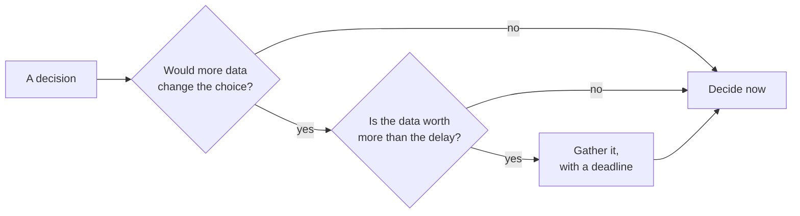
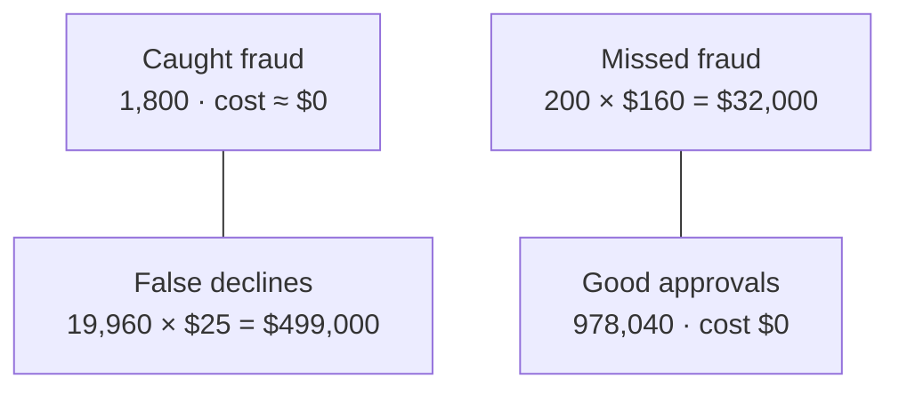

# Data and decisions: deciding well under uncertainty

*Part of [Business acumen for the product leader](./README.md)*

## TL;DR

Senior leaders rarely lack data. They lack time, and the data they have is partial, late or biased. The skill is to decide well **before** the data is complete. That means four things. Know what your data cannot see. Know the base rate before you trust an accuracy claim. Put a money value on each kind of mistake. And know when more data is worth its cost and its delay.

The core tradeoff is speed against confidence. Waiting for better data lowers the chance of a wrong call. It also delays the value of a right one. In competitive markets it hands time to rivals. A clear decision rule, a priced error table and a deadline beat another month of analysis.

The scale is large. A fraud model that "catches 90% of fraud" can block ten good customers for every fraudster. In this lesson's worked example, that model costs a merchant more than having no model at all. The fix is not a better model. It is a different threshold, set by money, not by accuracy.

> 🎯 **For the product leader**
>
> **Why it matters** — In Lending and Insurance, the outcome you care about (a default, a claim) arrives months or years after the decision. In Payments, fraud labels arrive weeks later, when disputes come in. You will always decide on incomplete evidence. And most of your risk decisions run through a model with a threshold that someone set.
>
> **What it changes in your decisions** — You ask for the base rate before you accept any accuracy figure. You ask what each kind of error costs in money, and you set thresholds where the marginal costs meet. You cap what a test or a data purchase is worth before you fund it. You ask for ranges, and you track whether they come true.
>
> **Ask your team** — *"At our current threshold, how many good customers do we block for each bad one we stop, and what does each of those blocks cost us?"*
>
> **Risk if ignored** — A risk model that looks accurate and quietly declines thousands of good customers. Tests that cost more than they could ever be worth. And false confidence on irreversible calls built on data that could not see the outcome.

## Decision rules in this lesson

1. **Ask for the base rate before any accuracy claim.** When the event is rare, even a strong model produces mostly false alarms.
2. **Price every cell of the error table.** A threshold is a business decision. Set it where the money lost to one more false alarm equals the money saved by one more catch.
3. **Cap a test's value before you fund it.** No test is worth more than the expected value of perfect information. If the test costs more than that cap, decide now.
4. **Forecast in ranges and keep score.** Report P10, P50 and P90. If fewer than about eight in ten outcomes land inside your P10 to P90 range, your ranges are too narrow.
5. **Judge the decision, not the outcome.** A good decision can have a bad result. Review what you knew and how you reasoned, not only what happened.
6. **Match the process to reversibility.** Decide reversible calls fast and low in the organization. Give hard-to-reverse calls more evidence and a senior owner.
7. **In regulated domains, a model is a governed asset.** It needs an owner, an inventory entry, an independent validation and a monitoring plan before it decides anything about a customer.

## Mental model: the forecast and the umbrella



You take an umbrella when the forecast says 60% rain. You do not wait to be sure. You weigh the cost of getting wet against the cost of carrying it. Business decisions work the same way. More data has value only if it could change what you do. And it is worth gathering only if that value exceeds the cost of waiting.

The umbrella also shows threshold thinking. A person who hates getting wet carries it at 20% rain. A person who hates carrying things waits for 80%. Same forecast, different costs, different threshold. Your fraud, credit and claims thresholds work the same way.

**Where the analogy breaks.** A weather forecast is calibrated. It has been checked against outcomes for years. Most business estimates are not. Treat your own team's confidence levels as uncalibrated until you have checked them against results.

## Mechanics

### What your data can and cannot see

| Type | What it shows | Its blind spot |
| --- | --- | --- |
| **Behavioural** (clicks, sessions, journeys) | What people do | Why they do it |
| **Transactional** (payments, orders, claims, loans) | What happened, with money attached | What did not happen |
| **Survey and interview** | What people say and feel | What they will actually do |
| **Third-party** (credit bureau files, card-network data, market reports) | Context you cannot see yourself | How it was collected; it may be stale |
| **Experimental** (A/B tests, pilots) | Cause and effect | Long-term effects beyond the test window |
| **Observational** (dashboards, trends) | Patterns over time | Cause; many things change at once |

Data also differs by timing. A **leading indicator** moves before the outcome, such as quote volume before written premium. A **lagging indicator** confirms the outcome after it happens, such as loss ratio. You steer with leading indicators and judge with lagging ones.

Each domain has a structural gap in what its data can show.

- **Lending: you only see outcomes for people you approved.** A lender never learns whether a rejected applicant would have repaid. A model trained only on approved loans can be wrong about the people it rejects. Lenders approve a small, controlled group below the cutoff to learn more. Estimating the outcomes of rejected applicants is called **reject inference**. The value-of-information section below prices such a test.
- **Insurance: losses develop slowly.** Claims for a policy year keep arriving and changing for a long time. In some lines it takes years. So the latest year's loss ratio is always too low. [Performance and growth](./performance-and-growth.md#insurance-loss-development) shows how a loss triangle corrects for this.
- **Payments: fraud labels arrive late.** A fraud model sees the transaction now. The proof that it was fraud arrives later, when the cardholder disputes it. Last week's fraud rate is always too low. And you never learn whether a declined transaction was fraud, so declines hide their own mistakes.
- **Retail: seasons and store changes mix together.** A sales rise may be the season, a promotion or a new store. Comparable-sales figures help. [Performance and growth](./performance-and-growth.md) covers how one large retailer defines them.
- **eCommerce: tests are cheap, long-term effects are not.** You can test a checkout change in a week. You cannot easily test its effect on repeat purchase over a year.
- **FinTech: rules limit what data you may use.** Fair-lending and privacy rules restrict which attributes a credit or pricing decision may use.

Root, an auto insurer, uses driving data from customers' phones as an input to pricing. Its 10-K filings say it chooses not to quote the riskiest drivers. That is a data decision with a business purpose: the company uses data it can collect to decide which customers it wants.

**Decision rule.** For every model or dashboard you rely on, write down the outcomes it cannot observe. Then fund one small, ongoing way to observe them, such as a holdout or a below-cutoff test.

### Base rates: why accurate models raise mostly false alarms

**What it is.** The **base rate** is how common an event is before you look at any signal. Card fraud might be 0.2% of transactions. A default might be 4% of loans. A fraudulent insurance claim might be a few percent of claims.

**How it works.** A model's alerts mix true alarms and false alarms. True alarms come from the rare group. False alarms come from the large group. So when the event is rare, a small false-alarm rate on the large group can swamp a high catch rate on the small one.

Two rates describe the model. **Recall** is the share of real fraud the model flags. **Precision** is the share of flags that are real fraud. The [measuring a model](../machine-learning/measuring-a-model.md) lesson defines both, with the confusion matrix behind them. Here is the business consequence.

**How to compute it.**

```text
true alarms   = volume × base rate × recall
false alarms  = volume × (1 − base rate) × false-alarm rate
precision     = true alarms ÷ (true alarms + false alarms)
```

**Numbers.** Take 1,000,000 card transactions with 0.2% fraud, a model with 90% recall and a 2% false-alarm rate. The model catches 1,800 frauds. It also flags 19,960 good transactions. Precision is 1,800 ÷ 21,760 = **8.3%**. Eleven of every twelve flags are good customers. The worked example below prices this.

**Domain application.**

- **Payments.** A "90% accurate" fraud model at a merchant blocks real buyers. Each block is a lost sale and an annoyed customer.
- **Anti-money-laundering (AML) monitoring.** Suspicious-activity alerts are rare events against huge volumes. Most alerts are false, and each one costs analyst time. The base rate drives the size of the investigations team.
- **Insurance.** A claims-fraud flag that sends claims to investigation slows payment for honest claimants. That hurts retention and can draw complaints.
- **Lending.** A model that flags "likely default" on 4% base-rate loans has far better precision than a fraud model, at the same recall. The base rate is twenty times higher.

**The common misreading.** "The model is 90% accurate, so 90% of its alerts are right." Accuracy and recall say nothing about precision until you know the base rate.

**Decision rule.** When someone quotes accuracy or recall, ask two questions. What is the base rate? How many alerts per true case does this produce at our volume?

### Threshold economics: price each cell

**What it is.** Most risk models produce a score. A **threshold** turns the score into an action: approve or decline, pay or investigate. Every threshold puts each case into one of four cells. Each cell has a cost.

**How it works.** Raise the threshold and you flag fewer cases. You miss more fraud, and you block fewer good customers. Lower it and the reverse happens. The best threshold is not the one with the highest accuracy. It is the one with the lowest total cost.

| Cell | Payments meaning | What it costs (illustrative) |
| --- | --- | --- |
| **Caught fraud** (true positive) | Fraud blocked | Little; maybe review time |
| **Missed fraud** (false negative) | Fraud approved | Lost goods, the chargeback, a dispute fee and handling |
| **False decline** (false positive) | Good customer blocked | Lost margin on the order, plus the chance the customer never comes back |
| **Good approval** (true negative) | Good customer served | Nothing extra |

**How to compute it.** Total cost at a threshold is missed fraud × cost per miss + false declines × cost per false decline. Compute it at several thresholds. Pick the lowest.

There is a shortcut for the margin. Look at the band of cases you would add by lowering the threshold one step. Block that band only if its fraud share is above this break-even:

```text
break-even fraud share = cost of a false decline ÷ (cost of a false decline + cost of a miss)
```

With a miss at $160 and a false decline at $25, the break-even is 25 ÷ 185 = **13.5%**. Block a band where more than 13.5% of cases are fraud. Approve a band where fewer are. This is the same cost-based cutoff that the [measuring a model](../machine-learning/measuring-a-model.md) lesson derives. The business job is to get the two costs right.

**Pricing the cells honestly.** Teams usually price the miss well, because fraud losses show up on a report. They usually underprice the false decline. Its costs are spread out:

- Lost margin on the blocked order.
- Customers who leave after a decline. This is real, but it is hard to measure, so it is often set to zero.
- Support contacts from blocked customers.
- In Payments, a lower **authorization rate**, the share of attempted payments that succeed. Merchants compare providers on it. See [performance and growth](./performance-and-growth.md).

A third action often beats both approve and decline. A **step-up** check asks for more proof, such as a one-time code or a bank-app confirmation. It costs some friction and some abandoned checkouts. It costs far less than a decline. In Lending, the equivalent is "refer to manual review". In Insurance, it is "ask for a document" before paying a claim.

**The common misreading.** "The data science team sets the threshold." The team can show the trade-off curve. Only the business can price the cells. A threshold set without prices is a business decision taken by default.

**Decision rule.** When a band's fraud share is below the break-even, approve it, even if the model team calls it risky. When it is above, block it or step it up. Recompute the threshold whenever a cost changes, such as a new dispute fee or a margin change.

The figure below shows the 90%-recall model from the base-rate section, with each cell priced.



### Value of information: what a test is worth

**What it is.** The **value of information** is how much better your decision gets, in money, because you learned something first. It is the right way to decide whether to run a test, buy a data source or wait for more results.

**How it works.** Information has value only if it can change your choice. If you would launch whatever the test says, the test is worth nothing to this decision. If it might flip your choice, it is worth the money that flip saves, weighted by how likely the flip is.

**How to compute it.** Start with the cap. The **expected value of perfect information (EVPI)** is what you would gain if you knew the answer for certain.

```text
EVPI = expected value if you could choose after learning the truth
     − expected value of your best choice today
```

No real test is perfect, so its value is lower than EVPI. The value of an imperfect test is the same calculation, using what the test would tell you instead of the truth. The Under the hood code computes both.

**Domain application: a credit-cutoff test.** *This example is illustrative. All inputs are assumed.*

A lender is deciding whether to approve a band of applicants just below its cutoff. About 10,000 such applicants apply each year.

- If the band is "good" (performs like current customers), each loan earns $300 of contribution after losses.
- If the band is "bad", each loan loses $250.
- The risk team thinks there is a 40% chance the band is good.

**Step 1: the best choice today.** Expected value of lending = 10,000 × (0.4 × $300 + 0.6 × −$250) = 10,000 × −$30 = **−$300,000**. So today the lender should not lend. The expected value of today's best choice is $0.

**Step 2: the cap.** With perfect information, the lender lends only if the band is good. That happens 40% of the time and earns 10,000 × $300 = $3,000,000. EVPI = 0.4 × $3,000,000 − $0 = **$1,200,000**. No test, model or data purchase can be worth more than $1.2 million for this decision.

**Step 3: a real test.** The lender approves 1,000 loans from the band for a year and watches them. Assume the result reads the band correctly 80% of the time. Then the test points to "good" 44% of the time. When it does, the chance the band is really good rises to 72.7%. Lending then earns $150 a loan, or $1.5 million on the next 10,000. When the test points to "bad", the lender holds back. The value of this imperfect test is 0.44 × $1,500,000 = **$660,000**.

**Step 4: compare with the cost.** The 1,000 test loans have an expected cost of 1,000 × $30 = $30,000. In the worst case, a bad band, they lose $250,000. The test is worth up to $660,000. Run it. But a data vendor offering a "$1.5 million insight" into this band is overpriced at any accuracy, because the cap is $1.2 million.

**The common misreading.** "More data is always better." Data has value only through the decision it changes. A perfect answer to a question that cannot change your choice is worth zero.

**Decision rule.** Before you fund a test or a data source, compute the cap. If the cost is above EVPI, decide now. If the cost is well below the value of the test, run it, with a deadline.

### Forecasting with ranges

**What it is.** A **range forecast** gives three numbers instead of one. P10 is a value the outcome should beat 90% of the time. P50 is the middle case. P90 is a value the outcome should beat only 10% of the time.

**How it works.** A range shows where the risk lies. "Payment volume of $820 million next quarter" hides the fact that $700 million is plausible. "P10 $700M, P50 $820M, P90 $900M" shows a downside that is larger than the upside. That shape changes the plan. You hold hiring until the P50 is confirmed, or you prepare the cost cuts that a P10 would need.

**How to run it.**

1. Ask each forecast owner for P10, P50 and P90.
2. Record them before the period starts.
3. At the end, mark whether the outcome landed between P10 and P90.
4. Over ten or more forecasts, about 80% should land inside. If only 60% land inside, the ranges are too narrow. The team is overconfident. Widen the ranges, or find what the team keeps missing.

This is **calibration**: checking stated confidence against results. Weather forecasters do it routinely. Most product teams never do. A team that tracks it for a year becomes much harder to surprise.

**Domain application.** Lending teams forecast losses by vintage, so ranges are natural there. Insurers set reserves, which are forecasts of claims still to come. Payments teams forecast volume by merchant segment. Retailers forecast demand by item and store, and the cost of a miss is markdown or empty shelves.

**Decision quality versus outcome quality.** A good decision can have a bad outcome. You approved a well-tested credit change, and a recession hit. A bad decision can have a good outcome. You launched without a test, and got lucky. Judging people only by outcomes teaches them to avoid risk, or to hide it. Judge the decision by what was known, what was assumed, and how it was reasoned. A written decision record makes this possible.

**The common misreading.** "A single number shows commitment. A range shows doubt." A range shows where the doubt already is.

**Decision rule.** When a forecast drives a hard-to-reverse commitment, such as hiring, a capital raise or a credit policy, plan for the P10, not the P50.

### Turning data into decisions

1. **Write the decision first.** Name the options and the date. Data without a decision is a report.
2. **Ask what would change your mind.** Write the result that would make you choose differently. If no result would, decide now.
3. **Price the errors.** Write what a wrong "yes" and a wrong "no" each cost.
4. **Use expected value for bets with known odds.** Multiply each outcome by its probability, and add them up. [Business cases, capital and valuation](./business-cases-and-valuation.md) extends this to cash flows over time.
5. **Match the process to reversibility.** See [teams and collaboration](./teams-and-collaboration.md).
6. **Run a pre-mortem.** Before you commit, imagine it failed a year from now. Ask why. Fix the top two reasons.
7. **Decide, record, review.** Write the decision, the reason and a review date. Set the decision date when the analysis starts, and agree in advance what evidence is enough.

### The decision matrix

A **weighted scoring matrix** compares options on several criteria at once. Use it when options differ on things that do not share a unit, such as revenue, fit and risk.

1. Pick four to six criteria that matter for this decision.
2. Give each a weight. Weights add up to 1.
3. Score each option on each criterion, for example 1 to 5.
4. Multiply each score by its weight and add them up.
5. **Test the weights.** Change them within a reasonable range. If the top option changes, the decision depends on the weights, not the scores. Say so.

*Illustrative example: a mid-size retailer scores four bets. The retailer, the bets and all scores are invented.* For cost, a high score means low cost.

| Bet | Revenue (0.35) | Fit (0.25) | Confidence (0.20) | Cost (0.20) | Total | Total if revenue 0.45, confidence 0.10 |
| --- | --- | --- | --- | --- | --- | --- |
| A. Expand buy online, pick up in store | 4 | 5 | 4 | 2 | **3.85** | **3.85** |
| B. Automated markdown pricing | 5 | 3 | 2 | 3 | **3.50** | **3.80** |
| C. Relaunch the loyalty program | 3 | 4 | 3 | 4 | **3.45** | **3.45** |
| D. Upgrade self-checkout | 2 | 2 | 5 | 3 | **2.80** | **2.50** |

Under the first weights, A wins clearly. When the CFO shifts weight from confidence to revenue, A and B almost tie. The decision now depends on one question: how much do we value confidence? B has the higher upside and the weaker evidence. The team picks A and funds a small, time-boxed test of B in one region. The matrix did not decide. It showed the team what it was arguing about.

**Decision rule.** Never present a matrix without its weight test. A gap of 0.05 is a tie. Allocating capacity across many bets is a different job. See [portfolio strategy and capital allocation](./portfolio-strategy-and-allocation.md).

### Model governance in regulated domains

**What it is.** In banking, a credit, fraud, pricing or capital model is a regulated asset. In 2011 the US Federal Reserve and the Office of the Comptroller of the Currency (OCC) issued supervisory guidance on **model risk management**. The Federal Reserve's version is its supervision and regulation (SR) letter 11-7, known as SR 11-7. It defines model risk as the harm that can come from decisions based on wrong or misused model outputs. Many lenders, and many fintechs that lend through partner banks, follow it.

**How it works.** The guidance rests on three ideas. Build and use models soundly. Validate them independently. Govern them with clear roles and policies. Its central test is **effective challenge**: people who are competent, independent and have the authority to make changes question the model. In practice, a governed model has:

- **An inventory entry.** Every model in use is listed, with its owner, purpose and risk tier.
- **Independent validation.** A team that did not build the model checks its concept, its data and its results before use.
- **Ongoing monitoring.** Score drift, approval rates and outcomes are tracked against what the model predicted.
- **A challenger.** A **champion–challenger** setup runs an alternative model or threshold on a small share of traffic. It shows whether the live model is still the best choice.
- **Documented overrides.** When people overrule the model, the reasons are recorded and reviewed.

**Domain application.** In US lending, a declined applicant must be told the main reasons for the decline. That is part of Regulation B. So a credit model must produce reasons a person can read. This shapes which model types a lender can use. Insurers file rating rules with state regulators. Payments and anti-money-laundering models are reviewed by bank partners and examiners.

**The common misreading.** "Governance slows us down." Model governance mostly adds lead time you can plan for. Discovering it late is what slows you down. A threshold change on a credit model may need validation sign-off. Put it in the plan.

**Decision rule.** Before you commit a date for a model or threshold change in a regulated product, ask your model risk team what review it needs and how long that takes. Treat a threshold change as a model change unless they say otherwise.

## Worked example: the fraud model that costs more than no model

*This example is illustrative. The merchant, the model and every input are assumed. The code under the hood reproduces every number.*

An online merchant processes 1,000,000 card transactions a year. Fraud is 0.2% of transactions, so 2,000 are fraudulent. The fraud team proposes a new model at a threshold with 90% recall and a 2% false-alarm rate.

**Step 1: count the cells.**

- Caught fraud: 2,000 × 90% = 1,800.
- Missed fraud: 2,000 − 1,800 = 200.
- False declines: 998,000 × 2% = 19,960.
- Precision: 1,800 ÷ (1,800 + 19,960) = **8.3%**.

**Step 2: price the cells.** The assumed inputs:

- A missed fraud costs **$160**. That is the lost goods on an average fraudulent order of $140, plus about $20 of dispute fees and handling.
- A false decline costs **$25**. That is $12 of lost margin on the order, plus a 5% chance the customer leaves for good, times $260 of future contribution ($13).

**Step 3: compare thresholds.** The team plots the model at five thresholds.

| Threshold | Recall | False-alarm rate | Missed fraud cost | False decline cost | Total cost |
| --- | --- | --- | --- | --- | --- |
| No model | 0% | 0% | $320,000 | $0 | **$320,000** |
| T1 | 95% | 5% | $16,000 | $1,247,500 | **$1,263,500** |
| T2 (proposed) | 90% | 2% | $32,000 | $499,000 | **$531,000** |
| T3 | 80% | 0.5% | $64,000 | $124,750 | **$188,750** |
| T4 | 60% | 0.1% | $128,000 | $24,950 | **$152,950** |
| T5 | 40% | 0.02% | $192,000 | $4,990 | **$196,990** |

**Step 4: read the table.** The proposed threshold costs **$531,000**. That is $211,000 more than having no model at all. The model is good. The threshold is wrong for this merchant's costs.

**Step 5: check the margin.** The break-even fraud share for a band is 13.5%. Moving from T3 to T4 stops blocking a band of 400 frauds and 3,992 good customers. Its fraud share is 9.1%, below break-even, so approving that band saves money. Moving from T4 to T5 would also approve a band of 400 frauds and 798 good customers. Its fraud share is 33.4%, above break-even, so it should stay blocked. **T4 is the best threshold here, at $152,950.** That saves $167,050 a year against no model, and $378,050 against the proposal.

**Step 6: check the inputs that drive it.** The answer depends on the $25 false-decline cost. The churn part of it is an estimate. The team agrees to run a holdout: a small share of flagged transactions in the T3 to T4 band goes through a step-up check instead of a decline. The holdout measures how many are good customers and whether they come back.

**What changed.** The fraud team had optimised for catching fraud. The merchant's goal was the lowest total cost. Pricing both errors moved the threshold, and turned a loss into a saving.

## Tradeoffs and decisions

- **Speed against confidence.** Every week of analysis delays value. The cost of deciding fast is a higher error rate, which is fine for reversible calls.
- **Catching fraud against serving customers.** A stricter threshold blocks more fraud and more good customers. You give up revenue and goodwill to cut losses. Only priced cells tell you where to stop.
- **Testing against deciding.** A test reduces uncertainty. It costs time, money and sometimes real losses on test loans or test traffic. Its value is capped by EVPI.
- **Precision against honesty.** A single number is easy to present. A range is more honest and harder to defend in a short meeting.
- **Scoring against judgement.** A matrix makes reasoning visible. It can also hide judgement inside the weights. Always show the weight test.
- **Model performance against explainability.** In lending, a more complex model may rank risk better. It may also be harder to explain and to validate. You can give up some accuracy for faster approval and clearer decline reasons.

## Failure modes

- **Accuracy without a base rate.** A launch review hears "92% accurate". Nobody asks how many alerts that means. Support sees a spike in "my card was declined" contacts a week after launch.
- **Unpriced false declines.** The fraud dashboard shows losses falling. Approval rate and repeat purchase fall too, but on a different team's dashboard. Revenue misses plan, and nobody links it to the threshold.
- **Waiting for the lagging indicator.** The team waits for loss data before acting. By then a year of loans is on the books.
- **Survivorship in the data.** A lender studies only approved loans and concludes its cutoff is perfect. It never tests below the cutoff, so it never learns otherwise.
- **The overpriced test.** A pilot costs more in losses and delay than the decision it informs could ever be worth. You see it when nobody can say which result would change the plan.
- **Uncalibrated ranges.** Every forecast comes with a range, and actuals keep landing outside it. Nobody keeps score, so nothing improves.
- **Spurious precision and hidden weights.** A score of 3.85 against 3.80 is treated as a clear win. Or someone tunes the weights until their favourite option wins.
- **Ungoverned threshold changes.** A team edits a credit cutoff in a config file. Validation never saw it. It surfaces in a partner-bank audit or an examination.

## Under the hood

The worked example, the threshold table, the value-of-information case and the weight test, in Python. It runs as written and reproduces the lesson's numbers.

```python
# Example F: base rate and a priced confusion matrix (all inputs assumed)
N, fraud_rate = 1_000_000, 0.002
fraud = N * fraud_rate              # 2,000 fraudulent transactions
good = N - fraud                    # 998,000 good ones

def cells(recall, fpr):
    tp = fraud * recall
    fp = good * fpr
    return tp, fraud - tp, fp       # caught, missed, false declines

tp, fn, fp = cells(0.90, 0.02)
print(f"precision {tp / (tp + fp):.1%}")      # 8.3%

COST_MISS, COST_FALSE_DECLINE = 160, 25       # assumed, per transaction
thresholds = {"T1": (0.95, 0.05), "T2": (0.90, 0.02), "T3": (0.80, 0.005),
              "T4": (0.60, 0.001), "T5": (0.40, 0.0002)}
print(f"no model: {fraud * COST_MISS:,.0f}")                       # 320,000
for name, (r, f) in thresholds.items():
    tp, fn, fp = cells(r, f)
    print(name, f"{fn * COST_MISS + fp * COST_FALSE_DECLINE:,.0f}")  # T4 152,950 is lowest
print(f"break-even: {COST_FALSE_DECLINE / (COST_FALSE_DECLINE + COST_MISS):.1%}")  # 13.5%

# Value of information: a credit-cutoff test (all inputs assumed)
loans, p_good, gain, loss = 10_000, 0.40, 300, -250
ev_now = max(loans * (p_good * gain + (1 - p_good) * loss), 0)     # lending EV is -300,000, so 0
evpi = p_good * loans * gain - ev_now                              # 1,200,000
acc = 0.80                                                         # test reads the band right 80% of the time
p_sig = p_good * acc + (1 - p_good) * (1 - acc)                    # 0.44
post = p_good * acc / p_sig                                        # 0.727
evsi = p_sig * max(loans * (post * gain + (1 - post) * loss), 0) - ev_now   # 660,000
print(f"EVPI {evpi:,.0f}  test value {evsi:,.0f}")

# Weight test for the scoring matrix
bets = {"A": [4, 5, 4, 2], "B": [5, 3, 2, 3], "C": [3, 4, 3, 4], "D": [2, 2, 5, 3]}
def rank(w):
    t = {k: round(sum(x * s for x, s in zip(w, v)), 2) for k, v in bets.items()}
    return sorted(t.items(), key=lambda kv: -kv[1])
print(rank([0.35, 0.25, 0.20, 0.20]))   # A 3.85, B 3.5, C 3.45, D 2.8
print(rank([0.45, 0.25, 0.10, 0.20]))   # A 3.85, B 3.8, C 3.45, D 2.5
```

A calibration log needs only one row per forecast:

```yaml
forecast: q3_tpv_smb_segment
owner: Head of SMB Payments
recorded: 2026-06-28
p10: 700_000_000
p50: 820_000_000
p90: 900_000_000
actual: null            # filled in after the quarter closes
inside_p10_p90: null    # the team's hit rate over many rows should be near 80%
```

## Practitioner checklist

- [ ] For each risk model in your product, write the base rate and the number of alerts per true case at current volume.
- [ ] Put a money value on a miss and on a false decline, and write where each number comes from.
- [ ] Recompute your main threshold from those prices. Compare it with the live threshold.
- [ ] Before your next test or data purchase, compute EVPI. Write which result would change the decision.
- [ ] Ask forecast owners for P10, P50 and P90, and start a calibration log.
- [ ] Name your domain's data blind spot, and the holdout or below-cutoff test that covers it.
- [ ] Check that every model and threshold in your product is in the model inventory, with an owner and a validation date.
- [ ] Find one reversible decision waiting on analysis, and decide it this week.

## Related lessons

- [Measuring a model](../machine-learning/measuring-a-model.md) — precision, recall, the confusion matrix and calibration, explained from the ground up.
- [Metrics and experimentation](../technical-product-management/metrics-and-experimentation.md) — running experiments and holdouts without fooling yourself.
- [Performance and growth](./performance-and-growth.md) — loss development, vintage curves and authorization rate.
- [Business cases, capital and valuation](./business-cases-and-valuation.md) — expected value over time, scenarios and sensitivity.
- [Portfolio strategy and capital allocation](./portfolio-strategy-and-allocation.md) — allocating across bets of different risk.
- [Data and the data model](../technical-product-sense/data-and-the-data-model.md) — where your data comes from technically.
- [Prioritization and roadmaps](../technical-product-management/prioritization-and-roadmaps.md) — scoring frameworks at team level.
