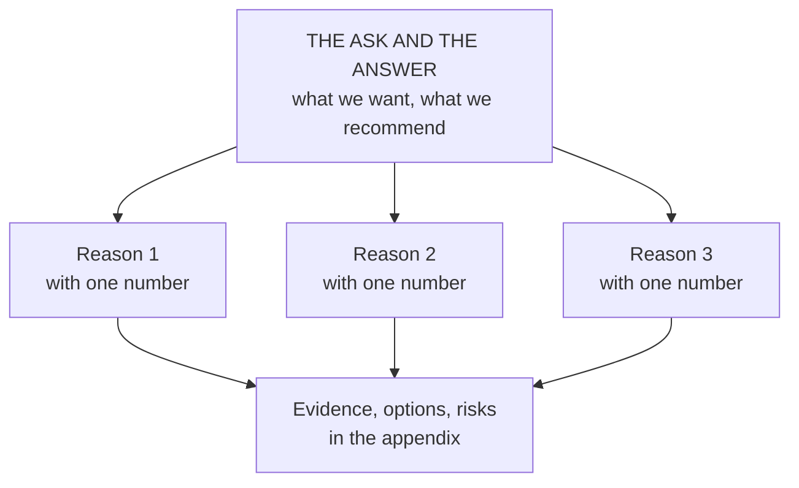
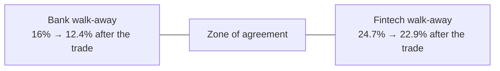

# Executive influence: narrative, the board and the negotiating table

*Part of [Business acumen for the product leader](./README.md)*

*Last reviewed: 2026-10 · Volatility: medium*

## TL;DR

At vice president (VP) level, influence is most of the job. You rarely control the resources you need. You win them by making a clear case to executives, aligning peers before decisions, and negotiating with partners and other leaders. The skills are learnable: an **answer-first narrative**, data that makes one point per chart, **pre-wiring** before meetings, a clear view of how the **board** works, and negotiation built on numbers.

The core tradeoff is clarity against completeness. Executives need the answer, the ask and the risk in the first minute. Your team wants every detail included. A narrative that includes everything persuades nobody. The cost of clarity is leaving out true things that do not change the decision.

Negotiation has its own arithmetic. Each side has a **walk-away point**, set by its own economics and its best alternative. If the two points overlap, a deal exists. Your job is to compute both before you sit down, and to trade across issues so the overlap grows.

> 🎯 **For the product leader**
>
> **Why it matters** — Budgets, headcount, partner terms and launch approvals are decided at the executive table. Some are decided in the boardroom. A strong product case told badly loses to a weaker case told well.
>
> **What it changes in your decisions** — You lead with the ask and the answer. You show the one number the decision depends on. You write board material as a decision, not a status update. You walk into every negotiation with both sides' walk-away points computed.
>
> **Ask your team** — *"If the partner refuses our terms, what exactly do we do next, what does it cost us, and at what share does that become the better option?"*
>
> **Risk if ignored** — Your proposal gets deferred to "next quarter." Or you agree to partner terms you could have improved, because you did not know your own walk-away point. Or you refuse a good deal because you never computed theirs.

## Decision rules in this lesson

- **Put the ask, the answer and the cost in the first paragraph.** If the reader stops there, they can still decide.
- **Bring the board a decision, a risk or a change in the scorecard, never a feature list.**
- **Compute your walk-away point from your best alternative, not from your break-even,** whenever the alternative is better than break-even.
- **Estimate the other side's walk-away point from its own costs and alternatives before the first meeting.**
- **Trade across issues only when the two sides' costs differ.** Move each cost to the side that bears it more cheaply.
- **Meet every high-power stakeholder alone before the decision meeting.**
- **Keep metric definitions fixed for at least a year.** Change one only with a restated history.

## Mental model: answer first, then support



Put the conclusion at the top. Support it with three reasons, each with one number. Put the evidence below. An executive can stop reading at any level and still know your position.

**Where the model breaks.** Answer-first works when the audience trusts you and the decision is clear. For a contested or emotional issue, starting with the conclusion can make people defensive. Then start with the shared facts, and reach the recommendation together.

## Mechanics

### Executive narrative

A good executive narrative follows a simple arc:

1. **The situation.** What is true today, in one or two sentences everyone agrees with.
2. **What changed.** The new fact that makes action necessary: a competitor, a rule, a loss trend.
3. **What we propose.** The recommendation and the ask.
4. **Why.** Three reasons, each with a number.
5. **Risks and options.** What could go wrong, and the alternatives you considered.

Write it before you build slides. Amazon has described its practice of using six-page narrative memos instead of slide decks, read in silence at the start of meetings. Whether or not you adopt that format, writing forces you to find the gaps in your own argument.

### Storytelling with data

- **One chart, one point.** State the point in the chart title: "Loss ratio on new policies is 6 points above the book," not "Loss ratio by cohort."
- **Show the comparison that matters.** Against plan, against last year, or against a control group.
- **Annotate.** Mark the launch date, the rule change or the outage on the chart.
- **Keep definitions stable.** If the metric's definition changed, say so on the chart, and restate the history.

Consistency builds trust over time. An executive who sees the same metric, defined the same way, every quarter starts to trust the trend. One who sees a new definition each quarter starts to doubt every number. The rules for owning and changing a metric's definition live in [performance and growth](./performance-and-growth.md).

### What executives ask, by domain

Each domain has a question the executive team will ask first. Answer it in your first paragraph.

| Domain | The first executive question |
| --- | --- |
| **Payments** | What happens to fraud and dispute rates, and to our net take rate? |
| **Lending** | What happens to losses by cohort, and to our funding needs? |
| **eCommerce** | What happens to contribution per order, not only to order volume? |
| **InsurTech** | What happens to the loss ratio, and do we need new rate filings? |
| **Retail** | What happens to gross margin and to inventory? |
| **FinTech** | What do our partner bank and our regulators need to approve? |

### How the board works

Most product leaders meet the board rarely. They meet its effects often. The board approves the annual plan, the risk appetite and large investments. A product leader who understands the board writes better proposals at every level below it.

**What the board is for.** The board oversees management on behalf of the owners. It does not run the company. In US corporate law, directors owe the company **fiduciary duties**: a **duty of care** (decide on good information, with attention) and a **duty of loyalty** (put the company's interest ahead of their own). The duty of care explains a lot. Directors ask for pre-reads, options and risks because they must show they decided on good information.

**What the board decides.** Boards typically decide five kinds of thing:

- **Strategy and the plan.** They approve the annual plan and the big shifts in strategy.
- **Capital.** Large investments, acquisitions, fundraising and dividends.
- **Risk.** The risk appetite, and whether management keeps the company inside it.
- **Leadership.** Hiring, paying and, if needed, replacing the chief executive officer (CEO).
- **Reporting and control.** Whether the financial statements are reliable and the controls work.

**Committees do most of the detailed work.** The full board then hears their reports.

| Committee | What it oversees | Where product shows up |
| --- | --- | --- |
| **Audit** | Financial reporting, internal controls, internal audit and the external auditor | Revenue recognition for a new pricing model; controls over a new money flow; capitalized software |
| **Risk** (common in banks and insurers) | Risk appetite, limits and the second line's reports | A launch that moves a credit, fraud or conduct metric toward its limit |
| **Compensation** | Pay for senior leaders, and the metrics bonuses are tied to | Which product metrics executives are paid on |
| **Nominating and governance** | Board membership and governance rules | Rarely |

Under rules of the US Securities and Exchange Commission (SEC) adopted after the Sarbanes-Oxley Act of 2002, a listed company's audit committee must be made up of independent directors. Federal Reserve rules require larger bank holding companies to have a board risk committee. In a regulated firm, a new product often needs a management new-product committee first. Its decision then appears in the risk committee's report.

**The board pack.** Directors receive a **board pack** some days before each meeting. Many boards meet about quarterly. A typical pack holds:

1. The CEO's letter: what changed, what worries management, what it needs.
2. Financial results against plan, and the latest forecast.
3. A stable scorecard of key performance indicators (KPIs).
4. Strategy papers, each with a decision or a request for advice.
5. The risk report: appetite metrics against their limits, and major incidents.
6. Committee reports.
7. Resolutions to approve, and minutes of the last meeting.

**How product appears in it.** Product rarely gets its own section. It shows up in four places:

- **The scorecard,** as the metrics your products move.
- **A strategy paper,** when a bet is large enough to need approval or advice.
- **The risk report,** when a launch pushes a metric toward amber, or an incident occurs.
- **The plan,** as the investment behind your area.

**Writing a board paper.** Keep it to two pages. Start with one line: "For decision", "For advice" or "For information". Then the ask, the answer and the cost, as in the narrative above. Show the one number the case depends on, and what happens if it is half as good. Name the risks with owners. Say which appetite metrics the bet touches, and where they will land. Directors read for the downside. Write for it.

**Domain application.** A lender's board approves its risk appetite, including a loss-rate limit. A product leader who wants to loosen the credit cutoff needs the forecast loss rate under the new cutoff. If it crosses amber, the decision goes to the risk committee, not only to the executive team. In an insurer, the audit committee watches reserve adequacy. A fast-growing new line will draw questions about whether its early loss ratio is too good to be true. The answer lives in [performance and growth](./performance-and-growth.md).

**Rules for board and CEO communication.**

- **No surprises.** Bad news goes to the CEO before the board meeting, and to the board before it reaches the press.
- **Pre-reads, not presentations.** Send material early. Use meeting time for questions.
- **Lead with what you need from them.** A decision, advice or awareness. Say which.
- **Keep the scorecard stable.** Show the same core metrics every time, with the same definitions.
- **Show risks with owners.** For each major risk: likelihood, impact, owner and mitigation.

**The common misreading.** "The board wants to see the roadmap." It wants to know whether management's bets fit the strategy, the capital and the risk appetite. A roadmap is evidence for that, at most.

### Influence without authority

You influence peers through four things:

- **Shared goals.** Frame your ask as progress toward their goal, not only yours.
- **Credibility.** A record of delivering what you said, and of admitting when you were wrong.
- **Reciprocity.** Help peers hit their targets. They remember.
- **Clarity.** A clear ask is easier to say yes to than a vague one.

**Managing up** means making your manager's job easier. Know their goals and pressures. Bring problems early, with options. Ask how they want to be updated. Disagree in private, with evidence, and support the decision in public once it is made.

**Managing across** means aligning peers. Know what each peer is measured on, as in [navigating the organization](./navigating-the-organization.md). Share credit. Escalate together when you cannot agree.

### Driving cross-functional alignment

1. **Name the decision and its owner.** See [teams and collaboration](./teams-and-collaboration.md).
2. **Map the stakeholders.** Use the power and interest grid in [navigating the organization](./navigating-the-organization.md). Mark every veto.
3. **Write the pre-read.** One document with the facts, the options and the recommendation.
4. **Pre-wire.** Meet each key stakeholder alone first. Learn their objections while you can still change the proposal.
5. **Use the meeting to decide.** Not to discover objections.
6. **Close the loop.** Send the decision, the reason and the owners within a day.

### Negotiation at the executive table

Executives negotiate constantly: budgets with Finance, dates with Sales, terms with partners. Four ideas make you better at it.

- **Interests, not positions.** A position is what someone asks for. An interest is why. A partner bank asks for a larger revenue share (position) because it needs to cover its compliance cost (interest). You might meet the interest another way, for example by taking on some of the compliance work.
- **Your best alternative to a deal.** Know what you will do if you cannot agree. A second partner? Building it yourself? Delaying? Your alternative sets your walk-away point. The stronger it is, the more you can ask for.
- **The zone of agreement.** If your walk-away point and theirs overlap, a deal is possible. Find out where theirs is by asking questions and by modelling its economics, not by guessing.
- **Trade across issues.** Price, term, exclusivity, volume and timing can be traded against each other. A deal on one issue alone is a tug of war.

Public deals often trade across several issues at once: ownership, board seats, partnerships and service terms. Shopify's 2023 agreement to sell most of its logistics business to Flexport is one example, covered in [portfolio strategy and capital allocation](./portfolio-strategy-and-allocation.md).

### Negotiation in numbers: the zone of agreement

**What it is.** Each side has a **walk-away point**: the worst terms it will accept. Below that point, it is better off with its best alternative. The **zone of agreement** is the range between the two walk-away points. Any deal inside it leaves both sides better off than walking away. The width of the zone is the **surplus** the deal creates. The negotiation decides how the surplus is split.

**How to compute your own walk-away point.** Work from your economics in three steps.

1. **Value the deal on the table** at different terms. For a revenue share, compute what you keep at each share.
2. **Value your best alternative.** Include its full cost: switching, migration, lost customers, delay. Spread one-off costs over the alternative's contract term.
3. **Your walk-away point is where the two are equal.** It is not your break-even. Break-even matters only if your best alternative is to stop the business.

**How to estimate theirs.** Build the same model for the other side, from what you can observe:

- **Its costs to serve you.** Staff, systems, compliance, losses it bears.
- **Its alternative.** What else could it do with the same capacity, or the same balance sheet?
- **Its constraints.** Regulators, capital, internal hurdle rates.

You will not know their numbers exactly. A range is enough. Test it with questions: "What does this programme cost you to oversee?" Their answers move your estimate.

**Why trades across issues create value.** A trade adds surplus only when the two sides' costs differ. Suppose a task costs the bank $0.8 million a year and costs you $0.4 million, because you already run the tooling. Moving the task to you lowers the bank's walk-away point by more than it raises yours. The zone widens by the difference, $0.4 million. If the task cost both sides the same, moving it would only shift money from one side to the other.

**Anchoring and the first offer.** The first number often pulls the final deal toward it. Make the first offer when you have a good estimate of the zone. Make it inside the zone, near the other side's walk-away point, and give a reason for it. When the other side opens far outside the zone, do not counter by splitting the difference. Restate the economics and re-anchor.

**Domain application.** Fintechs that offer debit cards usually issue them through a partner bank. In the US, debit interchange is capped for large issuers, and smaller issuers are exempt from the cap (see [pricing and business models](./monetization-and-business-models.md)). So partner banks are often smaller banks. The bank and the fintech split the interchange. The bank's share must cover its oversight, because its regulator holds it responsible for the programme. The fintech's share must cover cards, processing, fraud and support.

**Decision rule.** Write both walk-away points, in numbers, before the first meeting. If you cannot estimate theirs, your first meeting is for questions, not offers.

**The common misreading.** "A good negotiator gets the most." A good negotiator first makes the zone as wide as possible, then claims a fair share of it. Claiming everything often costs the relationship you renegotiate in three years.



## Worked example: a $3 million ask at an insurer

*This example is invented, to show the method. The insurer and all numbers are illustrative. All inputs are assumed.*

A VP of Product at a home insurer wants $3 million to rebuild underwriting rules and data for new policies. Earned premium on new business is $40 million a year. Its loss ratio is 72%. The target after the rebuild is 67%.

**Step 1: compute the value.** 5 points × $40 million = **$2 million a year** in lower claims cost, if the target is met. Payback = $3 million ÷ $2 million = **1.5 years**.

**Step 2: find the one assumption that matters.** The case depends on the 5-point improvement. At 2.5 points, the value is $1 million a year and payback is 3 years.

**Step 3: write the first paragraph.**

> *We ask for $3 million to rebuild underwriting for new home policies. We expect it to cut the loss ratio on new business from 72% to 67%. That is worth $2 million a year and pays back in 18 months. We propose to release the money in two stages. The second stage depends on the first stage showing at least 2 points of improvement in two pilot states.*

**Step 4: offer options.**

| Option | Cost | Expected value | Risk |
| --- | --- | --- | --- |
| A. Full rebuild now | $3.0M | $2.0M a year | All money at risk before proof |
| **B. Staged: two pilot states first** | $1.2M, then $1.8M if the gate is met | $2.0M a year, about two quarters later | Small delay; most money waits for proof |
| C. Do nothing | $0 | $0 | Loss ratio on new business stays at 72% |

**Step 5: pre-wire and negotiate.** The chief financial officer (CFO) wants to limit cash at risk. The Chief Risk Officer's interest is no new exposure in the pilot states. The VP recommends option B, which meets both interests. Her alternative if the full ask is refused is option B anyway, so she can concede on staging at no cost. She asks for one thing in return: a commitment to release stage two within a month if the gate is met.

## Worked example: renegotiating a partner-bank revenue share

*This example is invented, to show the method. The fintech, the banks and all numbers are illustrative. All inputs are assumed.*

A fintech offers a debit card through a partner bank. The contract is up for renewal. Today the bank keeps 20% of the interchange and passes 80% to the fintech. The bank asks to keep 30%. It cites a rise in its compliance cost.

**Step 1: size the pool.** The programme has 200,000 active cards. Each spends $750 a month. Annual purchase volume is 200,000 × $750 × 12 = **$1.8 billion**. At an assumed interchange rate of 1.25%, the interchange pool is **$22.5 million a year**.

| Bank keeps | Bank's revenue | Fintech's revenue |
| --- | --- | --- |
| 20% (today) | $4.5M | $18.0M |
| 30% (the ask) | $6.75M | $15.75M |

The ask moves $2.25 million a year from the fintech to the bank.

**Step 2: estimate the bank's walk-away point.** The fintech models the bank's economics.

| Bank cost or need | Assumed amount a year |
| --- | --- |
| Programme oversight: compliance staff, audit, monitoring | $1.5M |
| Variable costs, at 0.05% of volume | $0.9M |
| The return it could earn from another programme with the same oversight capacity | $1.2M |
| **Total the bank needs** | **$3.6M** |

$3.6 million ÷ $22.5 million = **16%**. Below 16%, the bank does better by signing a different programme. Today's 20% already clears it. The bank's interest is real, but its position of 30% is far above its need.

**Step 3: compute the fintech's walk-away point.** A second bank has quoted to keep 18%, on a three-year contract. Switching is not free. Reissuing cards, re-integrating and the customers lost on the way cost an assumed $4.5 million once. Over three years, that is $1.5 million a year, or $1.5 million ÷ $22.5 million = 6.7 points. So the second bank really costs 18% + 6.7% = **24.7%**. The fintech should accept up to 24.7% from the current bank, and no more.

The fintech's break-even is different. Its own costs are an assumed $15 million a year. It breaks even if the bank keeps up to 1 − 15 ÷ 22.5 = **33.3%**. That number does not set the walk-away point, because the second bank is a better option long before 33.3%.

**Step 4: find the zone.** The zone runs from 16% to 24.7%. It is 8.7 points wide, or **$1.95 million a year** of surplus. The bank's ask of 30% is outside the zone. The fintech says so, and shows why: at 30% it would move to the second bank.

**Step 5: trade across issues.** The bank's real interest is its oversight cost. Transaction monitoring for the programme costs the bank an assumed $0.8 million a year. The fintech already runs monitoring tooling for its own fraud work. Doing the bank's monitoring, under the bank's oversight, costs it only $0.4 million.

| | Before the trade | After the trade |
| --- | --- | --- |
| Bank walk-away | 16.0% | ($3.6M − $0.8M) ÷ $22.5M = **12.4%** |
| Fintech walk-away | 24.7% | 24.7% − $0.4M ÷ $22.5M = **22.9%** |
| Zone width | 8.7 points, $1.95M | 10.4 points, **$2.35M** |

The trade adds $0.4 million a year of surplus. That is the gap between the two sides' cost of the same task.

**Step 6: agree a split.** The two sides settle at **18%**, with the fintech running monitoring.

| At the deal | Bank | Fintech |
| --- | --- | --- |
| Above its walk-away, today (20%, no trade) | $4.5M − $3.6M = $0.9M | (24.7% − 20%) × $22.5M = $1.05M |
| Above its walk-away, new deal (18%, with trade) | $4.05M − $2.8M = **$1.25M** | (22.9% − 18%) × $22.5M = **$1.1M** |

Both sides end up better off than today. The bank's oversight cost falls, and its surplus rises by $0.35 million. The fintech keeps more of the pool, and its surplus rises by $0.05 million. The fintech also adds a three-year term, which the bank values for planning.

**What this shows.** The bank's 30% was a position. Its interest was cost. The numbers turned an argument about share into a trade about who does the work.

## Tradeoffs and decisions

- **Clarity vs. completeness.** A short narrative persuades. It leaves out detail your team cares about.
- **Pre-wiring vs. openness.** Pre-wiring avoids surprises. Done badly, it looks like back-room dealing. Share the same facts with everyone.
- **Staged vs. full ask.** A staged ask is easier to approve. It delays full value and adds a gate.
- **Board detail vs. board focus.** More detail answers more questions in advance. It also invites directors into management decisions.
- **Revealing your alternative vs. hiding it.** A credible alternative moves the other side. Revealing a weak one tells them your walk-away point.
- **Taking on work vs. paying for it.** Running a partner's task can widen the zone. It also adds operational and regulatory duties to your team.
- **Winning vs. relationship.** A hard negotiation can win terms and cost trust with a partner you will deal with for years.

## Failure modes

- **The buried ask.** The ask is on slide 14. The meeting runs out of time on slide 9.
- **Data without a point.** Twelve charts, no headline.
- **Surprise in the room.** A peer hears your proposal for the first time in the decision meeting and objects to protect their team.
- **The board status update.** Product sends the board a feature list. Directors cannot tell what they are asked to decide, or which risk changed.
- **Negotiating with no alternative.** You accept poor terms because you never prepared a fallback.
- **Break-even as walk-away.** You accept up to your break-even share, when a second partner would have been far better.
- **Splitting the difference.** The other side opens outside the zone, and you meet them halfway. You land outside your own walk-away point.
- **A trade that only moves cost.** You take on the partner's work at the same cost it had. The zone does not widen, and you now own the task.
- **Changing metrics.** A different definition each quarter. The board stops trusting the trend.

## Under the hood

The script reproduces the lesson's numbers: the insurer's payback and the partner-bank zone of agreement. All inputs are the illustrative assumptions above.

```python
# Worked example: the insurer's $3M ask (assumed inputs)
premium, ask = 40_000_000, 3_000_000
for points in (0.05, 0.025):
    value = points * premium
    print(f"{points:.1%} better loss ratio: ${value:,.0f}/yr, payback {ask / value:.1f} years")

# Worked example: partner-bank revenue share (assumed inputs)
cards, spend_per_month, ic_rate = 200_000, 750, 0.0125
volume = cards * spend_per_month * 12                  # $1.8B
pool = volume * ic_rate                                 # $22.5M

bank_need = 1_500_000 + 0.0005 * volume + 1_200_000     # $3.6M
bank_walk = bank_need / pool                            # 16.0%

alt_share, switch_cost, term = 0.18, 4_500_000, 3
fin_walk = alt_share + switch_cost / term / pool        # 24.7%
fin_breakeven = 1 - 15_000_000 / pool                   # 33.3%
print(f"pool ${pool:,.0f}; bank walk {bank_walk:.1%}; fintech walk {fin_walk:.1%}; "
      f"fintech break-even {fin_breakeven:.1%}")
print(f"zone {100 * (fin_walk - bank_walk):.1f} points, ${(fin_walk - bank_walk) * pool:,.0f}")

# Trade: fintech runs monitoring (bank saves $0.8M, fintech spends $0.4M)
bank_walk2 = (bank_need - 800_000) / pool               # 12.4%
fin_walk2 = fin_walk - 400_000 / pool                   # 22.9%
print(f"after trade: bank {bank_walk2:.1%}, fintech {fin_walk2:.1%}, "
      f"zone ${(fin_walk2 - bank_walk2) * pool:,.0f}")

# Split of the surplus: today versus the new deal
for label, share, need, walk in (("today 20%", 0.20, bank_need, fin_walk),
                                 ("new 18%", 0.18, bank_need - 800_000, fin_walk2)):
    print(f"{label}: bank +${share * pool - need:,.0f}, fintech +${(walk - share) * pool:,.0f}")
```

A one-page decision memo template:

```markdown
# <Decision title>
**For:** decision / advice / information
**Ask:** <money / people / decision>, by <date>
**Recommendation:** <one sentence>

## Why (three reasons, one number each)
1.
2.
3.

## What it depends on
- The key assumption, and the result if it is half as good.

## Options considered
| Option | Cost | Value | Risk |

## Risks and owners
| Risk | Likelihood | Impact | Owner | Mitigation |

## Risk appetite
- Metrics this touches, where they are today, where they will land.
```

A negotiation sheet, filled in before the first meeting:

```yaml
counterparty: Partner bank
issue_list: [revenue_share, monitoring_owner, term, minimum_fee]
our_walk_away: 0.247          # from best alternative, not break-even
our_best_alternative: "Second bank at 18%, $4.5M one-off switching cost, 3-year term"
their_walk_away_estimate: [0.14, 0.18]   # a range, from their costs and options
their_interests: ["cover oversight cost", "regulatory comfort", "predictable term"]
trades_that_widen_the_zone:
  - give: "run transaction monitoring"
    our_cost: 400000
    their_saving: 800000
opening_offer: 0.17
```

## Practitioner checklist

- [ ] Rewrite the first paragraph of your next proposal so it holds the ask, the answer and the cost.
- [ ] Give each chart a title that states its point.
- [ ] Find the one assumption your case depends on, and show the result if it is half as good.
- [ ] Read your company's last board pack, or ask your manager how product appears in it.
- [ ] Label your next board paper "for decision", "for advice" or "for information".
- [ ] Pre-wire every key stakeholder before your next decision meeting.
- [ ] Before your next negotiation, write your best alternative and compute your walk-away point from it.
- [ ] Model the other side's walk-away point from its costs and alternatives. Write it as a range.
- [ ] List the issues in play, and find one task the other side does at a higher cost than you.
- [ ] Keep your leadership scorecard's metric definitions fixed for a full year.

## Related lessons

- [Navigating the organization](./navigating-the-organization.md) — the power and interest grid, the plan and the risk appetite.
- [Teams and collaboration](./teams-and-collaboration.md) — decision rights and the business review.
- [Business cases, capital and valuation](./business-cases-and-valuation.md) — the numbers behind every executive ask.
- [Unit economics](./unit-economics.md) — the economics both sides of a negotiation rest on.
- [Pricing and business models](./monetization-and-business-models.md) — interchange, its caps, and revenue-share models.
- [Portfolio strategy and capital allocation](./portfolio-strategy-and-allocation.md) — large bets, and the Shopify and Flexport example.
- [Communication](../product-sense/communication.md) — artifacts and storytelling for product leaders.
- [Specs, PRDs and RFCs](../technical-product-management/specs-prds-and-rfcs.md) — writing that drives decisions at team level.

## Sources and notes

- The insurer example, the partner-bank example and all their numbers are invented and illustrative. All inputs are assumed. The arithmetic can be recomputed with the code above.
- Board duties, committees and board packs are described in general terms. Practice varies by country, company and industry.
- Amazon, 2017 letter to shareholders (published April 2018): six-page narrative memos, read silently at the start of meetings. [Amazon](https://www.aboutamazon.com/news/company-news/2017-letter-to-shareholders). As of 2026-10.
- Sarbanes-Oxley Act of 2002, section 301, implemented by SEC Rule 10A-3 in the Code of Federal Regulations (CFR): audit committees of listed companies must consist of independent directors. [17 CFR 240.10A-3](https://www.ecfr.gov/current/title-17/section-240.10A-3). As of 2026-10.
- Federal Reserve, enhanced prudential standards (12 CFR Part 252): risk committee requirements for larger bank holding companies. [12 CFR Part 252](https://www.ecfr.gov/current/title-12/part-252). As of 2026-10.
