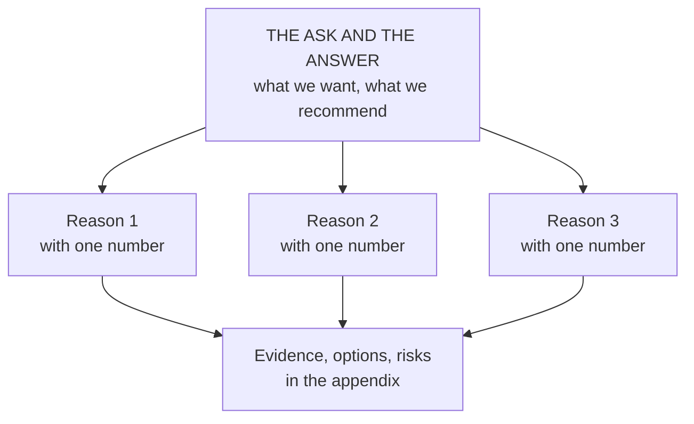

# Executive influence: narrative, the board and the negotiating table

*Part of [Business acumen for the product leader](./README.md)*

*Last reviewed: 2026-10 · Volatility: medium*

## TL;DR

At VP level, influence is most of the job. You rarely control the resources you need. You win them by making a clear case to executives, aligning peers before decisions, and negotiating with partners and other leaders. The skills are learnable: an **answer-first narrative**, data that makes one point per chart, **pre-wiring** before meetings, and negotiation built on interests and alternatives.

The core tradeoff is clarity against completeness. Executives need the answer, the ask and the risk in the first minute. Your team wants every detail included. A narrative that includes everything persuades nobody. The cost of clarity is leaving out true things that do not change the decision.

> 🎯 **For the product leader**
>
> **Why it matters** — Budgets, headcount, partner terms and launch approvals are decided at the executive table. A strong product case told badly loses to a weaker case told well.
>
> **What it changes in your decisions** — You lead with the ask and the answer. You show the one number the decision depends on. You meet each key stakeholder before the meeting. You walk into every negotiation knowing your best alternative.
>
> **Ask your team** — *"If the CEO reads only the first paragraph of our memo, do they know what we want, why, and what it costs?"*
>
> **Risk if ignored** — Your proposal gets deferred to "next quarter." Or you agree to partner terms you could have improved, because you did not know your own walk-away point.

## Mental model: answer first, then support



Put the conclusion at the top. Support it with three reasons, each with one number. Put the evidence below. An executive can stop reading at any level and still know your position.

**Where the model breaks.** Answer-first works when the audience trusts you and the decision is clear. For a contested or emotional issue, starting with the conclusion can make people defensive. Then start with the shared facts, and reach the recommendation together.

## Executive narrative

A good executive narrative follows a simple arc:

1. **The situation.** What is true today, in one or two sentences everyone agrees with.
2. **What changed.** The new fact that makes action necessary: a competitor, a rule, a loss trend.
3. **What we propose.** The recommendation and the ask.
4. **Why.** Three reasons, each with a number.
5. **Risks and options.** What could go wrong, and the alternatives you considered.

Write it before you build slides. Amazon has described its practice of using six-page narrative memos instead of slide decks, read in silence at the start of meetings. Whether or not you adopt that format, writing forces you to find the gaps in your own argument.

## Storytelling with data

- **One chart, one point.** State the point in the chart title: "Loss ratio on new policies is 6 points above the book," not "Loss ratio by cohort."
- **Show the comparison that matters.** Against plan, against last year, or against a control group.
- **Annotate.** Mark the launch date, the rule change or the outage on the chart.
- **Keep definitions stable.** If the metric's definition changed, say so on the chart.

Consistency builds trust over time. Public companies show the value of reporting the same metrics, defined the same way, quarter after quarter. Lemonade, for example, has reported its gross loss ratio in its public results over many years. Investors can track the trend because the measure stays the same.

## Board and CEO communication

Boards care about strategy, major risks, capital and leadership. They do not need feature detail.

- **No surprises.** Bad news goes to the CEO before the board meeting, and to the board before it reaches the press.
- **Pre-reads, not presentations.** Send material early. Use meeting time for questions.
- **Lead with what you need from them.** A decision, advice or awareness. Say which.
- **Keep the scorecard stable.** Show the same core metrics every time, with the same definitions.
- **Show risks with owners.** For each major risk: likelihood, impact, owner and mitigation.

## What executives ask, by domain

Each domain has a question the executive team will ask first. Answer it in your first paragraph.

| Domain | The first executive question |
| --- | --- |
| **Payments** | What happens to fraud and dispute rates, and to our net take rate? |
| **Lending** | What happens to losses by cohort, and to our funding needs? |
| **eCommerce** | What happens to contribution per order, not only to order volume? |
| **InsurTech** | What happens to the loss ratio, and do we need new rate filings? |
| **Retail** | What happens to gross margin and to inventory? |
| **FinTech** | What do our partner bank and our regulators need to approve? |

## Influence without authority

You influence peers through four things:

- **Shared goals.** Frame your ask as progress toward their goal, not only yours.
- **Credibility.** A record of delivering what you said, and of admitting when you were wrong.
- **Reciprocity.** Help peers hit their targets. They remember.
- **Clarity.** A clear ask is easier to say yes to than a vague one.

## Managing up and across

**Managing up** means making your manager's job easier. Know their goals and pressures. Bring problems early, with options. Ask how they want to be updated. Disagree in private, with evidence, and support the decision in public once it is made.

**Managing across** means aligning peers. Know what each peer is measured on, as in [lesson 2](./navigating-the-organization.md). Share credit. Escalate together when you cannot agree.

## Driving cross-functional alignment

1. **Name the decision and its owner.** See [lesson 3](./teams-and-collaboration.md).
2. **Write the pre-read.** One document with the facts, the options and the recommendation.
3. **Pre-wire.** Meet each key stakeholder alone first. Learn their objections while you can still change the proposal.
4. **Use the meeting to decide.** Not to discover objections.
5. **Close the loop.** Send the decision, the reason and the owners within a day.

## Negotiation at the executive table

Executives negotiate constantly: budgets with Finance, dates with Sales, terms with partners. Four ideas make you better at it.

- **Interests, not positions.** A position is what someone asks for. An interest is why. A partner bank asks for a larger revenue share (position) because it needs to cover its compliance cost (interest). You might meet the interest another way, for example by taking on some of the compliance work.
- **Your best alternative to a deal.** Know what you will do if you cannot agree. A second partner? Building it yourself? Delaying? Your alternative sets your walk-away point. The stronger it is, the more you can ask for.
- **The zone of agreement.** If your walk-away point and theirs overlap, a deal is possible. Find out where theirs is by asking questions, not by guessing.
- **Trade across issues.** Price, term, exclusivity, volume and timing can be traded against each other. A deal on one issue alone is a tug of war.

Public deals show trades across issues. When Shopify agreed in 2023 to sell most of its logistics business to Flexport, its results release said Shopify would receive a 13% equity interest in Flexport, on top of its existing stake. Shopify could also name a director to Flexport's board. Flexport would also become the official logistics partner for Shopify. Both sides traded across several issues: ownership, a board seat, a partnership and continued service for merchants.

## Worked example: a $3 million ask at an insurer

*This example is invented, to show the method. The insurer and all numbers are illustrative.*

A VP of Product at a home insurer wants $3 million to rebuild underwriting rules and data for new policies. Earned premium on new business is $40 million a year. Its loss ratio is 72%. The target after the rebuild is 67%.

**Step 1: compute the value.** 5 points × $40 million = **$2 million a year** in lower claims cost, if the target is met. Payback = $3 million ÷ $2 million = **1.5 years**.

**Step 2: find the one assumption that matters.** The case depends on the 5-point improvement. At 2.5 points, the value is $1 million a year and payback is 3 years.

**Step 3: write the first paragraph.**

> *We ask for $3 million to rebuild underwriting for new home policies. We expect it to cut the loss ratio on new business from 72% to 67%. That is worth $2 million a year and pays back in 18 months. We propose to release the money in two stages. The second stage depends on the first stage showing at least 2 points of improvement in two pilot states.*

**Step 4: offer options.**

| Option | Cost | Expected value | Risk |
| --- | --- | --- | --- |
| A. Full rebuild now | $3.0M | $2.0M a year | All money at risk before proof |
| **B. Staged: two pilot states first** | $1.2M, then $1.8M if the gate is met | $2.0M a year, about two quarters later | Small delay; most money waits for proof |
| C. Do nothing | $0 | $0 | Loss ratio on new business stays at 72% |

**Step 5: pre-wire and negotiate.** The CFO's interest is limiting cash at risk. The Chief Risk Officer's interest is no new exposure in the pilot states. The VP recommends option B, which meets both interests. Her alternative if the full ask is refused is option B anyway, so she can concede on staging at no cost. She asks for one thing in return: a commitment to release stage two within a month if the gate is met.

## Tradeoffs and decisions

- **Clarity vs. completeness.** A short narrative persuades. It leaves out detail your team cares about.
- **Pre-wiring vs. openness.** Pre-wiring avoids surprises. Done badly, it looks like back-room dealing. Share the same facts with everyone.
- **Staged vs. full ask.** A staged ask is easier to approve. It delays full value and adds a gate.
- **Winning vs. relationship.** A hard negotiation can win terms and cost trust with a partner you will deal with for years.

## Failure modes

- **The buried ask.** The ask is on slide 14. The meeting runs out of time on slide 9.
- **Data without a point.** Twelve charts, no headline.
- **Surprise in the room.** A peer hears your proposal for the first time in the decision meeting and objects to protect their team.
- **Negotiating with no alternative.** You accept poor terms because you never prepared a fallback.
- **Changing metrics.** A different definition each quarter. The board stops trusting the trend.

## Under the hood

A one-page decision memo template:

```markdown
# <Decision title>
**Ask:** <money / people / decision>, by <date>
**Recommendation:** <one sentence>

## Why (three reasons, one number each)
1.
2.
3.

## What it depends on
- The key assumption, and the result if it is half as good.

## Options considered
| Option | Cost | Value | Risk |

## Risks and owners
| Risk | Likelihood | Impact | Owner | Mitigation |

## What we need from this meeting
- Decide / advise / note
```

## Practitioner checklist

- [ ] Rewrite the first paragraph of your next proposal so it holds the ask, the answer and the cost.
- [ ] Give each chart a title that states its point.
- [ ] Find the one assumption your case depends on, and show the result if it is half as good.
- [ ] Pre-wire every key stakeholder before your next decision meeting.
- [ ] Before your next negotiation, write your best alternative and your walk-away point.
- [ ] List the other side's interests behind their positions.
- [ ] Keep your leadership scorecard's metric definitions fixed for a full year.

## Related lessons

- [Navigating the organization](./navigating-the-organization.md) — political capital and what each function protects.
- [The language of money](./the-language-of-money.md) — the numbers an executive case needs.
- [Communication](../product-sense/communication.md) — artifacts and storytelling for product leaders.
- [Specs, PRDs and RFCs](../technical-product-management/specs-prds-and-rfcs.md) — writing that drives decisions at team level.

## Sources and notes

- The insurer example and all its numbers are invented and illustrative.
- Amazon, 2017 letter to shareholders (published April 2018): six-page narrative memos, read silently at the start of meetings. [Amazon](https://www.aboutamazon.com/news/company-news/2017-letter-to-shareholders). As of 2026-10.
- Lemonade, Form 10-K for fiscal 2020 (filed 2021-03): gross loss ratio of 161% in 2017, 113% in 2018, 79% in 2019 and 71% in 2020. [Form 10-K](https://www.sec.gov/Archives/edgar/data/1691421/000169142121000024/lmda-20201231.htm). As of 2026-10.
- Shopify, first-quarter 2023 results release (Exhibit 99.1 to Form 6-K, 2023-05-04): agreement of 2023-05-03 to sell the majority of its logistics business to Flexport; Shopify to receive stock representing a 13% equity interest in Flexport, on top of its existing equity interest; Shopify entitled to name a director to Flexport's board; Flexport to become the official logistics partner for Shopify. [Exhibit 99.1](https://www.sec.gov/Archives/edgar/data/1594805/000159480523000023/exhibit991pressreleaseq120.htm). As of 2026-10.
