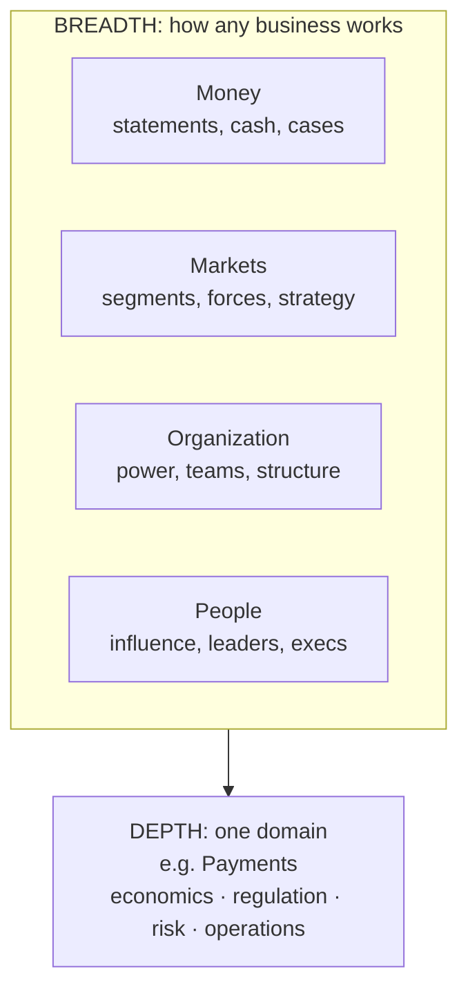

# Foundations: business acumen and the T-shaped leader

*Part of [Business acumen for the product leader](./README.md)*

## TL;DR

**Business acumen** is the skill of seeing how a decision moves the business. You know how the company makes money. You know which numbers matter. You can predict how a product change will show up in revenue, cost, risk and cash.

For a product leader, acumen has two parts. **Breadth** is general business knowledge: money, markets, organizations and people. **Depth** is mastery of one domain, such as Payments or Lending. Together they make a **T shape**: a wide bar of business knowledge over one deep stem of domain knowledge.

The core tradeoff is time. Every hour spent on breadth is an hour not spent on depth. This lesson helps you diagnose your own gaps first, so you spend that time where it pays. The track's <a href="assessment.html">interactive self-assessment</a> scores you on twelve axes and builds a plan.

> 🎯 **For the product leader**
>
> **Why it matters** — At Group PM level and above, your decisions move money directly. You approve bets, set targets and trade one team's capacity for another's. A leader who cannot connect a roadmap to the profit and loss statement gets overruled by someone who can.
>
> **What it changes in your decisions** — You stop picking development goals by comfort. You diagnose your gaps with evidence, pick the two that block your current decisions, and close them on purpose.
>
> **Ask your team** — *"If this initiative works, which line of our financial statements moves first, and by roughly how much?"*
>
> **Risk if ignored** — You win the product argument and lose the business argument. Finance, Risk or Sales leaders make the real call, and your team builds what they decided.

## Mental model: the T, and where it bends



The bar is what transfers. A balance sheet reads the same way in a bank and in a shop. The stem is what makes you hard to replace. A Payments leader knows that a lower price can still lose money if dispute rates rise.

**Where the analogy breaks.** A real leader's shape is not fixed. Depth in one domain often transfers to a neighbour. Payments depth helps in Lending, because both deal with fraud, regulation and money movement. And a stem can become a trap. Deep experts can stop questioning the rules of their own domain.

## What business acumen is, in practice

Acumen shows up as behaviour, not as vocabulary. A leader with acumen can do four things.

1. **Explain the money engine.** Say in two sentences how the company earns revenue, what it costs to deliver, and where profit comes from.
2. **Trace a decision to the numbers.** Say which metric a product change moves, and how that metric reaches revenue, cost or risk.
3. **Weigh options in a common currency.** Compare a growth bet and a cost cut using cash, margin and risk, not enthusiasm.
4. **Work the organization.** Know who decides, what each function is paid to protect, and how to build support before a meeting.

This track groups those abilities into four clusters. Each cluster is a set of lessons.

| Cluster | Lessons | The question it answers |
| --- | --- | --- |
| Foundations | 1, 5 | Where am I strong, and how do I decide under uncertainty? |
| Business and markets | 2, 4, 6 | How does this company make money, and where should it compete? |
| Product leadership | 7, 8, 9, 11 | What do we build, how do we price it, and how do we know it works? |
| People and influence | 3, 10, 12 | How do I lead teams, leaders and executives? |

## Why domain depth compounds

General acumen tells you which questions to ask. Domain depth tells you the answers that are specific to your industry. Each domain has a few **binding constraints**. These are the rules that decide what is possible, whatever the product idea.

| Domain | A binding constraint | What a leader without depth gets wrong |
| --- | --- | --- |
| **Payments** | Interchange and dispute economics. The card issuer earns a fee on each card payment. The merchant pays it, and the merchant also absorbs most losses when a cardholder disputes a charge. | Prices a new merchant segment on volume alone. Then dispute losses in that segment erase the margin. |
| **Lending** | Credit losses arrive months after the decision. Revenue arrives over the life of the loan. | Celebrates a rise in approval rate before the first loans have had time to default. |
| **eCommerce** | A marketplace keeps only its **take rate**, the share of each sale it earns as revenue. Logistics and returns can cost more than that share. | Reports gross merchandise value as if it were revenue. |
| **InsurTech** | The **loss ratio**, claims paid as a share of premium earned, is only known after claims come in. In the US, states regulate insurance, and many lines need rate filings with state regulators. | Launches a cheap price to grow fast. The losses on that business show up a year later. |
| **Retail** | Inventory ties up cash. Unsold stock gets marked down. | Adds range to lift sales and slows stock turns. Cash gets tight in the peak season. |
| **FinTech** | Regulation shapes the model. Licences, partner banks and capital rules decide what the company may do. | Plans a feature that the partner bank's compliance team must approve, and finds out late. |

Public companies show these constraints in what they choose to report. Three examples:

- **eCommerce.** DoorDash reports a "net revenue margin": its revenue as a share of the order value on its marketplace. Its filings put that figure at 13.4% for 2024. The rest of each order's value goes to merchants, couriers, taxes and tips.
- **InsurTech.** Lemonade's filings for 2020 show its gross loss ratio falling from 161% in 2017 to 71% in 2020. For its first years, claims cost more than the premium it earned.
- **Lending.** Upstart's 10-K for 2022 says funding constraints led it to use its own balance sheet to support loan funding. A lending platform depends on capital partners as much as on borrowers.

Depth compounds for three reasons. First, each decision reuses the same model, so you get faster. Second, you see second-order effects, such as a growth push that raises losses later. Third, you earn trust with Risk, Finance and Compliance partners. They stop explaining the basics and start debating options with you.

## How to self-diagnose

Self-ratings are noisy. Most people rate themselves higher on skills they use often, and lower on skills they rarely see. Three habits make a self-diagnosis useful.

- **Rate behaviours, not traits.** "I can explain how a rise in our default rate changes next quarter's profit" is testable. "I understand finance" is not.
- **Check against evidence.** For each high score, name an artifact you produced: a business case, a pricing memo, a reorg proposal. No artifact means the score is a guess.
- **Ask one honest peer.** A finance or risk partner can tell you in ten minutes where you sound unsure.

The <a href="assessment.html">self-assessment</a> uses this method. It asks 48 "I can" statements, four for each of the twelve lessons. It turns your answers into a score per axis and a radar chart. Then it ranks your gaps and suggests a two-week action from the matching lesson.

## Worked example: a leader changes domain

*This example is invented, to show the method. The person, the scores and the plan are illustrative.*

A Group PM has spent six years in eCommerce marketplaces. She moves to a consumer Lending company as Head of Product. In her first week she takes the self-assessment.

**Step 1: score each axis.** Each statement is rated 1 to 5. An axis has four statements, so its raw total runs from 4 to 20. The tool converts that to a percentage: (total − 4) ÷ 16 × 100.

| Axis | Ratings | Total | Score |
| --- | --- | --- | --- |
| The language of money | 4, 4, 3, 3 | 14 | (14 − 4) ÷ 16 = 62.5% |
| Markets and strategy | 4, 4, 4, 3 | 15 | 68.75% |
| Monetization and business models | 4, 3, 2, 2 | 11 | 43.75% |
| Data and decisions | 3, 2, 2, 3 | 10 | 37.5% |
| Executive influence | 4, 4, 4, 4 | 16 | 75% |

**Step 2: check the low scores against the new domain.** Her monetization score is low on the two lending statements. She knows take rates well. She has never priced credit, where the price must cover the cost of funds and the expected losses. Her data score is low because lending outcomes are slow. A loan approved today may not default for a year.

**Step 3: pick two gaps that block a current decision.** Her first big decision is whether to loosen the credit cutoff to grow volume. That decision needs both weak axes. She picks Monetization and Data and decisions.

**Step 4: set a two-week action for each.**

- Monetization: rebuild the unit economics of one loan product with the finance partner. Write down the cost of funds, expected loss, servicing cost and margin per loan. See [lesson 11](./monetization-and-business-models.md).
- Data and decisions: ask the credit risk team for loss curves by monthly cohort of loans. Learn when losses peak. See [lesson 5](./data-and-decisions.md).

**Step 5: re-take the assessment in a quarter.** The aim is not a high score. The aim is that the next cutoff decision is one she can defend to the Chief Risk Officer.

## Tradeoffs and decisions

- **Breadth vs. depth.** Breadth makes you mobile across companies. Depth makes you valuable inside one industry. The cost of breadth is shallow judgement on the hard calls. The cost of depth is a narrower market for your skills.
- **One domain vs. a neighbour.** Moving from Payments to Lending reuses half your depth. Moving from Payments to Retail reuses less. The cost of a far move is a slower first year.
- **Acumen vs. craft.** Time spent learning finance is time not spent on discovery or design. At VP level the balance shifts toward acumen. Your teams hold the craft, and you hold the tradeoffs.
- **Self-study vs. a partner.** Learning with a finance or risk partner is faster and builds a relationship. It costs you some exposure, because they see what you do not know.

## Failure modes

- **Vocabulary without judgement.** The leader says "contribution margin" in every meeting but cannot say which feature lowers it. Finance partners notice quickly.
- **Domain capture.** The leader knows the industry so well that they defend its habits. A new competitor wins with the idea they dismissed.
- **Finance as a side topic.** Business cases get written by a junior analyst and signed without reading. The first audit question exposes a broken assumption.
- **Inflated self-ratings.** The leader scores 5 everywhere and finds no gaps. The plan is empty, and nothing changes.
- **Studying the wrong gap.** The leader closes a gap that no current decision needs. The urgent gap stays open.

## Under the hood

The self-assessment uses a simple, transparent scoring rule. You can recompute it by hand.

```text
For each axis a with four ratings r1..r4 (each 1 to 5):
  total(a) = r1 + r2 + r3 + r4               # 4 to 20
  score(a) = (total(a) - 4) / 16 * 100       # 0% to 100%
  gap(a)   = 100 - score(a)

Rank axes by gap, largest first.
  score < 50%        -> "focus": show the lesson link and one two-week action
  50% <= score < 75% -> "build": show the lesson link
  score >= 75%       -> "maintain or stretch"
```

The radar chart plots each score as a distance from the centre on twelve spokes. The spokes are grouped by cluster, so a weak cluster shows as a dent on one side.

## Practitioner checklist

- [ ] Write two sentences on how your company makes money, and check them with a finance partner.
- [ ] Take the <a href="assessment.html">self-assessment</a> and record your twelve scores.
- [ ] For each score of 4 or 5 on a statement, name one artifact that proves it.
- [ ] List your domain's three binding constraints, and the team that owns each one.
- [ ] Pick two gaps that block a decision you face this quarter.
- [ ] Book a 30-minute session with one finance or risk partner to test your weakest area.
- [ ] Put a date in your calendar to re-take the assessment in one quarter.

## Related lessons

- [Navigating the organization](./navigating-the-organization.md) — how the company makes money, and who decides.
- [The language of money](./the-language-of-money.md) — the statements behind every business argument.
- [Domain expertise](../product-sense/domain-expertise.md) — how domain knowledge becomes product intuition, and the expert trap.
- [Becoming a polymath](../first-principles/becoming-a-polymath.md) — breadth and depth as a learning strategy.
- [The technical PM role](../technical-product-management/the-technical-pm-role.md) — the craft side of the job that acumen sits on.

## Sources and notes

- The worked example, the person and all scores are invented and illustrative.
- The scoring formula is the one implemented in this track's self-assessment page.
- Domain facts in the table are general descriptions of how these industries work. As of 2026-10.
- DoorDash, Form 10-K for fiscal 2024 (net revenue margin defined as revenue divided by Marketplace GOV; 13.4% for 2024). [Filing index](https://www.sec.gov/cgi-bin/browse-edgar?action=getcompany&CIK=1792789&type=10-K).
- Lemonade, Form 10-K for fiscal 2020 (gross loss ratio 161% in 2017, 113% in 2018, 79% in 2019, 71% in 2020). [Filing index](https://www.sec.gov/cgi-bin/browse-edgar?action=getcompany&CIK=1691421&type=10-K).
- Upstart, Form 10-K for fiscal 2022 (use of its balance sheet in response to funding constraints). [Filing index](https://www.sec.gov/cgi-bin/browse-edgar?action=getcompany&CIK=1647639&type=10-K).
- Note: sec.gov could not be opened from the build environment (blocked by the network proxy). These figures were corroborated from search-result excerpts of the filings, as of 2026-10. The fact-check should confirm them against the filings.
