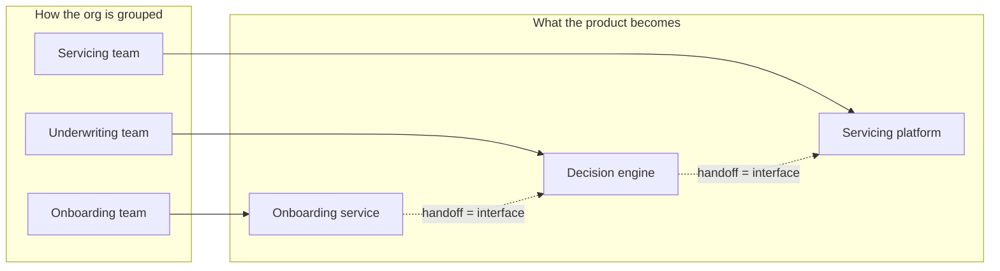
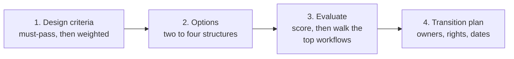
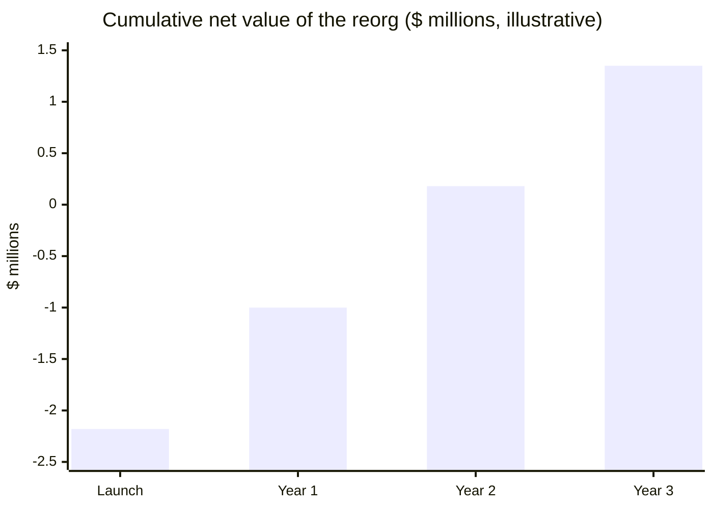

# Leading leaders and designing the product org

*Part of [Business acumen for the product leader](./README.md)*

## TL;DR

When you lead managers, your product is the organization. You no longer make most product decisions yourself. You choose the structure, hire and develop the leaders, set the standards, and inspect the results. A good org lets good decisions happen without you. A bad one routes every hard call to your calendar.

The core tradeoff is how you group people. Every structure makes some coordination easy and other coordination hard. Group by discipline and craft standards rise, but customer journeys cross many teams. Group by product line and journeys get one owner, but standards drift. There is no neutral choice. You choose which coordination you want to be cheap.

A reorg is also an investment with a price. It costs lost team-weeks and some people who leave. It pays back only through cheaper coordination over the years the new structure lasts. This lesson shows how to design a structure on purpose, how to price the change, when to give a product leader a profit and loss (P&L), and how to level and calibrate leaders fairly.

> 🎯 **For the product leader**
>
> **Why it matters** — Org design decides which problems your company can solve quickly. A lender organized by function needs four teams to change how a returning borrower is approved. A lender organized by customer journey may need one.
>
> **What it changes in your decisions** — You write design criteria before you draw boxes. You price a reorg in team-weeks before you announce it. You give a leader a P&L only when they hold its main levers. You calibrate ratings on evidence, not on advocacy.
>
> **Ask your team** — *"For our top goal this year, how many teams must change something to move it, and who owns the result?"*
>
> **Risk if ignored** — An org chart that made sense two strategies ago. Every important change becomes a cross-team project with no single owner. Or the opposite: a reorg every year that never pays back its own cost.

## Decision rules in this lesson

- **Write the design criteria first.** Must-pass criteria, such as an independent credit risk function, come before any weighted score.
- **Do not reorg unless the new structure will outlast its payback.** Price the lost team-weeks and the attrition, then compare them with the yearly saving.
- **Give every critical system a named owning team on day one of the new structure.**
- **Give a product leader a P&L only when they control the levers that drive most of it.** Otherwise you create blame without authority.
- **Define levels by scope, ambiguity and business impact, never by tenure.**
- **In calibration, a rating without evidence moves toward the middle.** Advocacy is not evidence.
- **Add a management layer last.** Try clearer decision rights and team boundaries first.

## Mental model: the system mirrors the org



Organizations tend to build systems that copy their own communication structure. Call this the **system-mirrors-the-org principle**. Each team builds its own part. Where two teams must talk, an interface appears. Where they rarely talk, the parts drift apart. So if you want a seamless customer journey, give one team ownership of it.

**Where the principle breaks.** It is a strong tendency, not a law. Shared platforms, strong architecture standards and good interfaces can soften it. And reorganizing to match a new design does not change the existing system overnight. The old structure stays in the code for years.

## Mechanics

### Managing managers

Leading leaders is a different job from leading individual contributors.

- **Set direction, not tasks.** Give each leader an outcome, a budget and constraints. Let them choose the path.
- **Inspect through artifacts.** Review strategies, business cases and metric reviews. Do not review every spec.
- **Use skip-levels.** Talk regularly with people two levels down. You hear what filtered reports leave out.
- **Develop leaders on purpose.** Give stretch scope with support. Name the next role each leader is growing toward.
- **Act on underperformance early.** A struggling leader affects a whole team. Waiting is the most expensive choice.

### Product org structures

| Structure | How it groups people | Makes cheap | Makes expensive |
| --- | --- | --- | --- |
| **Functional** | By discipline: all product managers (PMs) together, all engineers together | Craft standards, shared methods | Cross-team journeys; slow end-to-end decisions |
| **Product-line or business-unit** | By product, segment or line of business, often with its own profit and loss | Ownership of outcomes; speed within a line | Consistency across lines; shared platforms |
| **Matrix** | Two reporting lines: a discipline line and a product line | Balance of standards and outcomes | Clarity; people serve two bosses |

Block is a public example of grouping by customer segment. Its 10-K describes two ecosystems: Square, for sellers, and Cash App, for consumers. It reports gross profit for each. Each ecosystem serves a different customer with its own products.

Domain-specific choices:

- **Payments**: by flow (accepting payments, issuing cards, risk) or by customer segment (small business, enterprise, platforms).
- **Lending**: by lifecycle (acquisition, underwriting, servicing, collections) or by product (personal loans, cards, point-of-sale credit).
- **InsurTech**: by line of business (auto, home, renters), each with its own pricing and claims needs.
- **Retail**: by channel (stores, online) or by journey across channels. The more customers mix channels, the more a channel split hurts.
- **eCommerce marketplace**: by side (buyers, sellers) or by category.
- **FinTech**: often a product-line structure plus a strong central Risk and Compliance function.

Inside each unit, teams still need types and ways of working together. That level of design lives in [teams and collaboration](./teams-and-collaboration.md).

### The org-design process

Most reorgs start with boxes on a slide. That is the last step, not the first. A sound design runs in four steps.



**Step 1: write the design criteria.** Criteria come from the strategy. Ask what the org must make easy in the next two years. Split them into two kinds.

- **Must-pass criteria** are rules no option may break. In regulated domains, some come from the risk model. Credit risk must stay independent of the team paid on loan volume. Compliance must not report to the leader whose launches it reviews. The [three lines of defence](./navigating-the-organization.md) set these limits.
- **Weighted criteria** are goals you trade against each other. Examples: "the top goal sits in one team", "spans of about six", "no critical system without an owner", "low disruption".

Write the weights before you see the options. If you weight afterwards, you will weight toward the option you already like.

**Step 2: generate options.** Draw two to four real structures. Include the status quo with small fixes. It is often better than it looks, because it costs nothing to move to.

**Step 3: evaluate.** Drop any option that fails a must-pass criterion. Score the rest from 1 to 5 on each weighted criterion. Then do the step most leaders skip: **walk the top five workflows** through each option. For each workflow, count the teams that must change something and the handoffs between them. A score can hide a broken journey. A walk-through cannot.

**Step 4: write the transition plan.** A structure is not done until the plan names:

- the new owner of every system, data set and on-call rota;
- the new decision rights for each recurring decision (see [teams and collaboration](./teams-and-collaboration.md));
- who moves, who is told first, and in what order;
- a date to freeze the old roadmap and a date the new teams plan their first quarter;
- a review date, about six months out, to check the criteria were met.

**Decision rule.** Announce structure, people and owners in one week. A long gap between "a reorg is coming" and "here is your team" is the most expensive part of any reorg.

**The common misreading.** "The scoring matrix picks the answer." It only makes the choice explicit. The walk-through and the must-pass rules do most of the work.

### The cost of a reorg

A reorg is an investment. It has an up-front cost and a yearly return. Leaders rarely price either.

**The cost** has three parts.

1. **Lost team-weeks.** Teams that change members or scope slow down while they form and learn new systems. Teams that do not change still lose time to uncertainty and meetings.
2. **Attrition.** Some people leave, often the ones with the most options. Each regretted departure costs hiring time, ramp time and lost knowledge.
3. **Delay.** Roadmap work slips by about the lost weeks. That delays revenue.

The formula for the first part is simple:

**lost cost = Σ (teams in a group × weeks lost per team) × cost per team-week**

**Cost per team-week** = people per team × fully loaded cost per person ÷ working weeks per year. Fully loaded cost is defined in [navigating the organization](./navigating-the-organization.md).

**The return** is the coordination you no longer pay for. Fewer teams on a goal means fewer handoffs and fewer meetings. Each handoff also adds queue time, as the [cost of a handoff](./teams-and-collaboration.md) shows.

**Payback = total cost ÷ yearly saving.** If the structure will not last longer than its payback, the reorg destroys value. A company that reorgs every year never collects the return.

**Domain application.** In a lender, a reorg that moves the decision engine to a new team also moves the credit model's change process. Model risk teams may need to re-approve who can change it. Add those weeks to the cost.

**The common misreading.** "The reorg is free because nobody was hired or fired." The team-weeks are real money. They just never show up as a line in the budget.

### The general-manager model

A **general manager (GM)** owns a business unit's P&L. In a product company, this often means a product leader who answers for revenue, margin and cost, not only for usage and delivery.

**What changes for the leader.**

| | Product leader without a P&L | Product leader as GM |
| --- | --- | --- |
| Measured on | Adoption, delivery, product metrics | Unit revenue, contribution, operating profit |
| Owns | Roadmap and product decisions | Roadmap, pricing, marketing spend, often sales and operations |
| Trades | Features against features | Growth against margin, this year against next |
| Common pain | Accountable for outcomes it cannot fully steer | Pressure to hit the quarter at the expense of the product |

A GM P&L usually has the shape below. Shared costs, such as platform engineering, arrive as an [internal charge](./navigating-the-organization.md).

```text
  Unit revenue (net of incentives and refunds)
- Direct variable costs (processing, losses, fulfilment)
= Contribution
- Direct operating costs (the unit's own teams)
= Direct profit           <- what the GM controls most
- Allocated shared costs (platforms, central functions)
= Unit operating profit   <- what Finance reports
```

**When the GM model works.** Four conditions help.

- **Separable customers.** The unit serves a customer group that others do not. Block's two ecosystems, sellers and consumers, are an example of this split.
- **Separable revenue and cost.** Finance can measure the unit's P&L without large arguments over allocation.
- **Control of the main levers.** The GM sets price, product and acquisition spend. Shared platforms are priced fairly.
- **Enough scale.** The unit can carry its own leadership cost.

**Domain application.** A card issuer makes a product leader GM of its card business. Revenue is interchange, interest and fees. The biggest cost is credit losses. But the credit cutoff stays with Credit Risk, as the second line requires. So the GM's P&L contains a cost the GM cannot set alone. The fix is a shared target: the GM owns growth within a loss limit that Credit Risk sets. In payments, a GM of the small-business segment can own net revenue and fraud losses. The fraud rules still sit with Risk.

**Decision rule.** Give a product leader a P&L when they control the levers behind most of it. Judge them on direct profit, not on allocated cost they cannot change.

**The common misreading.** "A P&L makes a leader accountable." It makes them accountable for what they control. For the rest, it only makes them anxious.

### Hiring, leveling and performance

**Hiring.** Write a scorecard for each role: the outcomes expected in the first year and the skills needed. Use structured interviews, where each interviewer tests specific skills. This makes hiring more consistent.

**Leveling.** A career ladder defines each level by scope and impact, not by tenure. A useful rubric has a few dimensions, and describes each level on each one. The example below is illustrative. Your company's ladder will differ.

| Dimension | PM | Senior PM | Group PM | Director |
| --- | --- | --- | --- | --- |
| **Scope** | A feature area | A product | Several products | A product line and its business results |
| **Ambiguity** | Problem is defined; finds the solution | Defines the problem within a goal | Sets goals for several teams | Chooses which problems the line works on |
| **Business impact** | Moves a product metric | Moves a business metric for one product | Moves a P&L line, such as contribution | Owns a P&L or a major share of one |
| **Influence** | Own team | Peer teams | Other functions and partners | Executives, partners and regulators |
| **Develops people** | Self | Mentors | Hires and grows PMs | Hires and grows leaders |

Write evidence examples for each cell. "Moves a P&L line" means little alone. "Changed the dispute process and cut chargeback losses by a measured amount" is evidence.

**Span of control** is the number of people reporting to one manager. Narrow spans give more coaching and add layers. Wide spans flatten the org and give each person less attention. The right span depends on how similar the work is and how experienced the people are.

**Performance and calibration.** Set clear expectations at the start of a period. Then **calibrate**: a group of managers reviews ratings across teams, so one manager's "strong" means the same as another's. A calibration session works like this.

1. **Pre-read.** Each manager submits proposed ratings, with two or three pieces of evidence per person against the level rubric.
2. **Distribution check.** The facilitator shows each manager's share of ratings in each band. Large gaps between managers get discussed first.
3. **Anchor cases.** The group agrees on one or two clear examples per band. Every other case is compared with the anchors.
4. **Evidence over advocacy.** A rating moves only on evidence. A manager who argues harder does not win.
5. **Bias checks.** The facilitator asks about recency (only the last month counts), halo (one strength colours everything), and similarity (people like the manager rate higher).
6. **Record.** Final ratings, the reason for every change, and actions for each person.

*An illustrative example. All inputs are assumed.* Two managers each rate ten PMs. Manager A proposes "exceeds" for six of them, 60%. Manager B proposes "exceeds" for one, 10%. The company's guideline, not a quota, is about 20 to 30%. Either A's team is much stronger, or the two scales differ. The group asks A for evidence against the rubric for each of the six. Three hold up. Three move to "meets". B's team gets the same test in reverse: is anyone under-rated? One PM moves up. The result is four "exceeds" out of ten for A and two for B. Six of twenty is 30%, at the top of the guideline. The point is not the curve. It is that the evidence now means the same thing on both teams.

**Decision rule.** Address underperformance with a clear plan, evidence and a date. Calibrate before you tell anyone their rating.

### Scaling the org

Add structure when coordination costs start to hurt: decisions wait, teams duplicate work, or leaders cannot keep up with their reports. Common signs it is time:

- A manager's reports exceed what they can coach well.
- Two teams keep building the same thing.
- One leader is in every decision, and is the bottleneck.

Each added layer slows information and decisions. Add layers last. First try clearer decision rights ([teams and collaboration](./teams-and-collaboration.md)) and better team boundaries.

## Worked example: reorganizing a lending product org

*This example is invented, to show the method. The company, its teams and all numbers are illustrative. All inputs are assumed.*

A consumer lender has 30 PMs organized by function: a web team, a mobile team, a decision-engine team, a data team, and so on. There are 12 product teams of eight people. The top goal for next year is "approve returning borrowers in under one minute."

**Step 1: count the handoffs.** Under the current structure, the goal needs changes from four teams: web, mobile, decision engine and servicing data. Four teams means four backlogs and three handoffs.

**Step 2: write the criteria.** Must-pass: credit policy stays with Credit Risk, not with any product team. Weighted: the top goal sits in one team (weight 40%); spans of about six (20%); every system has an owner (20%); low disruption (20%).

**Step 3: design around the outcome.** The vice president (VP) of Product proposes a lifecycle structure: acquisition, underwriting, servicing and collections. The returning-borrower goal now sits mainly with one team, underwriting, and touches one other, servicing. Two teams, one handoff. The status quo scores higher only on disruption.

**Step 4: choose the span.** Compare two spans for 30 PMs.

| Span | Group leads | Next layer | Top | Management layers | Managers |
| --- | --- | --- | --- | --- | --- |
| 6 | 30 ÷ 6 = 5 | — | 1 VP (span 5) | 2 | 6 |
| 3 | 30 ÷ 3 = 10 | 4 directors (10 ÷ 3, rounded up) | 2 senior directors, then 1 VP | 4 | 17 |

A span of 3 needs 17 managers and four layers. A span of 6 needs 6 managers and two layers. The VP picks a span of about 6. Group leads still have time to coach, and decisions pass through fewer layers.

**Step 5: price the reorg.** Each team has eight people at an assumed fully loaded cost of $245,000 each. Assume 48 working weeks a year. One team-week costs 8 × $245,000 ÷ 48 = **$40,833**.

| Group | Teams | Weeks lost per team (assumed) | Team-weeks lost |
| --- | --- | --- | --- |
| Re-formed: new members and new scope | 5 | 6 | 30 |
| Re-scoped: same people, new scope | 4 | 3 | 12 |
| Untouched, but distracted | 3 | 0.5 | 1.5 |
| **Total** | **12** | | **43.5** |

Lost time costs 43.5 × $40,833 = **$1,776,250**. Assume two extra regretted departures at $200,000 each, for hiring, ramp and lost knowledge. That adds $400,000. The total cost is **$2,176,250**.

**Step 6: price the return.** Today, four teams each spend an assumed 20% of their time coordinating on the goal. That is 4 × 0.20 × 48 = 38.4 team-weeks a year. After the reorg, two teams spend 10%: 2 × 0.10 × 48 = 9.6 team-weeks. The saving is 28.8 team-weeks, worth 28.8 × $40,833 = **$1,176,000 a year**.

**Step 7: decide.** Payback is $2,176,250 ÷ $1,176,000 = **1.85 years**, about 22 months. Cumulative net value is −$1.0 million after one year, +$0.18 million after two and +$1.35 million after three. This count ignores the value of shipping the goal faster, which comes on top. The VP commits to keep the structure for at least three years. She would not do this reorg if another one were likely within two.



**Step 8: plan the transition.** The decision engine was built by a team that no longer exists in the new structure. The VP assigns it to the underwriting team on day one. She funds a quarter of work to clean up the interfaces the old structure created. She announces structure, people and owners in the same week.

## Tradeoffs and decisions

- **Functional vs. product line.** Functional orgs raise craft standards and slow journeys. Product-line orgs speed journeys and let standards drift.
- **Narrow vs. wide spans.** Narrow spans give coaching and add layers. Wide spans speed decisions and thin out support.
- **Stability vs. fit.** Every reorg costs months of lost speed. Not reorganizing costs speed every day the structure mismatches the strategy. The payback test tells you which cost is larger.
- **GM ownership vs. shared control.** A P&L sharpens trade-offs between growth and margin. It can push a leader toward the quarter and against shared platforms.
- **Calibration rigour vs. manager time.** Evidence-based calibration is fairer. It costs each manager hours of preparation every cycle.
- **Hire senior vs. grow internal.** Senior hires bring speed and new ideas. Internal growth keeps knowledge and builds loyalty.

## Failure modes

- **The reorg as a fix for everything.** Leaders reorganize every year. Teams never settle long enough to deliver, and no reorg pays back.
- **Boxes before criteria.** The new chart fits the leaders, not the strategy. Nobody can say what it was meant to make easy.
- **The long limbo.** A reorg is rumoured for two months. Work stops and the best people take outside calls.
- **The orphaned system.** A reorg leaves a critical system with no owning team. It fails at night and nobody is on call.
- **The paper P&L.** A GM is judged on a P&L whose main cost, such as credit losses, someone else sets. Blame flows, decisions do not.
- **Calibration by volume.** The loudest manager wins ratings for their team. Good people on quieter teams leave over fairness.
- **Layer creep.** Each promotion adds a manager. Decisions slow and nobody notices why.
- **The bottleneck leader.** One senior leader approves everything. The org cannot scale past their calendar.

## Under the hood

The script reproduces the lesson's numbers: the layer count, the reorg cost and payback, and the calibration shares. All inputs are the illustrative assumptions above.

```python
import math

# Layers and managers for N people at a given span
def layers(n, span):
    count, managers = 0, 0
    while n > 1:
        n = math.ceil(n / span)
        managers += n
        count += 1
    return count, managers

print(layers(30, 6))  # (2, 6)
print(layers(30, 3))  # (4, 17)

# Cost of a reorg (assumed inputs)
loaded, people, weeks = 245_000, 8, 48
team_week = people * loaded / weeks                     # $40,833
groups = {"re-formed": (5, 6.0), "re-scoped": (4, 3.0), "untouched": (3, 0.5)}
lost = sum(teams * w for teams, w in groups.values())   # 43.5 team-weeks
attrition = 2 * 200_000
cost = lost * team_week + attrition                     # $2,176,250

# Yearly return: coordination time saved on the top goal
saved = 4 * 0.20 * weeks - 2 * 0.10 * weeks             # 28.8 team-weeks
saving = saved * team_week                              # $1,176,000
print(f"team-week ${team_week:,.0f}; cost ${cost:,.0f}; saving ${saving:,.0f}/yr")
print(f"payback {cost / saving:.2f} years")             # 1.85
for year in (1, 2, 3):
    print(f"year {year}: cumulative net ${saving * year - cost:,.0f}")

# Calibration: share rated "exceeds" before and after
before = {"A": 6, "B": 1}
after = {"A": 4, "B": 2}
for label, d in (("before", before), ("after", after)):
    shares = {m: f"{n / 10:.0%}" for m, n in d.items()}
    print(label, shares, f"overall {sum(d.values()) / 20:.0%}")
```

A design-criteria file keeps the evaluation honest. Write it before you draw options.

```yaml
goal: "Approve returning borrowers in under one minute"
must_pass:
  - "Credit policy stays with Credit Risk, independent of volume targets"
  - "Every critical system has an owning team on day one"
weighted:
  top_goal_in_one_team: 0.40
  span_about_six: 0.20
  every_system_owned: 0.20
  low_disruption: 0.20
min_structure_life_years: 3     # longer than the payback
review_on: 2027-06-30
```

## Practitioner checklist

- [ ] For your top goal, count how many teams must change something to move it.
- [ ] Draw your org chart next to your system map. Mark where they mismatch.
- [ ] Before your next reorg, write the must-pass and weighted criteria and get them agreed.
- [ ] Walk your top five workflows through each structure option. Count teams and handoffs.
- [ ] Price the reorg in team-weeks and attrition. Compare the payback with how long the structure will last.
- [ ] Make sure every critical system has an owning team.
- [ ] For each P&L owner, list the levers they control and the ones they do not.
- [ ] Check every leader's span. Flag any that are too wide to coach or too narrow to justify a layer.
- [ ] Before your next calibration, write evidence examples for each level on your ladder.
- [ ] Hold one skip-level conversation this week.

## Related lessons

- [Teams and collaboration](./teams-and-collaboration.md) — team types, the cost of a handoff and decision rights inside the structure.
- [Navigating the organization](./navigating-the-organization.md) — fully loaded cost, internal charges and the three lines of defence.
- [Unit economics](./unit-economics.md) — the contribution line a GM steers by.
- [Business cases, capital and valuation](./business-cases-and-valuation.md) — payback and net present value (NPV) for any investment, a reorg included.
- [How systems are built](../technical-product-sense/how-systems-are-built.md) — the architecture your org will mirror.
- [Foundations and framework](../system-design/foundations-and-framework.md) — how systems are designed at scale.
- [Working with engineering](../technical-product-management/working-with-engineering.md) — the partnership at team level.
