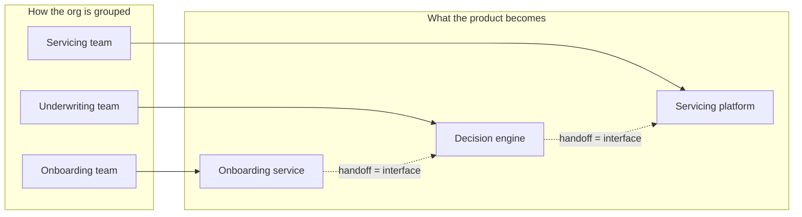

# Leading leaders and designing the product org

*Part of [Business acumen for the product leader](./README.md)*

*Last reviewed: 2026-10 · Volatility: medium*

## TL;DR

When you lead managers, your product is the organization. You no longer make most product decisions yourself. You choose the structure, hire and develop the leaders, set the standards, and inspect the results. A good org lets good decisions happen without you. A bad one routes every hard call to your calendar.

The core tradeoff is how you group people. Every structure makes some coordination easy and other coordination hard. Group by discipline and craft standards rise, but customer journeys cross many teams. Group by product line and journeys get one owner, but standards drift. There is no neutral choice. You choose which coordination you want to be cheap.

> 🎯 **For the product leader**
>
> **Why it matters** — Org design decides which problems your company can solve quickly. A lender organized by function needs four teams to change how a returning borrower is approved. A lender organized by customer journey may need one.
>
> **What it changes in your decisions** — You design the org around the outcomes you most need to move. You set span of control and leveling on purpose. You expect the product and its systems to mirror your structure, and you plan for it.
>
> **Ask your team** — *"For our top goal this year, how many teams must change something to move it, and who owns the result?"*
>
> **Risk if ignored** — An org chart that made sense two strategies ago. Every important change becomes a cross-team project with no single owner.

## Mental model: the system mirrors the org



Organizations tend to build systems that copy their own communication structure. Call this the **system-mirrors-the-org principle**. Each team builds its own part. Where two teams must talk, an interface appears. Where they rarely talk, the parts drift apart. So if you want a seamless customer journey, give one team ownership of it.

**Where the principle breaks.** It is a strong tendency, not a law. Shared platforms, strong architecture standards and good interfaces can soften it. And reorganizing to match a new design does not change the existing system overnight. The old structure stays in the code for years.

## Managing managers

Leading leaders is a different job from leading individual contributors.

- **Set direction, not tasks.** Give each leader an outcome, a budget and constraints. Let them choose the path.
- **Inspect through artifacts.** Review strategies, business cases and metric reviews. Do not review every spec.
- **Use skip-levels.** Talk regularly with people two levels down. You hear what filtered reports leave out.
- **Develop leaders on purpose.** Give stretch scope with support. Name the next role each leader is growing toward.
- **Act on underperformance early.** A struggling leader affects a whole team. Waiting is the most expensive choice.

## Product org structures

| Structure | How it groups people | Makes cheap | Makes expensive |
| --- | --- | --- | --- |
| **Functional** | By discipline: all PMs together, all engineers together | Craft standards, shared methods | Cross-team journeys; slow end-to-end decisions |
| **Product-line or business-unit** | By product, segment or line of business, often with its own profit and loss | Ownership of outcomes; speed within a line | Consistency across lines; shared platforms |
| **Matrix** | Two reporting lines: a discipline line and a product line | Balance of standards and outcomes | Clarity; people serve two bosses |

Block is a public example of grouping by customer segment. Its 10-K describes two ecosystems: Square, for sellers, and Cash App, for consumers. It reports gross profit for each. Each ecosystem serves a different customer with its own products.

Domain-specific choices:

- **Payments**: by flow (accepting payments, issuing cards, risk) or by customer segment (small business, enterprise, platforms).
- **Lending**: by lifecycle (acquisition, underwriting, servicing, collections) or by product (personal loans, cards, point-of-sale credit).
- **InsurTech**: by line of business (auto, home, renters), each with its own pricing and claims needs.
- **Retail**: by channel (stores, online) or by journey across channels. The more customers mix channels, the more a channel split hurts.
- **eCommerce marketplace**: by side (buyers, sellers) or by category.
- **FinTech**: often a product-line structure plus a strong central Risk and Compliance function.

## Hiring, leveling and performance

**Hiring.** Write a scorecard for each role: the outcomes expected in the first year and the skills needed. Use structured interviews, where each interviewer tests specific skills. This makes hiring more consistent.

**Leveling.** A career ladder defines each level by scope and impact, not by tenure. For example: a PM owns a feature area; a senior PM owns a product; a group PM owns several products and develops PMs; a director owns a product line and its business results.

**Span of control** is the number of people reporting to one manager. Narrow spans give more coaching and add layers. Wide spans flatten the org and give each person less attention. The right span depends on how similar the work is and how experienced the people are.

**Performance.** Set clear expectations at the start of a period. Calibrate ratings across teams, so one manager's "strong" means the same as another's. Address underperformance with a clear plan and a date.

## Scaling the org

Add structure when coordination costs start to hurt: decisions wait, teams duplicate work, or leaders cannot keep up with their reports. Common signs it is time:

- A manager's reports exceed what they can coach well.
- Two teams keep building the same thing.
- One leader is in every decision, and is the bottleneck.

Each added layer slows information and decisions. Add layers last. First try clearer decision rights ([lesson 3](./teams-and-collaboration.md)) and better team boundaries.

## Worked example: reorganizing a lending product org

*This example is invented, to show the method. The company, its teams and all numbers are illustrative.*

A consumer lender has 30 PMs organized by function: a web team, a mobile team, a decision-engine team, a data team, and so on. The top goal for next year is "approve returning borrowers in under one minute."

**Step 1: count the handoffs.** Under the current structure, the goal needs changes from four teams: web, mobile, decision engine and servicing data. Four teams means four backlogs and three handoffs.

**Step 2: design around the outcome.** The VP proposes a lifecycle structure: acquisition, underwriting, servicing and collections. The returning-borrower goal now sits mainly with one team, underwriting, and touches one other, servicing. Two teams, one handoff.

**Step 3: choose the span.** Compare two spans for 30 PMs.

| Span | Group leads | Next layer | Top | Management layers | Managers |
| --- | --- | --- | --- | --- | --- |
| 6 | 30 ÷ 6 = 5 | — | 1 VP (span 5) | 2 | 6 |
| 3 | 30 ÷ 3 = 10 | 4 directors (10 ÷ 3, rounded up) | 2 senior directors, then 1 VP | 4 | 17 |

A span of 3 needs 17 managers and four layers. A span of 6 needs 6 managers and two layers. The VP picks a span of about 6. Group leads still have time to coach, and decisions pass through fewer layers.

**Step 4: plan the system change.** The decision engine was built by a team that no longer exists in the new structure. The VP assigns it to the underwriting team, and funds a quarter of work to clean up the interfaces the old structure created.

## Tradeoffs and decisions

- **Functional vs. product line.** Functional orgs raise craft standards and slow journeys. Product-line orgs speed journeys and let standards drift.
- **Narrow vs. wide spans.** Narrow spans give coaching and add layers. Wide spans speed decisions and thin out support.
- **Stability vs. fit.** Every reorg costs months of lost speed. Not reorganizing costs speed every day the structure mismatches the strategy.
- **Hire senior vs. grow internal.** Senior hires bring speed and new ideas. Internal growth keeps knowledge and builds loyalty.

## Failure modes

- **The reorg as a fix for everything.** Leaders reorganize every year. Teams never settle long enough to deliver.
- **The orphaned system.** A reorg leaves a critical system with no owning team.
- **Layer creep.** Each promotion adds a manager. Decisions slow and nobody notices why.
- **Unclear leveling.** Titles drift between teams. Good people leave over fairness.
- **The bottleneck leader.** One senior leader approves everything. The org cannot scale past their calendar.

## Under the hood

Layers grow with the logarithm of headcount. For N people and span s, the number of management layers is about ⌈log_s(N)⌉.

```python
import math

def layers(n, span):
    count, managers = 0, 0
    while n > 1:
        n = math.ceil(n / span)
        managers += n
        count += 1
    return count, managers

print(layers(30, 6))  # (2, 6)
print(layers(30, 3))  # (4, 17)
```

## Practitioner checklist

- [ ] For your top goal, count how many teams must change something to move it.
- [ ] Draw your org chart next to your system map. Mark where they mismatch.
- [ ] Check every leader's span. Flag any that are too wide to coach or too narrow to justify a layer.
- [ ] Make sure every critical system has an owning team.
- [ ] Write a role scorecard before your next senior hire.
- [ ] Hold one skip-level conversation this week.
- [ ] Review your career ladder for levels defined by scope and impact.

## Related lessons

- [Teams and collaboration](./teams-and-collaboration.md) — decision rights and rhythms inside the structure.
- [Navigating the organization](./navigating-the-organization.md) — the informal network every structure sits on.
- [How systems are built](../technical-product-sense/how-systems-are-built.md) — the architecture your org will mirror.
- [Foundations and framework](../system-design/foundations-and-framework.md) — how systems are designed at scale.
- [Working with engineering](../technical-product-management/working-with-engineering.md) — the partnership at team level.

## Sources and notes

- The lending reorg example and all its numbers are invented and illustrative. The layer arithmetic can be recomputed with the code above.
- Block, Form 10-K for fiscal 2025 (filed 2026-02): the Square and Cash App ecosystems; gross profit of $10.4 billion, of which Cash App $6.3 billion and Square $3.9 billion. [Form 10-K](https://www.sec.gov/Archives/edgar/data/1512673/000162828026012254/xyz-20251231.htm). As of 2026-10.
