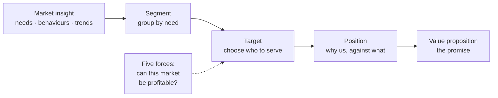

# Markets and strategy: choosing customers, offers and advantage

*Part of [Business acumen for the product leader](./README.md)*

## TL;DR

Strategy is a set of choices that fit together. Which customers will we serve? What offer will we make them? Why will we win against the alternatives? And what will we choose **not** to do? A strategy that does not exclude anything is a wish list.

The tools in this lesson help you make those choices with evidence. **Segmentation, targeting and positioning** pick the customer and the message. The **five competitive forces** test whether a market can be profitable at all. **SWOT** collects the facts, and synthesis turns them into options. The **growth matrix** shows how much risk each growth path carries. The core tradeoff is focus against reach. Focus builds advantage in one place. Reach spreads it thin.

> 🎯 **For the product leader**
>
> **Why it matters** — At VP level you set the frame your teams work inside. If the frame is "serve everyone," every roadmap debate is a fight about priorities. If the frame names a target customer and an advantage, most debates settle themselves.
>
> **What it changes in your decisions** — You choose a target segment and write down which segments you will not serve this year. You test each new market with the five forces before you build. You know which growth path you are on, and its risk.
>
> **Ask your team** — *"Which customers are we choosing not to serve, and what would make us change that?"*
>
> **Risk if ignored** — A product built for an average customer who does not exist. Or a move into a market where suppliers or buyers hold all the power, so growth never turns into profit.

## Mental model: from market to promise



Strategy narrows. You start with a whole market and end with one promise to one group of customers. Each step throws options away on purpose.

**Where the model breaks.** It looks linear. In practice you loop. A positioning test can show your segment was wrong. Markets also move, so a strategy needs a review date.

## Market insights

Good market insight explains **why** customers behave as they do, not only what they do. Sources include customer interviews, sales and support conversations, transaction data, competitor moves, regulation and technology shifts. In regulated domains, a rule change is often the biggest market insight of the year.

## Segmentation, targeting and positioning

**Segment by need, not by demographics.** Two small merchants of the same size can need very different payments products. One sells online across borders. The other sells in a café. Segment by the job they need done and the constraints they face.

Needs-based segments look different in each domain:

| Domain | Two segments with different needs |
| --- | --- |
| **Payments** | Cross-border online sellers who need many currencies, and cafés that need fast in-person checkout |
| **Lending** | Borrowers consolidating card debt, and borrowers financing one large purchase at checkout |
| **eCommerce** | Shoppers who want the lowest price, and shoppers who want delivery today |
| **InsurTech** | First-time renters who want a simple policy, and homeowners who want broad cover |
| **Retail** | Weekly stock-up shoppers, and shoppers who buy online and collect in store |
| **FinTech** | Workers paid in one currency who spend in another, and small businesses who need fast access to their own sales |

**Target with explicit criteria.** Size, growth, how reachable the segment is, how well your strengths fit, and how strong the competition is.

**Position against the real alternative.** The alternative is often not a competitor. It might be a spreadsheet, a bank branch or doing nothing.

Wise is a clear example of positioning on price and transparency. Wise says it uses the mid-market exchange rate and shows its fee separately, instead of adding a markup to the rate. Its 2019 annual report post said its average price fell from 0.73% of the transfer amount in 2016 to 0.67% in 2018. The position is "cheaper and clearer than your bank." Everything in the product supports it.

## Customer value proposition

A **customer value proposition** is the promise: the benefits a target customer gets, against what it costs them in money, time and risk, compared with their best alternative.

Write it in one sentence: *For [target customer] who [need], our [product] [key benefit], unlike [alternative], because [reason to believe].*

## The five competitive forces

A market's profit potential depends on five forces. The stronger the forces, the less profit is left for any player in it.

| Force | The question | Payments example | InsurTech example |
| --- | --- | --- | --- |
| **Rivalry** among current players | How hard do competitors fight on price? | Many processors compete for the same merchants | Online distribution makes price comparison easy |
| **Threat of new entrants** | How easy is it to enter? | Payment facilitator models lower the entry cost | Licensing, capital and rate filings raise it |
| **Threat of substitutes** | Can customers solve the need another way? | Bank transfers and real-time payment schemes | Self-insurance, or bundled cover from a bank card |
| **Buyer power** | Can customers push prices down? | Large merchants negotiate their own rates | Comparison marketplaces put the buyer in control |
| **Supplier power** | Can key suppliers capture the profit? | Card networks and issuers set interchange and scheme fees | Reinsurers and carriers supply the capacity to take risk |

Two public examples make the forces concrete:

- **Buyer power through a marketplace.** Policybazaar, run by PB Fintech in India, is an online insurance marketplace. It earns commissions and fees from insurers for policies sold through it. When customers compare insurers side by side, buyers gain power and insurers compete harder on price.
- **Supplier power in insurance.** Lemonade's 2020 filings describe its reliance on reinsurance. Reinsurers take a share of the risk in exchange for a share of the premium. A small insurer depends on that supply of capacity, so reinsurers hold real power over its economics.

## SWOT and synthesis

**SWOT** lists **strengths** and **weaknesses** (inside the company) and **opportunities** and **threats** (outside it). A SWOT on its own is a list. The value comes from synthesis: crossing the quadrants to produce options.

| | Opportunities | Threats |
| --- | --- | --- |
| **Strengths** | Use a strength to seize an opportunity | Use a strength to blunt a threat |
| **Weaknesses** | Fix a weakness to reach an opportunity | Avoid the spot where a weakness meets a threat |

Each cell should end in an action you could fund.

## The growth matrix

The growth matrix crosses **existing or new markets** with **existing or new products**. Each cell is a growth path, with rising risk as you move away from the core.

| | Existing product | New product |
| --- | --- | --- |
| **Existing market** | **Penetration**: sell more of what you have to the customers you know. Lowest risk. | **Product development**: sell new things to customers you know. |
| **New market** | **Market development**: take what you have to new customers or places. | **Diversification**: new things for new customers. Highest risk. |

Mercado Libre shows a move from one cell to another. It began as a marketplace. Its filings now report two revenue streams: Commerce, and Fintech through Mercado Pago, which includes payments and credit. For its existing buyers and sellers, payments and credit were new products. That is product development, built on a customer base it already had.

## Strategic options and tradeoffs

Every strategic option has a cost. Write it down.

- **Focus on one segment** costs the revenue from the segments you leave.
- **Compete on price** costs margin, and works only with a lasting cost advantage.
- **Compete on differentiation** costs investment, and works only if customers pay for the difference.
- **Expand to new markets** costs focus, and in regulated domains it costs licences and time.

## Worked example: growth options for a renters insurer

*This example is invented, to show the method. The insurer, its markets and all numbers are illustrative.*

A US renters insurer sells in a set of states. It has three growth options for next year.

**Assumed facts.** It can reach 3,000,000 renter households in its current states. It has 60,000 policies, so penetration is 60,000 ÷ 3,000,000 = 2%. The average premium is $180 a year.

**Option A, penetration.** Raise penetration from 2% to 3% in current states. New policies: 1% × 3,000,000 = 30,000. New written premium: 30,000 × $180 = **$5.4 million**. The insurer already has loss data for this product, so pricing risk is low.

**Option B, market development.** Expand to new states with 2,000,000 renter households. Assume it reaches 1% in two years: 20,000 policies × $180 = **$3.6 million**. Insurance is regulated by the states. Each new state needs a licence and rate filings, so this takes time and legal cost before the first sale.

**Option C, product development.** Sell pet insurance to existing customers. Assume 5% of 60,000 customers buy at $500 a year: 3,000 × $500 = **$1.5 million**. The insurer has no loss history for pets. Its first price is a guess, and the loss ratio could be far off for a year or more.

**Step 2: apply the five forces to the new cells.** For pets, specialist pet insurers are established rivals, and the insurer has no data advantage. For new states, its existing price advantage may not hold where rivals already have local data.

**Step 3: decide.** The team picks A as the main bet, with the largest premium and the lowest risk. It starts licence work in two new states as a slower second track. It drops pets for this year. It writes down why, so the choice can be revisited if a partner with pet loss data appears.

## Tradeoffs and decisions

- **Focus vs. reach.** A narrow target wins faster. It caps the size of the market you can win this year.
- **Price vs. differentiation.** A low price brings volume. It costs margin and invites rivals to match.
- **Organic vs. adjacent growth.** Penetration is cheaper and slower. Adjacent markets grow faster and carry new risks.
- **Analysis vs. learning.** A long strategy study gives a confident plan. A small market test gives real evidence for less time.

## Failure modes

- **Serving everyone.** No segment is excluded. Every roadmap debate restarts from zero.
- **SWOT as a list.** Four boxes of facts, no options, no actions.
- **Ignoring supplier power.** A fintech grows volume while network fees, partner banks or reinsurers take most of the margin.
- **Demographic segments.** Segments by age or company size, when the real difference is the need.
- **Diversification by accident.** A team adds a new product for a new market and calls it an extension.

## Under the hood

A simple market-sizing formula and a five-forces score card.

```text
Reachable premium = households × penetration × average premium
  Option A: 3,000,000 × (3% − 2%) × $180 = $5,400,000
  Option B: 2,000,000 × 1%         × $180 = $3,600,000
  Option C:    60,000 × 5%         × $500 = $1,500,000

Five forces score (1 = weak force, good for us; 5 = strong force, bad for us)
  forces = rivalry, entrants, substitutes, buyer power, supplier power
  pressure = sum of the five scores
  5 = very attractive market ... 25 = very unattractive market
```

Keep the scoring simple and the reasons written. The written reasons matter more than the sum.

## Practitioner checklist

- [ ] Write your target segment in one sentence, and list two segments you will not serve this year.
- [ ] Write your value proposition in the one-sentence template.
- [ ] Score your main market on the five forces, with a written reason for each score.
- [ ] Turn your last SWOT into at least four fundable actions.
- [ ] Place each of your current bets on the growth matrix.
- [ ] For any bet in a new market, list the licences, partners or filings it needs.
- [ ] Set a review date for your strategy.

## Related lessons

- [Products and marketing](./products-and-marketing.md) — turning a strategy into an offer and a launch.
- [Portfolio strategy and allocation](./portfolio-strategy-and-allocation.md) — funding bets across the growth matrix.
- [Prioritization and roadmaps](../technical-product-management/prioritization-and-roadmaps.md) — strategy as the input to a roadmap.
- [Cognitive empathy](../product-sense/cognitive-empathy.md) — understanding the need behind a segment.

## Sources and notes

- The renters insurer, its options and all numbers are invented and illustrative.
- Wise, *Revealing our 2019 annual report* (blog): average price fell from 0.73% in 2016 to 0.67% in 2018; use of the mid-market rate. [Wise](https://wise.com/gb/blog/annualreport2019). As of 2026-10.
- PB Fintech (Policybazaar), company disclosures describing its insurance marketplace and commission-based revenue. [BSE filing](https://www.bseindia.com/xml-data/corpfiling/AttachHis/d901abd2-8970-43e3-a81c-2cdc9feb982f.pdf). As of 2026-10.
- Lemonade, Form 10-K for fiscal 2020: reliance on reinsurance. [Filing index](https://www.sec.gov/cgi-bin/browse-edgar?action=getcompany&CIK=1691421&type=10-K). As of 2026-10.
- MercadoLibre, Form 10-K: Commerce and Fintech revenue streams; Fintech includes Mercado Pago and credit. [Filing index](https://www.sec.gov/cgi-bin/browse-edgar?action=getcompany&CIK=1099590&type=10-K). As of 2026-10.
- Note: these hosts could not be opened from the build environment (blocked by the network proxy). The facts were corroborated from search-result excerpts of the documents.
