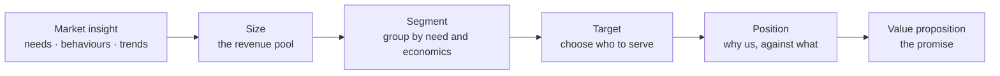
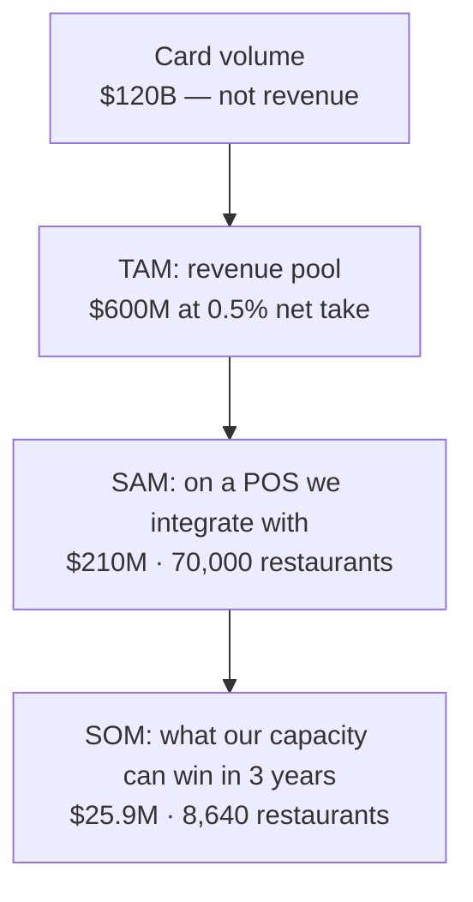

# Markets and customers: segments, sizing and positioning

*Part of [Business acumen for the product leader](./README.md)*

*Last reviewed: 2026-10 · Volatility: medium*

## TL;DR

Before you decide how to win, decide where to compete and for whom. This lesson covers the market side of strategy. **Market sizing** tells you how much revenue a market can hold. **Segmentation** splits that market into groups that need different things and have different economics. **Positioning** states why your target segment should choose you over its real alternative. A **competitor teardown** reads a rival's economics, not its feature list. **SWOT** and the **growth matrix** turn the facts into options and show how much risk each option carries.

The core tradeoff is focus against reach. Focus on one segment builds an edge faster and makes every message sharper. Reach spreads the same budget across customers with different needs and different economics. Most product lines serve two or three segments well. Few serve ten.

The scale matters. A sizing error of 10x is common when a team counts payment volume or loan volume as if it were revenue. A segment with half the revenue can be worth twice as much once you count acquisition cost and retention.

> 🎯 **For the product leader**
>
> **Why it matters** — At VP level you set the frame your teams work inside. If the frame is "serve everyone," every roadmap debate is a fight about priorities. If the frame names a target segment with known economics, most debates settle themselves.
>
> **What it changes in your decisions** — You size markets in revenue, from the bottom up. You choose segments by contribution and payback, not by size alone. You write down which segments you will not serve this year.
>
> **Ask your team** — *"What is this market worth in net revenue, not volume? Which segment pays back fastest, and which one are we choosing not to serve?"*
>
> **Risk if ignored** — A product built for an average customer who does not exist. A business case built on a market number that is ten times too big. A launch that wins the biggest segment and loses money on every customer in it.

## Decision rules in this lesson

- **Size the revenue pool, not the volume.** Multiply volume by the net take rate, spread or margin you can keep.
- **Trust bottom-up over top-down.** If the two differ by more than 2x, find out why before you use either.
- **Cap your obtainable share by capacity.** Your share is limited by how many customers your sales, partners or marketing can reach.
- **Segment by need and economics, not demographics.** A segment is real only if it behaves differently and pays back differently.
- **Choose the target segment on payback and lifetime contribution,** not on revenue alone.
- **Position against the customer's real alternative,** which is often a bank, a spreadsheet or doing nothing.
- **Read a rival's economics before you copy its features.** A rival with cheaper funding can beat you on price forever.

## Mental model: from market to promise



Strategy narrows. You start with a whole market and end with one promise to one group of customers. Each step throws options away on purpose. Sizing tells you whether the market is worth the effort. Segmentation and targeting pick the customers. Positioning and the value proposition say what you promise them.

**Where the model breaks.** It looks linear. In practice you loop. A positioning test can show that your segment was wrong. A segment's economics can show that your size estimate counted the wrong customers. Markets also move, so set a review date.

Whether the market can stay profitable once rivals arrive is a separate question. The five competitive forces answer it. They live in [Competitive advantage and strategy](./competitive-advantage-and-strategy.md).

## Mechanics

### Market insights

Good market insight explains **why** customers behave as they do, not only what they do. Sources include customer interviews, sales and support conversations, transaction data, competitor moves, regulation and technology shifts. In regulated domains, a rule change is often the biggest market insight of the year. An interchange cap, a new licence type or a new real-time payment scheme can change who buys and why. For research methods, see [User research](../product-sense/user-research.md).

### Market sizing done right

Market sizing estimates how much revenue a market can hold. Three nested numbers are common:

- **Total addressable market (TAM):** all the revenue available if every possible customer bought from you.
- **Serviceable addressable market (SAM):** the part of TAM your product can serve today, given its features, channels, licences and geography.
- **Serviceable obtainable market (SOM):** the part of SAM you can realistically win in a set period, often three years.

**Top-down and bottom-up.** A **top-down** estimate starts from a big published number and cuts it down with percentages. It is fast. It is also easy to inflate, because each percentage is a guess. A **bottom-up** estimate starts from the unit: the number of customers you can name, times what each one is worth to you in revenue. It is slower. It is also easier to check, because every input is a count or a price you can test. Use bottom-up as your main number. Use top-down as a cross-check. If the two differ by more than 2x, one of them is wrong.

**Size the revenue pool, not the volume.** In financial products, the volume is not your revenue. A payment provider processes payment volume but keeps only the net take rate. A lender lends principal but earns the spread. A marketplace lists gross merchandise value (GMV) but keeps only its take rate. Always convert volume into the revenue you can keep. The definitions of take rate and gross versus net revenue live in [The language of money](./the-language-of-money.md).

**Common pitfalls.**

- **Counting volume as revenue.** The deck says "a $120 billion market." The revenue pool is $600 million.
- **Ignoring reachable share.** A SAM that includes customers you cannot reach through any channel you have.
- **Double counting.** Adding the card volume and the bank-transfer volume of the same purchase.
- **Counting businesses, not buyers.** A chain of 50 stores is one buying decision, not 50.
- **A static number.** Markets grow, shrink and reprice. A falling net take rate shrinks the pool even when volume grows.
- **SOM as a share of TAM.** "We only need 1% of the market" ignores how you would reach that 1%.

**Worked sizing: payment acceptance for independent restaurants.** *Illustrative. Every input is assumed.*

| Step | Input (assumed) | Result |
| --- | --- | --- |
| Restaurants in the country | 200,000 independent restaurants | |
| Card volume per restaurant | $600,000 a year | |
| **Volume** (the misleading "market") | 200,000 × $600,000 | **$120 billion** |
| Net take rate after interchange and scheme fees | 0.5% | $3,000 per restaurant a year |
| **TAM** (revenue pool) | 200,000 × $3,000 | **$600 million** |
| Restaurants on a point-of-sale (POS) system you integrate with | 35% → 70,000 | |
| **SAM** | 70,000 × $3,000 | **$210 million** |
| Sales capacity | 40 reps × 6 net new restaurants a month × 36 months = 8,640 | |
| **SOM** (three years) | 8,640 × $3,000 | **$25.9 million a year** |



Three things stand out. First, the "market" in the pitch deck was 200 times the revenue pool. Second, the integration footprint cut the pool by almost two thirds. Third, the SOM comes from sales capacity, not from a percentage. It is 12.3% of SAM (8,640 ÷ 70,000). That share is high, so the team must also check it against win rates. If reps win one deal in five, each rep needs 30 qualified meetings a month.

**Decision rule.** If SOM in revenue cannot fund the team that builds and sells the product within the plan period, change the segment or the channel. Do not grow the TAM slide.

**Common misreading.** A big TAM is not a reason to enter. A big TAM with five strong rivals can be worth less than a small one you can own. The contribution per customer, which decides whether the SOM is worth winning, lives in [Unit economics](./unit-economics.md).

### Segmentation as a method

**Segment by need, not by demographics.** Two small merchants of the same size can need very different payments products. One sells online across borders. The other sells in a café. Segment by the job the customer hires the product to do, and the constraints they face.

Needs-based segments look different in each domain:

| Domain | Two segments with different needs |
| --- | --- |
| **Payments** | Cross-border online sellers who need many currencies, and cafés that need fast in-person checkout |
| **Lending** | Borrowers consolidating card debt, and borrowers financing one large purchase at checkout |
| **eCommerce** | Shoppers who want the lowest price, and shoppers who want delivery today |
| **InsurTech** | First-time renters who want a simple policy, and families who want broad cover |
| **Retail** | Weekly stock-up shoppers, and shoppers who buy online and collect in store |
| **FinTech** | Workers paid in one currency who spend in another, and small businesses who need fast access to their own sales |

**The method, in four steps.**

1. **Hypotheses.** Start from interviews and support logs. Write three to six candidate segments, each defined by a need and a constraint.
2. **Data.** Pull behaviour and economics for each customer: what they buy, how often, at what price, what it costs to serve them, and how long they stay.
3. **Criteria and clustering.** Choose a few variables that drive both need and economics. A data team can cluster customers on them. Then name each cluster in plain words. If you cannot name it, it is not a segment.
4. **Validation.** Check that each segment is **measurable**, **reachable** through a channel you have, **large enough** to matter, **distinct** in how it responds to offers, and **stable** over a year. A segment that converts, retains and pays back like every other segment is not useful.

**Segment economics.** The test that matters most is economic. Compute contribution and acquisition cost for each segment. Here is an illustrative case for a US renters insurer. *Every input is assumed.*

Assume loss-adjustment expense (LAE), the cost of handling claims, is 10% of premium. Assume payment and servicing cost $10 per policy a year. Then contribution per policy-year = premium × (1 − loss ratio − 10%) − $10.

| Segment | Premium | Loss ratio | Contribution per year | Customer acquisition cost (CAC) | Annual retention | Lifetime contribution | Lifetime ÷ CAC | Payback |
| --- | --- | --- | --- | --- | --- | --- | --- | --- |
| Students in shared housing | $120 | 75% | $8 | $60 | 40% | $13 | 0.2 | 7.5 years |
| Young professionals | $180 | 55% | $53 | $90 | 75% | $212 | 2.4 | 1.7 years |
| Families renting houses | $300 | 65% | $65 | $200 | 80% | $325 | 1.6 | 3.1 years |

Lifetime contribution here is contribution ÷ (1 − retention). For young professionals, that is $53 ÷ 0.25 = $212. It is undiscounted and simplified. [Unit economics](./unit-economics.md) shows the cohort method.

Families bring the largest premium. Young professionals pay back fastest and have the best ratio. Students lose money at this acquisition cost. The decision: target young professionals first, grow families as capital allows, and stop paid acquisition for students.

A caution for regulated products. Choosing whom to market to is not the same as charging them differently. In US insurance, states regulate the rating factors an insurer may use. In lending, fair-lending rules limit how you can treat groups of applicants. Check targeting plans with Compliance.

**Targeting.** Choose with explicit criteria: segment economics first, then size, growth, reachability, fit with your strengths, and the strength of rivals in that segment.

**Common misreading.** Segmenting by company size or age because the data is easy to get. Size is often a proxy for a need. Find the need.

### Positioning

**Positioning** is the place your product holds in the target customer's mind, compared with the alternatives. It is a choice you make, then express in product, price and message. Build it in five steps:

1. **Competitive alternatives.** What would the customer do if you did not exist? The answer is often not a competitor. It might be a bank branch, a spreadsheet, or doing nothing.
2. **Unique attributes.** What do you have that those alternatives lack?
3. **Value.** What does each attribute do for the customer, in money, time or risk?
4. **Target.** Which customers care most about that value?
5. **Market category.** Which frame makes your value obvious? Calling a product "a business account" invites comparison with banks. Calling it "a multi-currency account" invites a different comparison.

Wise is a clear example of positioning on price and transparency. Wise says it uses the mid-market exchange rate and shows its fee separately, instead of adding a markup to the rate. Its 2019 annual report post said its average price fell from 0.73% of the transfer amount in 2016 to 0.67% in 2018. The position is "cheaper and clearer than your bank." Everything in the product supports it.

**How to test a position.** Show two or three positioning statements to target customers, and measure which one they repeat back and which one moves them to act. Track win and loss reasons in sales. A good position shows up as shorter sales cycles and fewer price objections.

**Decision rule.** If customers compare you on price with a rival you did not choose, your category is wrong. Change the frame before you change the price.

### Customer value proposition

A **customer value proposition** is the promise: the benefits a target customer gets, against what it costs them in money, time and risk, compared with their best alternative.

Write it in one sentence: *For [target customer] who [need], our [product] [key benefit], unlike [alternative], because [reason to believe].*

### Competitor teardown: economics, not features

A feature comparison tells you what a rival ships. A teardown of its economics tells you what it can afford to do next. Public companies disclose a lot in annual reports, investor presentations and pricing pages. Read them for five numbers:

| What to estimate | How to compute it from public data | What it tells you |
| --- | --- | --- |
| **Take rate** | Revenue ÷ payment volume or GMV | How much it keeps per dollar, and whether that is falling |
| **Funding cost** | Interest expense ÷ average debt or deposits | How cheaply it can lend |
| **Credit or loss rate** | Net charge-offs ÷ average loans, or loss ratio for an insurer | How well it underwrites |
| **Acquisition cost** | Sales and marketing ÷ new customers | How hard it pays to grow |
| **Cost to serve** | Operating expense ÷ active customers | Whether it can survive a price war |

**Illustrative teardown: two consumer lenders.** *Every number is assumed.* Your company funds loans with a credit line at 7%. A rival with a bank charter funds with deposits at 3%. Both lose 6% of balances to credit losses each year. Both spend 5% of balances on operations.

- Your break-even interest rate is 7% + 6% + 5% = **18%**.
- The rival's break-even is 3% + 6% + 5% = **14%**.

The rival can price at 16% and still earn 2 points. At 16%, you lose 2 points on every loan. No feature closes a 4-point gap in funding cost. The right move is to avoid its prime segment. Compete where your underwriting gives you lower losses, or your channel gives you lower acquisition cost. Why a bank charter is a source of advantage is covered in [Competitive advantage and strategy](./competitive-advantage-and-strategy.md).

**Other sources.** Pricing pages, app store reviews, job postings (which show what a rival is building), regulatory filings and mystery shopping. Keep a one-page teardown per main rival, and update it each quarter.

**Common misreading.** "They have feature X, so we need it." Ask first whether feature X makes money for them, and whether it would for you.

### SWOT and synthesis

**SWOT** lists **strengths**, **weaknesses**, **opportunities** and **threats**. Strengths and weaknesses are inside the company. Opportunities and threats are outside it. A SWOT on its own is a list. The value comes from synthesis: crossing the quadrants to produce options.

| | Opportunities | Threats |
| --- | --- | --- |
| **Strengths** | Use a strength to seize an opportunity | Use a strength to blunt a threat |
| **Weaknesses** | Fix a weakness to reach an opportunity | Avoid the spot where a weakness meets a threat |

Three rules make a SWOT useful. First, every entry needs evidence: a number, a filing, a customer quote. Second, a strength counts only if it matters to the target segment. Third, each cell must end in an action you could fund, with a rough cost. Then rank the actions by segment economics, not by how many boxes they touch.

### The growth matrix

The growth matrix crosses **existing or new markets** with **existing or new products**. Each cell is a growth path, with rising risk as you move away from the core.

| | Existing product | New product |
| --- | --- | --- |
| **Existing market** | **Penetration**: sell more of what you have to the customers you know. Lowest risk. | **Product development**: sell new things to customers you know. |
| **New market** | **Market development**: take what you have to new customers or places. | **Diversification**: new things for new customers. Highest risk. |

Each step away from the core adds unknowns. A new product adds pricing and loss unknowns. A new market adds channel and customer unknowns. In regulated domains, a new market often means a new licence, a new partner bank or new rate filings. Each of these takes months before the first sale.

Mercado Libre shows a move from one cell to another. It began as a marketplace. Its filings now report two revenue streams: Commerce, and Fintech through Mercado Pago, which includes payments and credit. For its existing buyers and sellers, payments and credit were new products. That is product development, built on a customer base it already had.

### Strategic options and their costs

Every strategic option has a cost. Write it down.

- **Focus on one segment** costs the revenue from the segments you leave.
- **Compete on price** costs margin, and works only with a lasting cost advantage.
- **Compete on differentiation** costs investment, and works only if customers pay for the difference.
- **Expand to new markets** costs focus, and in regulated domains it costs licences and time.

## Worked example: growth options for a renters insurer

*This example is invented, to show the method. The insurer, its markets and all numbers are illustrative, and every input is assumed.*

A US renters insurer sells in a set of states. It has three growth options for next year.

**Assumed facts.** It can reach 3,000,000 renter households in its current states. It has 60,000 policies, so penetration is 60,000 ÷ 3,000,000 = 2%. The average premium is $180 a year.

**Step 1: size each option.**

**Option A, penetration.** Raise penetration from 2% to 3% in current states. New policies: 1% × 3,000,000 = 30,000. New written premium: 30,000 × $180 = **$5.4 million**. The insurer already has loss data for this product, so pricing risk is low.

**Option B, market development.** Expand to new states with 2,000,000 renter households. Assume it reaches 1% in two years: 20,000 policies × $180 = **$3.6 million**. Insurance is regulated by the states. Each new state needs a licence and rate filings, so this takes time and legal cost before the first sale.

**Option C, product development.** Sell pet insurance to existing customers. Assume 5% of 60,000 customers buy at $500 a year: 3,000 × $500 = **$1.5 million**. The insurer has no loss history for pets. Its first price is a guess, and the loss ratio could be far off for a year or more.

**Step 2: run the five competitive forces on the new cells.** Use the method in [Competitive advantage and strategy](./competitive-advantage-and-strategy.md). For pets, specialist pet insurers are established rivals, and the insurer has no data advantage. For new states, its existing price advantage may not hold where rivals already have local data.

**Step 3: check segment economics.** Option A is not one market. Using the segment table above, the insurer aims the new 30,000 policies at young professionals first. That segment pays back in under two years. It stops paid acquisition for students.

**Step 4: decide.** The team picks A as the main bet, with the largest premium and the lowest risk. It starts licence work in two new states as a slower second track. It drops pets for this year. It writes down why, so the choice can be revisited if a partner with pet loss data appears.

## Tradeoffs and decisions

- **Focus vs. reach.** A narrow target wins faster. It caps the size of the market you can win this year.
- **Bottom-up vs. top-down sizing.** Bottom-up is checkable and slower. Top-down is fast and easy to inflate.
- **Largest segment vs. best-paying segment.** The largest segment brings revenue. The best-paying one funds growth sooner.
- **Price vs. differentiation.** A low price brings volume. It costs margin and invites rivals to match.
- **Organic vs. adjacent growth.** Penetration is cheaper and slower. Adjacent markets grow faster and carry new risks.
- **Analysis vs. learning.** A long strategy study gives a confident plan. A small market test gives real evidence in less time.

## Failure modes

- **Serving everyone.** No segment is excluded. Every roadmap debate restarts from zero.
- **The volume slide.** The business case uses payment or loan volume as the market. Finance converts it to revenue, and the case collapses in the review.
- **Averaged economics.** Contribution looks fine on average, while one segment loses money on every customer. You see it when growth in that segment makes total margin fall.
- **Demographic segments.** Segments by age or company size, when the real difference is the need.
- **Feature-copy strategy.** The team copies a rival's features without its funding cost or channel. You see it as matching features and losing on price.
- **SWOT as a list.** Four boxes of facts, no options, no actions.
- **Diversification by accident.** A team adds a new product for a new market and calls it an extension.

## Under the hood

The numbers in this lesson, reproduced in Python.

```python
# Bottom-up sizing: payment acceptance for independent restaurants (all inputs assumed)
restaurants, volume_each, net_take = 200_000, 600_000, 0.005
rev_each = volume_each * net_take                     # 3,000
tam = restaurants * rev_each                           # 600,000,000
sam_count = int(restaurants * 0.35)                    # 70,000
sam = sam_count * rev_each                             # 210,000,000
som_count = 40 * 6 * 36                                # 8,640
som = som_count * rev_each                             # 25,920,000
print(f"volume ${restaurants*volume_each/1e9:.0f}B  TAM ${tam/1e6:.0f}M  "
      f"SAM ${sam/1e6:.0f}M  SOM ${som/1e6:.1f}M ({som_count/sam_count:.1%} of SAM)")

# Segment economics for a renters insurer (all inputs assumed)
LAE, SERVICING = 0.10, 10
segments = {  # name: (premium, loss_ratio, cac, retention)
    "students":      (120, 0.75,  60, 0.40),
    "professionals": (180, 0.55,  90, 0.75),
    "families":      (300, 0.65, 200, 0.80),
}
for name, (prem, lr, cac, ret) in segments.items():
    cm = prem * (1 - lr - LAE) - SERVICING
    life = cm / (1 - ret)                              # undiscounted
    print(f"{name:13} CM/yr ${cm:.0f}  lifetime ${life:.0f}  "
          f"ratio {life/cac:.1f}  payback {cac/cm:.1f} yrs")

# Lender teardown: break-even rate = funding + losses + operations (assumed)
for who, funding in (("us", 0.07), ("rival", 0.03)):
    print(who, f"break-even {funding + 0.06 + 0.05:.0%}")

# Renters growth options: households x penetration gain x premium (assumed)
for opt, hh, pen, prem in (("A", 3_000_000, 0.01, 180),
                           ("B", 2_000_000, 0.01, 180),
                           ("C", 60_000, 0.05, 500)):
    print(opt, f"${hh * pen * prem:,.0f}")
```

The script prints a TAM of $600M, a SAM of $210M and a SOM of $25.9M (12.3% of SAM). For segments, it prints contribution of $8, $53 and $65 a year; payback of 7.5, 1.7 and 3.1 years. It prints break-even rates of 18% and 14%, and option values of $5,400,000, $3,600,000 and $1,500,000.

## Practitioner checklist

- [ ] Size your market bottom-up, in revenue you keep, not in volume.
- [ ] Cross-check with a top-down number. Explain any gap over 2x.
- [ ] Derive SOM from your sales, partner or marketing capacity.
- [ ] Compute contribution, CAC and payback for each segment.
- [ ] Write your target segment in one sentence, and list two segments you will not serve this year.
- [ ] Write your value proposition in the one-sentence template, against the customer's real alternative.
- [ ] Keep a one-page economic teardown of each main rival.
- [ ] Turn your last SWOT into at least four fundable actions.
- [ ] Place each of your current bets on the growth matrix.
- [ ] For any bet in a new market, list the licences, partners or filings it needs.
- [ ] Set a review date for your strategy.

## Related lessons

- [Competitive advantage and strategy](./competitive-advantage-and-strategy.md) — the five forces, profit pools and how to win once you have chosen the segment.
- [Unit economics](./unit-economics.md) — the contribution and payback behind segment economics.
- [The language of money](./the-language-of-money.md) — take rate, and gross versus net revenue, for sizing in revenue.
- [Products and marketing](./products-and-marketing.md) — turning a position into an offer and a launch.
- [Portfolio strategy and allocation](./portfolio-strategy-and-allocation.md) — funding bets across the growth matrix.
- [User research](../product-sense/user-research.md) — the interviews behind segment hypotheses.
- [Cognitive empathy](../product-sense/cognitive-empathy.md) — understanding the need behind a segment.
- [Prioritization and roadmaps](../technical-product-management/prioritization-and-roadmaps.md) — strategy as the input to a roadmap.

## Sources and notes

- The restaurant sizing, the renters insurer segments, the lender teardown and the renters insurer's growth options are invented and illustrative. Every input is assumed.
- Wise, *Revealing our 2019 annual report* (blog): average price fell from 0.73% of the transfer amount in 2016 to 0.67% in 2018. [Wise blog](https://wise.com/gb/blog/annualreport2019). As of 2026-10.
- Wise, pricing page for sending money: customers get the mid-market rate, with no markup on the rate, and a separate fee. [Wise pricing](https://wise.com/gb/pricing/send-money). As of 2026-10.
- MercadoLibre, Form 10-K for fiscal 2025 (filed 2026-02): Commerce and Fintech revenue streams; Fintech includes the Mercado Pago platform and credit. [Form 10-K](https://www.sec.gov/Archives/edgar/data/1099590/000109959026000006/meli-20251231.htm). As of 2026-10.
