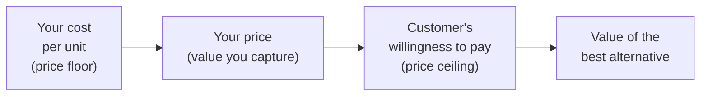

# Monetization and business models

*Part of [Business acumen for the product leader](./README.md)*

*Last reviewed: 2026-10 · Volatility: medium*

## TL;DR

A **business model** is how a company turns value for customers into revenue, and revenue into profit. **Monetization** is the set of choices inside it: what you charge for, how much, and how you package it. At leadership level, these choices often matter more than any single feature. The same product can be a great business or a poor one, depending on the price metric and the unit economics.

The core tradeoff is capture against growth. A higher price captures more value per customer and slows adoption. A lower price speeds adoption and may never cover cost. Good monetization aligns the **price metric** with what customers value and with what drives your cost. Then it checks **unit economics** before you spend to grow.

> 🎯 **For the product leader**
>
> **Why it matters** — In Payments, Lending and Insurance, the business model is the product. A payments company that misprices risk, a lender whose spread does not cover losses, or an insurer whose premium does not cover claims will lose more money as it grows.
>
> **What it changes in your decisions** — You choose a price metric that grows with customer value and covers your cost driver. You check customer acquisition cost, lifetime value, payback and contribution margin before you approve growth spend. You stress-test the revenue line that depends on a rule or a partner.
>
> **Ask your team** — *"What happens to our payback period if our largest revenue line falls by half because of a rule change or a partner renegotiation?"*
>
> **Risk if ignored** — Growth that deepens losses. Or a model that depends on one fee, one partner or one rule that you do not control.

## Mental model: the value gap and the meter



Your price sits between two limits. Below it is your cost to serve: price under it and every sale loses money. Above it is the customer's **willingness to pay**, which is set by the value they get and by their next-best alternative. Monetization is the choice of where to sit in that gap.

The **price metric** is the meter: per seat, per transaction, per dollar processed, per loan, per policy. The meter decides who pays more as usage grows. Think of a taxi meter. Charge by distance and long trips pay more. Charge a flat fare and short trips subsidize long ones.

**Where the analogy breaks.** A taxi meter is fixed. Your price metric shapes behaviour. Customers will change how they use the product to lower their bill. A per-transaction fee nudges merchants toward fewer, larger payments.

## Pricing strategy and willingness to pay

| Approach | How it sets price | Risk |
| --- | --- | --- |
| **Cost-plus** | Cost plus a markup | Ignores what customers would pay; leaves money on the table or prices you out |
| **Competitor-based** | Matches or undercuts rivals | Leads to price wars; ignores your own costs |
| **Value-based** | A share of the value the customer gains | Needs real evidence of that value |

To learn willingness to pay, use more than one method:

- **Customer interviews** about the value of the problem solved.
- **Price-sensitivity surveys** that ask at what price a product feels too cheap, a bargain, getting expensive and too expensive.
- **Trade-off surveys** that ask customers to choose between bundles of features and prices.
- **Live price tests**, where rules and fairness allow. In credit and insurance, price tests are restricted by law in many places. Check with Compliance first.

## Packaging and tiering

- **Good-better-best tiers** let customers pick a level. The middle tier often sells most.
- **Add-ons** sell extra capabilities to customers who need them.
- **Bundles** combine products at one price. They raise average revenue and can hide weak products.
- **Fences** decide who gets which price: volume, company size, contract length.

Wise shows a transparent package. It says it uses the mid-market exchange rate and charges a visible fee, instead of hiding a markup in the rate. The package itself is part of the value proposition.

## Business models by domain

| Model | Revenue line | Main cost line | Profit lever | A public example |
| --- | --- | --- | --- | --- |
| **Subscription** | Recurring fee | Cost to serve | Retention and expansion | Shopify's Subscription Solutions were 24% of its revenue in 2025. The other 76% came from Merchant Solutions, mainly payment processing. |
| **Usage-based** | Fee per unit used | Variable cost per unit | Margin per unit, volume | Payment processors charge per transaction or per dollar processed |
| **Marketplace take rate** | A share of each transaction | Delivery, payments, support, incentives | Take rate and contribution per order | DoorDash's net revenue margin was 13.4% of Marketplace GOV in 2024. |
| **Transactional / interchange** | Fees on payments | Interchange and network fees paid onward | Net take rate after pass-through costs | Adyen's interchange++ pricing shows its fee apart from interchange and scheme fees. |
| **Lending spread** | Interest and fees | Cost of funds, credit losses, servicing | Risk-adjusted margin | Upstart earns fees from lending partners for its platform and for borrower referrals. Most of the loans are kept by its lending partners or bought by institutional investors. |
| **Insurance premium** | Premium | Claims, expenses, reinsurance | Combined ratio, plus investment income on premiums held | Lemonade's 2020 filings described a fixed fee: 25% of premiums at the time. The rest went to claims and reinsurance. |
| **Retail margin** | Product sales | Cost of goods, shrink, markdowns | Gross margin and stock turns | A retailer earns the gap between the shelf price and the landed cost of goods. |
| **Advertising** | Fees from brands | Sales and ad-tech costs | Ad revenue per user | Instacart reports advertising and other revenue as a separate line from transaction revenue. |

**A note on interchange.** On a card payment, the merchant's bank pays an **interchange** fee to the cardholder's bank. Card networks set the rates. In some places the law caps them. The European Union caps interchange on consumer debit and credit cards. In the US, a Federal Reserve rule, Regulation II, caps debit interchange for card issuers with $10 billion or more in assets. Smaller issuers are exempt from that cap. As of 2026-10, the US cap is 21 cents plus 5 basis points of the transaction value, with a 1-cent fraud-prevention adjustment for eligible issuers. The Federal Reserve proposed lowering it in 2023, so check the current level before you model it. A general inference, not a sourced fact: the exemption can make a smaller partner bank attractive to a fintech that issues debit cards, because the bank can earn uncapped interchange.

## Unit economics

**Unit economics** describe the profit from one customer or one transaction.

- **Customer acquisition cost (CAC)** = sales and marketing spend ÷ new customers won.
- **Contribution margin** per customer = revenue − variable costs, per period.
- **Lifetime value (LTV)** = contribution margin per period × expected customer lifetime. A simple estimate of lifetime is 1 ÷ the churn rate per period. Discount it for long lifetimes.
- **Payback period** = CAC ÷ contribution margin per period.
- **LTV to CAC ratio** compares what a customer is worth with what it costs to win them.

Nubank publishes two of the inputs. It reports monthly average revenue per active customer and monthly cost to serve. In Q2 2023 it said the first passed $9 while the second stayed below $1. A low cost to serve is what lets a digital bank profit from customers with small balances.

Affirm says it never charges late fees. So its revenue must come from merchant fees, interest and other sources. That shows in its chosen metric, revenue less transaction costs. The model choice is also a brand promise.

## Worked example: a neobank's debit card economics

*This example is invented, to show the method. The neobank, its partner and all rates are illustrative assumptions.*

A US neobank issues debit cards through a partner bank that is exempt from the debit interchange cap.

**Assumed inputs, per active customer per month:**

- Card spend $1,000. Interchange rate 1.2%. The neobank keeps 75% of interchange; the partner bank keeps 25%.
- Average balance $800, earning a net 3% a year for the neobank.
- Cost to serve $4 (support, card, processing, compliance). Fraud and other losses $1.
- CAC $90. Monthly churn 2%.

**Step 1: revenue.** Interchange: $1,000 × 1.2% = $12. Neobank share: $12 × 75% = $9. Interest: $800 × 3% ÷ 12 = $2. Total: **$11 a month**.

**Step 2: contribution margin.** $11 − $4 − $1 = **$6 a month**.

**Step 3: payback.** $90 ÷ $6 = **15 months**.

**Step 4: LTV.** Expected lifetime = 1 ÷ 2% = 50 months. LTV = $6 × 50 = **$300**, undiscounted. LTV to CAC = $300 ÷ $90 = **3.3**.

**Step 5: stress test.** Suppose interchange halves. The partner bank might grow past the $10 billion threshold, or renegotiate its share. Interchange becomes $6. Neobank share: $4.50. Revenue: $6.50. Contribution: $1.50. Payback: $90 ÷ $1.50 = **60 months**. LTV: $1.50 × 50 = **$75**. LTV to CAC: **0.8**. Each new customer now loses money.

**What the leader does with this.** The model depends on one revenue line that a partner and a rule control. The team adds a second revenue line, such as a paid tier or a lending product, and caps acquisition spend until the second line proves out.

## A lending spread, simplified

*Illustrative and simplified: one year, a balance that does not amortize, no fees.*

| Item | Rate | On a $10,000 loan |
| --- | --- | --- |
| Interest charged | 18% | $1,800 |
| − Cost of funds | 6% | −$600 |
| − Expected credit loss | 5% | −$500 |
| − Servicing cost | 1.5% | −$150 |
| **Risk-adjusted margin** | **5.5%** | **$550** |

A small rise in expected loss erases the margin fast. Each point of loss is $100 here. Approving riskier applicants to grow volume only pays if the price rises with the risk, and in many places the law limits how high it can go.

## Tradeoffs and decisions

- **Capture vs. growth.** Higher prices raise margin and slow adoption.
- **Simple vs. precise pricing.** A flat rate is easy to understand. A pass-through model like interchange-plus is more transparent and harder to compare.
- **Subscription vs. usage.** Subscriptions give predictable revenue. Usage pricing grows with the customer and swings with their volume.
- **One revenue line vs. many.** A single line is simple and fragile. More lines add resilience and complexity.
- **Promise vs. revenue.** No late fees builds trust. It gives up a revenue line that rivals may keep.

## Failure modes

- **Price below cost to serve.** Each new customer deepens the loss.
- **CAC from the best channel only.** The blended CAC hides a channel that never pays back.
- **LTV on hope.** Lifetime value assumes churn the product has never achieved.
- **Single-point revenue.** A rule change or partner renegotiation removes most of the margin.
- **Meter mismatch.** You charge per seat while your cost grows per transaction. Heavy users become unprofitable.

## Under the hood

The unit economics above, in Python:

```python
def unit_econ(spend, ic_rate, share, balance, nim, cost, loss, cac, churn):
    revenue = spend * ic_rate * share + balance * nim / 12
    contribution = revenue - cost - loss
    payback = cac / contribution if contribution > 0 else float("inf")
    ltv = contribution / churn
    return round(revenue, 2), round(contribution, 2), round(payback, 1), round(ltv), round(ltv / cac, 2)

print(unit_econ(1000, 0.012, 0.75, 800, 0.03, 4, 1, 90, 0.02))  # (11.0, 6.0, 15.0, 300, 3.33)
print(unit_econ(1000, 0.006, 0.75, 800, 0.03, 4, 1, 90, 0.02))  # (6.5, 1.5, 60.0, 75, 0.83)
```

## Practitioner checklist

- [ ] Write your price metric, and check that it grows with customer value and with your cost driver.
- [ ] Compute CAC by channel, not only blended.
- [ ] Compute contribution margin and payback for your main customer segment.
- [ ] List each revenue line that depends on a rule, a partner or a network, and stress-test it at half.
- [ ] Run one willingness-to-pay study before your next price change.
- [ ] Review your tiers. Check which one most customers buy, and why.
- [ ] Check with Compliance which price tests are allowed in your domain.

## Related lessons

- [The language of money](./the-language-of-money.md) — margins, statements and the business case.
- [Performance and growth](./performance-and-growth.md) — the KPIs that track unit economics.
- [The economics of infrastructure](../technical-product-sense/economics-of-infrastructure.md) — the cost side of unit economics.
- [Transactional and financial systems](../system-design/transactional-and-financial.md) — how payments are processed and settled.
- [Motivation and behaviour](../product-sense/motivation-and-behaviour.md) — why people pay, and why they stop.

## Sources and notes

- The neobank example, the lending spread and all their rates are invented and illustrative.
- Shopify, Form 10-K for fiscal 2025 (filed 2026-02): subscription solutions were 24% of total revenues. [Form 10-K](https://www.sec.gov/Archives/edgar/data/1594805/000159480526000007/shop-20251231.htm). As of 2026-10.
- DoorDash, Form 10-K for fiscal 2024 (filed 2025-02): net revenue margin is revenue as a percentage of Marketplace GOV; 13.4% for 2024. [Form 10-K](https://www.sec.gov/Archives/edgar/data/1792789/000162828025005715/dash-20241231.htm). As of 2026-10.
- Adyen, help article *What is the interchange ++?*: Adyen's fee shown apart from interchange and card-scheme fees. [Adyen](https://help.adyen.com/knowledge/payment-methods/explore-payment-methods/what-is-the-interchange). As of 2026-10.
- Upstart, Form 10-K for fiscal 2022 (filed 2023-02): platform and referral fees charged to lending partners at origination, and servicing fees. [Form 10-K](https://www.sec.gov/Archives/edgar/data/1647639/000164763923000021/upst-20221231.htm). As of 2026-10.
- Lemonade, Form 10-K for fiscal 2020 (filed 2021-03): it typically retains a fixed fee, then 25% of premiums. [Form 10-K](https://www.sec.gov/Archives/edgar/data/1691421/000169142121000024/lmda-20201231.htm). As of 2026-10.
- Maplebear (Instacart), Form 10-K for fiscal 2025 (filed 2026-02): revenue consists of transaction revenue and advertising and other revenue. [Form 10-K](https://www.sec.gov/Archives/edgar/data/1579091/000157909126000018/cart-20251231.htm). As of 2026-10.
- Nu Holdings, second quarter 2023 results (2023-08-15): monthly average revenue per active customer of $9.3, and monthly cost to serve per active customer of $0.8. [Nu newsroom](https://nu.com/en/newsroom/company/nu-holdings-ltd-reports-second-quarter-2023-financial-results). As of 2026-10.
- Affirm, Form 10-K for fiscal 2026 (year ended 2026-06-30, filed 2026-08-27): it has charged $0 in late fees since its founding. [Form 10-K](https://www.sec.gov/Archives/edgar/data/1820953/000162828026059279/afrm-20260630.htm). As of 2026-10.
- Wise, pricing page for sending money: the mid-market rate with no markup, and a separate fee. [Wise pricing](https://wise.com/gb/pricing/send-money). As of 2026-10.
- EU interchange: Regulation (EU) 2015/751 caps consumer debit card interchange at 0.2% and consumer credit card interchange at 0.3% of the transaction value. Text of the Regulation as adopted by the EU, published on legislation.gov.uk: [Article 3](https://www.legislation.gov.uk/eur/2015/751/article/3/adopted) and [Article 4](https://www.legislation.gov.uk/eur/2015/751/article/4/adopted). As of 2026-10.
- US debit interchange: Regulation II, 12 CFR 235.3 to 235.5. The cap is 21 cents plus 5 basis points of the transaction value (235.3), plus up to 1 cent for fraud prevention (235.4). Issuers with less than $10 billion in assets, with affiliates, are exempt (235.5). [12 CFR 235.3](https://www.law.cornell.edu/cfr/text/12/235.3), [235.4](https://www.law.cornell.edu/cfr/text/12/235.4) and [235.5](https://www.law.cornell.edu/cfr/text/12/235.5) (Cornell Legal Information Institute); matches the eCFR text current as of 2026-10-09.
- Federal Reserve, press release of 2023-10-25 proposing to lower the debit interchange cap. [Federal Reserve](https://www.federalreserve.gov/newsevents/pressreleases/bcreg20231025a.htm). As of 2026-10.
- The link between the small-issuer exemption and fintech partner-bank choice is general reasoning, not a sourced fact.
