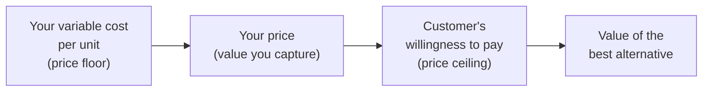
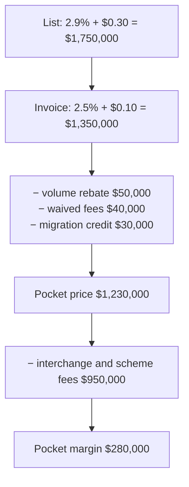

# Pricing and business models

*Part of [Business acumen for the product leader](./README.md)*

## TL;DR

A **business model** is how a company turns value for customers into revenue, and revenue into profit. **Pricing** is the set of choices inside it: what you charge for, how much, how you package it, and how much of the list price you actually collect. Pricing is the fastest lever a product leader has. A feature takes a quarter to ship. A price change can move contribution by a fifth in one billing cycle.

The core tradeoff is capture against growth. A higher price captures more value per customer and loses some customers. A lower price wins customers and may never cover cost. The useful question is never "will we lose customers?" You will. The question is "how many can we lose before the change stops paying?" This lesson gives you the formula for that, and the methods to estimate the answer before you act.

Pricing in financial products is also regulated. Card fees, loan rates and insurance premiums each sit under rules that limit what you may charge, how you must disclose it, and what you may test. The lesson ends with the module's one table of business models, which says what each model sells, what it costs, and which unit to measure it on.

> 🎯 **For the product leader**
>
> **Why it matters** — Most product teams under-price, then give the rest away in discounts nobody tracks. In Payments, Lending and Insurance, the price is also a risk and compliance decision. A merchant rate that ignores card mix, a loan rate that ignores default risk, or a premium that ignores claims will lose more money as volume grows.
>
> **What it changes in your decisions** — You choose a value metric that grows with customer value and tracks your cost. You judge a price change by its break-even volume loss, not by fear of churn. You govern discounts on pocket price, not list price. You clear every price test with Compliance before it runs.
>
> **Ask your team** — *"If we raise this price, how many customers can we lose before total contribution falls? And what evidence says we will lose fewer than that?"*
>
> **Risk if ignored** — Prices set once and never revisited. Margin lost to discounts that buy no extra wins. Or a price test that a regulator later calls unfair discrimination.

## Decision rules in this lesson

1. Pick a value metric that grows with customer value, tracks your main cost driver, gives a bill the customer can predict, and is hard to game.
2. Before a price change, compute the break-even volume loss: price change ÷ (contribution margin + price change). Act only if the evidence says you will lose less.
3. Estimate willingness to pay with at least two methods, one stated and one observed.
4. Approve discounts on pocket price and pocket margin, never on the headline rate.
5. Treat every price test in lending, insurance or consumer payments as a compliance decision first.
6. Move existing customers to a new price in cohorts, with notice, and measure churn against a held-back group.
7. Report the business model in its own unit: per transaction, order, loan, policy or customer. Then use [unit economics](./unit-economics.md) to check it.

## Mental model: the value gap



Your price sits in a gap between two limits. Below it is your variable cost per unit. Price under it, and every sale loses money. Above it is the customer's **willingness to pay**. That ceiling is set by the value the customer gets and by the price of their next-best alternative. Pricing is the choice of where to sit in the gap.

The space between your price and their willingness to pay is the customer's surplus. It is why they buy and why they stay. The space between your cost and your price is your margin. A price rise moves value from the first space to the second. If you move too much, the customer leaves for the alternative.

**Where the picture breaks.** It shows one customer and one price. Real customers each have a different ceiling. A single price is too high for some and leaves money on the table with others. Packaging, fences and discounts exist to sell to several ceilings at once. The ceiling also moves. It rises when you add value and falls when a rival cuts its price.

## Mechanics

### Choose the value metric

**What it is.** The **value metric** is the unit you charge for: per seat, per transaction, per dollar processed, per loan, per policy. It decides who pays more as usage grows. It matters more than the price level, because a wrong metric cannot be fixed by a better number.

Think of a taxi meter. Charge by distance and long trips pay more. Charge a flat fare and short trips subsidize long ones. The meter also changes behaviour. Customers will change how they use the product to lower their bill. A per-transaction fee nudges merchants toward fewer, larger payments. A per-seat price nudges customers to share logins.

**How it works: four tests.** A good value metric passes all four.

| Test | The question | What failure looks like |
| --- | --- | --- |
| **Grows with value** | Does the bill rise when the customer gets more value? | Customers get much more value and pay the same, so you leave money on the table |
| **Tracks the cost driver** | Does the bill rise when your cost rises? | Heavy users cost more than they pay |
| **Predictable** | Can the customer estimate next month's bill? | Bill shock, disputes, and buyers who refuse to commit |
| **Hard to game** | Can the customer cut the bill without cutting their use? | Shared logins, split transactions, accounts moved between entities |

The tests pull against each other. Usage tracks cost best and is hardest to predict. A flat fee is easy to predict and tracks nothing. Most good metrics combine a base fee with a usage part, so you can trade predictability against fit.

**Domain applications.**

- **Payments: percentage or fixed fee.** A percentage fee grows with the ticket size. It also tracks interchange, which is mostly a percentage. A fixed fee per transaction covers costs that do not scale with the amount, such as processing and fraud checks. Most small-merchant prices combine both, for example 2.9% + $0.30. The combination hurts small tickets. A $5 payment pays $0.445, an effective rate of 8.9%. A merchant who sells coffee feels that more than one who sells furniture.
- **Lending: rate or fee.** A loan can charge interest as an annual percentage rate (APR), a flat fee, or both. Interest grows with the amount and the time, which matches the lender's funding cost and risk. A flat fee is easy to understand. But it can hide a high rate on a short loan. A $10 fee on a $100 loan repaid in two weeks equals an APR of about 261%. Regulators look at the APR, not at how small the fee feels.
- **Insurance: premium per exposure unit.** Insurers price per unit of risk exposure. For car insurance the unit is often a car-year. For property it is often each $1,000 of insured value. For US workers' compensation it is commonly each $100 of payroll. Usage-based car insurance charges partly by distance or driving behaviour. That tracks risk better and makes the bill harder to predict.
- **eCommerce and Retail: margin or membership.** A retailer earns its margin on each item. A paid membership adds a fixed fee per year, often in exchange for free delivery. The fee is predictable for the customer. The delivery cost scales with orders. So a heavy-use member can cost more than they pay.
- **AI features: seat or usage.** An AI feature priced per seat often has a cost that grows per model call. That fails the cost-driver test. The heaviest users become the least profitable. Teams respond with usage limits, credits or a usage-based add-on.

**Decision rule.** When your cost per customer varies by more than about three times between light and heavy users, add a usage part to the price. When customers value a predictable bill above all, keep a base fee and put usage in bands. Both thresholds are judgement, not law.

**Common misreading.** "Competitors charge per seat, so we must too." Copying a rival's metric copies its cost structure as well. If your cost driver differs, the same metric gives you different margins.

### Measure willingness to pay

**What it is.** **Willingness to pay** is the highest price a customer would pay for your product, given the alternatives. You cannot ask for it directly. People do not know it, and they have a reason to understate it. So you estimate it. Four methods are common. Each answers a different question.

#### The price-sensitivity meter

**How it works.** A survey asks each respondent four questions about one product:

1. At what price would it be so cheap that you would doubt its quality? (**too cheap**)
2. At what price would it be a bargain? (**cheap**)
3. At what price would it start to feel expensive, though you would still consider it? (**expensive**)
4. At what price would it be too expensive to consider? (**too expensive**)

**How to compute it.** For each price, compute the share of respondents who gave that answer or a more extreme one. That gives four cumulative curves. "Too cheap" and "cheap" fall as the price rises. "Expensive" and "too expensive" rise. Then read where the curves cross. In one common reading:

- The **lower bound** of the acceptable range is where "too cheap" crosses "not cheap", the reverse of the "cheap" curve.
- The **upper bound** is where "too expensive" crosses "not expensive", the reverse of the "expensive" curve.
- Many teams also mark where "too cheap" crosses "too expensive". It is the price that the fewest people reject on either side.

Practitioners use slightly different crossing rules. Agree the rule before you read the chart.

*Illustrative readout, all inputs assumed:* 400 small-business owners answer the four questions about an invoicing plan. The acceptable range runs from $18 to $41 a month. The "fewest rejections" point sits at $27. The current price of $29 sits inside the range.

**What it tells you.** The range of prices that customers will not reject on sight. It is cheap, fast and works before launch.

**What it cannot tell you.** How many people will buy at each price. It shows no competitor and no trade-off. Answers anchor on the price customers already pay. It cannot compute revenue or contribution.

#### The trade-off survey

**How it works.** A **trade-off survey** shows each respondent a series of choice tasks. Each task shows three or four versions of a product. The versions differ in features and price. The respondent picks one, or picks "none". After 10 to 15 tasks, a statistical choice model estimates a **part-worth** for each feature level and for price. A part-worth is the utility that the level adds to a choice.

**How to compute willingness to pay for a feature.** Divide the feature's part-worth by the utility of one dollar of price. *Illustrative, inputs assumed:* the model finds that each extra dollar a month lowers utility by 0.05. Same-day payouts add 0.6. Willingness to pay for same-day payouts is 0.6 ÷ 0.05 = **$12 a month**.

The same model can simulate share of choice. You describe your product and two rivals, change your price, and watch the predicted share move.

**What it tells you.** Which features carry value, how much each is worth in dollars, and how share might move against rivals. It is the best stated method for packaging.

**What it cannot tell you.** Real behaviour. Respondents spend no money, so stated value often runs higher than what they pay. It needs a careful design, a few hundred respondents per segment, and a specialist to run the model. It costs weeks and money.

#### Live price tests

**How it works.** You show different prices to comparable groups and measure what they actually do. Common designs:

- **New-visitor split.** Randomly assign new visitors to price A or price B. Measure conversion, revenue per visitor and retention at 90 days.
- **Geographic or time split.** Use price A in some markets or weeks and price B in others. This is easier to explain, and harder to read, because markets and weeks differ.
- **Painted door.** Show a paid upgrade that is not yet built, and count who clicks "buy". Then tell them it is coming. This tests demand for a new paid feature, not a price change.

**What it tells you.** Real behaviour at real prices. It is the strongest evidence you can get.

**What it cannot tell you.** Long-run effects such as later churn or brand damage, unless you run it for months. It needs enough volume to detect a difference. And customers who find out they paid more than others may complain, publicly. In lending and insurance, many live price tests are restricted by law. See the regulated domains section below.

#### Win/loss price analysis

**How it works.** In a sales-led business, record every deal. Log the quoted pocket price, the discount, the competitor, and whether you won. Then plot the win rate by discount band.

*Illustrative, inputs assumed:* deals with 0–10% discount win 31% of the time. Deals with 10–20% discount win 33%. Deals with more than 20% discount win 34%. Discounts above 10% buy about two to three points of win rate. They cost much more margin than those wins are worth.

**What it tells you.** Whether discounts buy wins, and against which rival. It uses data you already have.

**What it cannot tell you.** Why you lost. Sales teams often record "price" as the reason for every loss. Pair it with interviews of lost buyers, run by someone other than the seller.

#### Choosing a method

| Method | Answers | Cost and time | Main weakness |
| --- | --- | --- | --- |
| **Price-sensitivity meter** | What range will customers accept? | Low, days | No volume, no rivals, anchored on today's price |
| **Trade-off survey** | Which features are worth how much? | Medium to high, weeks | Stated, not real, behaviour |
| **Live price test** | What do people actually do at price B? | Medium, weeks to months | Legal limits, fairness, needs volume |
| **Win/loss analysis** | Do discounts buy wins? | Low, uses existing data | Biased loss reasons, sales-led only |

**Decision rule.** Use one stated method to set a range and one observed method to confirm the point. Do not change a price on a survey alone.

**Common misreading.** "Customers said the price is too high." Customers always say that. The useful question is whether they leave at the new price, and how many.

### Elasticity and the break-even of a price change

**What it is.** **Price elasticity** of demand measures how much volume moves when price moves.

**Elasticity = % change in quantity ÷ % change in price.**

Elasticity is almost always negative: price up, volume down. People often quote it without the minus sign. An elasticity of −0.5 means a 10% price rise loses 5% of volume. Demand is **inelastic** when the size of elasticity is below 1, and **elastic** when it is above 1.

**Why elasticity is not enough.** The textbook rule says: raise price when demand is inelastic, because revenue rises. But you do not manage revenue. You manage contribution. Contribution can rise even when revenue falls, because each lost customer also takes away their variable cost.

**The break-even formula.** Let contribution margin (CM) be the margin per unit before the change, and ΔP the price change per unit. Before the change, total contribution is Q × CM. After it, volume is Q × (1 − x) and margin per unit is CM + ΔP. Set them equal and solve for x:

**Break-even volume loss = ΔP ÷ (CM + ΔP).**

If you lose less volume than this, the price rise pays. The same formula works for a price cut. Make ΔP negative, and the result is the volume gain you need.

**How to compute it.** You need three numbers: the price, the variable cost per unit, and the new price. Variable cost includes everything that rises with the unit: hosting, support, payment processing, interchange, expected losses. Finance can give you all three in an afternoon.

**The asymmetry.** The lower your margin, the more dangerous a cut is, and the safer a rise is.

- With CM of $20, a $6 rise can afford to lose 23.1% of volume.
- With CM of $20, a $4 cut needs 25% more volume just to stand still.

A cut is a bet that volume will rise by more than most cuts ever deliver. A rise is a bet that volume will fall by less than the break-even. The second bet is usually easier to win.

**Domain applications.**

- **Payments.** A processor considers raising its fixed fee from $0.30 to $0.35. Its net revenue per transaction after interchange is small. So the five cents is a large share of its contribution, and the break-even loss is high. The risk sits with small-ticket merchants, who feel the fixed fee most. Check their volume share first.
- **eCommerce.** A delivery fee rise from $4.99 to $5.99 lifts contribution per order by $1. In the food-delivery order in [unit economics](./unit-economics.md), contribution is $2.15. The break-even loss is $1 ÷ $3.15 = 31.7% of orders. That is a lot of room. But the loss may show up as smaller baskets as well as fewer orders. Measure both.
- **Insurance.** A rate rise also changes who stays. The customers most likely to shop and leave are often the ones other insurers want: the lower-risk ones. If the lowest-risk customers leave first, the loss ratio rises. So the contribution gain is smaller than the formula says. This is **adverse selection**.

**Decision rule.** When the evidence says you will lose less volume than the break-even, raise the price. When you cannot estimate the loss within a factor of two, run a test first.

**Common misreading.** "Elasticity is a fixed property of the product." It is not. It differs by segment, by channel, and by time. Existing customers react more slowly than new ones. Churn after a price rise can take two or three billing cycles to appear. Measure for at least that long.

### The price waterfall and discount governance

**What it is.** The **price waterfall** follows one deal from the list price down to the price you actually keep. The **pocket price** is what remains after every discount, rebate, waiver and incentive. In sales-led businesses, the gap between list and pocket is often large, and nobody owns it.

**How it works.** The waterfall has two parts.

- **On-invoice discounts** show on the bill: the negotiated rate, a percentage off.
- **Off-invoice leakage** does not: volume rebates paid later, fees waived, free months, migration credits, extra support at no charge, faster payouts given away.

Off-invoice items are often booked in different places. One is a marketing cost. One is a support cost. One is a contra-revenue line. So nobody sees their sum against the deal.

**Domain application: an enterprise payments deal.** *Illustrative, all inputs assumed.* A payments company signs a merchant with $50 million of card volume a year. The average payment is $50, so there are 1 million payments.



| Step | Annual amount | Share of volume |
| --- | --- | --- |
| List price, 2.9% + $0.30 | $1,750,000 | 3.50% |
| − Negotiated rate, to 2.5% + $0.10 | −$400,000 | |
| **Invoice price** | **$1,350,000** | **2.70%** |
| − Volume rebate, 0.10% of volume | −$50,000 | |
| − Waived dispute and platform fees | −$40,000 | |
| − Migration credit, $60,000 over a 2-year contract | −$30,000 | |
| **Pocket price** | **$1,230,000** | **2.46%** |
| − Interchange and scheme fees, assumed 1.9% | −$950,000 | |
| **Pocket margin** | **$280,000** | **0.56%** |

The invoice suggests a margin of $1,350,000 − $950,000 = $400,000. The off-invoice items take $120,000 of it. That is 30% of the margin, from items that each looked small against the $1.35 million bill. Leakage looks small against gross revenue. It looks large against net revenue, which is where it lands.

**Discount governance.** Set approval bands on pocket margin, not on the headline rate. *Illustrative bands:*

| Pocket margin versus the standard deal | Who approves |
| --- | --- |
| Within 10% | The account executive |
| 10% to 25% below | Sales director and the pricing lead |
| More than 25% below, or below the contribution floor | A deal desk with Finance |

A **deal desk** is a small team that reviews non-standard deals. It checks the full waterfall, the contract length and the precedent the deal sets. Give it a turnaround target, such as one business day. A slow deal desk teaches sellers to avoid it.

**Decision rule.** When a deal needs approval, show the approver the pocket margin and the full waterfall, not the headline rate. When a seller can give away an item without approval, that item will be given away.

**Common misreading.** "The rate is 2.5%, so we keep 0.6% after interchange." That ignores everything off the invoice. Always ask what else the deal includes.

### Packaging: tiers, fences and add-ons

**What it is.** **Packaging** decides how features are grouped and sold. It lets one product sell to customers with different willingness to pay. [Products and go-to-market](./products-and-marketing.md) covers how packaging fits the sales motion. This section covers the pricing mechanics.

**How it works.** Five tools.

- **Good-better-best tiers.** Three tiers at rising prices. The middle tier usually sells most. The top tier often exists partly to make the middle look reasonable.
- **The anchor.** The first price a buyer sees sets the reference for the rest. Show the most complete tier first, or beside the one you want to sell, and the middle tier feels moderate.
- **The decoy.** A tier priced so that it is clearly worse value than its neighbour. Few buy it. Its job is to steer choice toward the neighbour. Use it with care. Buyers who notice feel managed.
- **Fences.** The rules that decide who may buy at which price: volume, company size, contract length, feature limits, channel. A fence keeps customers who would pay more from buying the cheaper option. A **leaky fence** lets them through. A discount for "startups" with no proof of size is a leaky fence.
- **Upgrade triggers.** The usage limit or feature need that moves a customer up a tier. Good triggers fire when the customer is getting more value: a team grows, a volume limit is hit, a second location opens. Bad triggers fire on things the customer resents, such as basic security features.

**Add-on or tier: a test.** Put a feature in a tier when most customers in that segment value it, and it defines the segment. Sell it as an add-on when a minority values it highly, or when it has its own variable cost. As a rough guide, a feature that fewer than about a quarter of customers want is a better add-on than a tier driver. This is a heuristic, not a rule.

**Domain applications.**

- **Payments software.** A free tier for card acceptance, a paid tier that adds invoicing and reporting, and a top tier with multi-location support. Upgrade trigger: opening a second location. Add-on: same-day payouts, priced against the float it gives up. [The language of money](./the-language-of-money.md) shows how float is worth money.
- **Transparent packaging.** Wise says it uses the mid-market exchange rate and charges a visible fee, instead of hiding a markup in the rate. The package itself is part of the value proposition.
- **Insurance.** Tiers of cover, such as basic, standard and premium deductibles. Each tier changes both the price and the claims cost. So a tier is also an underwriting decision.

**Decision rule.** When more than about 60% of buyers pick the cheapest tier, the fences are leaky or the middle tier is weak. When almost nobody picks the top tier, check whether it anchors or just confuses.

**Common misreading.** "More tiers means more choice, so more sales." More tiers also mean more comparison and slower decisions. Three tiers plus add-ons is usually enough.

### Pricing in regulated domains

In Payments, Lending and Insurance, the price is set inside rules. This section names the main ones, as of 2026-10. It is a map for the conversation with Legal and Compliance. It is not legal advice.

#### Payments: how merchants are priced

On a card payment, the merchant's acquirer pays an **interchange** fee to the cardholder's bank, the issuer. Card networks set the rates. In some places the law caps them. The acquirer also pays **scheme fees** to the card network. Then it adds its own markup. Merchant pricing decides how these parts are shown.

| Model | What the merchant sees | Who carries the card-mix risk | Fits |
| --- | --- | --- | --- |
| **Blended** | One rate for all cards, such as 2.9% + $0.30 | The provider. If more customers use premium cards with higher interchange, the provider's margin shrinks | Small merchants who value a simple, predictable bill |
| **Interchange-plus** | Interchange and scheme fees at cost, plus the provider's markup | The merchant | Large merchants who want transparency and can negotiate the markup |
| **Tiered** | Cards grouped into buckets, such as qualified and non-qualified, each with a rate | Shared, but the provider decides the buckets | Often criticised as hard to audit |

Adyen's interchange++ pricing shows its own fee apart from interchange and scheme fees. "Plus plus" means interchange, plus scheme fees, plus the provider's markup.

**The rules that cap interchange.**

- The European Union caps interchange on consumer debit and credit cards. The cap is 0.2% of the transaction value for debit and 0.3% for credit.
- In the US, a Federal Reserve rule, Regulation II, caps debit interchange for card issuers with $10 billion or more in assets. Smaller issuers are exempt from that cap. As of 2026-10, the US cap is 21 cents plus 5 basis points of the transaction value, with a 1-cent fraud-prevention adjustment for eligible issuers. The Federal Reserve proposed lowering it in 2023, so check the current level before you model it. US credit card interchange is not capped by this rule.

A general inference, not a sourced fact: the exemption can make a smaller partner bank attractive to a fintech that issues debit cards, because the bank can earn uncapped interchange. [Unit economics](./unit-economics.md) works through what happens to a neobank when that revenue halves.

**Surcharges.** Card network rules and some laws limit whether a merchant may add a fee for paying by card. The limits differ by network, country and card type. Check them before you build a surcharge feature.

**Decision rule.** When you sell to small merchants, offer blended pricing and price the card-mix risk into it. When a merchant is large enough to compare offers line by line, move it to interchange-plus and compete on the markup.

#### Lending: risk-based pricing and disclosure

**Risk-based pricing** charges higher rates to borrowers with higher expected loss. It is how a lender covers each risk band. [Unit economics](./unit-economics.md) shows how expected loss sets the floor for each band. Several US rules shape the price.

- **Disclosure.** The Truth in Lending Act and its Regulation Z require lenders to disclose the APR and the finance charge in a standard form. Many fees, such as an origination fee, count in the finance charge. So a low headline rate with a high fee shows as a higher APR. How these rules apply to buy now, pay later plans has been contested and has changed. Ask Legal for the current position.
- **Rate limits.** Many US states set maximum interest rates, and the limits vary widely by state and product. A national bank can generally charge the rate allowed in its home state to borrowers in other states. That is one reason many fintech lenders partner with banks. Some states have challenged these partnerships.
- **The Military Lending Act.** It caps the cost of many consumer credit products for active-duty servicemembers and their dependents at a 36% Military Annual Percentage Rate. That rate includes many fees that a standard APR leaves out. A product with a flat fee on short loans can breach it easily. The 261% example above would.
- **Fair lending.** The Equal Credit Opportunity Act and its Regulation B forbid discrimination in any part of a credit transaction on protected grounds, such as race, sex or age. Price is part of the transaction. A pricing model that uses a factor closely linked to a protected group can create a fair-lending problem even if no one intended it.
- **Changing the price later.** For US credit cards, Regulation Z generally requires 45 days' written notice before a significant change in terms, such as a higher rate.

**Decision rule.** When you design a fee for a credit product, convert it to an APR and to a Military Annual Percentage Rate before you test it. When either looks high, take it to Compliance before you take it to customers.

#### Insurance: rate filings

In the US, insurance is regulated by the states. Insurers file their rates, or the rules behind them, with each state's insurance regulator. The common standard is that rates must not be excessive, inadequate or unfairly discriminatory.

- **Prior approval.** In some states and lines, the regulator must approve a new rate before the insurer uses it. That can take months.
- **File and use.** In others, the insurer files the rate and may start using it straight away, or after a short wait.

Which applies varies by state and by line of business. A product team that plans a price change in four weeks may find it needs months in key states. Several states have also restricted pricing on factors other than risk, such as a customer's likelihood to shop around at renewal.

The UK took a similar step. From 2022, the Financial Conduct Authority's rules require home and motor insurers to offer a renewing customer a price no higher than they would offer a new customer through the same channel. The practice it ended was known as "price walking": raising renewal prices year after year for customers who do not shop around.

A pricing model does not change this duty. Even an insurer that keeps a fixed fee, as in the Lemonade row of the business-model table below, must file rates that cover expected claims.

**Decision rule.** When you plan an insurance price change, ask for the filing timeline in each state before you commit to a launch date.

#### Fair-pricing limits on experiments

A price test shows different prices to different people. In most retail software, that is a business choice. In credit and insurance, it can breach the rules above. Even in payments and eCommerce, three limits apply.

- **Disparate impact.** If the test groups line up with a protected characteristic, through geography for example, the test can discriminate without intending to.
- **Disclosure and fairness.** Consumer-protection rules in many places forbid misleading price presentation. Customers who find they paid more than a neighbour may complain to a regulator.
- **Reputation.** A personalized price that looks like it targets people who cannot shop around damages trust fast.

**Decision rule.** When a price test touches consumers in a regulated product, get written approval from Compliance first. Prefer tests by time or by new-customer cohort over tests by person.

### Executing a price change

A good price can still fail in the rollout. Five decisions shape the result.

1. **Grandfathering.** Do existing customers keep the old price? Three options: forever, for a set period, or not at all. Forever protects goodwill and gives up the gain on your largest base. A set period, such as 6 or 12 months, is the common middle. In worked example E below, 12 months of grandfathering delays up to $60,000 a month of extra revenue.
2. **Notice.** Give notice in line with contracts and law, and earlier than the minimum. Say what changes, when, and why. Name the value added since the last price.
3. **Cohorted rollout.** Change the price for new customers first. Then move existing customers in cohorts, starting with those least likely to leave, such as long-tenure, high-usage customers. Hold back a random group at the old price for a few months to measure the effect.
4. **Churn by cohort.** Track churn, downgrades and support contacts for each cohort against the held-back group. Read results after two or three billing cycles, not after one week.
5. **Sales enablement.** Give sellers and support a short explanation, the answers to the three hardest objections, and a clear discount rule. Freeze extra discount authority for the first quarter. Otherwise the rise is negotiated away deal by deal.

**Decision rule.** When you raise prices on an existing base, move one cohort, wait two billing cycles, and compare churn with the held-back group before you move the next.

**Common misreading.** "We lost 2% of customers in the first week, so the change worked." Churn after a price rise is delayed. Customers leave at renewal, at the next invoice, or when a rival calls.

### Business models by domain

This is the module's single table of business models. Each row names the unit to measure it on. [Unit economics](./unit-economics.md) builds the full waterfall for each unit.

| Model | Revenue line | Main cost line | Profit lever | The unit | A public example |
| --- | --- | --- | --- | --- | --- |
| **Subscription** | Recurring fee | Cost to serve | Retention and expansion | [Customer per month](./unit-economics.md) | Shopify's Subscription Solutions were 24% of its revenue in 2025. The other 76% came from Merchant Solutions, mainly payment processing. |
| **Usage-based** | Fee per unit used | Variable cost per unit | Margin per unit, volume | [The usage unit, such as one transaction](./unit-economics.md) | Payment processors charge per transaction or per dollar processed |
| **Marketplace take rate** | A share of each transaction | Delivery, payments, support, incentives | Take rate and contribution per order | [One order](./unit-economics.md) | DoorDash's net revenue margin was 13.4% of Marketplace GOV in 2024. |
| **Transactional / interchange** | Fees on payments | Interchange and network fees paid onward | Net take rate after pass-through costs | [One transaction](./unit-economics.md) | Adyen's interchange++ pricing shows its fee apart from interchange and scheme fees. |
| **Lending spread** | Interest and fees | Cost of funds, credit losses, servicing | Risk-adjusted margin | [One loan](./unit-economics.md) | Upstart earns fees from lending partners for its platform and for borrower referrals. Most of the loans are kept by its lending partners or bought by institutional investors. |
| **Insurance premium** | Premium | Claims, expenses, reinsurance | Combined ratio, plus investment income on premiums held | [One policy-year](./unit-economics.md) | Lemonade's 2020 filings described a fixed fee: 25% of premiums at the time. The rest went to claims and reinsurance. |
| **Retail margin** | Product sales | Cost of goods, shrink, markdowns | Gross margin and stock turns | [One category](./unit-economics.md) | A retailer earns the gap between the shelf price and the landed cost of goods. |
| **Advertising** | Fees from brands | Sales and ad-tech costs | Ad revenue per user | Advertiser per month | Instacart reports advertising and other revenue as a separate line from transaction revenue. |

Many companies combine rows. A payments company may add subscription software. A marketplace may add advertising. Each extra row adds a revenue line that does not depend on the first one. It also adds a second set of economics to manage.

**Decision rule.** When more than half of contribution comes from one row, and that row depends on a rule or a partner, plan a second row before you scale acquisition.

**Common misreading.** "We are a subscription business." Most fintechs that say this earn most of their money from a usage row, such as payments or interest. Read the revenue split, not the pitch.

## Worked example: a 20% price rise

*Illustrative. A small-business software company sells an invoicing plan. Every input is assumed.*

**The situation.** The plan costs **$29 a month**. Variable cost is **$9 a month** per customer: hosting, support, text-message reminders and third-party services. So contribution margin is **$20**. The company has **10,000 customers**. It has added recurring invoices and payment reminders since the last price change. A price-sensitivity meter put the acceptable range at $18 to $41. The team proposes **$35**.

**Step 1: the price change.** $35 − $29 = $6. That is $6 ÷ $29 = a **20.7%** rise.

**Step 2: the new margin.** Variable cost stays at $9. New contribution margin = $35 − $9 = **$26**.

**Step 3: the break-even volume loss.** $6 ÷ ($20 + $6) = $6 ÷ $26 = **23.1%**. The company can lose up to 23.1% of its customers and still earn the same total contribution.

**Step 4: the evidence.** A live test on new visitors showed a conversion drop of about 8% at $35. The team assumes existing customers react the same way over two billing cycles. So it plans for an **8%** volume loss. That implies an elasticity of −8% ÷ 20.7% = **−0.39**. The break-even elasticity is −23.1% ÷ 20.7% = −1.12.

**Step 5: the result at 8% loss.**

| | Before | After | Change |
| --- | --- | --- | --- |
| Customers | 10,000 | 9,200 | −8.0% |
| Price | $29 | $35 | +20.7% |
| Monthly revenue | $290,000 | $322,000 | **+11.0%** |
| Contribution per customer | $20 | $26 | +30.0% |
| Monthly contribution | $200,000 | $239,200 | **+19.6%** |

Revenue rises 11.0%. Contribution rises 19.6%, almost twice as much. The 800 customers who leave also take away $9 each of variable cost.

**Step 6: the range of outcomes.**

| Volume loss | Revenue change | Contribution change |
| --- | --- | --- |
| 0% | +20.7% | +30.0% |
| 8% | +11.0% | +19.6% |
| 15% | +2.6% | +10.5% |
| 23.1% | −7.2% | 0.0% |
| 30% | −15.5% | −9.0% |

Look at the 23.1% row. Revenue falls 7.2%, yet contribution holds. A team that tracks only revenue would call that a failure.

**Step 7: the segment check.** Averages hide the risk. The team splits customers by monthly invoice volume. The smallest fifth uses the product least and faces the largest relative rise. If that segment churns at 30% and the rest at 4%, the total loss is 0.2 × 30% + 0.8 × 4% = **9.2%**. That is still well below 23.1%.

**What the leader does with this.** She approves $35 for new customers now. She moves existing customers in cohorts with 60 days' notice, starting with high-usage accounts. She holds back a random 5% at $29 for three months to measure true churn. She sets a stop rule: if any cohort's churn passes 15%, the rollout pauses. And she asks the team to add a lower-priced plan with a usage limit, for the smallest fifth. That fences the price-sensitive segment instead of losing it.

## Tradeoffs and decisions

- **Capture vs. growth.** A higher price raises margin per customer and slows adoption. The cost of under-pricing is margin you never see. The cost of over-pricing is a market a rival takes.
- **Simple vs. precise pricing.** A flat rate is easy to buy. A pass-through model like interchange-plus is fairer and harder to compare. You trade conversion for margin protection.
- **Subscription vs. usage.** A subscription gives predictable revenue. Usage pricing grows with the customer and swings with their volume. The cost of usage pricing is a forecast you cannot trust. The cost of subscription is heavy users who cost more than they pay.
- **Sell the base vs. protect it.** Grandfathering protects goodwill. It gives up the price gain on your largest group of customers, for as long as it lasts.
- **Discount flexibility vs. price integrity.** Letting sellers discount wins some deals faster. It also teaches buyers to wait for the discount and erodes the list price for everyone.
- **Fast change vs. regulatory timeline.** In insurance and credit, the fastest price change may need filings, notices and reviews. You trade speed for the right to keep selling.
- **Promise vs. revenue.** Affirm says it has never charged late fees. That is a pricing choice and a brand promise at once. It builds trust, and it gives up a revenue line that many rivals keep. So its revenue must come from merchant fees, interest and other sources.

## Failure modes

- **Fear of churn freezes the price.** The team never raises prices because "customers will leave". It never computes the break-even. You see it as contribution per customer falling each year as costs rise.
- **Price cut without the maths.** A team cuts price to grow. Volume rises 10% when it needed to rise 25%. You see it as higher volume and lower contribution in the same quarter.
- **Discount leakage.** Off-invoice items pile up in different budgets. You see it as a pocket price far below the invoice price when Finance finally builds the waterfall.
- **Meter mismatch.** You charge per seat while your cost grows per transaction or per model call. You see it as your largest customers becoming your least profitable.
- **Leaky fences.** Large buyers qualify for small-business pricing. You see it as a cheap tier with a growing share of high-volume accounts.
- **Survey treated as proof.** A survey said customers would pay $35. They did not. You see it as a conversion drop far beyond what the survey suggested.
- **A test that becomes a finding.** A price test in a credit or insurance product runs without Compliance review. You see it as a regulator's letter, or a complaint that goes public.
- **Delayed churn missed.** The team declares victory after a week. You see it as a churn spike at the next renewal date.

## Under the hood

The script below reproduces the numbers in this lesson: worked example E, its range of outcomes, the price-cut case, the price waterfall and the trade-off survey calculation. It uses only the standard library. All inputs are assumed.

```python
# Pricing: reproduces the numbers in this lesson. Python 3, standard library only.

def breakeven_loss(cm, dp):
    """Share of volume you can lose after a price change of dp and keep the same
    total contribution. Positive dp (a rise) gives a loss you can afford.
    Negative dp (a cut) gives a negative number: the volume GAIN you need."""
    return dp / (cm + dp)

def price_change(price, var_cost, new_price, loss, customers=10_000):
    cm, new_cm = price - var_cost, new_price - var_cost
    kept = customers * (1 - loss)
    rev0, rev1 = customers * price, kept * new_price
    con0, con1 = customers * cm, kept * new_cm
    return dict(price_change=new_price / price - 1, cm=cm, new_cm=new_cm,
                breakeven=breakeven_loss(cm, new_price - price),
                elasticity=-loss / (new_price / price - 1),
                rev0=rev0, rev1=rev1, rev_change=rev1 / rev0 - 1,
                con0=con0, con1=con1, con_change=con1 / con0 - 1)

# Worked example E: $29 -> $35 a month, variable cost $9 (all inputs assumed)
e = price_change(29, 9, 35, 0.08)
print(f"price +{e['price_change']:.1%}  CM ${e['cm']} -> ${e['new_cm']}  "
      f"break-even loss {e['breakeven']:.1%}")
print(f"at 8% loss: revenue ${e['rev0']:,.0f} -> ${e['rev1']:,.0f} ({e['rev_change']:+.1%}), "
      f"contribution ${e['con0']:,.0f} -> ${e['con1']:,.0f} ({e['con_change']:+.1%}), "
      f"implied elasticity {e['elasticity']:.2f}")
print(f"break-even elasticity {-e['breakeven'] / e['price_change']:.2f}")
for loss in (0.0, 0.15, e['breakeven'], 0.30):
    r = price_change(29, 9, 35, loss)
    con = round(r['con_change'], 9) + 0.0          # avoid printing -0.0%
    print(f"  loss {loss:.1%}: revenue {r['rev_change']:+.1%}  contribution {con:+.1%}")
print(f"segment check: blended loss {0.2 * 0.30 + 0.8 * 0.04:.1%}")
print(f"12 months of grandfathering delays up to ${10_000 * (35 - 29):,} a month")

# The mirror case: a cut from $29 to $25 needs this much more volume
print(f"cut to $25: volume gain needed {-breakeven_loss(20, -4):.1%}")

# Other numbers in the Mechanics section (all inputs assumed)
fee = 5 * 0.029 + 0.30
print(f"$5 payment at 2.9% + $0.30: fee ${fee:.3f}, effective rate {fee / 5:.1%}")
print(f"$10 fee on a $100 loan for 14 days: APR about {10 / 100 * 365 / 14:.0%}")
print(f"delivery fee +$1 on $2.15 contribution: break-even loss {breakeven_loss(2.15, 1):.1%}")

# Price waterfall: one enterprise merchant, one year (all inputs assumed)
volume = 50_000_000
tx = volume / 50
steps = [("list price (2.9% + $0.30)", tx * (0.029 * 50 + 0.30)),
         ("invoice price (2.5% + $0.10)", tx * (0.025 * 50 + 0.10))]
invoice = steps[-1][1]
leaks = {"volume rebate (0.10%)": 0.001 * volume,
         "waived fees": 40_000,
         "migration credit ($60k over 2 years)": 30_000}
pocket = invoice - sum(leaks.values())
pass_through = 0.019 * volume
for name, v in steps:
    print(f"{name:40s} ${v:>12,.0f}  {v / volume:.2%}")
for name, v in leaks.items():
    print(f"  - {name:36s} ${v:>12,.0f}")
print(f"{'pocket price':40s} ${pocket:>12,.0f}  {pocket / volume:.2%}")
print(f"{'pocket margin after 1.9% pass-through':40s} ${pocket - pass_through:>12,.0f}  "
      f"{(pocket - pass_through) / volume:.2%}")
print(f"margin the invoice suggests ${invoice - pass_through:,.0f}; "
      f"leakage = {sum(leaks.values()) / (invoice - pass_through):.0%} of it")

# Trade-off survey: willingness to pay for a feature from part-worths (assumed)
price_utility_per_dollar = -0.05
feature_utility = 0.6
print(f"implied WTP for the feature: ${feature_utility / -price_utility_per_dollar:.0f} a month")
```

Output:

```text
price +20.7%  CM $20 -> $26  break-even loss 23.1%
at 8% loss: revenue $290,000 -> $322,000 (+11.0%), contribution $200,000 -> $239,200 (+19.6%), implied elasticity -0.39
break-even elasticity -1.12
  loss 0.0%: revenue +20.7%  contribution +30.0%
  loss 15.0%: revenue +2.6%  contribution +10.5%
  loss 23.1%: revenue -7.2%  contribution +0.0%
  loss 30.0%: revenue -15.5%  contribution -9.0%
segment check: blended loss 9.2%
12 months of grandfathering delays up to $60,000 a month
cut to $25: volume gain needed 25.0%
$5 payment at 2.9% + $0.30: fee $0.445, effective rate 8.9%
$10 fee on a $100 loan for 14 days: APR about 261%
delivery fee +$1 on $2.15 contribution: break-even loss 31.7%
list price (2.9% + $0.30)                $   1,750,000  3.50%
invoice price (2.5% + $0.10)             $   1,350,000  2.70%
  - volume rebate (0.10%)                $      50,000
  - waived fees                          $      40,000
  - migration credit ($60k over 2 years) $      30,000
pocket price                             $   1,230,000  2.46%
pocket margin after 1.9% pass-through    $     280,000  0.56%
margin the invoice suggests $400,000; leakage = 30% of it
implied WTP for the feature: $12 a month
```

To use it on your own product, replace the price, variable cost and expected loss with your numbers. Then replace the single loss rate with a loss rate per segment, weighted by each segment's share.

## Practitioner checklist

- [ ] Write down your value metric and check it against the four tests: value, cost driver, predictability, gaming.
- [ ] Get price, variable cost per unit and contribution margin for your main plan from Finance.
- [ ] Compute the break-even volume loss for a 10% and a 20% price rise.
- [ ] Run one stated and one observed willingness-to-pay method before your next price change.
- [ ] Build the price waterfall for your five largest deals, including every off-invoice item.
- [ ] Check that discount approval bands use pocket margin, not the headline rate.
- [ ] Check which tier most customers buy, and why. Look for leaky fences.
- [ ] For any credit product, compute the APR and the Military Annual Percentage Rate of every fee.
- [ ] For any insurance price change, get the filing timeline for each state.
- [ ] Get written Compliance approval before any price test on consumers in a regulated product.
- [ ] Plan a cohorted rollout with a held-back group and a stop rule.

## Related lessons

- [Unit economics](./unit-economics.md) — the contribution waterfall for each unit in the business-model table, the lending spread and the neobank example.
- [The language of money](./the-language-of-money.md) — gross versus net revenue, contra-revenue and float.
- [Competitive advantage and strategy](./competitive-advantage-and-strategy.md) — the card profit pool and how rivals respond to a price move.
- [Products and go-to-market](./products-and-marketing.md) — packaging inside the sales motion.
- [Performance and growth](./performance-and-growth.md) — revenue retention after a price change.
- [Metrics and experimentation](../technical-product-management/metrics-and-experimentation.md) — how to design and read a price test with guardrails.
- [The economics of infrastructure](../technical-product-sense/economics-of-infrastructure.md) — the variable cost behind usage pricing.
- [Transactional and financial systems](../system-design/transactional-and-financial.md) — how payments are processed and settled.
- [Motivation and behaviour](../product-sense/motivation-and-behaviour.md) — why people pay, and why they stop.

## Sources and notes

- Worked example E, the price waterfall, the willingness-to-pay readouts, the win/loss figures and the approval bands are illustrative. Their inputs are assumed. The script above reproduces every number.
- The add-on threshold, the tier-share threshold and the cost-variation threshold for usage pricing are rules of thumb, not sourced facts.
- Shopify, Form 10-K for fiscal 2025 (filed 2026-02): subscription solutions were 24% of total revenues. [Form 10-K](https://www.sec.gov/Archives/edgar/data/1594805/000159480526000007/shop-20251231.htm). As of 2026-10.
- DoorDash, Form 10-K for fiscal 2024 (filed 2025-02): net revenue margin is revenue as a percentage of Marketplace GOV; 13.4% for 2024. [Form 10-K](https://www.sec.gov/Archives/edgar/data/1792789/000162828025005715/dash-20241231.htm). As of 2026-10.
- Adyen, help article *What is the interchange ++?*: Adyen's fee shown apart from interchange and card-scheme fees. [Adyen](https://help.adyen.com/knowledge/payment-methods/explore-payment-methods/what-is-the-interchange). As of 2026-10.
- Upstart, Form 10-K for fiscal 2022 (filed 2023-02): platform and referral fees charged to lending partners at origination, and servicing fees. [Form 10-K](https://www.sec.gov/Archives/edgar/data/1647639/000164763923000021/upst-20221231.htm). As of 2026-10.
- Lemonade, Form 10-K for fiscal 2020 (filed 2021-03): it typically retains a fixed fee, then 25% of premiums. [Form 10-K](https://www.sec.gov/Archives/edgar/data/1691421/000169142121000024/lmda-20201231.htm). As of 2026-10.
- Maplebear (Instacart), Form 10-K for fiscal 2025 (filed 2026-02): revenue consists of transaction revenue and advertising and other revenue. [Form 10-K](https://www.sec.gov/Archives/edgar/data/1579091/000157909126000018/cart-20251231.htm). As of 2026-10.
- Affirm, Form 10-K for fiscal 2026 (year ended 2026-06-30, filed 2026-08-27): it has charged $0 in late fees since its founding. [Form 10-K](https://www.sec.gov/Archives/edgar/data/1820953/000162828026059279/afrm-20260630.htm). As of 2026-10.
- Wise, pricing page for sending money: the mid-market rate with no markup, and a separate fee. [Wise pricing](https://wise.com/gb/pricing/send-money). As of 2026-10.
- EU interchange: Regulation (EU) 2015/751 caps consumer debit card interchange at 0.2% and consumer credit card interchange at 0.3% of the transaction value. Text of the Regulation as adopted by the EU, published on legislation.gov.uk: [Article 3](https://www.legislation.gov.uk/eur/2015/751/article/3/adopted) and [Article 4](https://www.legislation.gov.uk/eur/2015/751/article/4/adopted). As of 2026-10.
- US debit interchange: Regulation II, in title 12 of the Code of Federal Regulations (CFR), 12 CFR 235.3 to 235.5. The cap is 21 cents plus 5 basis points of the transaction value (235.3), plus up to 1 cent for fraud prevention (235.4). Issuers with less than $10 billion in assets, with affiliates, are exempt (235.5). [12 CFR 235.3](https://www.law.cornell.edu/cfr/text/12/235.3), [235.4](https://www.law.cornell.edu/cfr/text/12/235.4) and [235.5](https://www.law.cornell.edu/cfr/text/12/235.5) (Cornell Legal Information Institute); matches the eCFR text current as of 2026-10-09.
- Federal Reserve, press release of 2023-10-25 proposing to lower the debit interchange cap. [Federal Reserve](https://www.federalreserve.gov/newsevents/pressreleases/bcreg20231025a.htm). As of 2026-10.
- The link between the small-issuer exemption and fintech partner-bank choice is general reasoning, not a sourced fact.
- Truth in Lending Act and Regulation Z (12 CFR Part 1026): APR and finance-charge disclosure, and 45 days' notice of significant changes in terms for credit card accounts (12 CFR 1026.9). Not yet fact-checked in this pass.
- Military Lending Act (10 U.S.C. 987) and its rule (32 CFR Part 232): the 36% Military Annual Percentage Rate limit for covered borrowers. Not yet fact-checked in this pass.
- Equal Credit Opportunity Act and Regulation B (12 CFR Part 1002): no discrimination on protected grounds in any aspect of a credit transaction. Not yet fact-checked in this pass.
- UK Financial Conduct Authority, Policy Statement PS21/5 on general insurance pricing practices (2021): renewal prices for home and motor insurance no higher than the equivalent new-business price, from 2022-01-01. Not yet fact-checked in this pass.
- The US state insurance rate standards (not excessive, inadequate or unfairly discriminatory) and the prior-approval and file-and-use systems are described generically. They vary by state and line.
