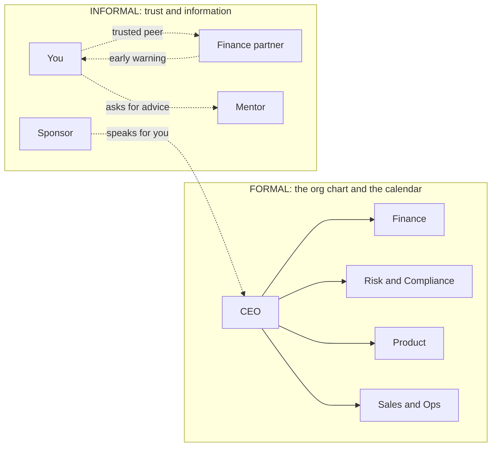
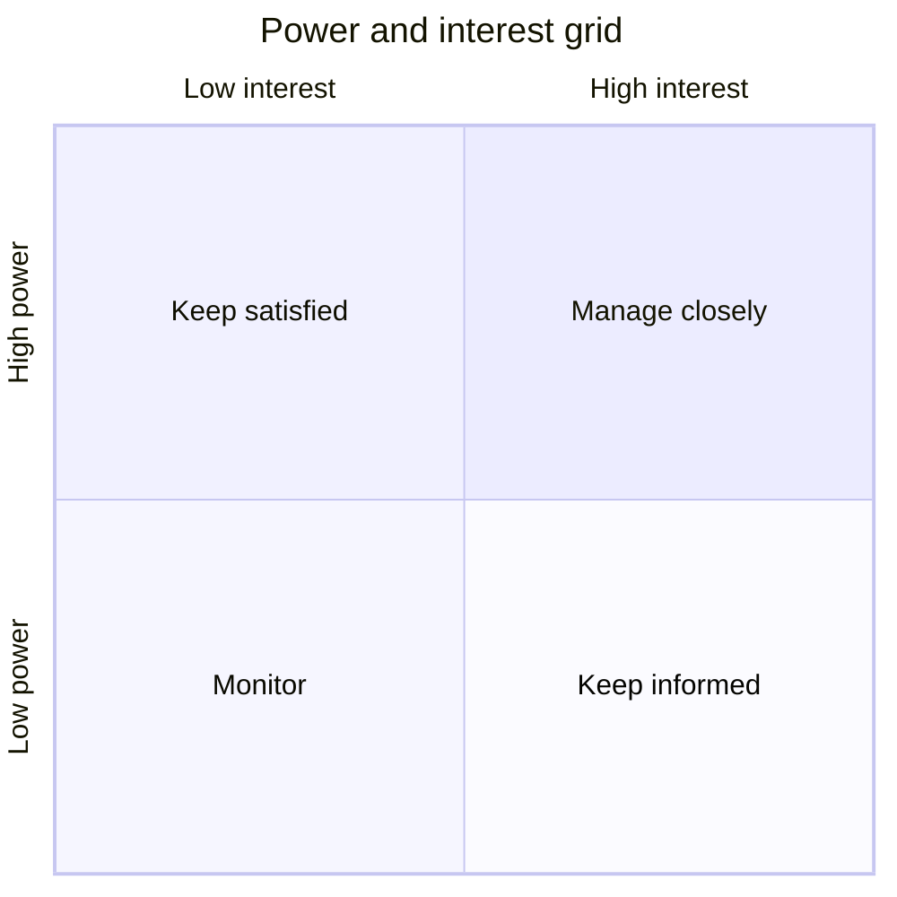

# Navigating the organization: how the company really works

*Part of [Business acumen for the product leader](./README.md)*

*Last reviewed: 2026-10 · Volatility: medium*

## TL;DR

Every company has two maps. The **formal organization** is the org chart, the budget and the approval process. The **informal organization** is the network of trust, favours and information that decides what actually happens. A product leader needs both maps. You also need to know which function holds which lever on the money.

The formal map runs on a calendar. Money and headcount are decided in the **annual plan**. Risk is decided against a written **risk appetite**, through **three lines of defence**. If your idea misses the plan, or breaks a risk policy, a good idea still stalls.

The core tradeoff is time and credibility. Building relationships, sponsors and political capital takes months. Skipping that work feels faster, until a decision you need is made in a room you were not in. At Group PM level and above, most of your outcomes depend on people who do not report to you.

> 🎯 **For the product leader**
>
> **Why it matters** — Your biggest decisions need a yes from Finance, Risk, Sales, Operations and sometimes an outside partner. Each is measured on something different. If you do not know what they are paid to protect, you cannot design a proposal they can accept.
>
> **What it changes in your decisions** — You get asks into the plan before targets lock. You price them at fully loaded cost, in both the profit view and the cash view. You map who can veto before you write the proposal. When a launch breaks a policy, you ask for a time-boxed risk acceptance, not an exception by email.
>
> **Ask your team** — *"Who outside this room can stop this, which policy might it break, and is the money in next year's plan?"*
>
> **Risk if ignored** — A well-built launch is blocked a week before release. A compliance review, a partner bank or a missing budget line stops it. Nobody on the team knew it existed.

## Decision rules in this lesson

- **When you need money or people, get the ask into the bottom-up plan before targets lock.** Mid-year, name what you will stop to pay for it.
- **Price every ask at fully loaded cost.** Show the profit view and the cash view side by side.
- **When your launch adds cost to a cost-centre team, move budget to them in the business case.** Otherwise they are paid to say no.
- **When a launch breaks a policy, ask for a time-boxed risk acceptance with a fix plan.** Do not ask Risk to change the policy.
- **Anyone with a veto goes in the high-power row of your stakeholder map, whatever their title.**
- **Spend political capital only on the two or three decisions that change your year.**

## Mental model: the road map and the traffic



The org chart is the road map. It shows the official routes. The informal network is the traffic. It shows which routes are open today, and which shortcut a trusted peer can give you. The plan and the risk process are the traffic lights. They turn green on a schedule, not when you arrive.

**Where the analogy breaks.** Roads do not remember you. People do. Every interaction changes the informal map. A shortcut you abuse closes for good.

## Which function holds which lever

Start with the money. Write in two sentences how the company makes money. Then check it with a finance partner. Most leaders get one part wrong. The module's single table of business models lives in [pricing and business models](./monetization-and-business-models.md). Use it to write your two sentences.

Then find who holds each lever. A **lever** is a decision that moves revenue, cost or risk. Product rarely holds the big ones alone. The table shows the usual owner in the six domains. Your company may differ, so confirm it.

| Lever | Usually held by | Measured on | What helps them move it | Where it is taught |
| --- | --- | --- | --- | --- |
| Price list and fees | Pricing, Finance or a business-unit head | Revenue, margin | A price test with a guardrail on churn | [Pricing and business models](./monetization-and-business-models.md) |
| Credit cutoff and pricing by risk band | Credit Risk | Loss rate against appetite | A test cell with a loss cap | [Unit economics](./unit-economics.md) |
| Fraud and dispute rules | Fraud or Payments Risk | Fraud loss, false declines | The cost of each false decline, in money | [Data and decisions](./data-and-decisions.md) |
| Funding, liquidity and payout timing | Treasury | Funding cost, liquidity buffer | A funding estimate in money and days | [The language of money](./the-language-of-money.md) |
| Rates and underwriting rules | Actuarial and Underwriting | Loss ratio, rate adequacy | Data on how the new segment performs | [Performance and growth](./performance-and-growth.md) |
| Range and stock budget | Merchandising | Gross margin, stock turns | Return on the stock the range ties up | [Unit economics](./unit-economics.md) |
| Paid acquisition budget | Marketing or Growth | Cost to acquire a customer | Proof of incremental customers, not attributed ones | [Products and go-to-market](./products-and-marketing.md) |
| Customer disclosures and terms | Legal and Compliance | Regulatory findings | Early drafts and a clear change log | This lesson, below |
| Headcount and budget | Finance, through the plan | Plan accuracy, cost | A fully loaded cost and a named stop | This lesson, below |

Three facts from public companies show how levers split.

- **Payments.** Part of the price is not yours to set. Adyen prices many card payments as **interchange++**: the card's interchange fee, plus network fees, plus Adyen's own fee. Its markup is visible apart from the pass-through costs. A pricing team at a payments company controls only the markup.
- **eCommerce.** A whole revenue line can belong to another team. Instacart reports two revenue lines: transaction revenue and advertising and other revenue. An ads team that owns its own line has its own goals, and they can clash with the shopping experience.
- **Retail.** A shared metric can align teams that would otherwise compete. Walmart's comparable-sales figure includes eCommerce sales, not only sales in its stores. In general, a shared metric like this makes a store leader less likely to fight an online feature.

**The common misreading.** "The function head decides." Often a senior expert decides, and the head signs. In a lender, the head of Credit Risk signs the cutoff. A credit strategy analyst may have written it. Find the person who writes the recommendation.

## The planning and budget cycle

The formal org decides money and people through a few fixed processes. Learn their calendar. A good idea that misses the calendar waits a year.

### How the annual plan works

Most companies plan once a year, then re-forecast each quarter. The steps below are typical for a company whose year ends in December. The months vary.

1. **Strategy and targets (mid-year).** Leaders agree the strategy. Finance proposes top-down targets for revenue, profit and headcount for each unit.
2. **Bottom-up asks (early autumn).** Each unit says what it can deliver and what it needs. This is the moment to put your ask in.
3. **Negotiation (autumn).** Finance adds up the asks. They almost always exceed the money available. Leaders trade bets against each other.
4. **Approval (late in the year).** The executive team agrees the plan. The board approves it.
5. **Quarterly re-forecast.** Finance updates the forecast. A unit that is behind plan loses budget. A unit that is ahead may get more.

Two things are true once the plan locks. First, headcount is mostly fixed for the year. Second, new money mid-year comes from one of two places: someone else's budget, or a small reserve held by the CFO. Both cost political capital.

**Decision rule.** If your ask is not in the bottom-up submission, assume it is not funded this year. The exception is when you name what you will stop to pay for it.

### Fully loaded cost

The **fully loaded cost** of a person is everything the company pays to employ them. It is not the salary. It adds payroll taxes, benefits, bonus, equity, equipment, software and office space. Finance plans with fully loaded numbers. If your ask uses salaries, Finance will mark it up, and you will look naive.

*An illustrative example. All inputs are assumed.*

| Cost line | Per engineer, per year |
| --- | --- |
| Base salary | $160,000 |
| Payroll taxes and benefits (assumed 25% of base) | $40,000 |
| Bonus and equity | $30,000 |
| Equipment, software, office | $15,000 |
| **Fully loaded cost** | **$245,000** (1.53 × base) |

A team of eight at this cost is 8 × $245,000 = **$1.96 million a year**. Add $240,000 of cloud and vendor cost. The ask is about **$2.2 million a year**. That is the number Finance will see.

The multiple of base salary varies by country, level and equity policy. Ask your finance partner for the planning rate your company uses. Most finance teams have one standard rate per level and location.

### Opex, capex and capitalized development

Finance splits spending into two kinds.

- **Operating expense (opex)** is spent and used up in the period. Salaries for support staff, marketing and rent are opex. It hits the income statement at once.
- **Capital expenditure (capex)** buys an asset that lasts several years. Servers and buildings are capex. The cost goes onto the balance sheet. It then reaches the income statement slowly, as **depreciation** or **amortization** over the asset's useful life.

Software built for the company's own use can sit in either bucket. Some of the engineering cost of building it can be **capitalized**. That means it is treated as an asset, not as an expense. Under long-standing US generally accepted accounting principles (GAAP), the rules for internal-use software sit in Accounting Standards Codification (ASC) topic 350-40. Under those rules, costs in the build stage of a new capability could be capitalized. Costs of research, planning, bug fixing and maintenance were expensed. International Financial Reporting Standards (IFRS) allow development costs to be capitalized when set tests are met. The US standard-setter has recently updated the internal-use software rules. Ask Finance which version your company applies, and what evidence it needs.

**How it works on your ask.** *An illustrative example. All inputs are assumed.* The $2.0 million team cost above builds a new merchant onboarding flow. Finance judges that 60% of the work qualifies for capitalization. The asset goes into service at the start of next year. Finance amortizes it over three years.

| | Year 1 | Year 2 | Year 3 | Year 4 |
| --- | --- | --- | --- | --- |
| Cash out for the team | $2.0M | — | — | — |
| Expensed at once (40%) | $0.8M | — | — | — |
| Capitalized (60%), then amortized | — | $0.4M | $0.4M | $0.4M |
| **Cost on the income statement** | **$0.8M** | **$0.4M** | **$0.4M** | **$0.4M** |

The total cost is $2.0 million either way. Capitalization changes **when** profit shows the cost. It does not change the cash. Year 1 cash is still $2.0 million.

What this means for you:

- **Teams may need to tag their time.** Finance needs evidence of which work built new capability. That is why engineers are sometimes asked to log hours or tag tickets by project.
- **A budget holder may prefer capex.** If the unit is judged on operating profit, capitalized work looks cheaper this year. The cost still arrives later, as amortization.
- **Stopping a capitalized project has a cost.** If the software is abandoned, Finance may have to write off the asset in one go. That is called an **impairment**. A product leader who kills a half-built platform can create a surprise loss.

**Decision rule.** Show Finance both views of your ask: the cash view and the income-statement view. Decide on cash. Report on the income statement.

**The common misreading.** "Capex is free money because it does not hit this year's profit." It hits the next three to five years instead, and the cash is gone today.

### Cost centres, profit centres and internal charges

Finance gives each unit a type. The type decides what the unit's leader is measured on. That, in turn, decides what they say yes to.

| Unit type | Measured on | Typical examples | What it says no to |
| --- | --- | --- | --- |
| **Cost centre** | Spend against budget | Customer support, platform engineering, Compliance | Anything that adds cost, even if company profit rises |
| **Revenue centre** | Revenue or bookings | A sales team | Anything that slows a deal |
| **Profit centre** | Profit of the unit | A business unit or product line | Anything that cuts its margin to help another unit |

Here is the trap. Your launch may raise company profit and still add cost to a cost centre. Support gets more tickets. Compliance gets more reviews. Their leaders are paid to keep cost flat. So they push back, and they are right to.

**Decision rule.** When your launch adds work to a cost centre, put the cost in your business case. Then move the budget to them. A support leader who gets the money for three more agents has no reason to block you.

**Internal charges.** Many companies bill shared costs back to the teams that use them. Finance calls this a **chargeback** or **cost allocation**. In this lesson, "internal charge" means this. It is not the card dispute that is also called a chargeback. A softer version, **showback**, reports the cost to each team without billing it.

Internal charges change behaviour, for good and bad.

- **Good.** A team that sees its cloud bill or its fraud-review cost uses less of it. Waste falls.
- **Bad.** A team that is charged a high price for a shared platform may build its own copy. The company then pays twice.

*An illustrative example. All inputs are assumed.* A payments platform team costs $3 million a year. It handles 1.5 billion internal calls a year. Finance sets an internal charge of $3 million ÷ 1.5 billion = $0.002 per call. A product team makes 300 million calls a year, so it is charged $600,000. That team's leader now has a reason to cut useless calls. If the price stays fixed while volume grows, the platform over-recovers. If volume falls, it under-recovers, and the price must rise. Rising prices push more teams to leave. See [the economics of infrastructure](../technical-product-sense/economics-of-infrastructure.md) for how unit cost behaves at scale.

**Decision rule.** Charge back costs that a team can control. Show back costs it cannot. Never charge more than the platform's real cost per unit.

### How an ask gets into the plan

An ask that succeeds has five parts.

1. **It arrives before the targets lock.** Talk to your finance partner in the summer, not in October.
2. **It ties to the unit's target.** "This adds $1.5 million of gross profit toward our $20 million goal." Not "this is strategic."
3. **It shows fully loaded cost, in cash and profit views.** Include the extra cost it puts on cost centres.
4. **It names what you would stop if you get half.** Finance will often fund half. Decide in advance which half.
5. **It asks for staged money.** Release the second stage when the first meets a gate. See [business cases, capital and valuation](./business-cases-and-valuation.md).

## How Risk and Compliance decide

In Payments, Lending, Insurance and FinTech, Risk and Compliance can stop a launch. Product leaders often treat them as a gate to get through. That is the wrong model. They run a defined process. If you know the process, you can design for it.

### The three lines of defence

Regulated companies split risk work into **three lines of defence**. Each line has a different job.

| Line | Who | Job | What they need from product |
| --- | --- | --- | --- |
| **First line** | The business: product, engineering, operations | Owns the risk. Runs the controls every day. | You. You own the risk your product creates. |
| **Second line** | Risk management and Compliance | Sets policy and risk appetite. Challenges the first line. Monitors. | A risk assessment, the controls and the data to monitor them |
| **Third line** | Internal audit | Gives the board independent assurance that lines one and two work | Evidence that controls ran as designed |

Regulators and external auditors sit outside the three lines. They test the whole system.

The key point is in the first row. **The business owns the risk.** Risk does not own it. The second line sets limits and challenges. It does not run your fraud rules for you. A product leader who says "Risk approved it, so it is Risk's problem" misreads the model.

US bank supervisors write this split into their expectations. In 2014 the Office of the Comptroller of the Currency (OCC), which supervises national banks, issued guidelines known as **heightened standards** for large banks. They describe front line units, independent risk management and internal audit. They also expect a written **risk appetite statement**.

**Domain application.** A fintech that offers accounts through a partner bank sits inside the bank's model. The bank stays responsible for the programme in the eyes of its regulator. So the bank's second line reviews the fintech's product, disclosures and complaint data. In practice, your launch needs your own Compliance team and the bank's.

### Risk appetite

A **risk appetite statement** says how much risk of each kind the company will take to meet its goals. The board approves it. It has two parts.

- **Qualitative statements.** For example: "We have no appetite for breaches of sanctions law."
- **Quantitative limits.** A metric, a limit and an early-warning trigger for each risk type.

*An illustrative appetite for a lender with a payments product. All figures are assumed.*

| Risk | Metric | Early warning (amber) | Limit (red) |
| --- | --- | --- | --- |
| Credit | Annualized net loss rate on consumer loans | 4.0% | 5.0% |
| Fraud | Fraud losses as a share of payment volume | 0.06% | 0.08% |
| Liquidity | Days of outflows covered by liquid assets | 45 days | 30 days |
| Conduct | Complaints per 1,000 customers per month | 1.5 | 2.5 |
| Sanctions | Confirmed breaches | 0 | 0 |

**How it decides your launch.** The second line asks one question: does this product push any metric past amber? If your launch is forecast to add 0.01 points of fraud loss, and the book already runs at 0.055%, the forecast lands at 0.065%. That is past amber. Expect a hard review, a pilot cap or a request for more controls.

**Decision rule.** Before you design a launch, ask the second line for the appetite metrics it touches, and where each metric is today. Design to stay below amber.

### Inherent risk, controls and residual risk

Risk teams assess a new product in three steps.

1. **Inherent risk.** How likely is the bad event, and how bad is it, with no controls? Teams often score each from 1 to 5. Risk = likelihood × impact.
2. **Controls.** What reduces likelihood or impact? Examples: a daily cap, an account-age rule, a manual review queue.
3. **Residual risk.** The risk left after controls. This is what is compared with the appetite.

*Illustrative.* Instant payouts to new merchants carry a fraud risk. Inherent: likelihood 4, impact 4, score 16, which is high. Add a 90-day account-age rule and a daily cap. Residual: likelihood 2, impact 4, score 8, which is medium. If the company's appetite accepts medium residual risk with monitoring, the launch can go.

### Risk acceptance

Sometimes a launch cannot meet a policy on day one. A control is not built yet. A vendor review is not finished. Then the business can ask for a **risk acceptance**. This is a documented, time-limited decision to carry a known gap.

A risk acceptance has six parts:

- The policy it breaks, and why.
- The residual risk, in the same scoring used above.
- The compensating controls in the meantime.
- A fix plan with a date.
- An expiry date, usually months, not years.
- A signature from a business owner senior enough for the risk. The second line reviews it. It does not sign for the business.

**Decision rule.** When a launch breaks a policy, ask for a time-boxed risk acceptance with a fix plan. Do not ask for the policy to change. Policy changes take months and need the board's or a committee's approval.

**The common misreading.** "Risk said no." Usually Risk said: "not with this residual risk, and not without an owner." Ask what control would bring the risk inside appetite.

## Stakeholder mapping: the power and interest grid

Before a big decision, map the people who can affect it. A **power and interest grid** places each stakeholder on two axes.

- **Power:** how much they can change or stop the decision.
- **Interest:** how much the decision affects them.

The grid gives four groups, and a rule for each.



- **High power, high interest: manage closely.** Meet alone before every decision. Shape the proposal with them.
- **High power, low interest: keep satisfied.** Keep their effort low. Send a short note and a clear ask. Do not surprise them.
- **Low power, high interest: keep informed.** Share plans early. They often spot practical problems first.
- **Low power, low interest: monitor.** A line in the update is enough.

Add one more mark to each name: their stance today. Support, neutral or against.

**Domain application.** For instant payouts at a payments company, Treasury and Merchant Risk are high power and high interest. The partner bank's compliance lead is high power and low interest. They care little about the feature but can veto it. Support operations is low power and high interest. Brand marketing is low power and low interest.

**Decision rule.** Anyone with a veto goes in the high-power row, whatever their title. A compliance analyst at a partner bank can outrank your VP on this one decision.

**The common misreading.** "Power means seniority." Power on a decision comes from a veto, a budget or a control the decision needs. Map power per decision, not per person.

## The informal organization: trust, capital and sponsors

**Political capital** is the stock of trust you can draw on to get things done. Think of it as an account.

| Deposits | Withdrawals |
| --- | --- |
| Delivering what you promised | Escalating a peer to their boss |
| Giving credit to other teams in public | Asking for an exception to a process |
| Sharing information early | Surprising a peer in a large meeting |
| Helping a peer hit their target | Missing a commitment you made to them |
| Keeping a confidence | Reversing a decision they relied on |

Withdrawals are not bad. They are the point of saving. Spend capital on the two or three decisions that change your year. Do not spend it on a slide format or a meeting time.

**Mentors and sponsors are different.** A **mentor** gives you advice. A **sponsor** spends their own capital to argue for you in rooms you are not in, such as promotion or staffing discussions. You earn a sponsor by making them look right for backing you. Most leaders have mentors. Fewer have a sponsor. At vice president (VP) level, a sponsor often decides whether you get the next scope.

## Managing conflict and influence across functions

Conflict between functions is normal. Each function is paid to protect something. The design question is how to make the conflict useful.

1. **Separate positions from interests.** Risk says "no launch." Its interest is "no loss above appetite." A launch with a loss cap may meet that interest.
2. **Agree on the facts first.** Write the shared facts in one document. Most fights are about different numbers.
3. **Name the decision owner.** If nobody owns the call, the loudest voice wins. See [teams and collaboration](./teams-and-collaboration.md).
4. **Escalate together.** If you cannot agree, write one page with both views and take it up together. A joint escalation costs little capital. A solo escalation costs a lot.

To influence a function, know what it is measured on and what it fears.

| Function | Measured on | Fears | What helps them say yes |
| --- | --- | --- | --- |
| Finance | Plan accuracy, margin, cash | Surprises and unfunded costs | A fully loaded cost and a sensitivity table |
| Risk and Compliance | Losses and findings against appetite | An issue a regulator finds first | Early involvement, a residual-risk view and a loss cap |
| Sales | Bookings against quota | Losing deals to a missing feature | A date they can tell customers |
| Operations | Cost per case, service levels | Volume spikes with no staff | A volume forecast, a runbook and the budget for staff |
| Engineering | Delivery, reliability | Rushed scope and on-call pain | Clear scope and time for quality |

## Worked example: launching instant payouts at a payments company

*This example is invented, to show the method. The company and numbers are illustrative. Inputs are assumed.*

A payments company pays merchants their sales in two business days. The VP of Product wants to offer instant payouts for a fee. She assumes a fee of 1% of each payout.

**Step 1: map the money.** Assume merchants would move $50 million a month through instant payouts. At 1%, that is $500,000 a month in fee revenue.

**Step 2: map who decides, and what they fear.**

| Stakeholder | Grid position | What they fear | What they need |
| --- | --- | --- | --- |
| Treasury | Manage closely | Paying merchants before the card networks settle with the company. That needs cash on hand. | A funding estimate. At two days of early payout on $50 million a month, the company pre-funds about $3.3 million at any time ($50 million ÷ 30 days × 2 days). |
| Merchant Risk | Manage closely | A fraudster takes sales, cashes out instantly, and the disputes arrive weeks later. | Eligibility rules and a daily cap per merchant |
| Partner bank compliance | Keep satisfied | A new money movement it has not reviewed | A product description 30 days before launch |
| Finance | Manage closely | Fee revenue counted before losses | A net figure after expected losses and funding cost |
| Support operations | Keep informed | Tickets about failed payouts with no extra staff | A help article, a status page and budget for one agent |

**Step 3: check the risk appetite.** Merchant Risk shares the fraud metric. The book runs at 0.050% of volume. Amber is 0.06%. The VP's team estimates instant payouts add 0.005 points across the whole book if new merchants are excluded. That lands at 0.055%, below amber. With new merchants included, the estimate is 0.012 points, which lands at 0.062%. That is past amber. So the design excludes merchants under 90 days old.

**Step 4: get it into the plan.** The build needs a team of five for six months. At $245,000 fully loaded each, that is 5 × $245,000 × 0.5 = **$612,500**. Support needs one more agent, assumed at $80,000 fully loaded a year. The VP puts both into the business case, and moves the $80,000 to the support budget.

**Step 5: adjust the proposal to their interests.** Finance models the funding cost. Assume 5% a year on $3.3 million. That is about $167,000 a year, or about $14,000 a month.

**Step 6: spend capital on one point only.** Risk wants a 90-day account age for everyone. The VP asks for one exception: merchants that moved from a partner platform with 12 months of clean dispute history. Risk agrees to a six-month risk acceptance. It has a daily cap of $5,000 per merchant and a review at month three. The head of the merchant business signs it.

**Step 7: pre-wire.** She meets each high-power stakeholder alone before the decision meeting. The meeting confirms what was already agreed.

**The result.** About $486,000 a month in fees net of funding cost, before losses. The one-off build cost of $612,500 is covered in under two months of net fees. Fraud stays below amber.

## Tradeoffs and decisions

- **Speed vs. support.** Pre-wiring every stakeholder takes days. Skipping it saves days and risks a late veto.
- **Capex vs. flexibility.** Capitalizing work lowers this year's reported cost. It adds amortization for years, and makes it costly to stop the project.
- **Internal charges vs. reuse.** Charging teams for shared platforms cuts waste. It can push teams to build their own copies.
- **Risk acceptance vs. waiting.** A risk acceptance lets you launch before every control is built. You carry the gap, and your name is on it.
- **Visibility vs. trust.** Credit given to other teams builds trust. It costs you some visibility with your own leadership.
- **Formal vs. informal routes.** Informal routes are fast. They leave no record, so a decision made in a hallway can be undone in a review.

## Failure modes

- **The missed plan.** The team builds a strong case in January. The budget was locked in December. The project waits a year or steals from a peer.
- **The salary-only ask.** The ask uses base salaries. Finance marks it up by half, and the business case breaks in the room.
- **The cost-centre veto.** Support blocks a launch that raises company profit, because it raises their cost. Nobody moved the budget.
- **The impairment surprise.** A leader stops a half-built platform. Finance writes off the capitalized asset, and the quarter misses plan.
- **The invisible approver.** A partner bank, a carrier or a regulator-facing team blocks a launch late. Nobody mapped them.
- **"Risk owns it."** The product team treats Risk sign-off as transfer of ownership. When losses rise, nobody in the first line is watching.
- **The expired acceptance.** A risk acceptance runs past its date. The fix never shipped. Internal audit finds it first.
- **Capital spent on small things.** The leader argues every point and has nothing left for the one that matters.

## Under the hood

The script reproduces the lesson's numbers: the fully loaded cost, the capitalization schedule, the internal charge and the instant-payout economics. All inputs are the illustrative assumptions above.

```python
# Fully loaded cost per engineer (assumed inputs)
base = 160_000
loaded = base + 0.25 * base + 30_000 + 15_000
print(f"fully loaded: ${loaded:,.0f} ({loaded / base:.2f} x base)")   # $245,000 (1.53 x)
team = 8 * loaded
print(f"team of 8: ${team:,.0f}; ask with $240k cloud: ${team + 240_000:,.0f}")

# Capitalization: $2.0M team cost, 60% capitalized, 3-year amortization from year 2
cost, cap_share, life = 2_000_000, 0.60, 3
expensed = cost * (1 - cap_share)
amort = cost * cap_share / life
pnl = [expensed] + [amort] * life
print("income statement by year:", [f"${x/1e6:.1f}M" for x in pnl], "total", sum(pnl))

# Internal charge per call
rate = 3_000_000 / 1_500_000_000
print(f"charge per call: ${rate:.3f}; 300M calls -> ${300_000_000 * rate:,.0f}")

# Instant payouts
volume, fee, days, funding_rate = 50_000_000, 0.01, 2, 0.05
prefund = volume / 30 * days
funding_month = prefund * funding_rate / 12
net = volume * fee - funding_month
build = 5 * loaded * 0.5
print(f"pre-funded: ${prefund:,.0f}; funding/month: ${funding_month:,.0f}; net/month: ${net:,.0f}")
print(f"build cost: ${build:,.0f}; months to cover: {build / net:.2f}")

# Risk appetite check: fraud loss as % of volume
book, amber = 0.050, 0.060
for label, add in [("exclude new merchants", 0.005), ("include new merchants", 0.012)]:
    level = book + add
    print(f"{label}: {level:.3f}% -> {'past amber' if level > amber else 'below amber'}")
```

Keep the stakeholder map and any risk acceptance as plain, versioned files next to the proposal.

```yaml
initiative: instant-payouts
decision_owner: VP Product
decision_date: 2026-11-15
in_plan: true                 # bottom-up submission, fiscal 2027
fully_loaded_build_cost: 612500
cost_centre_transfers:
  - to: Support operations
    amount_per_year: 80000
stakeholders:
  - function: Treasury
    grid: manage_closely
    measured_on: [liquidity buffer, funding cost]
    stance: neutral
    pre_wire: done
  - function: Partner bank compliance
    grid: keep_satisfied
    veto: true
    lead_time_days: 30
risk_acceptance:
  policy: "Instant payouts require account age >= 90 days"
  gap: "Migrated merchants with 12 months clean history are eligible earlier"
  residual_risk: {likelihood: 2, impact: 3, score: 6}
  compensating_controls: ["daily cap $5,000", "month-3 review"]
  owner: Head of Merchant Business
  reviewed_by: Merchant Risk (second line)
  expires: 2027-05-31
```

## Practitioner checklist

- [ ] Write two sentences on how the company makes money. Get a finance partner to correct them.
- [ ] For your area, list the levers in the table and the person who holds each one.
- [ ] Put the dates of the planning cycle in your calendar. Meet your finance partner before the bottom-up asks are due.
- [ ] Re-cost your next ask at fully loaded rates. Show the cash view and the income-statement view.
- [ ] For every launch, list the cost-centre teams it adds work to, and move budget to them.
- [ ] Ask the second line for the appetite metrics your product touches, and where each one sits today.
- [ ] List every open risk acceptance in your area, with its expiry date and owner.
- [ ] Place every stakeholder for your next big decision on the power and interest grid. Mark each veto.
- [ ] Name your sponsor. If you cannot, decide whose sponsor you want to earn.

## Related lessons

- [Teams and collaboration](./teams-and-collaboration.md) — decision rights that stop conflicts without owners.
- [Executive influence and stakeholders](./executive-influence-and-stakeholders.md) — the board, the executive table and negotiation.
- [Business cases, capital and valuation](./business-cases-and-valuation.md) — the case behind every ask.
- [Pricing and business models](./monetization-and-business-models.md) — the business-model table for your two sentences.
- [Prioritization and roadmaps](../technical-product-management/prioritization-and-roadmaps.md) — turning a funded plan into goals and a roadmap.
- [The economics of infrastructure](../technical-product-sense/economics-of-infrastructure.md) — unit cost of shared platforms.
- [Communication](../product-sense/communication.md) — influencing stakeholders with artifacts and story.
- [Transactional and financial systems](../system-design/transactional-and-financial.md) — how payment systems settle and pay out.

## Sources and notes

- The instant payouts example, the fully loaded cost, the capitalization schedule, the internal charge, the risk appetite table, the risk scores and the stakeholder map are invented and illustrative. All their inputs are assumed. The planning calendar is a typical pattern, not a rule.
- Capitalized software is described in general terms. US GAAP topic ASC 350-40 covers internal-use software, and the US standard-setter has recently amended it. Confirm the current treatment with your finance team.
- Office of the Comptroller of the Currency, *Guidelines Establishing Heightened Standards for Certain Large Insured National Banks, Insured Federal Savings Associations, and Insured Federal Branches* (2014), at 12 CFR Part 30, Appendix D: front line units, independent risk management, internal audit, and a risk appetite statement. [eCFR Part 30](https://www.ecfr.gov/current/title-12/chapter-I/part-30). As of 2026-10.
- Adyen, help article *What is the interchange ++?*: the card's interchange, plus scheme fees, plus Adyen's own fee. [Adyen](https://help.adyen.com/knowledge/payment-methods/explore-payment-methods/what-is-the-interchange). As of 2026-10.
- Maplebear (Instacart), Form 10-K for fiscal 2025 (filed 2026-02): revenue consists of transaction revenue and advertising and other revenue. [Form 10-K](https://www.sec.gov/Archives/edgar/data/1579091/000157909126000018/cart-20251231.htm). As of 2026-10.
- Walmart, Form 10-K for fiscal 2026 (year ended 2026-01-31, filed 2026-03): comparable sales include eCommerce sales, measured as all sales initiated digitally. [Form 10-K](https://www.sec.gov/Archives/edgar/data/104169/000010416926000055/wmt-20260131.htm). As of 2026-10.
