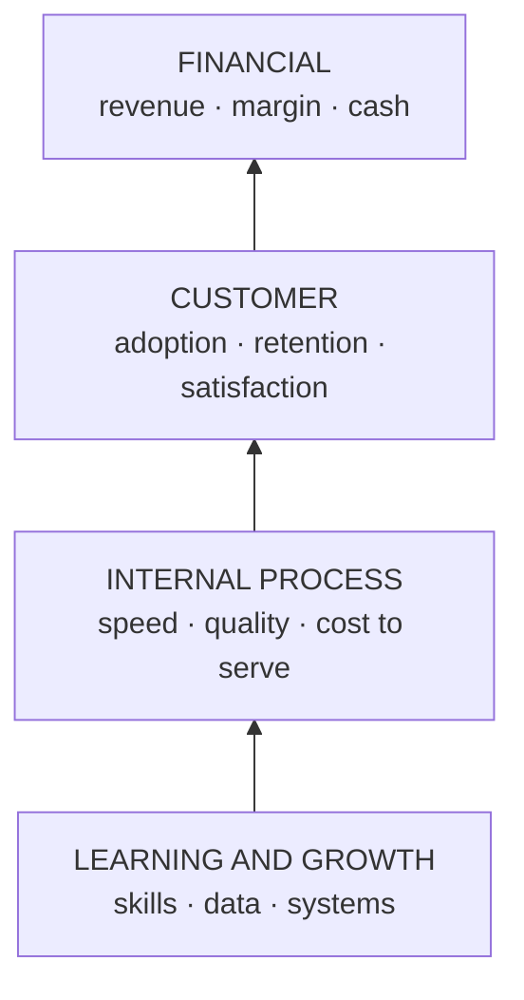
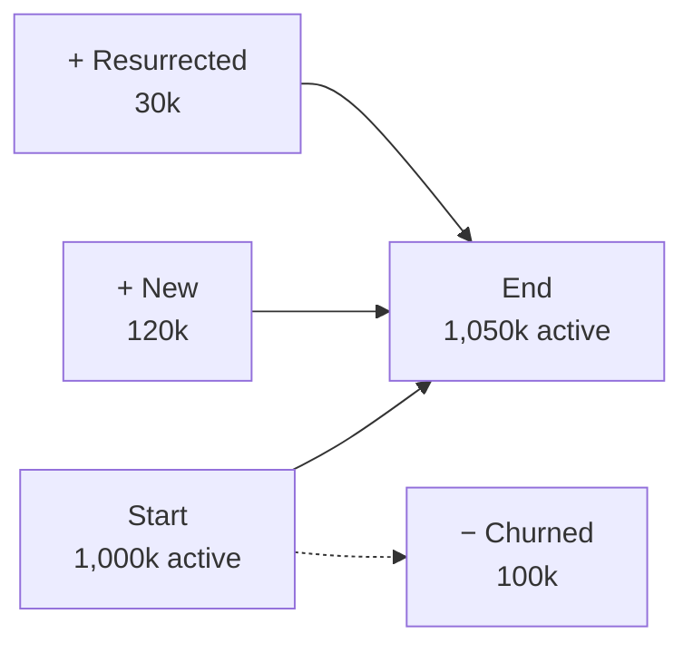
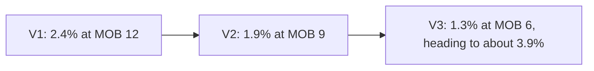

# Performance and growth: KPIs, scorecards and the metrics that move profit

*Part of [Business acumen for the product leader](./README.md)*

## TL;DR

Performance management is a loop: set targets, measure, review, act. A **key performance indicator (KPI)** is a measure you have chosen to steer by. At leadership level, the hard part is not choosing metrics. It is choosing a small, balanced set that ties product work to profit, reading it correctly, and acting on what it shows.

Reading correctly is where most leaders slip. Net growth hides churn. Net revenue retention hides leaks. A lender's loss rate looks better while it grows fast, because new loans have not had time to go bad. An insurer's latest loss ratio is always too low, because claims are still arriving. This lesson gives you the tools that correct for each: growth accounting, gross and net retention, vintage curves and loss triangles.

The core tradeoff is focus against balance. One metric focuses everyone and invites gaming. Many metrics balance each other and blur focus. The answer is a short set with clear owners, financial and non-financial measures together, and guardrails built into the targets.

> 🎯 **For the product leader**
>
> **Why it matters** — Your teams optimize what you review. If you review signups, you get signups, including ones that never pay. If you review approval rate in Lending, you can get approvals that default. And the lagging numbers that would warn you arrive late, and look better than they are while you grow.
>
> **What it changes in your decisions** — You split growth into its flows before you celebrate it. You read gross retention before net retention. You compare loan vintages and insurance years at the same age, never on the calendar. You write targets that include their own guardrail.
>
> **Ask your team** — *"If we froze new customer acquisition today, what would this metric look like in six months?"*
>
> **Risk if ignored** — Growth that destroys value. Volume rises, the dashboard is green, and the losses arrive a year later, on loans and policies you can no longer reprice.

## Decision rules in this lesson

1. **Split net growth into flows.** Report new, resurrected and churned separately. A growth quick ratio near 1 means you are replacing leavers, not growing.
2. **Read gross retention before net retention.** Net retention above 100% can hide a leaking base. Fix the leak first.
3. **Compare vintages at the same age.** Judge a lending cohort at month 6 against other cohorts at month 6. Never judge a portfolio's loss rate during fast growth.
4. **Treat the latest insurance year as unfinished.** Project it to its final cost with development factors before you price on it.
5. **Put the guardrail inside the target.** "Grow premium with a new-business combined ratio below 98%" beats "grow premium 20%".
6. **Give every metric one written definition and one owner.** A metric whose definition changes quietly breaks every trend that uses it.
7. **Price one point of your main metric in money.** Teams prioritise what they can value.

## Mental model: four perspectives in one chain



The **balanced scorecard** looks at performance from four perspectives. Financial results are the outcome. Customer results drive them. Internal processes drive customer results. Learning and growth — people, data and systems — drive processes. Read it bottom up as a chain of cause and effect.

**Where the model breaks.** The chain is a hypothesis, not a law. A faster process does not always lift retention. Test the links. And a scorecard with forty metrics stops being a scorecard. Keep three to five per perspective at most.

## Mechanics

### The performance-management mindset

- **Targets come from the plan.** Each KPI target should trace to the annual plan. See [business cases, capital and valuation](./business-cases-and-valuation.md).
- **Every KPI has one owner.** The owner explains movement and proposes action.
- **Reviews end in actions.** A review that only reads numbers is a ritual.
- **Leading metrics steer, lagging metrics judge.** Review leading metrics weekly. Review lagging ones monthly or quarterly.
- **Expect gaming.** Any metric used as a target will be pushed in ways you did not intend. Pair it with a guardrail.

The [metric tree](../technical-product-management/metrics-and-experimentation.md) links a product goal to the inputs teams can move. This lesson adds the profit layer on top, and the tools to read lagging numbers correctly.

| Financial | Non-financial |
| --- | --- |
| Revenue and growth rate | Active customers and retention |
| Gross margin and contribution margin | Activation rate and time to first value |
| Operating margin | Customer satisfaction and complaints |
| Cash burn and runway | Cycle time and release frequency |
| Customer acquisition cost and payback | Error, outage and dispute rates |

Non-financial metrics often lead. Retention falls before revenue does.

### Growth accounting: split the net number into flows

**What it is.** **Growth accounting** breaks the change in active customers into the flows that cause it. It works for any count that has an "active" state: customers, merchants, borrowers or policies.

**How it works.**

```text
end of period = start + new + resurrected − churned
growth quick ratio = (new + resurrected) ÷ churned
```

**New** customers are active for the first time. **Resurrected** customers were inactive and came back. **Churned** customers were active and stopped. The **growth quick ratio** compares what you add with what you lose. Above 1 means you grow. Near 1 means you are mostly replacing leavers.



**How to compute it.** Pick one definition of "active", such as "made a transaction in the last 30 days". Tag each customer each period as new, retained, resurrected or churned. Sum each group. The worked example below does this for one quarter.

**Domain application.**

- **Payments.** Count active merchants, and run the same split on payment volume. A merchant that stays but processes less is a contraction, not a churn.
- **Lending.** Count active borrowers. Repeat borrowers who return after paying off a loan are resurrected. They are cheaper to acquire and usually lower risk.
- **Insurance.** Count policies in force. New business, reinstatements and lapses or non-renewals are the three flows.
- **eCommerce and Retail.** Count active buyers. A loyalty program that lifts resurrection can be worth more than one that lifts new sign-ups.

**The common misreading.** "We grew 5%, so the product is healthy." The same 5% can come from 15% new and 10% churn, or from 6% new and 1% churn. The first business must buy a tenth of its base every quarter just to stand still.

**Decision rule.** When churned customers are more than about two-thirds of new ones, put retention work ahead of acquisition spend. Each new customer is mostly replacing a lost one.

### Retention economics: gross and net revenue retention

**What it is.** **Net revenue retention (NRR)** is the revenue a group of customers brings this year, as a share of what the same group brought a year ago. It includes expansion. **Gross revenue retention (GRR)** counts only losses: churn and contraction. It cannot exceed 100%.

**How it works.**

```text
NRR = (start revenue + expansion − contraction − churn) ÷ start revenue
GRR = (start revenue − contraction − churn) ÷ start revenue
```

NRR tells you whether the base grows on its own. GRR tells you whether the base leaks. A business can have NRR above 100% and GRR of 75%. Its best customers grow fast, and a quarter of its revenue walks out each year. That business depends on a few large accounts.

**Domain application.**

- **Payments.** The analogue is **volume retention**: this year's payment volume from a merchant cohort, as a share of last year's. Merchant growth, inflation and price changes all flow into it. So split it. Separate merchants that left from merchants that shrank, and price effects from volume effects.
- **Lending.** A lender with repeat borrowers can track revenue retention by borrower cohort. Paid-off loans look like churn but often return as new loans.
- **Insurance.** Premium retention combines policy retention with rate changes. Rate increases can lift premium retention while policy counts fall. Read both.
- **Software sold to merchants or lenders.** Software that charges per seat or per transaction tracks NRR and GRR in the usual way.

The shape of retention over time is a cohort curve. [Unit economics](./unit-economics.md) shows how to draw and read it. Here we use the two summary ratios.

**The common misreading.** "NRR is 110%, so churn is not a problem." NRR nets expansion against churn. It cannot tell a healthy base from a leaking base with a few fast-growing accounts.

**Decision rule.** Read GRR first. If GRR is falling, fix churn and contraction before you fund expansion features, whatever NRR says.

### Profit-impacting metrics by domain

Each domain has a few metrics that move profit directly. Public companies show which ones they steer by.

| Domain | Metrics that move profit | A public example |
| --- | --- | --- |
| **Payments** | Total payment volume, authorization rate, fraud and dispute rates, net take rate | Stripe reported total payment volume of about $1.4 trillion for 2024, up 38% on 2023. |
| **Lending** | Approval rate, loss rate by monthly cohort of loans, cost of funds, revenue after transaction costs | Affirm reports revenue less transaction costs as a share of GMV, as a measure of unit economics. |
| **eCommerce** | Order value, conversion, take rate, contribution per order, return rate | DoorDash reports net revenue margin: revenue as a share of Marketplace GOV, 13.4% for 2024. |
| **InsurTech** | Loss ratio, expense ratio, **combined ratio**, retention, quote-to-bind rate | Lemonade reports its gross loss ratio. See the loss-development section below. |
| **Retail** | Comparable sales, inventory turnover, gross margin return on inventory, shrink | Walmart reports comparable sales, including eCommerce. |
| **FinTech** | Revenue per active customer, cost to serve, active customers | [Unit economics](./unit-economics.md) works through a neobank's figures. |

GMV is gross merchandise value, the total value of goods sold. GOV is gross order value, the total value of orders placed.

**Insurance ratios, defined.** The **loss ratio** is claims and claim-handling costs divided by earned premium. The **expense ratio** is underwriting expenses divided by premium. The **combined ratio** is the two added together. Below 100% means the insurer makes money on underwriting, before investment income. Above 100% means it loses money on underwriting.

### Lending: vintage curves

**What it is.** A **vintage** is the group of loans made in one period, such as one quarter. A **vintage curve** plots that group's cumulative net charge-offs against **months on book (MOB)**, the loans' age. A net charge-off is a loan balance written off as lost, minus any later recoveries.

**How it works.** Loans go bad over time. Few default in the first months. Losses climb, then flatten as loans pay off. So a young vintage always looks good. Comparing vintages at the same MOB removes the age effect. What is left is the change in quality: who you approved, how you priced, and what the economy did.

**How to compute it.** For each vintage, divide cumulative net charge-offs at each MOB by the original amount lent. Line the vintages up by MOB, not by calendar month.

*Illustrative. Three consecutive quarterly vintages of an unsecured personal loan. All figures assumed. The lender priced for about 3% cumulative loss at month 12.*

| Vintage | MOB 3 | MOB 6 | MOB 9 | MOB 12 |
| --- | --- | --- | --- | --- |
| V1 (oldest) | 0.2% | 0.8% | 1.6% | 2.4% |
| V2 | 0.3% | 1.0% | 1.9% | not yet |
| V3 (newest) | 0.4% | 1.3% | not yet | not yet |

**Reading it.** At MOB 6, the vintages run 0.8%, 1.0% and 1.3%. V3 is 62.5% worse than V1 at the same age. If V3 follows V1's shape, it will reach about 2.4% × 1.3 ÷ 0.8 ≈ **3.9%** at month 12. That is above the 3% the loans were priced for. The lender learns this at month 6, not month 12. It can tighten approvals for V4 and V5 now.



**Why the portfolio loss rate lies.** A lender that doubles its lending puts many young loans on its books. Young loans have few losses yet. So the portfolio's loss rate, losses divided by total balances, falls. It looks like quality improved. It did not. The newest vintages may be the worst ones. The truth shows up a year later, when those loans age.

**Domain application.** Card issuers, buy now, pay later providers, auto lenders and mortgage servicers all track vintages. Insurers use the same idea by accident year, below. In Payments, chargebacks also arrive weeks after the transaction, so dispute rates should be tracked by transaction cohort too.

**The common misreading.** "Losses are down this quarter." During fast growth, that is often the denominator effect, not better loans.

**Decision rule.** When originations grow more than about 30% a year, stop reporting the portfolio loss rate alone. Report vintage curves at fixed MOB, and set credit triggers on early MOB points such as month 3 and month 6.

### Insurance loss development

**What it is.** An insurer's claims for a given year are not known for a long time. Some claims are reported late. Others are reported and then grow, as medical bills or repair costs come in. **Loss development** is that growth. An **accident year** groups claims by the year the loss happened.

**How it works.** A **loss triangle** shows each accident year's reported losses at each age. Older years have more columns filled in. The newest year has only one. The ratio between one age and the next is a **development factor**. Apply the factors to the younger years to project their final, or **ultimate**, losses. Actuaries call this the chain-ladder method. It is the simplest of several.

*Illustrative. Reported losses in $ millions. All figures assumed.*

| Accident year | Earned premium | At 12 months | At 24 months | At 36 months |
| --- | --- | --- | --- | --- |
| 2023 | $80M | $40.0M | $52.0M | $56.0M |
| 2024 | $90M | $45.0M | $58.5M | not yet |
| 2025 | $100M | $50.0M | not yet | not yet |

**How to compute it.**

1. Factor from 12 to 24 months = (52.0 + 58.5) ÷ (40.0 + 45.0) = 110.5 ÷ 85.0 = **1.30**.
2. Factor from 24 to 36 months = 56.0 ÷ 52.0 = **1.077**.
3. Ultimate for 2024 = 58.5 × 1.077 = **$63.0M**.
4. Ultimate for 2025 = 50.0 × 1.30 × 1.077 = **$70.0M**.

| Accident year | Reported loss ratio today | Projected ultimate loss ratio |
| --- | --- | --- |
| 2023 | 56 ÷ 80 = 70% | 70% |
| 2024 | 58.5 ÷ 90 = 65% | 63 ÷ 90 = 70% |
| 2025 | 50 ÷ 100 = 50% | 70 ÷ 100 = 70% |

**Reading it.** The reported loss ratio seems to fall from 70% to 50%. It looks like pricing improved by 20 points. The projection says every year is the same 70%. The "improvement" is only age. A team that cut prices on the 50% would be pricing on losses that have not been reported yet.

**A public series.** Lemonade's 2020 Form 10-K reported its gross loss ratio as 161% in 2017, 113% in 2018, 79% in 2019 and 71% in 2020. A falling series like this is what a young insurer wants to show. Before you read such a series, as an outsider or as an insider, ask how much each year's figure later developed. Filings disclose reserve development for this reason.

**Domain application.** Loss development matters most in lines where claims take long to settle, such as liability. It is shorter in lines like renters or travel insurance. Embedded insurance sold at checkout has the same tail. A product team that sells it must wait for development before it judges the price.

**The common misreading.** "This year's loss ratio is our best number, because it is the most recent." It is the least complete.

**Decision rule.** Before you change price or appetite based on the latest year, ask for its projected ultimate loss ratio and the development factors behind it.

### Payments: authorization-rate economics

**What it is.** The **authorization rate** is the share of attempted card payments that the card issuer approves. Some declines are right, such as fraud or no funds. Others are false: a good customer, declined because of a data error, a risk rule or a network fault.

**How it works.** A decline usually loses the sale. Some customers retry or switch cards. Many leave. So the merchant loses the margin on a lost order. The payment provider loses its fee on that volume. Providers compete on authorization rate. They work on message formatting, retry logic and card-update services, and on how they route transactions.

**How to compute it.** One point of authorization rate is worth: attempted volume × 1% × the margin of whoever you are. *Illustrative, all inputs assumed:* a provider sees $10 billion of attempted volume a year. One extra point approves $100 million more. At a 0.30% net take rate, the provider earns $300,000 more. At a 20% gross margin, its merchants earn $20 million more. That gap explains why merchants care so much. It is the strongest sales argument a provider has.

**Domain application.** In eCommerce, also track the decline reason mix. "Do not honour" from the issuer needs a different fix from "suspected fraud" from your own rules. Your own fraud threshold is part of the authorization rate the merchant sees. [Data and decisions](./data-and-decisions.md) shows how to price it.

**Decision rule.** When you change a fraud rule or a payment route, report the change in authorization rate next to the change in fraud loss. One without the other is half the result.

### Retail: comparable sales and inventory metrics

**Comparable sales** compare sales in the same stores across periods. They remove the effect of opening or closing stores. Walmart's 10-K counts stores and clubs open for the previous 12 months, and includes eCommerce sales. Its filing also notes that other retailers calculate the measure differently. So check the definition before you compare two retailers.

**Inventory turnover** is cost of goods sold divided by average inventory. **Gross margin return on inventory (GMROI)** is gross margin divided by average inventory at cost. [Unit economics](./unit-economics.md) works through GMROI by category.

### Setting targets with the guardrail inside

**Plan versus target.** The plan is what Finance expects. A target is what you ask a team to reach. They differ on purpose.

- **A commit** is a number the team expects to hit about nine times in ten. The company's plan should rest on commits.
- **A stretch** is a number the team might hit one time in three. It drives ambition. Do not build the company's plan on it.
- **Sandbagging** is setting a commit too low, so the team always beats it. You see it when a team beats its target every quarter by a similar margin.

The fix for sandbagging is not tougher talk. Track each team's forecast accuracy, as in the calibration log in [data and decisions](./data-and-decisions.md). Reward accurate forecasts, not only beats.

**Guardrails inside the target.** A target with a separate guardrail invites a trade between them. A target with the guardrail inside it does not. Progressive, the US auto insurer, has for many years stated two linked goals in its annual reports. It aims for an underwriting profit of at least 4%, a combined ratio of 96 or lower. And it aims to grow as fast as it can within that limit and its service standards. Growth is the goal. Profit is built into it.

**Domain application.** Lending: "grow originations, with month-6 vintage losses at or below plan." Payments: "grow volume, with authorization rate and dispute rate inside range." eCommerce: "grow orders, with contribution per order above $X." Retail: "grow comparable sales, with markdown below Y%."

**The common misreading.** "Guardrails slow the team down." They stop the team from hitting its target in a way that hurts the company.

**Decision rule.** For every growth target you set, write the quality limit inside the same sentence.

### Metric definition governance

A metric is only useful if it means the same thing every time. Three practices keep it so.

- **One written definition per metric.** It names the formula, scope, source, owner and refresh cadence. The spec under the hood shows one way to write it, in a plain-text configuration format (YAML).
- **Versioned changes.** When a definition changes, give it a new version and a change date. Restate history, or mark the break on every chart.
- **Certified metrics.** A small set of metrics is certified by Finance or the data team. Leadership reviews use only certified metrics.

The signal of a problem is two teams quoting different numbers for "active customers" in the same meeting.

## Worked example: reading one quarter's growth

*This example is illustrative. The neobank and every number are assumed. The code under the hood reproduces them.*

A neobank's board pack says: "Active customers up 5% this quarter. Revenue retention 100%." The product leader digs in.

**Step 1: split the growth.** Start: 1,000,000 active customers. New: 120,000. Resurrected: 30,000. Churned: 100,000.

- End = 1,000,000 + 120,000 + 30,000 − 100,000 = **1,050,000**.
- Growth quick ratio = (120,000 + 30,000) ÷ 100,000 = **1.5**.
- Quarterly churn = 100,000 ÷ 1,000,000 = 10% of the base.

The bank gains three customers for every two it loses. It must replace a tenth of its base each quarter.

**Step 2: split the retention.** Take the cohort active a year ago. It brought $10.0 million of revenue then. This year the same customers brought $1.5M of expansion, $0.5M of contraction and $1.0M of churn.

- NRR = (10.0 + 1.5 − 0.5 − 1.0) ÷ 10.0 = **100%**.
- GRR = (10.0 − 0.5 − 1.0) ÷ 10.0 = **85%**.

Revenue held flat only because some customers grew. Fifteen percent of last year's revenue left.

**Step 3: decide.** The board pack's two numbers were true and misleading. The leader proposes two changes. First, report the quick ratio and GRR next to net growth and NRR. Second, move one acquisition squad to churn reduction for a quarter, with a target of 8% quarterly churn. At the same new and resurrected volumes, 80,000 churned customers would lift the quick ratio from 1.5 to 150,000 ÷ 80,000 ≈ 1.9.

## Worked example: which lever moves an insurer's profit?

*This example is invented, to show the method. The insurer and all numbers are illustrative. For simplicity, both ratios here use earned premium. Some reports divide expenses by written premium instead, so check the definition.*

An insurer has $50 million of earned premium a year. Claims and claim-handling costs are $34 million. Other underwriting expenses are $17 million.

**Step 1: compute the ratios.**

- Loss ratio = $34M ÷ $50M = 68%.
- Expense ratio = $17M ÷ $50M = 34%.
- Combined ratio = 68% + 34% = **102%**.
- Underwriting result = $50M − $34M − $17M = **−$1 million**.

**Step 2: price each lever.** One point of either ratio is worth 1% × $50M = $500,000.

| Lever | Effect | Underwriting result |
| --- | --- | --- |
| Better underwriting rules cut the loss ratio by 3 points | +$1.5M | **+$0.5M** |
| Claims automation cuts the expense ratio by 2 points | +$1.0M | **$0** |
| Marketing grows premium 10% at the same ratios | Premium $55M, combined still 102% | **−$1.1M** |

**Step 3: read the result.** Growth at a combined ratio above 100% makes the loss bigger: 2% × $55M = $1.1M. The growth team would hit its target and the company would lose more money. The underwriting lever is worth the most.

**Step 4: set the scorecard.** The growth team's KPI becomes "premium growth with a combined ratio below 100% for new business." The guardrail now sits inside the target. And because the loss ratio for new business is young, the team reads it on a projected-ultimate basis, as in the triangle above.

## Tradeoffs and decisions

- **One metric against a balanced set.** One metric aligns everyone and invites gaming. A balanced set resists gaming and blurs focus.
- **Leading against lagging.** Leading metrics let you act early. They are less certain proof of results. Early vintage points are leading. Month-12 losses are lagging.
- **Growth against quality.** Approval rate, conversion and premium growth all trade against losses or returns. You give up some volume to keep losses inside plan.
- **Speed of reading against accuracy of reading.** Development factors and vintage projections let you act sooner. They are estimates, and they can be wrong when the mix of business changes.
- **Comparability against fit.** Standard industry metrics let you compare with peers. Your own metrics may fit your model better. Walmart's 10-K notes that other retailers calculate comparable sales differently.

## Failure modes

- **Net growth without flows.** Active customers rise. Acquisition spend rises faster. Nobody sees that churn doubled until spend is cut and the base shrinks.
- **NRR masking churn.** NRR stays above 100% for a year while GRR slides. Then two large accounts stop growing, and NRR drops ten points in a quarter.
- **The denominator effect.** A lender reports falling loss rates through a growth spurt. A year later, the young vintages season and losses jump. By then, a year of loans is on the books.
- **Pricing on an undeveloped year.** An insurer cuts rates because the latest year looks good. The year develops to the old level. The rate cut is now a loss.
- **Authorization rate without fraud, or fraud without authorization rate.** A fraud team cuts losses and the approval rate falls. Merchants notice before you do.
- **Metric drift.** The definition of "active" changes quietly. Trends break, and two teams quote different numbers in the same review.
- **Sandbagged targets.** Teams beat every target by the same margin. The plan is built on low numbers, and capacity is wasted.

## Under the hood

The numbers in this lesson, in Python. It runs as written.

```python
# Growth accounting for one quarter (thousands of active customers, assumed)
start, new, resurrected, churned = 1_000, 120, 30, 100
end = start + new + resurrected - churned              # 1,050
quick_ratio = (new + resurrected) / churned            # 1.5
print(end, quick_ratio, (new + resurrected) / 80)      # with 80k churned: 1.875

# Net and gross revenue retention ($ millions, assumed)
start_rev, expansion, contraction, churn = 10.0, 1.5, 0.5, 1.0
nrr = (start_rev + expansion - contraction - churn) / start_rev   # 1.00
grr = (start_rev - contraction - churn) / start_rev               # 0.85
print(f"NRR {nrr:.0%}  GRR {grr:.0%}")

# Vintage curves: cumulative net charge-off % by months on book (assumed)
v1 = {3: 0.2, 6: 0.8, 9: 1.6, 12: 2.4}
v3_mob6 = 1.3
print(f"V3 projected at MOB 12: {v1[12] * v3_mob6 / v1[6]:.1f}%")  # 3.9%

# Loss triangle and chain-ladder projection ($ millions, assumed)
tri = {2023: [40.0, 52.0, 56.0], 2024: [45.0, 58.5], 2025: [50.0]}
premium = {2023: 80.0, 2024: 90.0, 2025: 100.0}
f12_24 = (tri[2023][1] + tri[2024][1]) / (tri[2023][0] + tri[2024][0])   # 1.30
f24_36 = tri[2023][2] / tri[2023][1]                                     # 1.077
to_ultimate = {3: 1.0, 2: f24_36, 1: f12_24 * f24_36}
for year, row in tri.items():
    ultimate = row[-1] * to_ultimate[len(row)]
    print(year, f"reported {row[-1] / premium[year]:.0%}",
          f"ultimate {ultimate:.1f} ({ultimate / premium[year]:.0%})")  # all 70%

# Value of one point of authorization rate (assumed)
attempted, net_take, merchant_margin = 10e9, 0.003, 0.20
extra = attempted * 0.01
print(f"provider +${extra * net_take:,.0f}, merchants +${extra * merchant_margin:,.0f}")
```

Define each KPI in a spec, so it means one thing everywhere:

```yaml
kpi: combined_ratio_new_business
version: 2                     # bump on any definition change; note the date
changed: 2026-07-01
owner: Head of Growth
formula: (incurred_losses + loss_adjustment_expense + underwriting_expense) / earned_premium
basis: projected_ultimate      # not reported-to-date, because new business is young
scope: policies written in the last 12 months
source: finance data warehouse, monthly close
certified_by: Finance
cadence: monthly
target: "< 0.98"
guardrails:
  - quote_to_bind_rate: ">= 0.15"
  - complaint_rate_per_1000_policies: "<= 2"
leading_indicators: [quote_volume, bind_rate_by_channel]
```

## Practitioner checklist

- [ ] Report new, resurrected and churned customers next to net growth, and compute the growth quick ratio.
- [ ] Put GRR next to NRR in every review that shows NRR.
- [ ] If you lend, show vintage curves at fixed months on book, and set triggers on early points.
- [ ] If you insure, ask for projected ultimate loss ratios by accident year before any price change.
- [ ] If you process payments, report authorization rate next to fraud loss for every rule or routing change.
- [ ] Rewrite each growth target so its guardrail sits in the same sentence.
- [ ] Give every KPI one owner, one written definition and a version number.
- [ ] Price one point of your main profit metric in money.

## Related lessons

- [Metrics and experimentation](../technical-product-management/metrics-and-experimentation.md) — the metric tree, guardrails, instrumentation and experiments.
- [Unit economics](./unit-economics.md) — cohort curves, payback and GMROI.
- [Data and decisions](./data-and-decisions.md) — pricing a fraud threshold, and calibrating forecasts.
- [The language of money](./the-language-of-money.md) — the statements behind the profit metrics.
- [Pricing and business models](./monetization-and-business-models.md) — the price lever behind revenue retention.
- [Reliability and failure](../technical-product-sense/reliability-and-failure.md) — the operational metrics under a good scorecard.
