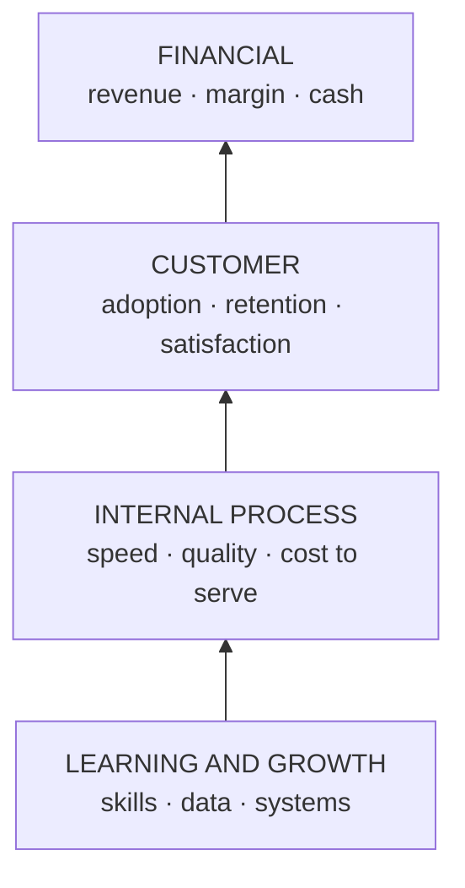

# Performance and growth: KPIs, scorecards and the metrics that move profit

*Part of [Business acumen for the product leader](./README.md)*

## TL;DR

Performance management is a loop: set targets, measure, review, act. A **key performance indicator (KPI)** is a measure you have chosen to steer by. At leadership level, the hard part is not choosing metrics. It is choosing a small, balanced set that ties product work to profit, and then acting on what it shows.

The core tradeoff is focus against balance. One metric focuses everyone and invites gaming. Many metrics balance each other and blur focus. The answer is a short set with clear owners, financial and non-financial measures together, and guardrails that catch harm.

> 🎯 **For the product leader**
>
> **Why it matters** — Your teams optimize what you review. If you review signups, you get signups, including ones that never pay. If you review approval rate in Lending, you can get approvals that default.
>
> **What it changes in your decisions** — You pair every growth metric with a quality or loss guardrail. You learn the profit metrics of your domain, and you trace each product metric to one of them.
>
> **Ask your team** — *"If this metric went up 10% next quarter, which line of the profit and loss statement would move, and could anything bad move with it?"*
>
> **Risk if ignored** — Growth that destroys value. Volume rises, the dashboard is green, and the losses arrive a quarter later.

## Mental model: four perspectives in one chain



The **balanced scorecard** looks at performance from four perspectives. Financial results are the outcome. Customer results drive them. Internal processes drive customer results. Learning and growth — people, data and systems — drive processes. Read it bottom up as a chain of cause and effect.

**Where the model breaks.** The chain is a hypothesis, not a law. A faster process does not always lift retention. Test the links. And a scorecard with forty metrics stops being a scorecard. Keep three to five per perspective at most.

## The performance-management mindset

- **Targets come from the plan.** Each KPI target should trace to the annual plan, see [lesson 4](./the-language-of-money.md).
- **Every KPI has one owner.** The owner explains movement and proposes action.
- **Reviews end in actions.** A review that only reads numbers is a ritual.
- **Leading metrics steer, lagging metrics judge.** Review leading metrics weekly. Review lagging ones monthly or quarterly.
- **Expect gaming.** Any metric used as a target will be pushed in ways you did not intend. Pair it with a guardrail.

## Financial and non-financial KPIs

| Financial | Non-financial |
| --- | --- |
| Revenue and growth rate | Active customers and retention |
| Gross margin and contribution margin | Activation rate and time to first value |
| Operating margin | Customer satisfaction and complaints |
| Cash burn and runway | Cycle time and release frequency |
| Customer acquisition cost and payback | Error, outage and dispute rates |

Non-financial metrics often lead. Retention falls before revenue does.

## Inbound and outbound marketing metrics

**Inbound** marketing attracts customers who come to you: search, content, referrals. **Outbound** marketing reaches out: sales calls, paid ads, partner campaigns.

| Inbound | Outbound |
| --- | --- |
| Organic visitors and their trend | Contacts reached |
| Visitor-to-lead conversion | Contact-to-meeting rate |
| Cost per lead (content and search spend ÷ leads) | Pipeline created per sales rep |
| Lead-to-customer conversion | Win rate and sales cycle length |

For both, the metric that matters to profit is **customer acquisition cost (CAC)** by channel, and how fast each channel's customers pay it back. [Lesson 11](./monetization-and-business-models.md) covers the arithmetic.

## Profit-impacting metrics by domain

Each domain has a few metrics that move profit directly. Public companies show which ones they steer by.

| Domain | Metrics that move profit | A public example |
| --- | --- | --- |
| **Payments** | Total payment volume, authorization rate, fraud and dispute rates, net take rate | Stripe reported total payment volume of about $1.4 trillion for 2024, up 38% on 2023. |
| **Lending** | Approval rate, loss rate by monthly cohort of loans, cost of funds, revenue after transaction costs | Affirm reports revenue less transaction costs as a share of GMV, as a measure of unit economics. |
| **eCommerce** | Order value, conversion, take rate, contribution per order, return rate | DoorDash reports net revenue margin: revenue as a share of Marketplace GOV, 13.4% for 2024. |
| **InsurTech** | Loss ratio, expense ratio, **combined ratio**, retention, quote-to-bind rate | Lemonade reports its gross loss ratio. Its 2020 10-K showed 71% for 2020. |
| **Retail** | Comparable sales, inventory turnover, gross margin return on inventory, shrink | Walmart reports comparable sales, including eCommerce. |
| **FinTech** | Revenue per active customer, cost to serve, active customers | Nubank reports monthly average revenue per active customer and monthly cost to serve. In Q2 2023 it said revenue per active customer passed $9, while cost to serve stayed below $1. |

**Insurance ratios, defined.** The **loss ratio** is claims and claim-handling costs divided by earned premium. The **expense ratio** is underwriting expenses divided by premium. The **combined ratio** is the two added together. Below 100% means the insurer makes money on underwriting, before investment income. Above 100% means it loses money on underwriting.

**Retail ratios, defined.** **Inventory turnover** is cost of goods sold divided by average inventory. Higher means stock sells faster. **Gross margin return on inventory** is gross margin divided by average inventory at cost. It tells you how much margin each dollar of stock earns.

## Reading the profit tree

The metric tree in [Metrics and experimentation](../technical-product-management/metrics-and-experimentation.md) links a product goal to the inputs teams can move. At leadership level, add the profit layer on top. Every branch should end in volume, price, variable cost, fixed cost or loss.

```text
Underwriting profit
├── Earned premium  = policies × average premium
├── − Losses        = earned premium × loss ratio
└── − Expenses      = earned premium × expense ratio
```

When you read a tree, ask three questions. Which branch does this team move? Which branch could it harm? Which branch is biggest, so a small change there is worth the most?

## Worked example: which lever moves an insurer's profit?

*This example is invented, to show the method. The insurer and all numbers are illustrative. For simplicity, both ratios here use earned premium. Statutory reporting usually divides expenses by written premium instead.*

An insurer has $50 million of earned premium a year. Claims and claim-handling costs are $34 million. Other underwriting expenses are $17 million.

**Step 1: compute the ratios.**

- Loss ratio = $34M ÷ $50M = 68%.
- Expense ratio = $17M ÷ $50M = 34%.
- Combined ratio = 68% + 34% = **102%**.
- Underwriting result = $50M − $34M − $17M = **−$1 million**.

**Step 2: price each lever.** One point of either ratio is worth 1% × $50M = $500,000.

| Lever | Effect | Underwriting result |
| --- | --- | --- |
| Better underwriting rules cut the loss ratio by 3 points | +$1.5M | **+$0.5M** |
| Claims automation cuts the expense ratio by 2 points | +$1.0M | **$0** |
| Marketing grows premium 10% at the same ratios | Premium $55M, combined still 102% | **−$1.1M** |

**Step 3: read the result.** Growth at a combined ratio above 100% makes the loss bigger: 2% × $55M = $1.1M. The growth team would hit its target and the company would lose more money. The underwriting lever is worth the most.

**Step 4: set the scorecard.** The growth team's KPI becomes "premium growth with a combined ratio below 100% for new business." The guardrail now sits inside the target.

## Tradeoffs and decisions

- **One metric vs. a balanced set.** One metric aligns everyone and invites gaming. A balanced set resists gaming and blurs focus.
- **Leading vs. lagging.** Leading metrics let you act early. They are less certain proof of results.
- **Growth vs. quality.** Approval rate, conversion and premium growth all trade against losses or returns. Every growth target needs a quality guardrail.
- **Comparability vs. fit.** Standard industry metrics let you compare with peers. Your own metrics may fit your model better. Walmart's 10-K notes that other retailers calculate comparable sales differently.

## Failure modes

- **Vanity metrics.** Downloads and signups rise with no effect on revenue or retention.
- **Growth at a loss.** Premium or loan volume grows while each unit loses money.
- **Lagging-only reviews.** The team learns about a problem from the quarterly results.
- **Ownerless metrics.** A metric moves and nobody explains it.
- **Metric drift.** The definition changes quietly, and trends break without anyone noticing.

## Under the hood

Define each KPI in a spec, so it means one thing everywhere.

```yaml
kpi: combined_ratio_new_business
owner: Head of Growth
formula: (incurred_losses + loss_adjustment_expense + underwriting_expense) / earned_premium
scope: policies written in the last 12 months
source: finance data warehouse, monthly close
cadence: monthly
target: "< 0.98"
guardrails:
  - quote_to_bind_rate: ">= 0.15"
  - complaint_rate_per_1000_policies: "<= 2"
leading_indicators: [quote_volume, bind_rate_by_channel]
```

## Practitioner checklist

- [ ] List the three to five metrics that move profit in your domain.
- [ ] Trace each of your team's KPIs to one of those profit metrics.
- [ ] Pair every growth KPI with a quality or loss guardrail.
- [ ] Give every KPI one owner and a written definition.
- [ ] Split your review agenda into leading metrics (weekly) and lagging metrics (monthly).
- [ ] Price one point of your main profit metric in money.
- [ ] Remove one vanity metric from your leadership review.

## Related lessons

- [Metrics and experimentation](../technical-product-management/metrics-and-experimentation.md) — the metric tree, instrumentation and experiments.
- [Monetization and business models](./monetization-and-business-models.md) — CAC, LTV and payback.
- [The language of money](./the-language-of-money.md) — the statements behind the profit metrics.
- [Reliability and failure](../technical-product-sense/reliability-and-failure.md) — the operational metrics under a good scorecard.

## Sources and notes

- The insurer example and all its numbers are invented and illustrative.
- Stripe, 2024 annual letter summary in the Stripe newsroom: total payment volume of $1.4 trillion, up 38%. [Stripe](https://stripe.com/en-pl/newsroom/news/stripe-2024-update). As of 2026-10.
- Affirm, earnings releases filed on Form 8-K: revenue less transaction costs as a percentage of GMV. [Filing index](https://www.sec.gov/cgi-bin/browse-edgar?action=getcompany&CIK=1820953&type=8-K). As of 2026-10.
- DoorDash, Form 10-K for fiscal 2024: net revenue margin of 13.4%. [Filing index](https://www.sec.gov/cgi-bin/browse-edgar?action=getcompany&CIK=1792789&type=10-K). As of 2026-10.
- Lemonade, Form 10-K for fiscal 2020: gross loss ratio of 71% for 2020. [Filing index](https://www.sec.gov/cgi-bin/browse-edgar?action=getcompany&CIK=1691421&type=10-K). As of 2026-10.
- Walmart, Form 10-K: comparable sales definition and note on comparability. [Filing index](https://www.sec.gov/cgi-bin/browse-edgar?action=getcompany&CIK=104169&type=10-K). As of 2026-10.
- Nu Holdings, second quarter 2023 results. [Nubank](https://international.nubank.com.br/company/nu-holdings-ltd-reports-second-quarter-2023-financial-results/). As of 2026-10.
- Note: these hosts could not be opened from the build environment (blocked by the network proxy). The facts were corroborated from search-result excerpts of the documents.
