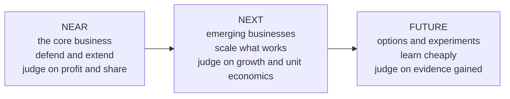
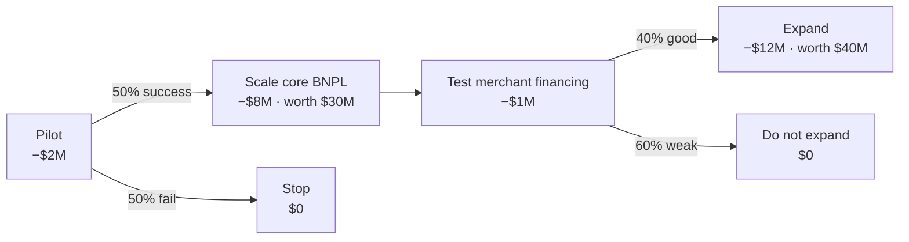

# Portfolio strategy and capital allocation

*Part of [Business acumen for the product leader](./README.md)*

*Last reviewed: 2026-10 · Volatility: medium*

## TL;DR

A product leader at Head of Product or vice president (VP) level owns a **portfolio**: several products and bets at different stages. The job is to allocate money and people across them. That means funding the core, growing what is emerging, buying options on the future, buying what is faster to buy than build, and stopping what no longer earns its place.

The core tradeoff is today against tomorrow. Money spent defending the core cannot fund future bets. Money spent on future bets is not spent on the business that pays the bills. A good portfolio makes that split on purpose. It judges each bet by the right standard. It funds big bets in stages, so you can stop them cheaply. And it counts how bets depend on each other, because three bets on one partner are one bet.

The scale is large. Staging one illustrative bet in this lesson raises its expected value by half. Valuing the option it opens raises it again. A product-level acquisition that works on the deck can destroy value once synergies are counted at realistic rates. And a product that loses $0.8 million a year can cost more to keep than to close.

> 🎯 **For the product leader**
>
> **Why it matters** — Most portfolio waste is not a bad bet. It is a bet that should have been stopped a year ago, or a future bet judged by core-business return targets and starved before it could prove anything. The rest is acquisitions priced on synergies nobody delivered.
>
> **What it changes in your decisions** — You size each horizon from the growth gap, not from a fixed split. You place each bet in a horizon and judge it by that horizon's standard. You fund large bets in stages with written gates. You count the options a bet opens and the dependencies it shares. You price an acquisition on realized synergies. You close products on sunset economics, not on sentiment.
>
> **Ask your team** — *"What evidence, by what date, would make us stop this bet? Have we written it down? And which other bets fail if the same partner, rule or channel fails?"*
>
> **Risk if ignored** — A portfolio of zombie products that each need a team, a growth plan that rests on one hidden dependency, and no capacity left for the next growth engine.

## Decision rules in this lesson

1. Size the next and future horizons from the growth gap between the target and the core's own trajectory. A fixed split is a starting point, not an answer.
2. Judge each horizon by its own standard. Use net present value (NPV) at the hurdle rate for the core, unit economics and gates for emerging bets, and cost per learning milestone for options.
3. Release money in stages. Each stage buys the evidence for the next decision, and each gate is written before the stage starts.
4. Count shared dependencies. Bets that share one partner, one rule or one channel are one bet.
5. Value the option a bet opens, but only if a later decision really depends on what the bet reveals.
6. Price an acquisition at standalone value plus realized synergies minus integration cost. Tie the uncertain part of the price to delivery.
7. Close a product when the cost avoided beats the contribution lost plus the one-off cost of sunset and run-off.

## Mental model: near, next and future horizons



**Near-horizon** work extends the core business that earns today's profit. **Next-horizon** work scales emerging businesses that have shown early proof. **Future-horizon** work buys options: small, cheap experiments that might become the next core.

Each horizon needs a different standard. Judge a future bet by core-business profit targets and it will always lose. Judge the core by learning goals and it will drift.

**Where the model breaks.** Horizons are not a timeline. A regulatory change can turn a future option into an urgent near-horizon need overnight. And some companies set a fixed budget split across horizons. The right split depends on how fast your core is growing or shrinking, not on a rule.

## Mechanics

### The portfolio view

List every product and bet in one table. For each, record its horizon, growth, contribution margin, strategic role, team cost and key dependencies. A **share-versus-growth grid** is one common way to view it. It plots market growth against your relative market share:

| | Low market share | High market share |
| --- | --- | --- |
| **High market growth** | Question marks: invest to win, or exit | Stars: invest to keep the lead |
| **Low market growth** | Candidates to fix, sell or sunset | Cash generators: fund the rest of the portfolio |

The grid is a starting point. It ignores synergies. A low-share product might be what keeps your best customers loyal. In a neobank, a small savings product may hold deposits that fund the lending book. Judge it by what the whole customer is worth, not by its own line.

### Allocation mechanics

Allocation decides how much money and how many people each horizon gets. Four mechanics make it work.

#### Size the horizons from the growth gap

A fixed split, such as 70% core, 20% next and 10% future, is common. It is easy to explain. It is also arbitrary. A shrinking core needs more in the later horizons. A core growing fast needs most of its capacity just to keep up.

A better start is the **growth gap**: the distance between the company's target and where the core will get on its own.

**How to compute it.** An illustrative company has $500 million of revenue. All inputs are assumed.

1. The target is 15% growth a year for three years: $500M × 1.15³ = **$760.4M**.
2. The core, left alone, grows 5% a year: $500M × 1.05³ = **$578.8M**.
3. The gap is $760.4M − $578.8M = **$181.6M** of year-three revenue.
4. Next-horizon bets already in flight are expected to add $100M, risk-adjusted.
5. That leaves **$81.6M** for new bets.

Now test the plan. Suppose a typical future bet has a 10% chance of becoming a $100M business. Filling $81.6M would take about 8 such bets: 81.6 ÷ (0.10 × 100) = 8.2. Worse, future bets rarely reach scale within three years. So the year-three gap cannot come from the future horizon. It must come from more next-horizon bets, an acquisition, or a lower target.

**Decision rule.** When the gap is larger than what the next horizon can deliver, say so in the plan. Do not pretend a handful of experiments will close it in time.

**Common misreading.** "We put 10% into innovation, so we are covered." The share of budget says nothing about whether the bets can fill the gap, or fill it in time.

#### Set the hurdle rate by horizon

A **hurdle rate** is the minimum return Finance requires for a bet. [Business cases, capital and valuation](./business-cases-and-valuation.md) shows how it starts from the cost of capital and rises with risk. At portfolio level, each horizon uses a different test.

| Horizon | Main test | Typical hurdle | What to report |
| --- | --- | --- | --- |
| Near | NPV at the hurdle rate | Cost of capital, about 10% in the illustration | NPV, payback, sensitivity |
| Next | Unit economics with gates | Higher rate, or probability-weighted cash flows | Cohort payback, contribution margin trend, gate results |
| Future | Cost per learning milestone | A spending cap per stage, not a rate | Evidence gained against the written gate |

Use one risk adjustment, not two. If the cash flows are already weighted by the probability of success, a large premium on the rate counts the same risk twice. For future bets, the cash flows are too uncertain for a rate to mean much. Fund them as options instead, as shown below.

#### Fund in stages (metered funding)

**Metered funding** releases money in stages. Each stage gets enough to reach its next proof point. More money comes only when the bet passes a written gate. Venture investors fund startups this way. An internal portfolio can do the same.

**How it works (illustrative, all inputs assumed).** A company has ten future bets.

- **Stage 1:** each gets $0.5M to test its riskiest assumption. Cost: 10 × $0.5M = $5M.
- **Stage 2:** three pass. Each gets $2M to prove unit economics. Cost: $6M.
- **Stage 3:** one passes. It gets $10M to scale. Cost: $10M.

Total spend: **$21M**. Funding all ten bets fully from the start would cost 10 × $12.5M = **$125M**. Staging does not change which bet wins. It stops paying for the losers early.

**Domain application: lending.** A lender tests a new credit band with a small pool of loans. Early delinquency at 30 days past due arrives in weeks. Losses arrive over the loan's life. The gate can use early delinquency, but the stage-two budget should allow for a later loss surprise.

**Decision rule.** Size each stage to the cheapest test that can change the next decision. If no result could change it, the stage is not a test. It is a launch.

#### Zero-based review

Most budgets are **incremental**: last year's number plus or minus a few percent. A **zero-based review** starts each team from zero. The team must justify every dollar against what it delivers.

Zero-based review finds the spending that nobody would approve today. It has a cost. It takes leaders' time, and it can scare teams into short-term projects. Many companies run it every two or three years, or on one slice of the portfolio each year. A practical version splits each team's budget into **run** (keep the lights on, meet regulatory duties) and **change** (new value). Then it reviews the change part from zero.

**Decision rule.** When more than about half of a product's team works on run costs, put that product in the next zero-based review. It is a sunset or re-platform candidate.

[Navigating the organization](./navigating-the-organization.md) explains how the annual plan and budget cycle works.

#### Hold a reserve, and review on a cadence

- **Hold a reserve.** Keep some capacity unallocated for what you learn mid-year.
- **Count opportunity cost.** A team on a weak bet is a team not on a strong one.
- **Review on a cadence.** A quarterly portfolio review asks one question per bet: scale, continue, change or stop?

### Portfolio construction: correlation and concentration

A portfolio is not a list of independent bets. Bets often share a partner, a rule, a channel or a customer group. When the shared piece fails, they fail together.

**How it works.** Compare two portfolios of three bets. Each bet has a 70% chance of success on its own. All inputs are assumed.

- **Independent bets.** The chance all three fail is 0.3 × 0.3 × 0.3 = **2.7%**.
- **Bets sharing one partner bank.** There is a 20% chance the partner bank exits or is stopped by its regulator, and then all three fail. Otherwise, each bet succeeds with 87.5%, so its overall chance stays at 70%. The chance all three fail is 0.2 + 0.8 × 0.125³ = **20.2%**.

Both portfolios expect 2.1 successes. But the shared-partner portfolio is **7.5 times** as likely to deliver nothing. Expected value hides this. Your board will not.

**Where correlation hides in financial and commerce products:**

| Domain | Shared dependency |
| --- | --- |
| FinTech | One partner bank holds the licence for every product |
| Payments | One card network rule, or one acquiring bank |
| Lending | One funding source, such as one warehouse line or one forward-flow buyer |
| InsurTech | One carrier or reinsurer, or one region exposed to the same storm |
| eCommerce | One marketplace or one ad platform supplies most demand |
| Retail | One supplier region or one shipping route |

**Concentration** is the same problem measured by share. Ask what share of contribution comes from one product, one partner, one channel and one rule. Debit interchange is an example of a rule risk. In the US, it is capped for large issuers. [Pricing and business models](./monetization-and-business-models.md) covers that rule. A product line that earns mostly debit interchange depends on staying outside the cap.

**Decision rule.** When two bets share a critical dependency, report them as one bet in the portfolio review. Add a bet that removes the dependency, such as a second partner, before you add a third bet that shares it.

**Common misreading.** "We have five bets, so we are diversified." Count the dependencies, not the bets.

### Build, buy or partner at portfolio level

At portfolio level, the question is how to gain a whole capability or market, not a single feature. [Products and go-to-market](./products-and-marketing.md) covers the feature-level version and total cost of ownership.

- **Build** when the capability is core to your advantage and you have time.
- **Buy** a company when you need speed, a licence, a team or customers. SoFi agreed in 2021 to acquire Golden Pacific Bancorp, a community bank with about $150 million in assets. SoFi said the deal would accelerate its pursuit of a national bank charter. It already had preliminary conditional approval from the Office of the Comptroller of the Currency (OCC), the US national bank regulator, for a new bank, granted in October 2020. With the deal, it planned to switch that new-bank application to a change-of-control application. A charter lets a lender fund loans with deposits.
- **Partner** when someone else holds what you need and you can share the economics. Many fintechs reach customers through a partner bank instead of holding a charter.

### Acquisitions at product level

Product leaders are often asked to judge a target: a small company whose product, team or licence would fill a gap. The core equation is simple.

**Value created for the buyer = standalone value + present value (PV) of realized synergies − PV of integration cost − price paid.**

- **Standalone value** is what the target is worth on its own cash flows, as it runs today.
- **Synergies** are the extra value from combining. **Cost synergies** remove duplicate cost or lower your losses. **Revenue synergies** sell the target's product to your customers, or yours to theirs.
- **Integration cost** is the one-off cost of combining: engineering, migration, compliance, retention packages, and the roadmap you pause.
- **Price** usually includes a premium over standalone value. That premium is a bet that synergies will arrive.

**Realization is the whole game.** Cost synergies are within your control and arrive sooner. Revenue synergies depend on customers buying, and they often arrive late and smaller. Discount plans for each kind separately.

**How to compute it (illustrative, all inputs assumed).** A payments company considers buying a fraud-tools startup.

1. Standalone value: **$40M**. Price asked: **$60M**. Integration cost: **$8M**.
2. Planned synergies: $6M a year of revenue synergy (selling the tools to existing merchants) and $3M a year of cost synergy (lower fraud losses on your own volume).
3. Value them over five years at 10%. The five-year annuity factor is 3.7908. Planned PV = $9M × 3.7908 = **$34.1M**.
4. On the deck: $40M + $34.1M − $8M − $60M = **+$6.1M**. The deal looks good.
5. Now assume realistic delivery: 50% of the revenue synergy and 90% of the cost synergy. Realized PV = ($3M + $2.7M) × 3.7908 = **$21.6M**.
6. Realistic value created: $40M + $21.6M − $8M − $60M = **−$6.4M**. The deal destroys value.
7. The **walk-away price** on realized synergies is $40M + $21.6M − $8M = **$53.6M**.

**Earn-outs move the risk.** An **earn-out** pays part of the price later, only if agreed targets are met. Here, offer $45M up front and up to $15M more if the revenue synergy is delivered. If it is delivered in full, you pay $60M and create $6.1M of value. If only half is delivered, you pay $45M and create $40M + $21.6M − $8M − $45M = **+$8.6M**. The earn-out turns a losing case into a winning one.

Earn-outs have costs. The sellers will push the earn-out metric, even when that conflicts with integration. Disputes over how the metric was measured are common. Write the definition as carefully as a contract price.

**Acqui-hires.** An **acqui-hire** buys a company mainly for its team. Price it against the alternative of hiring. In an illustration, a $12M deal for 15 engineers costs $800,000 per engineer. Hiring 15 engineers might cost $40,000 each in recruiting: $0.6M. The acqui-hire is worth more only if it saves time worth the difference. If it brings a product to market 12 months earlier, and that product earns $0.5M of gross profit a month, the time is worth $6M. Then the deal is worth about $6.6M against a $12M price. It needs more than speed to pay. A rare skill, a licence or customers must make up the rest. Retention packages also matter. If the team leaves when its packages vest, you bought a short lease.

**Domain application: insurance.** An insurer buys an agency or a managing general agent (MGA) for its distribution. The revenue synergy is placing more premium with the buyer. The hidden cost is that the agency's other carriers may move their business elsewhere. Standalone value can fall on the day the deal closes.

**Decision rule.** Pay no more than standalone value plus synergies you control. Pay for the rest with an earn-out tied to delivery.

**Common misreading.** "The synergies justify the premium." The planned synergies justify it. The realized ones decide whether you created value.

### Valuing the option to expand

A **real option** is the right, but not the obligation, to take a future business action. Staged investment creates options. You invest a little to learn, then decide whether to invest more. Options are worth more when uncertainty is high. If you knew the outcome, you would not need the option.

Common options in a product portfolio:

- **Option to expand**: start small and scale if it works. Then enter a second market from that base.
- **Option to abandon**: stop after the pilot and limit the loss.
- **Option to wait**: delay until a regulation, a partner or a technology is clearer.

The option to expand is the one most often left out of business cases. A first product can open a door: a second market, a second product, or a data asset. A case that values only the first product undervalues the bet. The worked example below extends a staged buy now, pay later case with a second stage.



**When an option is real.** Three conditions must all hold. A later decision must exist. The first stage must reveal information that changes that decision. And you must be willing to walk away when the news is bad. If the team will expand whatever the pilot shows, there is no option. There is only a slower commitment.

**Decision rule.** Count option value only when the gate that triggers the next stage is written and someone is accountable for enforcing it.

**Common misreading.** "It is strategic, so the option value makes up for the negative NPV." Strategic value that nobody can describe as a later decision is not an option. It is a hope.

### Double down or sunset

Decide in advance what would make you scale a bet, and what would make you stop it. Typical scale signals: improving unit economics, organic demand, and a lead competitors cannot easily close. Typical stop signals: flat adoption after real effort, unit economics that do not improve with scale, and a high cost to maintain.

Shopify shows that a large bet can be reversed. In 2022 it agreed to buy Deliverr, a fulfillment company, in a deal valued at about $2.1 billion, to build its logistics business. In May 2023 Shopify agreed to sell most of its logistics business to Flexport. Shopify's results release said it would receive stock representing a 13% equity interest in Flexport, on top of its existing stake. Flexport would become the official logistics partner for Shopify. Shopify moved logistics from "build" to "partner" in about a year.

#### Sunset economics

Stopping a product is an investment decision too. It has a one-off cost and a stream of savings.

**Sunset value = PV of costs avoided − PV of contribution lost − one-off sunset costs.**

- **Costs avoided:** the team, infrastructure, vendors, compliance work and incident risk the product carries.
- **Contribution lost:** the margin from customers who leave instead of moving to another product.
- **One-off costs:** migration engineering, customer notice and support, incentives to move, and the cost of **run-off**: serving what remains until it ends.

**Run-off duration** depends on the domain. A payments product can wind down in months. A loan book runs off over the remaining loan terms, unless you sell it. An insurance book can pay claims for years after the last policy ends, especially in liability lines.

| Domain | What a sunset must handle |
| --- | --- |
| Lending | Existing loans must be serviced until they are repaid or sold |
| InsurTech | Policies in force must be honoured. Claims on them must be paid, sometimes for years. This is called **run-off**. |
| Payments | Merchants need time and help to move to another payment method |
| FinTech | Account closures need customer notice and a way to move funds |
| Retail | Stock must be cleared, and leases and staff handled |
| eCommerce | Sellers in a closed category need notice and a path elsewhere |

**Decision rule.** When a product's run costs exceed its contribution, and the team could move to a bet that clears its hurdle, model the sunset. Do not wait for the product to fail loudly.

**Common misreading.** "It still has customers, so we cannot close it." The question is not whether anyone uses it. The question is whether keeping it beats closing it, after migration and run-off are paid.

## Worked examples

### Worked example: staging a buy now, pay later bet

*This example is invented, to show the method. The company and all numbers are illustrative. For simplicity, it ignores the time value of money.*

An eCommerce platform considers launching its own buy now, pay later (BNPL) product. Leadership believes there is a 50% chance it succeeds.

**Assumed values.** If it succeeds, the business is worth $30 million in present value. If it fails, what is left is worth $2 million.

**Option A: commit fully now.** Invest $10 million up front.

- Expected value = 0.5 × $30M + 0.5 × $2M − $10M = $15M + $1M − $10M = **$6 million**.

**Option B: stage it.** Spend $2 million on a pilot with one merchant category. The pilot reveals whether the product will succeed. Then invest the remaining $8 million only if it does. If the pilot fails, stop and recover nothing.

- If success: $30M − $8M = $22M.
- If failure: $0.
- Expected value = −$2M + 0.5 × $22M + 0.5 × $0 = **$9 million**.

**Step 3: value the option.** Staging is worth $9M − $6M = **$3 million** more. That is the value of the right to stop.

**Step 4: write the gate.** Before the pilot starts, the team writes what "success" means. For example: a target approval rate, a cap on early delinquency, and a minimum lift in merchant conversion. Without a written gate, the pilot drifts into a launch whatever the result.

### Extending the case: the option to expand

*Still illustrative. All new inputs are assumed. Still no time value of money.*

If core BNPL succeeds, the platform can expand into financing for its merchants: working-capital loans repaid from sales. It can only do so from a working BNPL base. It reuses the credit models, the funding and the licences.

**Step 5: value the expansion on its own.** Expansion costs $12M. There is a 40% chance it is worth $40M and a 60% chance it is worth $5M.

- Expand without a test: 0.4 × $40M + 0.6 × $5M − $12M = $16M + $3M − $12M = **$7M**.
- Run a $1M test first, and expand only if the news is good: −$1M + 0.4 × ($40M − $12M) = **$10.2M**.

The tested route is worth more, so the expansion option is worth **$10.2M**, if the core succeeds.

**Step 6: put it back in the tree.** The expansion option exists only in the success branch.

- Commit fully now: 0.5 × ($30M + $10.2M) + 0.5 × $2M − $10M = **$11.1M**.
- Stage it: −$2M + 0.5 × ($22M + $10.2M) = **$14.1M**.

**Step 7: see what the option changes.** The staged bet is now worth $14.1M, not $9M. The difference matters most when the first stage is weak on its own. Suppose success were worth only $10M instead of $30M. Then the staged bet alone is −$2M + 0.5 × ($10M − $8M) = **−$1.0M**. A standalone case would reject it. With the expansion option, it is −$2M + 0.5 × ($2M + $10.2M) = **+$4.1M**. The first product is worth starting because of the door it opens.

**Step 8: write the second gate.** The merchant-financing test needs its own written gate, such as early delinquency below a cap and a minimum share of merchants who draw a loan. Without it, the option value is fiction.

### Worked example: sunsetting a legacy prepaid card

*Illustrative. The company and every input are assumed.*

A fintech runs a legacy prepaid card next to its main debit account. The prepaid card has 40,000 active accounts.

**Step 1: today's economics.** The card earns $1.2M a year of net revenue. It costs $2.0M a year to run: six engineers, a processor contract and compliance work. It loses **$0.8M** a year.

**Step 2: the sunset plan.** The company moves customers to the main account. It expects 60% of them to move. Those customers keep their revenue, $0.72M a year. The main account serves them for an extra $0.1M a year. The other 40% leave.

**Step 3: the new economics.** After the sunset, the moved customers earn $0.72M − $0.1M = **$0.62M** a year. The annual gain is $0.62M − (−$0.8M) = **$1.42M**.

**Step 4: the one-off costs.** Migration engineering, customer notice, support and move incentives cost $1.0M. Run-off for remaining balances and late disputes costs $0.2M. Total: **$1.2M**.

**Step 5: payback and NPV.** Payback is $1.2M ÷ $1.42M × 12 = **about 10 months**. Over three years at 10%, the annuity factor is 2.4869. NPV = $1.42M × 2.4869 − $1.2M = **$2.33M**.

**Step 6: the hidden benefit.** The six engineers move to a bet that clears its hurdle. That value is not in the NPV above, so the case is conservative.

**Step 7: the obligations.** Customers need notice and a simple way to move their balance. Unclaimed balances follow the rules for unclaimed property. The partner bank must approve the plan. Plan the run-off before you announce the date.

**Decision.** Sunset, with the migration live before the notice goes out.

## Tradeoffs and decisions

- **Core vs. future.** Funding the core protects today's profit. Funding the future protects next decade's. The cost of either extreme is a business that is efficient and shrinking, or exciting and broke.
- **Fixed split vs. growth gap.** A fixed split is simple and predictable. It costs you a plan that may not close the gap. Sizing from the gap is honest. It costs harder conversations about the target.
- **Staging vs. speed.** Staging limits losses and costs time. In a race, a competitor may scale first.
- **Diversified vs. focused.** Spreading bets lowers the chance of total failure. It costs focus, and each bet gets less. Concentrating gives a bet the resources to win. It costs a higher chance of losing everything at once.
- **Buy vs. build at scale.** An acquisition buys time and capability. It costs a premium, and integration is hard.
- **Earn-out vs. clean price.** An earn-out ties price to delivery. It costs flexibility in integration, and it invites disputes.
- **Sunset vs. maintain.** Stopping frees a team. It costs customer goodwill and regulatory work, and sometimes a strategic position.

## Failure modes

- **Zombie products.** Bets that never hit their goals but are never stopped. You see them as teams that spend most of their time on run work.
- **Wrong yardstick.** Future bets judged on near-term profit, and starved.
- **The launch that was a pilot.** A pilot with no gate quietly becomes a full product.
- **The innovation budget that cannot close the gap.** The plan funds 10% for the future and still misses the target in year three.
- **Hidden correlation.** Three bets fail in the same quarter because one partner bank changed its risk appetite.
- **Synergy on the deck.** An acquisition priced on planned revenue synergies. Two years later, the integration team reports half of them.
- **Option value as an excuse.** A negative case is approved for "strategic options" that no one has written down.
- **Sunk-cost thinking.** "We have spent $20 million, we cannot stop now."
- **Sunset without a plan.** A product is closed, and the servicing, claims or migration obligations surprise the team.

## Under the hood

This script reproduces the growth gap, staged funding, correlation, option tree, acquisition and sunset numbers. Python 3, standard library only. All inputs are assumed. Values are in $ millions.

```python
# 1. Growth gap
target = 500 * 1.15 ** 3               # 760.4
core = 500 * 1.05 ** 3                 # 578.8
gap = target - core                    # 181.6
left_for_new = gap - 100               # 81.6
print(round(target, 1), round(core, 1), round(gap, 1), round(left_for_new / (0.10 * 100), 1))  # ... 8.2

# 2. Metered funding of ten future bets
print(10 * 0.5 + 3 * 2.0 + 1 * 10.0, 10 * (0.5 + 2.0 + 10.0))   # 21.0 125.0

# 3. Correlation: three 70% bets, independent vs one shared partner (20% failure)
p, q = 0.7, 0.2
independent = (1 - p) ** 3                        # 0.027
shared = q + (1 - q) * (1 - p / (1 - q)) ** 3     # 0.2016
print(round(independent, 3), round(shared, 3), round(shared / independent, 1))   # 0.027 0.202 7.5

# 4. BNPL tree: commit vs stage, then the option to expand
ps = 0.5
commit = ps * 30 + (1 - ps) * 2 - 10              # 6.0
staged = -2 + ps * (30 - 8)                       # 9.0
expand_now = 0.4 * 40 + 0.6 * 5 - 12              # 7.0
expand_tested = -1 + 0.4 * (40 - 12)              # 10.2
expand = max(0, expand_now, expand_tested)
print(commit, staged, round(ps * (30 + expand) + (1 - ps) * 2 - 10, 1), round(-2 + ps * (30 - 8 + expand), 1))  # 6.0 9.0 11.1 14.1
print(-2 + ps * (10 - 8), round(-2 + ps * (10 - 8 + expand), 1))   # -1.0 4.1 (success worth only $10M)

# 5. Acquisition: value = standalone + realized synergy - integration - price
af5 = sum(1 / 1.10 ** t for t in range(1, 6))    # 3.7908
planned = (6 + 3) * af5                           # 34.1
realized = (6 * 0.5 + 3 * 0.9) * af5              # 21.6
print(round(40 + planned - 8 - 60, 1), round(40 + realized - 8 - 60, 1))    # 6.1 -6.4
print(round(40 + realized - 8, 1))                       # walk-away price 53.6
print(round(40 + realized - 8 - 45, 1))                  # earn-out, half delivered: 8.6

# Acqui-hire: price per engineer, and the alternative
print(12 / 15, 15 * 0.04 + 12 * 0.5)              # 0.8 per engineer; 6.6 alternative

# 6. Sunset a legacy prepaid card
gain = (1.2 * 0.6 - 0.1) - (1.2 - 2.0)            # 1.42 a year
one_off = 1.0 + 0.2
af3 = sum(1 / 1.10 ** t for t in range(1, 4))    # 2.4869
print(round(gain, 2), round(one_off / gain * 12, 1), round(gain * af3 - one_off, 2))  # 1.42 10.1 2.33
```

A portfolio review row, as a config file:

```yaml
bet: bnpl-pilot
horizon: future
stage_budget: 2_000_000
gate_date: 2027-03-31
scale_if: {approval_rate: ">= 0.60", early_delinquency_30d: "<= 0.02", merchant_conversion_lift: ">= 0.05"}
stop_if: "any scale_if criterion missed by more than half"
shared_dependencies: [partner-bank-a, card-network-rules]
options_opened: [merchant-financing]
owner: GM Commerce Financial Services
```

## Practitioner checklist

- [ ] List every product and bet in your portfolio, with its horizon, team cost and key dependencies.
- [ ] Compute the growth gap. Check whether the next horizon can close it in time.
- [ ] Write the standard each horizon is judged by.
- [ ] For your largest bet, write the scale criteria, the stop criteria and the gate date.
- [ ] Find one bet that should be staged, and split it into a pilot and a scale phase.
- [ ] Group bets by shared partner, rule and channel. Report each group as one bet.
- [ ] For any acquisition on the table, compute value created on realized synergies, and the walk-away price.
- [ ] Name one candidate to sunset. Compute its sunset value and list the obligations it would trigger.
- [ ] Hold a quarterly portfolio review with one decision per bet.
- [ ] Keep a reserve of capacity unallocated.

## Related lessons

- [Business cases, capital and valuation](./business-cases-and-valuation.md) — NPV, hurdle rates, scenarios and how the company is valued.
- [Unit economics](./unit-economics.md) — the contribution and payback tests for next-horizon bets.
- [Data and decisions](./data-and-decisions.md) — deciding under uncertainty and the value of information.
- [Competitive advantage and strategy](./competitive-advantage-and-strategy.md) — which bets build a durable advantage.
- [Products and go-to-market](./products-and-marketing.md) — build, buy or partner for a single capability, and total cost of ownership.
- [Navigating the organization](./navigating-the-organization.md) — the planning and budget cycle.
- [Prioritization and roadmaps](../technical-product-management/prioritization-and-roadmaps.md) — turning allocation into a roadmap.
- [Launches, rollouts and migrations](../technical-product-management/launches-rollouts-and-migrations.md) — running the migration in a sunset.
- [Tech debt and estimation](../technical-product-sense/tech-debt-and-estimation.md) — the maintenance cost every product carries.

## Sources and notes

- The growth-gap, staged-funding, correlation, buy now, pay later, acquisition, acqui-hire and prepaid-card examples are invented and illustrative. All their inputs are assumed.
- SoFi, press release of 2021-03-09 announcing the agreement to acquire Golden Pacific Bancorp: a community bank with about $150 million in assets; the deal to accelerate SoFi's pursuit of a national bank charter; OCC preliminary conditional approval of its de novo bank plan in October 2020; the switch to a change-of-control application. [SoFi](https://www.sofi.com/newsroom/sofi-announces-agreement-acquire-golden-pacific-bancorp-inc/). As of 2026-10.
- Shopify, first-quarter 2022 results release (Exhibit 99.1 to Form 6-K, 2022-05-05): plan to acquire Deliverr in a transaction valued at about $2.1 billion. [Exhibit 99.1](https://www.sec.gov/Archives/edgar/data/1594805/000159480522000019/exhibit991pressreleaseq120.htm). As of 2026-10.
- Shopify, first-quarter 2023 results release (Exhibit 99.1 to Form 6-K, 2023-05-04): agreement of 2023-05-03 to sell the majority of its logistics business to Flexport; a 13% equity interest in Flexport on top of its existing equity interest; Flexport to become the official logistics partner for Shopify. [Exhibit 99.1](https://www.sec.gov/Archives/edgar/data/1594805/000159480523000023/exhibit991pressreleaseq120.htm). As of 2026-10.
