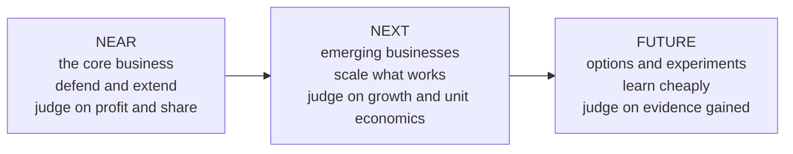

# Portfolio strategy and capital allocation

*Part of [Business acumen for the product leader](./README.md)*

## TL;DR

A product leader at Head of Product or VP level owns a **portfolio**: several products and bets at different stages. The job is to allocate money and people across them. That means funding the core, growing what is emerging, buying options on the future, and stopping what no longer earns its place.

The core tradeoff is today against tomorrow. Money spent defending the core cannot fund future bets. Money spent on future bets is not spent on the business that pays the bills. A good portfolio makes that split on purpose, judges each bet by the right standard, and stages big bets so you can stop them cheaply.

> 🎯 **For the product leader**
>
> **Why it matters** — Most portfolio waste is not a bad bet. It is a bet that should have been stopped a year ago, or a future bet judged by core-business return targets and starved before it could prove anything.
>
> **What it changes in your decisions** — You place each bet in a horizon and judge it by that horizon's standard. You stage large investments with clear gates. You set kill and scale criteria before you start, not after.
>
> **Ask your team** — *"What evidence, by what date, would make us stop this bet? Have we written it down?"*
>
> **Risk if ignored** — A portfolio of zombie products that each need a team, and no capacity left for the next growth engine.

## Mental model: near, next and future horizons



**Near-horizon** work extends the core business that earns today's profit. **Next-horizon** work scales emerging businesses that have shown early proof. **Future-horizon** work buys options: small, cheap experiments that might become the next core.

Each horizon needs a different standard. Judge a future bet by core-business profit targets and it will always lose. Judge the core by learning goals and it will drift.

**Where the model breaks.** Horizons are not a timeline. A regulatory change can turn a future option into an urgent near-horizon need overnight. And some companies set a fixed budget split across horizons. The right split depends on how fast your core is growing or shrinking, not on a rule.

## The portfolio view

List every product and bet in one table. For each, record its horizon, growth, margin, strategic role and the team cost. A **share-versus-growth grid** is one common way to view it. It plots market growth against your relative market share:

| | Low market share | High market share |
| --- | --- | --- |
| **High market growth** | Question marks: invest to win, or exit | Stars: invest to keep the lead |
| **Low market growth** | Candidates to fix, sell or sunset | Cash generators: fund the rest of the portfolio |

The grid is a starting point. It ignores synergies. A low-share product might be what keeps your best customers loyal.

## Allocating capital and people

- **Fund in stages.** Give a bet enough to reach its next proof point. Release more only when it passes the gate.
- **Use the right hurdle.** Near-horizon bets need a return above the cost of capital. Future bets need a credible path to learning, at low cost.
- **Count opportunity cost.** A team on a weak bet is a team not on a strong one.
- **Hold a reserve.** Keep some capacity unallocated for what you learn mid-year.
- **Review on a cadence.** A quarterly portfolio review asks one question per bet: scale, continue, change or stop?

## Build, buy or partner at portfolio level

At portfolio level, the question is how to gain a whole capability or market, not a single feature.

- **Build** when the capability is core to your advantage and you have time.
- **Buy** a company when you need speed, a licence, a team or customers. SoFi agreed in 2021 to acquire Golden Pacific Bancorp, a small community bank. SoFi said the deal was a faster route to a national bank charter than applying from scratch. A charter lets a lender fund loans with deposits.
- **Partner** when someone else holds what you need and you can share the economics. Many fintechs reach customers through a partner bank instead of holding a charter.

## Double down or sunset

Decide in advance what would make you scale a bet, and what would make you stop it. Typical scale signals: improving unit economics, organic demand, and a lead competitors cannot easily close. Typical stop signals: flat adoption after real effort, unit economics that do not improve with scale, and a high cost to maintain.

Shopify shows that a large bet can be reversed. In 2022 it bought Deliverr, a fulfillment company, for about $2.1 billion, to build its logistics business. In May 2023 Shopify agreed to sell its logistics business to Flexport. Press coverage reported that Shopify took an equity stake in Flexport in return, and that Flexport became a logistics partner for Shopify merchants. Shopify moved logistics from "build" to "partner" in about a year.

**Sunsetting has obligations in regulated domains.** You cannot just switch a product off.

| Domain | What a sunset must handle |
| --- | --- |
| Lending | Existing loans must be serviced until they are repaid or sold |
| InsurTech | Policies in force must be honoured. Claims on them must be paid, sometimes for years. This is called **run-off**. |
| Payments | Merchants need time and help to move to another payment method |
| FinTech | Account closures need customer notice and a way to move funds |
| Retail | Stock must be cleared, and leases and staff handled |
| eCommerce | Sellers in a closed category need notice and a path elsewhere |

## Real-options thinking

A **real option** is the right, but not the obligation, to take a future business action. Staged investment creates options. You invest a little to learn, then decide whether to invest more.

Options are worth more when uncertainty is high. If you knew the outcome, you would not need the option. Common options in a product portfolio:

- **Option to expand**: start small and scale if it works.
- **Option to abandon**: stop after the pilot and limit the loss.
- **Option to wait**: delay until a regulation, a partner or a technology is clearer.

## Worked example: staging a buy now, pay later bet

*This example is invented, to show the method. The company and all numbers are illustrative. For simplicity, it ignores the time value of money.*

An eCommerce platform considers launching its own buy now, pay later product. Leadership believes there is a 50% chance it succeeds.

**Assumed values.** If it succeeds, the business is worth $30 million in present value. If it fails, what is left is worth $2 million.

**Option A: commit fully now.** Invest $10 million up front.

- Expected value = 0.5 × $30M + 0.5 × $2M − $10M = $15M + $1M − $10M = **$6 million**.

**Option B: stage it.** Spend $2 million on a pilot with one merchant category. The pilot reveals whether the product will succeed. Then invest the remaining $8 million only if it does. If the pilot fails, stop and recover nothing.

- If success: $30M − $8M = $22M.
- If failure: $0.
- Expected value = −$2M + 0.5 × $22M + 0.5 × $0 = **$9 million**.

**Step 3: value the option.** Staging is worth $9M − $6M = **$3 million** more. That is the value of the right to stop.

**Step 4: write the gate.** Before the pilot starts, the team writes what "success" means. For example: a target approval rate, a cap on early delinquency, and a minimum lift in merchant conversion. Without a written gate, the pilot drifts into a launch whatever the result.

## Tradeoffs and decisions

- **Core vs. future.** Funding the core protects today's profit. Funding the future protects next decade's. The cost of either extreme is a business that is efficient and shrinking, or exciting and broke.
- **Staging vs. speed.** Staging limits losses and costs time. In a race, a competitor may scale first.
- **Buy vs. build at scale.** An acquisition buys time and capability. It costs a premium, and integration is hard.
- **Sunset vs. maintain.** Stopping frees a team. It costs customer goodwill and regulatory work, and sometimes a strategic position.

## Failure modes

- **Zombie products.** Bets that never hit their goals but are never stopped.
- **Wrong yardstick.** Future bets judged on near-term profit, and starved.
- **The launch that was a pilot.** A pilot with no gate quietly becomes a full product.
- **Sunk-cost thinking.** "We have spent $20 million, we cannot stop now."
- **Sunset without a plan.** A product is closed, and the servicing, claims or migration obligations surprise the team.

## Under the hood

The two options above as a small decision tree, in Python:

```python
p = 0.5
commit = p * 30 + (1 - p) * 2 - 10            # 6.0  ($ millions)
staged = -2 + p * (30 - 8) + (1 - p) * 0      # 9.0
option_value = staged - commit                # 3.0
print(commit, staged, option_value)
```

A portfolio review row:

```yaml
bet: bnpl-pilot
horizon: future
stage_budget: 2_000_000
gate_date: 2027-03-31
scale_if: {approval_rate: ">= 0.60", early_delinquency_30d: "<= 0.02", merchant_conversion_lift: ">= 0.05"}
stop_if: "any scale_if criterion missed by more than half"
owner: GM Commerce Financial Services
```

## Practitioner checklist

- [ ] List every product and bet in your portfolio, with its horizon and team cost.
- [ ] Write the standard each horizon is judged by.
- [ ] For your largest bet, write the scale criteria, the stop criteria and the gate date.
- [ ] Find one bet that should be staged, and split it into a pilot and a scale phase.
- [ ] Name one candidate to sunset, and list the obligations a sunset would trigger.
- [ ] Hold a quarterly portfolio review with one decision per bet.
- [ ] Keep a reserve of capacity unallocated.

## Related lessons

- [Data and decisions](./data-and-decisions.md) — scoring bets and deciding under uncertainty.
- [The language of money](./the-language-of-money.md) — NPV and staged cases.
- [Prioritization and roadmaps](../technical-product-management/prioritization-and-roadmaps.md) — turning allocation into a roadmap.
- [Tech debt and estimation](../technical-product-sense/tech-debt-and-estimation.md) — the maintenance cost every product carries.

## Sources and notes

- The buy now, pay later example and all its numbers are invented and illustrative.
- SoFi, press release announcing the agreement to acquire Golden Pacific Bancorp (March 2021). [SoFi](https://www.sofi.com/press/sofi-announces-agreement-acquire-golden-pacific-bancorp-inc/). As of 2026-10.
- Shopify's sale of its logistics business, including Deliverr, to Flexport (agreed May 2023, completed June 2023), from press coverage of the announcement (a secondary source). [CNBC](https://www.cnbc.com/2023/05/04/shopify-offloads-logistics-business-to-flexport.html). Shopify's own filings for 2023 are the primary record. As of 2026-10.
- Note: these hosts could not be opened from the build environment (blocked by the network proxy). The facts were corroborated from search-result excerpts and press coverage.
