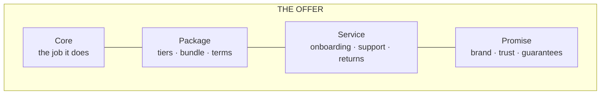

# Products and marketing: from opportunity to launch

*Part of [Business acumen for the product leader](./README.md)*

## TL;DR

A **product** is the whole offer a customer buys: the core function, the package around it, the price, the service and the promise. Features are only part of it. Marketing is how the offer reaches the right customer with the right message. At leadership level, both are business decisions. You decide which opportunities get a business case, what to build, buy or partner for, and how the product goes to market.

The core tradeoff is control against speed. Building gives you control and differentiation. Buying or partnering gets you to market faster. In regulated domains, a partner may hold the licence you lack. But the regulator still holds you responsible for what your customers experience.

> 🎯 **For the product leader**
>
> **Why it matters** — Many products fail on the parts around the feature: the wrong price, the wrong channel, a missing licence, terms that scare buyers away. Those parts are your call, not the engineering team's.
>
> **What it changes in your decisions** — You require an opportunity assessment before a build. You make build-buy-partner calls on differentiation and total cost, not on pride. You plan the launch with all four Ps, not only the product.
>
> **Ask your team** — *"If a competitor copied this feature tomorrow, what part of our offer would they still not have?"*
>
> **Risk if ignored** — A strong feature with a weak offer. Or a vendor or partner who becomes a single point of failure for a regulated product you still answer for.

## Mental model: the offer is more than the feature



Think of the offer as layers. The core is what the product does. The package, service and promise make it something people buy. Competitors can copy a core feature quickly. The outer layers take longer to copy.

**Where the model breaks.** In some markets, the core really is everything. A payments API that fails one time in ten loses, whatever its service. Layers help only once the core is good enough.

## Opportunity assessment and the business case

Before a build, answer these questions on one page:

1. **What problem, for whom?** Name the target customer and the need.
2. **How big?** Size the reachable market with simple, visible arithmetic.
3. **Why now?** What changed: a rule, a technology, a competitor, a customer behaviour?
4. **Why us?** What advantage do we bring?
5. **How will we know it worked?** One outcome metric and a target.
6. **What could kill it?** Regulatory, credit, fraud, operational and partner risks.

If the answers are strong, write the full business case with NPV and a sensitivity table, as in [lesson 4](./the-language-of-money.md).

## Iterative development, with gates where the rules require them

Most products should be built in small steps: test the riskiest assumption first, release to a small group, learn, then scale. In regulated domains, some steps need a gate before they go live. Examples are a new credit product, new customer disclosures or a new insurance rate. Plan the gate in from the start. Do not discover it a week before launch.

Warby Parker is a public example of iterating on the offer, not just the product. Its 2021 S-1 describes a Home Try-On program. Customers chose five frames online and tried them at home for five days for free. The program solved the main barrier to buying glasses online: you cannot try them on. Warby Parker's website now says the program has ended, and points customers to virtual try-on and its stores instead. The offer changed as the channel mix changed.

## Product design and packaging

**Packaging** decides how features are grouped and sold: one product or many, tiers, bundles and add-ons. Packaging is a pricing decision in disguise. [Lesson 11](./monetization-and-business-models.md) covers it in depth.

Faire, a wholesale marketplace, packages risk relief into its offer to independent retailers. Its help pages describe net 60 payment terms for eligible retailers, and free returns on the first order with each brand. Both lower the risk of trying a new brand. Faire absorbs some of that risk itself as part of the offer.

## Make, buy or partner

| Option | Choose it when | The cost |
| --- | --- | --- |
| **Make** | The capability is a core differentiator, or no vendor fits | Time, team and upkeep for as long as you run it |
| **Buy** | The capability is common, and vendors do it well | Per-unit fees, less control, vendor lock-in |
| **Partner** | Someone else holds what you need: a licence, a balance sheet, a channel | A share of the revenue, and dependence on the partner's priorities |

In regulated domains, partnership is common. A fintech may use a partner bank to hold deposits or issue cards. An insurance agency may sell on a carrier's licence and capital. A retailer may use an outside lender for financing at checkout.

Target took the buy route for same-day delivery. In December 2017 it agreed to acquire Shipt, a same-day delivery platform, for $550 million. Building a delivery network from scratch would have taken years.

## The marketing cycle and go-to-market

Marketing runs as a loop: **insight → plan → execute → measure → learn**. A **go-to-market plan** answers:

- **Who** is the target segment for this launch?
- **What** is the message, and the proof behind it?
- **Where** will we reach them: self-serve, sales team, partners or marketplaces?
- **How much** will it cost to win each customer, and how fast will it pay back?
- **When** will each segment get it?

## The four Ps

The 4 Ps are four levers of the marketing mix.

| P | The question | Payments | Retail |
| --- | --- | --- | --- |
| **Product** | What exactly are we selling? | Online card acceptance with fraud tools | A private-label product line |
| **Price** | What do we charge, and how? | A blended rate, or interchange plus a markup | Shelf price, promotions and markdown plan |
| **Place** | Where does the customer buy it? | Direct sign-up, or through software platforms that embed it | Stores, website, marketplaces |
| **Promotion** | How do they hear about it? | Developer docs, partner listings, sales team | In-store display, loyalty emails, ads |

## Launches

Not every launch needs the same weight. Tier them.

- **Tier 1**: a new product or market. Full plan: press, sales training, support readiness, risk sign-off.
- **Tier 2**: a major feature. Customer communication, docs, support briefing.
- **Tier 3**: an improvement. Release notes.

See [Launches, rollouts and migrations](../technical-product-management/launches-rollouts-and-migrations.md) for the execution side.

## Intellectual property basics

Four kinds of intellectual property matter most to a product leader.

| Type | What it protects | How you get it | Domain example |
| --- | --- | --- | --- |
| **Patent** | An invention: a new, useful, non-obvious method or device | Apply and get it granted. You must disclose how it works. In the US, a utility patent generally lasts 20 years from filing. | A new card-reader design |
| **Trademark** | A brand name, logo or slogan | Use it in trade, and register it for stronger rights. It can last as long as you use it and renew it. | A product or app name |
| **Copyright** | Original expression, such as code, text and design | It exists once the work is created. Registration adds rights in some countries. | Your app's code and content |
| **Trade secret** | Valuable information kept secret | Keep it secret, with access controls and contracts | A credit model or pricing algorithm |

Credit and pricing models are usually protected as trade secrets, not patents. A patent would require you to publish how the model works. Note one tension in US lending: the law requires a lender to tell a declined applicant the main reasons for the decision. You disclose reasons, not the model.

## Worked example: build or buy identity verification

*This example is invented, to show the method. The company and all numbers are illustrative.*

A fintech must verify each new customer's identity. This step is often called know your customer (KYC). It needs 600,000 checks a year.

**Buy.** A vendor charges $1.20 a check. Annual cost: 600,000 × $1.20 = $720,000. Three-year cost: **$2,160,000**.

**Build.** Build cost $1,500,000. Running cost $400,000 a year for data sources, staff and upkeep. Three-year cost: $1,500,000 + 3 × $400,000 = **$2,700,000**.

**Step 1: compare.** Over three years, buying is $540,000 cheaper.

**Step 2: find the break-even volume.** Building costs $2,700,000 over three years. Buying the same costs 3 × $1.20 × V. They are equal when V = $2,700,000 ÷ $3.60 = **750,000 checks a year**. Below that, buy. Above it, building starts to pay, if the build estimate holds.

**Step 3: check differentiation.** Identity checks are not why customers choose this fintech. They are a gate. That points to buy.

**Step 4: check accountability.** Buying moves the work, not the responsibility. If the vendor's checks fail, the fintech answers to its regulator and its partner bank. The team adds vendor monitoring, a fallback vendor and audit rights to the contract.

**Decision:** buy now, with a review if volume nears 750,000 a year.

## Tradeoffs and decisions

- **Make vs. buy.** Making gives control and costs time and upkeep. Buying gives speed and costs per unit, forever.
- **Partner vs. licence.** A partner's licence gets you to market. It costs revenue share and control of your roadmap. Getting your own licence costs years and capital.
- **Big launch vs. quiet launch.** A big launch builds awareness. It costs more and makes a slow start visible.
- **Patent vs. trade secret.** A patent gives a time-limited legal monopoly and requires disclosure. A secret lasts as long as you keep it, and gives no protection if someone builds the same thing on their own.

## Failure modes

- **Feature without an offer.** A strong feature with no price, channel or support plan.
- **Gate discovered late.** A regulatory or partner approval appears in the last week.
- **Outsourced and forgotten.** A vendor's failure becomes your regulatory finding.
- **One launch weight for all.** Every launch is tier 1, so none gets the attention it needs.
- **Leaked secret.** A pricing model is shared in a pitch deck or a partner integration with no protection.

## Under the hood

A one-page opportunity assessment template:

```markdown
## Opportunity: <name>
- Target customer and need:
- Reachable market (show the arithmetic):
- Why now:
- Why us (advantage):
- Outcome metric and target:
- Build / buy / partner, and why:
- Regulatory and partner gates (with lead times):
- Top three risks and how we test them first:
- Go-to-market: segment, message, channel, launch tier:
- Ask: money, people, decision date
```

## Practitioner checklist

- [ ] Write a one-page opportunity assessment for your next proposed build.
- [ ] List the outer layers of your offer that a competitor could not copy quickly.
- [ ] For each vendor or partner, name the fallback if they fail.
- [ ] Map every regulatory and partner gate for your next launch, with lead times.
- [ ] Fill in the 4 Ps for your next launch.
- [ ] Assign a launch tier to each item on your roadmap.
- [ ] Check with Legal which of your assets are patents, trademarks, copyright or trade secrets.

## Related lessons

- [Markets and strategy](./markets-and-strategy.md) — choosing the segment the offer serves.
- [Monetization and business models](./monetization-and-business-models.md) — pricing, packaging and tiers.
- [Launches, rollouts and migrations](../technical-product-management/launches-rollouts-and-migrations.md) — running the launch itself.
- [Creativity](../product-sense/creativity.md) — generating the options before you choose.
- [Discovery to delivery](../technical-product-management/discovery-to-delivery.md) — testing the riskiest assumption first.

## Sources and notes

- The identity-verification case and all its numbers are invented and illustrative.
- Warby Parker, Form S-1 (2021): Home Try-On program; Warby Parker's Home Try-On page says the program has ended. [Filing index](https://www.sec.gov/cgi-bin/browse-edgar?action=getcompany&CIK=1504776&type=S-1) and [Warby Parker](https://www.warbyparker.com/home-try-on). As of 2026-10.
- Faire, retailer FAQ: net 60 terms for eligible retailers; free returns on the first order with each brand. [Faire](https://www.faire.com/faq/retailers). As of 2026-10.
- Target's agreement to acquire Shipt for $550 million (December 2017), as reported in press coverage of Target's announcement. As of 2026-10.
- US utility patent term (generally 20 years from the filing date) and the US rule that lenders give declined applicants the principal reasons for adverse action are matters of US law (35 U.S.C. 154; Regulation B, 12 CFR 1002.9).
- Note: these hosts could not be opened from the build environment (blocked by the network proxy). The facts were corroborated from search-result excerpts of the documents.
