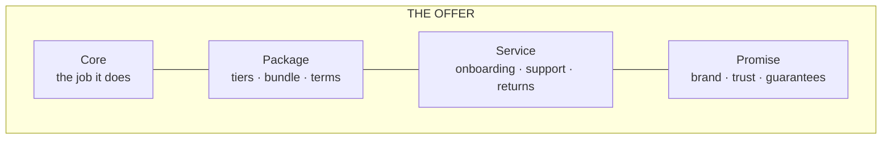
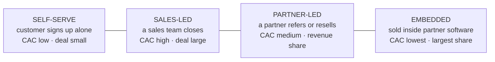

# Products and go-to-market

*Part of [Business acumen for the product leader](./README.md)*

*Last reviewed: 2026-10 · Volatility: medium*

## TL;DR

A **product** is the whole offer a customer buys: the core function, the package around it, the price, the service and the promise. Features are only part of it. **Go-to-market** (GTM) is how the offer reaches the customer and how the customer buys it. At leadership level, both are business decisions. You decide which opportunities get a business case. You decide what to build, buy or partner for. And you decide which **GTM motion** sells the product: self-serve, a sales team, partners, or embedding inside someone else's software.

Each motion has its own unit economics. A sales team costs thousands of dollars per customer and needs large accounts to pay back. Self-serve costs little per customer and only works when the product sells itself. Partners and embedding cut acquisition cost, but they take a share of revenue for as long as the customer stays. The wrong motion for the deal size is one of the most common reasons a good product loses money.

Two more tools complete the picture. **Incrementality** tells you which marketing spend actually created customers, not just touched them. **Total cost of ownership** tells you what build, buy or partner really costs, including the oversight a regulator expects. In regulated domains, a partner may hold the licence you lack. But the regulator still holds you responsible for what your customers experience.

> 🎯 **For the product leader**
>
> **Why it matters** — Many products fail on the parts around the feature: the wrong channel, a sales team selling deals too small to pay back, a marketing channel that takes credit for customers who would have come anyway, or a vendor who fails on your behalf. Those parts are your call, not the engineering team's.
>
> **What it changes in your decisions** — You choose the GTM motion from the deal size and the payback it allows. You plan sales hiring with ramp and attainment, not with quota. You fund marketing on incremental acquisition cost from a holdout, not on attributed conversions. You make build-buy-partner calls on total cost of ownership, with an exit plan for every critical vendor.
>
> **Ask your team** — *"If we had switched this channel off last quarter, how many of these customers would we still have won? Show me the holdout."*
>
> **Risk if ignored** — You scale a channel whose true acquisition cost is three times the reported one. Or you build a sales team for accounts that can never pay it back. Or a vendor or partner becomes a single point of failure for a regulated product you still answer for.

## Decision rules in this lesson

1. Match the GTM motion to the deal size. Use a sales team only where contribution per account pays back the sales cost within your payback limit.
2. Plan sales capacity on ramped, attained output, not on quota. A new hire delivers well under half of quota in year one in a typical plan.
3. Price a partner or an embedded channel on contribution after the revenue share, for the life of the customer, not on its low acquisition cost.
4. Fund marketing on incremental acquisition cost from a holdout. Treat attributed conversions as a ceiling, not a measurement.
5. Compare build, buy and partner on three-year total cost of ownership, including oversight, integration and exit.
6. Outsource the work, never the accountability. Every critical vendor gets due diligence, monitoring and a tested exit plan.
7. Protect models and pricing logic as trade secrets. Disclose decision reasons, not the model.

## Mental model: the offer is more than the feature



Think of the offer as layers. The core is what the product does. The package, service and promise make it something people buy. Competitors can copy a core feature quickly. The outer layers take longer to copy. The GTM motion is how the whole offer reaches the buyer. A strong offer sold through the wrong motion still loses money.

**Where the model breaks.** In some markets, the core really is everything. A payments API that fails one time in ten loses, whatever its service. Layers help only once the core is good enough.

## Mechanics

### Opportunity assessment and the business case

Before a build, answer these questions on one page:

1. **What problem, for whom?** Name the target customer and the need.
2. **How big?** Size the reachable market with simple, visible arithmetic.
3. **Why now?** What changed: a rule, a technology, a competitor, a customer behaviour?
4. **Why us?** What advantage do we bring?
5. **How will we sell it?** Name the GTM motion and the acquisition cost it implies.
6. **How will we know it worked?** One outcome metric and a target.
7. **What could kill it?** Regulatory, credit, fraud, operational and partner risks.

If the answers are strong, write the full business case with NPV (net present value), a counterfactual and a sensitivity table. [Business cases, capital and valuation](./business-cases-and-valuation.md) shows how. Size the market as in [markets and customers](./markets-and-strategy.md).

### Iterative development, with gates where the rules require them

Most products should be built in small steps: test the riskiest assumption first, release to a small group, learn, then scale. In regulated domains, some steps need a gate before they go live. Examples are a new credit product, new customer disclosures or a new insurance rate. Plan the gate in from the start. Do not discover it a week before launch.

Warby Parker is a public example of iterating on the offer, not just the product. Its 2021 S-1 describes a Home Try-On program. Customers chose five frames online and tried them at home for five days for free. The program solved the main barrier to buying glasses online: you cannot try them on. Warby Parker's 10-Q for the quarter ended June 30, 2026 says it decided in the second quarter of 2025 to sunset Home Try-On at the end of 2025. Its 10-K for 2025 names Virtual Try-On as part of its offer.

The lesson for a product leader: an offer layer can be right for one stage and wrong for the next. A free home trial lowers the buyer's risk. It also carries shipping, handling and return costs on every order. Review each layer's cost against what it still earns.

### Product design and packaging

**Packaging** decides how features are grouped and sold: one product or many, tiers, bundles and add-ons. Packaging is a pricing decision in disguise. [Pricing and business models](./monetization-and-business-models.md) covers it in depth.

A wholesale marketplace can package risk relief into its offer to independent retailers. Two common forms are delayed payment terms and easy returns on a first order from a new brand. Both lower the retailer's risk of trying a new brand. The marketplace absorbs some of that risk itself as part of the offer. (This is a general pattern, not a description of one company's current terms.) Delayed terms also tie up cash. [The language of money](./the-language-of-money.md) works through what net-60 terms do to working capital.

### Go-to-market motions

A **GTM motion** is the repeatable way a customer finds, buys and starts using the product. Four motions cover most financial and commerce products.



**Self-serve.** The customer finds the product, signs up, and starts using it with no salesperson. Acquisition cost comes from paid marketing, content and referrals. It works when the product is simple to evaluate and quick to start. Small merchants who sign up for online card acceptance are the classic case. In FinTech, a consumer opening a savings account in an app is another.

**Sales-led.** A sales team finds accounts, runs a sales cycle and closes a contract. It works when deals are large, the buyer needs convincing, or the contract is negotiated. Mid-sized and enterprise merchants in payments are sold this way. So are commercial insurance programmes and bank partnerships.

**Partner-led.** Another company refers or resells your product. Examples are an accounting firm that refers small businesses to a lender, a broker that sells an insurer's policies, or a bank that offers a fintech's product to its customers. The partner already has the customer's trust. You pay it a fee per customer or a share of revenue.

**Embedded.** Your product is sold inside software the customer already uses. Payments inside salon or restaurant software is the common case. Lending offered at a commerce checkout is another, and so is insurance sold at the point of a purchase. The software partner owns the customer relationship. You get very cheap distribution. You pay the largest share of revenue, and you depend on the partner the most. [Competitive advantage and strategy](./competitive-advantage-and-strategy.md) explains why embedding also raises switching costs.

#### The unit economics of each motion

The table compares the four motions for a payments company. The figures are illustrative, and every input is assumed. Each motion serves the merchant size it fits. Contribution is per merchant per month, after the partner's revenue share and the cost to serve. It uses the second contribution-margin layer (CM2) from [unit economics](./unit-economics.md).

| Per merchant (assumed) | Self-serve | Sales-led | Partner-led | Embedded |
| --- | --- | --- | --- | --- |
| Typical merchant | Small, online | Mid-sized | Mid-sized | Small, in vertical software |
| Net revenue per month | $100 | $1,000 | $1,000 | $133.33 |
| Revenue share to partner | 0% | 0% | 25% | 30% |
| Cost to serve per month | $40 | $400 | $400 | $40 |
| **Contribution per month** | **$60** | **$600** | **$350** | **$53.33** |
| Acquisition cost (CAC) | $400 | $10,071 | $4,250 | $400 |
| Monthly churn | 3% | 1% | 1.5% | 1% |
| **Simple payback** | **6.7 months** | **16.8 months** | **12.1 months** | **7.5 months** |
| Lifetime contribution (contribution ÷ churn) | $2,000 | $60,000 | $23,333 | $5,333 |
| Lifetime contribution ÷ CAC | 5.0 | 6.0 | 5.5 | 13.3 |

The embedded column uses the same assumed numbers as the worked example in [competitive advantage and strategy](./competitive-advantage-and-strategy.md). The sales-led acquisition cost of $10,071 comes from the capacity math below. Lifetime contribution here is undiscounted, to keep the comparison simple. [Unit economics](./unit-economics.md) shows why you should discount it and cap it.

**How to read it.** Four points stand out.

- **Sales-led has the best lifetime value and the worst payback.** Each merchant is worth $60,000 over its life. But the company waits almost 17 months to recover the cost of winning it. A fast-growing sales team burns cash before it earns it.
- **The partner's share is a cost for life.** The partner-led merchant costs less than half as much to acquire as the sales-led one. It also earns $250 less every month, for as long as the merchant stays. Over the expected life of about 67 months, that share adds up to about $16,700. That is far more than the $5,800 saved on acquisition cost.
- **Embedded wins on ratio, not on size.** Its ratio of 13.3 is the best in the table. Each merchant is small, so the channel only matters at volume. It also depends on one partner.
- **Self-serve lives on churn.** At 3% a month, the average self-serve merchant stays about 33 months. A small rise in churn wipes out most of the value.

**Common misreading.** "The partner channel is cheaper, so shift budget to it." It is cheaper to *acquire*. Whether it is cheaper *overall* depends on the revenue share, the churn, and how long the share lasts. Always compare lifetime contribution after the share, at the same discount rate.

#### When to switch motions

Motions are not chosen once. Companies add and drop them as they move up or down market.

- **Add sales on top of self-serve** when a group of self-serve accounts is large enough to pay back a salesperson. Many companies flag such accounts from product usage. These are often called product-qualified leads. A salesperson then helps them expand.
- **Move a segment from sales-led to self-serve** when its deals are too small. In the table, a ramped sales team costs $10,071 per merchant. To pay that back within 18 months, a merchant must earn at least $560 a month of contribution. At a 60% margin, that is about $933 a month of net revenue, or about $11,200 a year. Below that size, sales loses money on every deal. Self-serve or a partner should serve it.
- **Add partners** when someone else already holds the customer's trust or workflow, and your direct payback is too long.
- **Embed** when the buying decision happens inside software the customer already runs. Accept the revenue share and the dependence as the price.

**Domain application: lending.** A small-business lender may run all four motions at once. Self-serve online applications for small loans. A sales team for larger credit lines. Accountants and brokers as referral partners. And loans offered inside a commerce or accounting platform. Each channel has its own CAC, its own approval rate and its own default rate. Report unit economics by channel, never blended.

**Decision rule.** When the contribution per account cannot pay back the motion's CAC within your payback limit, change the motion for that segment. Do not change the price first.

### Sales capacity math

A sales-led business plans in **capacity**: how many salespeople, how fast they become productive, and what each one closes. Four inputs drive it.

- **Quota.** The new business one fully productive salesperson is expected to close in a year. Here, an **account executive** (AE) has a quota of $600,000 of new annualized net revenue.
- **Attainment.** The share of quota a rep actually closes, on average. Many teams plan well below 100%. Here, the plan assumes 70%.
- **Ramp.** How long a new hire takes to reach full productivity. Here, a new AE closes nothing for three months, 50% of a full rep's output for the next three, and 100% after that. The year-one average is (0 × 3 + 0.5 × 3 + 1 × 6) ÷ 12 = **62.5%**.
- **Fully loaded seat cost.** Salary, commission, benefits, tools, and the AE's share of managers, sales engineers and lead generation. Here, **$300,000 a year** per seat.

**From capacity to sales-led CAC.** All figures are assumed.

1. A ramped AE closes $600,000 × 70% = **$420,000** of new annualized net revenue a year.
2. The average new merchant brings $12,000 a year. So the AE closes $420,000 ÷ $12,000 = **35 deals** a year.
3. Sales cost per deal = $300,000 ÷ 35 = $8,571.
4. Add marketing's cost of the leads, $1,500 per closed deal. **Sales-led CAC = $10,071.**

**Ramp raises CAC.** A new hire in year one closes $420,000 × 62.5% = $262,500, or about 21.9 deals. Their CAC is $300,000 ÷ 21.875 + $1,500 = **$15,214**. That is 51% higher than a ramped rep. A team where half the reps are new shows a much higher CAC than its mature cost. Read sales CAC by tenure group, or you will blame the wrong thing.

**Planning the hiring.** Suppose the plan needs $6 million of new annualized net revenue next year. The team has 8 ramped account executives.

1. Ramped account executives deliver 8 × $420,000 = $3,360,000.
2. The gap is $6,000,000 − $3,360,000 = $2,640,000.
3. A new hire, hired at the start of the year, delivers $262,500.
4. Hires needed = $2,640,000 ÷ $262,500 = 10.06. Round up to **11**.

Those 11 hires cost 11 × $300,000 = $3.3 million in year one. They bring in about $2.9 million of new annualized revenue. Hire them late in the year, and they deliver almost nothing until the next one. That is why sales capacity is planned two quarters ahead of the revenue target.

**Common misreading.** "Revenue target ÷ quota = headcount." That plan assumes 100% attainment and no ramp. Here it would say $6,000,000 ÷ $600,000 = 10 reps in total, so only 2 new hires. The real need is 11 new hires.

**Decision rule.** When you plan a sales-led launch, model attainment and ramp explicitly. Then check that the resulting CAC pays back within your payback limit for the deal size you will actually sell.

#### Partner revenue share

A **referral partner** sends you customers. A **reseller** sells your product under its own contract. Both expect payment. The common forms are a one-off fee per customer, a share of revenue for a fixed period, or a share for the life of the customer.

The cost of a partner channel is: partner-management staff + onboarding + the revenue share. In the table, a partner manager costs $150,000 a year and brings in 40 merchants: $3,750 each. Onboarding adds $500. So CAC is $4,250 (assumed). The revenue share of 25% then costs $250 a month for life.

**Negotiating the share.** A share for life costs far more than a share for 24 months. On the partner-led merchant, a 24-month share costs $250 × 24 = $6,000, undiscounted and ignoring churn. A share for life costs about $16,700 at the same churn. Price the share as a CAC equivalent before you sign.

#### Embedded payments revenue share

In embedded payments, a vertical software company offers card acceptance to the businesses on its platform. A payments provider processes the payments and shares the revenue. The software company gains a second revenue line. The payments provider gains distribution.

**From the platform's side (illustrative).** A salon-software company has 5,000 merchants. Assume 40% of them adopt its embedded payments. Each paying merchant brings $133.33 of net revenue a month, and the platform's share is 30%: $40 a month. That is 5,000 × 40% × $40 × 12 = **$960,000** a year. It needs almost no extra sales effort. This is why many vertical software companies now see payments as a core revenue line.

**The share rises with risk.** A software company can take more of the economics by taking on more of the work. Some register as a **payment facilitator**. They onboard and underwrite their own merchants under a provider's licence. They then keep a larger share. They also take on fraud and credit losses, compliance duties, and the cost of the risk team.

**Decision rule.** When a partner asks for a higher share, ask which risk or cost it takes on in return. A higher share with no transfer of losses or work is just a price cut.

### Attribution versus incrementality

**Attribution** assigns credit for a conversion to the marketing touches the customer saw before converting. **Incrementality** measures how many conversions the marketing *caused*: conversions with the spend minus conversions that would have happened without it. They answer different questions. Attribution says who touched the customer. Incrementality says who changed the outcome.

**The common attribution rules.**

- **Last-touch.** All credit goes to the last ad or link before the conversion. It favours channels that catch people just before they buy, such as paid search on your own brand name and retargeting ads.
- **First-touch.** All credit goes to the first touch. It favours awareness channels.
- **Multi-touch.** Credit is split across touches by a rule: equally, more to recent touches, or more to the first and last. Some tools fit the split from data.

All three share one flaw. They only split credit among touches that *happened*. None asks what the customer would have done with no ad at all. Ad platforms also report conversions on their own ads. They grade their own homework. Privacy rules and platform changes have also cut the user-level data that attribution needs, so the numbers are less complete than they look.

**How incrementality is measured.**

- **Holdout test.** Randomly withhold the ads from part of the target audience. Compare conversion rates. The gap is the incremental effect. This is the gold standard. [Metrics and experimentation](../technical-product-management/metrics-and-experimentation.md) covers test design and sample size.
- **Geographic test.** Switch spend on in some regions and off in comparable ones. It works for channels you cannot randomize by person, such as television or outdoor ads.
- **Marketing mix modelling** (MMM). A statistical model links total sales to spend by channel over time. It covers every channel, including offline ones. It needs years of data and gives broad answers. Calibrate it with holdout tests.

**Where the gap is largest.** Attributed and incremental numbers diverge most for brand search, retargeting, and offers to existing customers. These touches reach people who were already about to buy. They diverge least for new audiences who have never heard of you.

**Domain application: lending.** A lender pays a comparison site per funded loan. Many of those borrowers searched for the lender by name first. The site's tracking link was the last touch, so it takes the credit. A holdout by region or by time shows how many borrowers would have applied directly.

**Domain application: FinTech.** A neobank offers a cash bonus to open an account. Attribution credits the bonus with every account opened during the offer. Some of those customers were coming anyway. Many others take the bonus and leave. Incrementality on *retained* customers is the number that matters.

**Decision rule.** Fund a channel on incremental CAC from a holdout. Re-test each large channel at least once a year, because the gap changes as the audience saturates.

**Common misreading.** "Retargeting has our lowest CAC." It often has the lowest *attributed* CAC, because it reaches people who already chose you. Its incremental CAC can be the highest in the plan.

The worked example below shows the arithmetic.

### Make, buy or partner

| Option | Choose it when | The cost |
| --- | --- | --- |
| **Make** | The capability is a core differentiator, or no vendor fits | Time, team and upkeep for as long as you run it |
| **Buy** | The capability is common, and vendors do it well | Per-unit fees, less control, vendor lock-in |
| **Partner** | Someone else holds what you need: a licence, a balance sheet, a channel | A share of the revenue, and dependence on the partner's priorities |

In regulated domains, partnership is common. A fintech may use a partner bank to hold deposits or issue cards. An insurance agency may sell on a carrier's licence and capital. A retailer may use an outside lender for financing at checkout.

Target took the buy route for same-day delivery. In December 2017 it agreed to acquire Shipt, a same-day delivery platform, for $550 million. As general reasoning, not a Target statement: buying an existing network can be faster than building one. Buying a whole company is a portfolio decision. [Portfolio strategy and capital allocation](./portfolio-strategy-and-allocation.md) covers acquisition math.

#### Total cost of ownership

**Total cost of ownership** (TCO) is everything an option costs over its life, not only its price tag. Compare options over the same period, usually three to five years.

| Cost | Make | Buy | Partner |
| --- | --- | --- | --- |
| Up front | Design and build | Integration, contract, security review | Integration, legal, due diligence |
| Running | Engineers, infrastructure, data sources | Per-unit or licence fees, price rises at renewal | Revenue share, joint operations |
| Oversight | Compliance testing, audits, model validation | Vendor monitoring, audit rights, a fallback vendor | Partner oversight, joint compliance reviews |
| Hidden | The roadmap the team did not build | Lock-in, data you cannot take with you | Partner's priorities, partner's regulator |
| Exit | Decommissioning | Migration to another vendor | Unwinding customers, data and contracts |

Three costs are missed most often. **Opportunity cost:** the team that builds a commodity capability does not build your differentiator. **Price at renewal:** a vendor that is hard to leave can raise prices. **Exit cost:** moving millions of records or customers to a new provider is a project in itself. The worked example below shows how hidden costs move a build-or-buy break-even.

#### Third-party risk management

**Third-party risk management** is how a company chooses, watches and leaves its vendors and partners. In financial services, regulators treat it as part of running the business safely. In June 2023, the three US federal banking agencies (the Federal Reserve, the Federal Deposit Insurance Corporation (FDIC) and the Office of the Comptroller of the Currency (OCC)) issued joint final guidance on third-party relationships. It describes a life cycle: planning, due diligence and selection, contract negotiation, ongoing monitoring, and termination. The bank stays responsible for activities it outsources. In the EU, the Digital Operational Resilience Act (DORA) has applied since January 2025. It sets rules for how financial firms manage their technology providers.

The life cycle, in product terms:

1. **Plan.** Decide whether the activity is critical. A vendor that touches customer money, credit decisions or identity checks is critical.
2. **Due diligence.** Check the vendor's financial health, security, compliance record, and its own key vendors.
3. **Contract.** Write in service levels, audit rights, data ownership, incident notice, and help with exit.
4. **Monitor.** Track performance, incidents and the vendor's finances. Review critical vendors at least yearly.
5. **Exit.** Keep a written, tested plan to move to another provider or bring the work in-house.

**When you are the third party.** In banking-as-a-service, a fintech uses a partner bank's licence. To the bank, the fintech is the third party. The bank must oversee the fintech's onboarding, complaints and compliance. US bank regulators have taken enforcement action against partner banks over weak oversight of their fintech programmes, for example a Federal Reserve action in June 2024. The fintech feels that as slower launches and new controls.

**A real failure of a middle layer.** In April 2024, a banking-as-a-service middleware provider filed for bankruptcy. Many end customers of the fintech apps that relied on it lost access to their money for weeks or months, while the parties tried to reconcile who owned what. The lesson for a product leader is not about one company. If a middle layer keeps the record of whose money is whose, your customers depend on that record. Ask who holds it, and how you would rebuild it without them.

**Decision rule.** For any critical vendor or partner, name the fallback before you sign. If there is none, the contract needs stronger rights or the capability needs to come in-house.

### The marketing cycle and the four Ps

Marketing runs as a loop: **insight → plan → execute → measure → learn**. A GTM plan answers:

- **Who** is the target segment for this launch?
- **What** is the message, and the proof behind it?
- **Where** will we reach them: self-serve, a sales team, partners or embedded?
- **How much** will it cost to win each customer, and how fast will it pay back?
- **When** will each segment get it?

The four Ps are four levers of the marketing mix.

| P | The question | Payments | Retail |
| --- | --- | --- | --- |
| **Product** | What exactly are we selling? | Online card acceptance with fraud tools | A private-label product line |
| **Price** | What do we charge, and how? | A blended rate, or interchange plus a markup | Shelf price, promotions and markdown plan |
| **Place** | Where does the customer buy it? | Direct sign-up, or through software platforms that embed it | Stores, website, marketplaces |
| **Promotion** | How do they hear about it? | Developer docs, partner listings, sales team | In-store display, loyalty emails, ads |

"Place" is the GTM motion. Choose it with the unit economics above, not by habit.

### Launches

Not every launch needs the same weight. Tier them.

- **Tier 1**: a new product or market. Full plan: press, sales training, support readiness, risk sign-off.
- **Tier 2**: a major feature. Customer communication, docs, support briefing.
- **Tier 3**: an improvement. Release notes.

A sales-led tier 1 launch also needs sales enablement before launch day. Reps must be trained, and pricing approval rules must be set. See [Launches, rollouts and migrations](../technical-product-management/launches-rollouts-and-migrations.md) for the execution side.

### Intellectual property basics

Four kinds of intellectual property matter most to a product leader.

| Type | What it protects | How you get it | Domain example |
| --- | --- | --- | --- |
| **Patent** | An invention: a new, useful, non-obvious method or device | Apply and get it granted. You must disclose how it works. In the US, a utility patent generally lasts 20 years from filing. | A new card-reader design |
| **Trademark** | A brand name, logo or slogan | Use it in trade, and register it for stronger rights. It can last as long as you use it and renew it. | A product or app name |
| **Copyright** | Original expression, such as code, text and design | It exists once the work is created. Registration adds rights in some countries. | Your app's code and content |
| **Trade secret** | Valuable information kept secret | Keep it secret, with access controls and contracts | A credit model or pricing algorithm |

Credit and pricing models are usually protected as trade secrets, not patents. A patent would require you to publish how the model works. Note one tension in US lending: the law requires a lender to tell a declined applicant the main reasons for the decision. You disclose reasons, not the model.

Partnerships put trade secrets at risk. A partner integration or a vendor contract can expose your pricing logic or model features. Check confidentiality terms and data-use limits before you share them.

## Worked examples

### Worked example: attributed versus incremental CAC

*Illustrative. The company and every input are assumed.*

A neobank runs a $150,000 paid-social campaign for new card customers. The ad platform reports **1,000 conversions**. The growth team reports a CAC of $150,000 ÷ 1,000 = **$150**. Each new customer earns an assumed $25 a month of contribution. So reported payback is $150 ÷ $25 = 6 months. The team asks to double the budget.

The product leader asks for the holdout. The campaign targeted 1,000,000 people. A random 20% (200,000 people) never saw the ads.

**Step 1: read the holdout.** The holdout group produced 175 sign-ups with no ads. Its conversion rate was 175 ÷ 200,000 = 0.0875%.

**Step 2: build the counterfactual.** Without ads, the 800,000 exposed people would have converted at the same rate. That is 800,000 × 0.0875% = **700** sign-ups.

**Step 3: find the incremental conversions.** The exposed group produced 1,000 sign-ups. Incremental = 1,000 − 700 = **300**. The ads lifted sign-ups by 300 ÷ 700 = 42.9%. That is a real effect. It is also much smaller than the platform claims.

**Step 4: compute true CAC.** Incremental CAC = $150,000 ÷ 300 = **$500**. That is **3.3 times** the reported $150.

**Step 5: recompute payback.** $500 ÷ $25 = **20 months**, not 6.

**Step 6: state the uncertainty.** The holdout had only 175 sign-ups, so the estimate is noisy. A rough 95% range for the incremental conversions is 179 to 421. So incremental CAC lies between about $356 and $837. Even the best case is more than twice the reported number.

**Decision.** Do not double the budget. Cut the audience that converts anyway: existing app visitors and people who searched for the brand. Re-test with a larger holdout. Fund the channel only if incremental payback falls inside the company's limit.

**Why this matters beyond marketing.** The business case for the next product used the same $150 CAC. Every case built on attributed CAC overstated its return. [Business cases, capital and valuation](./business-cases-and-valuation.md) shows the same counterfactual logic for a whole product.

### Worked example: build or buy identity verification

*This example is invented, to show the method. The company and all numbers are illustrative.*

A fintech must verify each new customer's identity. This step is often called know your customer (KYC). It needs 600,000 checks a year.

**Buy.** A vendor charges $1.20 a check. Annual cost: 600,000 × $1.20 = $720,000. Three-year cost: **$2,160,000**.

**Build.** Build cost $1,500,000. Running cost $400,000 a year for data sources, staff and upkeep. Three-year cost: $1,500,000 + 3 × $400,000 = **$2,700,000**.

**Step 1: compare.** Over three years, buying is $540,000 cheaper.

**Step 2: find the break-even volume.** Building costs $2,700,000 over three years. Buying the same costs 3 × $1.20 × V. They are equal when V = $2,700,000 ÷ $3.60 = **750,000 checks a year**. Below that, buy. Above it, building starts to pay, if the build estimate holds.

**Step 3: add the hidden costs (TCO).** The price tags leave out oversight. Assume these extra three-year costs.

- **Buy:** integration $100,000 once. Vendor monitoring and audits $50,000 a year. A fallback vendor's minimum fees $30,000 a year. Total extra: $100,000 + 3 × $80,000 = $340,000. Three-year TCO: **$2,500,000**.
- **Build:** compliance testing and audit $50,000 a year. Total extra: $150,000. Three-year TCO: **$2,850,000**.

**Step 4: recompute the break-even.** Build TCO equals buy TCO when $2,850,000 = $340,000 + $3.60 × V. So V = $2,510,000 ÷ $3.60 = **about 697,000 checks a year**. The hidden costs moved the break-even down by about 53,000 checks. Buy still wins today. The review point arrives sooner.

**Step 5: check differentiation.** Identity checks are not why customers choose this fintech. They are a gate. That points to buy.

**Step 6: check accountability.** Buying moves the work, not the responsibility. If the vendor's checks fail, the fintech answers to its regulator and its partner bank. The team adds vendor monitoring, a fallback vendor and audit rights to the contract. Those are the costs counted in step 3.

**Decision:** buy now, with a review if volume nears 700,000 a year.

## Tradeoffs and decisions

- **Self-serve vs. sales-led.** Self-serve is cheap per customer and scales fast. It costs you the large accounts that need a person to buy. Sales-led wins large accounts. It costs cash up front and long payback.
- **Partner or embedded vs. direct.** A partner gives you cheap reach and trust you do not have. It costs a revenue share for years, and the partner owns the relationship.
- **Attribution vs. holdouts.** Attribution is cheap and always on. It overstates channels that catch buyers late. Holdouts are accurate. They cost the conversions you give up in the held-out group, and they take weeks.
- **Make vs. buy.** Making gives control and costs time and upkeep. Buying gives speed and costs per unit, forever, plus oversight.
- **Partner vs. licence.** A partner's licence gets you to market. It costs revenue share and control of your roadmap. Getting your own licence costs years and capital.
- **Big launch vs. quiet launch.** A big launch builds awareness. It costs more and makes a slow start visible.
- **Patent vs. trade secret.** A patent gives a time-limited legal monopoly and requires disclosure. A secret lasts as long as you keep it, and gives no protection if someone builds the same thing on their own.

## Failure modes

- **Feature without an offer.** A strong feature with no price, channel or support plan.
- **Motion mismatch.** A sales team sells deals too small to pay back its cost. You see it as rising sales CAC and payback beyond 24 months in the small-deal segment.
- **Quota-based hiring plan.** Headcount set as target ÷ quota. The year ends far short, because new hires were ramping and attainment was below 100%.
- **Revenue share for life, priced as a fee.** A partner deal signed on low CAC. Two years later, the share has cost several times the saving. You see it as falling contribution margin in the partner segment.
- **Attribution taken as truth.** Budget shifts to retargeting and brand search. Attributed CAC falls, total new customers stay flat. That pattern is the signal.
- **Gate discovered late.** A regulatory or partner approval appears in the last week.
- **Outsourced and forgotten.** A vendor's failure becomes your regulatory finding, or your customers lose access to their money.
- **No exit plan.** A critical vendor raises prices or fails, and the migration takes a year you do not have.
- **One launch weight for all.** Every launch is tier 1, so none gets the attention it needs.
- **Leaked secret.** A pricing model is shared in a pitch deck or a partner integration with no protection.

## Under the hood

This script reproduces the sales capacity math, the motion table, the embedded share, worked example J and the build-or-buy TCO. Python 3, standard library only. Every input is assumed.

```python
import math

# 1. Sales capacity -> sales-led CAC
seat_cost = 300_000        # fully loaded cost per account executive seat, per year
quota = 600_000            # new annualized net revenue per ramped rep, per year
attainment = 0.70          # average share of quota reps actually close
deal = 12_000              # annualized net revenue per new merchant
lead_cost = 1_500          # marketing cost per closed deal
ramp = [0]*3 + [0.5]*3 + [1]*6   # productivity by month for a new hire
ramp_factor = sum(ramp) / 12     # 0.625

def sales_cac(productivity):
    revenue = quota * attainment * productivity
    deals = revenue / deal
    return revenue, deals, seat_cost / deals + lead_cost

print(sales_cac(1.0))          # (420000.0, 35.0, 10071.4...)
print(sales_cac(ramp_factor))  # (262500.0, 21.875, 15214.2...)

# Hiring plan: $6M of new annualized net revenue, 8 ramped reps today
gap = 6_000_000 - 8 * quota * attainment                  # 2,640,000
hires = math.ceil(gap / (quota * attainment * ramp_factor))
print(gap, hires)                                         # 2640000.0 11

# 2. Four motions, per merchant per month
motions = {
    #             net rev, partner share, cost to serve, CAC, monthly churn
    "self-serve": (100,   0.00, 40,  400,              0.030),
    "sales-led":  (1_000, 0.00, 400, sales_cac(1.0)[2], 0.010),
    "partner":    (1_000, 0.25, 400, 4_250,            0.015),
    "embedded":   (400/3, 0.30, 40,  400,              0.010),
}
for m, (rev, share, cts, cac, churn) in motions.items():
    cm = rev * (1 - share) - cts
    print(m, round(cm, 2), round(cac / cm, 1), round(cm / churn), round(cm / churn / cac, 1))
# self-serve 60.0 6.7 2000 5.0 | sales-led 600.0 16.8 60000 6.0
# partner 350.0 12.1 23333 5.5 | embedded 53.33 7.5 5333 13.3

cm_needed = sales_cac(1.0)[2] / 18          # 18-month payback limit
print(round(cm_needed), round(cm_needed / 0.6 * 12))   # 560 11190

# 3. Embedded payments, from the software platform's side
print(5_000 * 0.40 * (400/3 * 0.30) * 12)   # 960000.0

# 4. Worked example J: attribution vs incrementality
spend = 150_000
exposed_n, holdout_n = 800_000, 200_000
exposed_conv, holdout_conv = 1_000, 175
baseline = holdout_conv * exposed_n / holdout_n            # 700
incremental = exposed_conv - baseline                      # 300
sd = math.sqrt(exposed_conv + (exposed_n / holdout_n) ** 2 * holdout_conv)
lo, hi = incremental - 1.96 * sd, incremental + 1.96 * sd  # about 179 to 421
print(spend / exposed_conv, spend / incremental)           # 150.0 500.0
print(round(spend / hi), round(spend / lo))                # 356 837
print(spend / exposed_conv / 25, spend / incremental / 25) # 6.0 20.0 months

# 5. Build or buy identity checks: three-year TCO
fee, years = 1.20, 3
buy_tco = 600_000 * fee * years + 100_000 + (50_000 + 30_000) * years   # 2,500,000
build_tco = 1_500_000 + 400_000 * years + 50_000 * years                # 2,850,000
buy_fixed = 100_000 + 80_000 * years
print(round((build_tco - buy_fixed) / (fee * years)))                   # 697222
```

The uncertainty range in step 4 uses a simple count-based approximation. Ask your analyst for a proper confidence interval before a large budget call.

A one-page opportunity assessment template:

```markdown
## Opportunity: <name>
- Target customer and need:
- Reachable market (show the arithmetic):
- Why now:
- Why us (advantage):
- GTM motion, CAC and payback by channel:
- Outcome metric and target:
- Build / buy / partner, three-year TCO, and the exit plan:
- Regulatory and partner gates (with lead times):
- Top three risks and how we test them first:
- Launch tier:
- Ask: money, people, decision date
```

## Practitioner checklist

- [ ] Write a one-page opportunity assessment for your next proposed build, including its GTM motion.
- [ ] For each channel, list CAC, contribution after any revenue share, churn and payback. Compare them at the same discount rate.
- [ ] Find the deal size below which your sales team loses money, and move that segment to another motion.
- [ ] Rebuild the sales hiring plan with ramp and attainment. Check that hiring starts early enough.
- [ ] Ask for a holdout on your largest marketing channel. Replace attributed CAC with incremental CAC in every business case.
- [ ] Price every partner revenue share as a CAC equivalent over the customer's life.
- [ ] For each critical vendor or partner, write the fallback, the exit plan and the three-year TCO.
- [ ] Map every regulatory and partner gate for your next launch, with lead times.
- [ ] Assign a launch tier to each item on your roadmap.
- [ ] Check with Legal which of your assets are patents, trademarks, copyright or trade secrets.

## Related lessons

- [Unit economics](./unit-economics.md) — CAC, contribution layers, cohort payback and lifetime value.
- [Business cases, capital and valuation](./business-cases-and-valuation.md) — NPV, counterfactuals and incrementality for a whole bet.
- [Competitive advantage and strategy](./competitive-advantage-and-strategy.md) — embedding as a strategy, and the direct-versus-embedded merchant.
- [Markets and customers](./markets-and-strategy.md) — choosing and sizing the segment the offer serves.
- [Pricing and business models](./monetization-and-business-models.md) — pricing, packaging and tiers.
- [Portfolio strategy and capital allocation](./portfolio-strategy-and-allocation.md) — buying whole companies, and staging big bets.
- [Metrics and experimentation](../technical-product-management/metrics-and-experimentation.md) — holdouts, test design and sample size.
- [Launches, rollouts and migrations](../technical-product-management/launches-rollouts-and-migrations.md) — running the launch itself.
- [APIs and contracts](../technical-product-sense/apis-and-contracts.md) — what an integration with a vendor or partner commits you to.
- [Creativity](../product-sense/creativity.md) — generating the options before you choose.
- [Discovery to delivery](../technical-product-management/discovery-to-delivery.md) — testing the riskiest assumption first.
