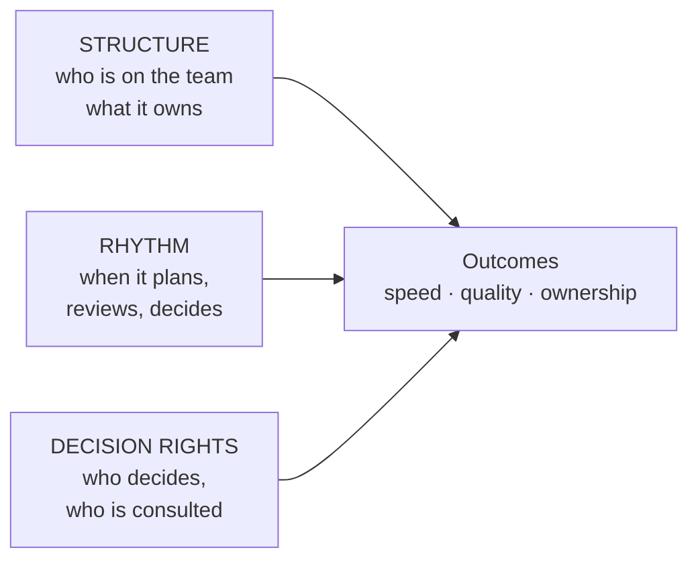

# Teams and collaboration: structures, rhythms and decision rights

*Part of [Business acumen for the product leader](./README.md)*

## TL;DR

Above the individual-contributor level, your job changes. You stop being the person in every meeting. You design the system that lets teams decide well without you. That system has three parts: **structure** (who is on each team), **rhythm** (when teams meet, review and decide) and **decision rights** (who decides what).

The core tradeoff is autonomy against alignment. Autonomous teams move fast and drift apart. Tightly aligned teams stay together and move slowly. Explicit decision rights let you have more of both. Each team knows what it may decide alone, and what needs others.

> 🎯 **For the product leader**
>
> **Why it matters** — In Payments, Lending and Insurance, many decisions cross Product, Risk, Compliance and Operations. Without clear rights, every decision becomes a meeting. Speed drops, and nobody is accountable for the result.
>
> **What it changes in your decisions** — You write down who is accountable for each recurring decision type. You set a review rhythm that surfaces problems early. You stop approving things your teams should own.
>
> **Ask your team** — *"For the last three decisions that took more than two weeks, who was accountable, and did everyone know it at the start?"*
>
> **Risk if ignored** — Decisions by consensus. Launches wait for the last person to agree. When a launch goes wrong, five people approved it and nobody owns it.

## Mental model: three dials



Think of a team system as three dials. Turning one changes what the others must do. A team that owns a whole customer journey (structure) needs fewer cross-team approvals (rights). A team spread across functions needs a tighter rhythm.

**Where the analogy breaks.** Dials suggest you can tune each one alone and see the effect at once. Real changes take a quarter to show results. People also adapt to the system in ways you did not plan.

## Structure: what each team owns

Most product organizations combine three team types.

| Type | Owns | Example in a domain |
| --- | --- | --- |
| **Product team** | A customer outcome or journey, end to end | In a lender, the team that owns the application journey from first visit to decision |
| **Platform team** | A shared capability other teams build on | In a payments company, the ledger or the payment-routing service |
| **Specialist team** | Deep expertise lent to other teams | In an insurer, pricing actuaries working with product teams |

A good structure minimizes **handoffs**: points where work must pass from one team to another. Each handoff adds waiting time and a chance of error.

Amazon has written about its "two-pizza teams" on its AWS blog. The point it makes is less about team size and more about autonomy and a **single-threaded owner**: one leader who focuses only on one goal. The lesson for any company is to give each important outcome one owner whose attention is not split.

## Rhythm: the operating cadence

A rhythm is the set of recurring meetings and documents that keep teams aligned. A good rhythm is short, written and predictable.

| Cadence | Purpose | Input | Output |
| --- | --- | --- | --- |
| Weekly | Unblock and adjust | Team updates, risks | Decisions on blockers |
| Monthly business review | Check metrics against plan | A written pre-read with the key metrics | Actions with owners |
| Quarterly planning | Set goals and trade capacity | Results, strategy, proposals | Goals, staffing, bets |
| Annual planning | Set budget and headcount | Strategy and financial plan | The plan, see [lesson 4](./the-language-of-money.md) |

**Write before you meet.** A written pre-read forces clear thinking and lets people disagree with facts, not impressions. Amazon has described replacing slide decks with six-page narrative memos read at the start of meetings, in its 2017 shareholder letter.

## Decision rights: who decides what

A **decision-rights matrix** lists recurring decisions and gives each person or function one of four roles.

- **Responsible**: does the work to reach the decision.
- **Accountable**: makes the final call and owns the result. Only one per decision.
- **Consulted**: gives input before the decision. Two-way conversation.
- **Informed**: told after the decision. One-way.

The most important rule is **one accountable owner per decision**. Two accountable owners means none.

Decisions also differ in how hard they are to undo. Amazon's 2015 shareholder letter called hard-to-reverse decisions "one-way doors" and reversible ones "two-way doors". Treat them differently:

- **Reversible decisions** (a copy change, a pilot with a small group) belong low in the organization. Decide fast and fix later.
- **Hard-to-reverse decisions** (a pricing model, a credit policy, a partner contract) need wider input and a senior owner.

## Decision rights across the six domains

The hard-to-reverse decisions differ by domain. So does the function that usually holds them.

| Domain | A hard-to-reverse decision | Usually accountable | Product's role |
| --- | --- | --- | --- |
| **Payments** | Fraud rules that block or allow payments | Risk | Consulted on customer impact and false declines |
| **Lending** | The credit cutoff and pricing by risk band | Credit Risk | Consulted on volume and experience |
| **eCommerce** | Seller fees and marketplace policies | Marketplace or category leader | Responsible for the analysis |
| **InsurTech** | Rates and underwriting rules, which may need regulator filings | Pricing or underwriting lead | Consulted on quote flow and conversion |
| **Retail** | The range and the stock budget | Merchandising | Consulted on digital shelf and search |
| **FinTech** | Customer disclosures and new account features | Compliance, often with a partner bank | Responsible for the design |

Knowing this map saves weeks. You stop asking the wrong person for a yes.

## High-trust collaboration

Trust makes collaboration cheap. In a high-trust team, people raise bad news early, admit mistakes and challenge each other without fear. You build it through behaviour, not slogans:

- Respond to bad news with questions, not blame.
- Share your own mistakes first.
- Close the loop on every decision. Say what was decided and why.
- Protect people who raised a risk that came true.

## Communities of practice

A **community of practice** is a group that shares a skill across teams. Examples: all PMs who work on pricing, or all teams that touch fraud models. It meets regularly, shares methods and keeps standards. It does not own a roadmap.

It is useful when a skill is spread thin across many product teams. In a retailer, every team touching promotions needs the same rules for discount stacking. A promotions community keeps those rules consistent.

## Worked example: decision rights for a buy now, pay later launch

*This example is invented, to show the method. The company and the decisions are illustrative.*

An eCommerce company plans to offer a buy now, pay later option at checkout through a lending partner. The first draft plan listed nine people as "approvers." Every decision waited for all nine.

**Step 1: list the recurring decisions.** The team found six.

**Step 2: assign one accountable owner to each.**

| Decision | Product | Risk | Legal and Compliance | Finance | Lending partner |
| --- | --- | --- | --- | --- | --- |
| Which checkout pages show the option | **A** | C | C | I | I |
| Which customers are eligible | C | R | C | I | **A** |
| Customer disclosures and terms | C | C | **A** | I | C |
| Fee paid to the partner per order | R | I | C | **A** | C |
| Launch date and rollout size | **A** | C | C | I | C |
| Pause the option if losses rise | C | **A** | I | I | C |

*A = accountable, R = responsible, C = consulted, I = informed.*

**Step 3: check the hard-to-reverse calls.** Eligibility and disclosures are hard to reverse once customers have loans. Those two owners hold the final call. The page placement is reversible. Product decides alone and tests it.

**Step 4: count the effect.** Before, each of six decisions needed nine approvals: 54 sign-offs. After, each decision has one accountable owner. Six owners make six calls, with consultation built in. The plan is faster, and each outcome has a name on it.

## Tradeoffs and decisions

- **Autonomy vs. consistency.** Autonomous teams choose their own methods. Customers then see inconsistent experiences. Communities of practice reduce this, at the cost of time.
- **Product teams vs. platform teams.** Product teams move fast on journeys. Platform teams keep shared systems sound. Too few platform teams and shared systems decay.
- **Written rhythm vs. live discussion.** Pre-reads improve thinking. They cost writing time, and some leaders resist reading.
- **Wide consultation vs. speed.** More consulted roles reduce surprises and slow decisions. Consult on hard-to-reverse calls. Inform on reversible ones.

## Failure modes

- **Approval sprawl.** Every function wants to be an approver. Nobody is accountable.
- **The two-owner decision.** Product and Risk both think they own the credit cutoff. The cutoff never changes, or it changes twice.
- **Rhythm without decisions.** The monthly review reads metrics aloud and ends with no actions.
- **Platform starvation.** All headcount goes to visible product teams. The ledger or data platform falls behind, and every team slows.
- **Trust broken by blame.** A leader punishes bad news once. Problems now surface late.

## Under the hood

A decision log turns rights into a record. Keep it in a shared file.

```yaml
- id: D-2026-031
  decision: "Pause BNPL for orders above $1,000"
  type: reversible           # reversible | hard-to-reverse
  accountable: Head of Risk
  consulted: [Product, Lending partner]
  informed: [Finance, Support]
  options_considered: [pause, lower limit, keep]
  chosen: pause
  reason: "Early delinquency in the band above $1,000 was above the agreed cap"
  review_on: 2026-12-01
```

Review the log each quarter. Look for decisions with no owner, decisions that were reversed, and hard-to-reverse decisions made too fast.

## Practitioner checklist

- [ ] List the ten most frequent cross-team decisions in your area.
- [ ] Give each one a single accountable owner, and publish the list.
- [ ] Mark each decision as reversible or hard to reverse.
- [ ] Replace one status meeting with a written pre-read and a decision list.
- [ ] Check that each critical outcome has one owner whose focus is not split.
- [ ] Start or join one community of practice for a skill spread across teams.
- [ ] Start a decision log and review it next quarter.

## Related lessons

- [Navigating the organization](./navigating-the-organization.md) — conflict between functions and how to escalate.
- [Leading leaders and org design](./leading-leaders-and-org-design.md) — structure at the scale of a whole product org.
- [Working with engineering](../technical-product-management/working-with-engineering.md) — the product and engineering partnership.
- [Discovery to delivery](../technical-product-management/discovery-to-delivery.md) — how a team moves an idea to production.

## Sources and notes

- The buy now, pay later example, its decisions and its counts are invented and illustrative.
- AWS Executive in Residence blog, *Two-pizza teams are just the start* (part 2): two-pizza teams and single-threaded owners. [AWS blog](https://aws.amazon.com/blogs/enterprise-strategy/two-pizza-teams-are-just-the-start-accountability-and-empowerment-are-key-to-high-performing-agile-organizations-part-2/). As of 2026-10.
- Amazon, 2017 letter to shareholders (six-page narrative memos) and 2015 letter to shareholders ("one-way doors" and "two-way doors"). [Amazon investor relations](https://ir.aboutamazon.com/annual-reports-proxies-and-shareholder-letters/default.aspx). As of 2026-10.
- Note: these hosts could not be opened from the build environment (blocked by the network proxy). The facts were corroborated from search-result excerpts and press coverage of the documents.
