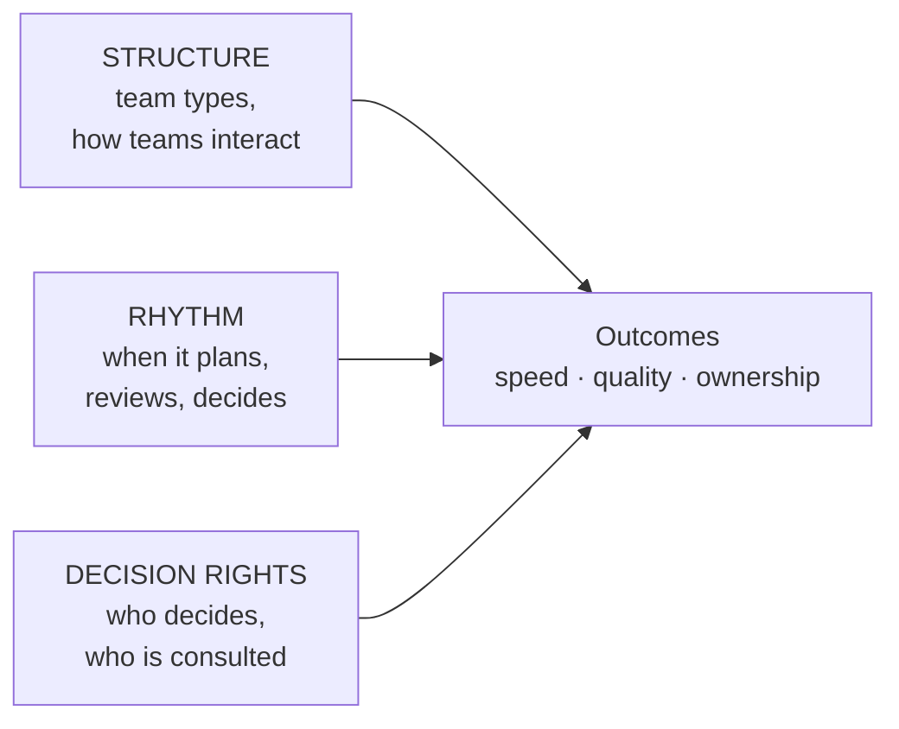
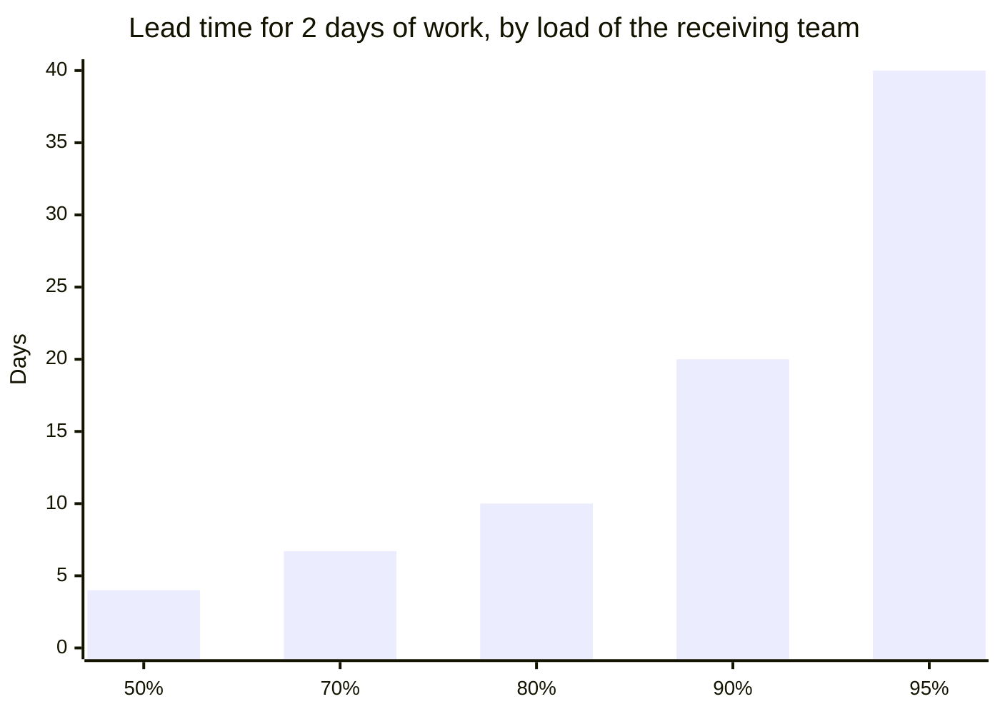

# Teams and collaboration: structures, rhythms and decision rights

*Part of [Business acumen for the product leader](./README.md)*

## TL;DR

Above the individual-contributor level, your job changes. You stop being the person in every meeting. You design the system that lets teams decide well without you. That system has three parts: **structure** (which teams exist and how they work together), **rhythm** (when teams meet, review and decide) and **decision rights** (who decides what).

The core tradeoff is autonomy against alignment. Autonomous teams move fast and drift apart. Tightly aligned teams stay together and move slowly. Clear team types, declared ways of working together and explicit decision rights let you have more of both.

There is also hidden arithmetic. Every handoff to a busy team adds a wait. The wait grows slowly at first, then explodes as that team nears full load. A team at 90% load makes a two-day request wait about eighteen days.

> 🎯 **For the product leader**
>
> **Why it matters** — In Payments, Lending and Insurance, many decisions cross Product, Risk, Compliance and Operations. Many features also need a shared platform, such as the ledger or the fraud model. Without clear structure and rights, every decision becomes a meeting and every feature waits in someone else's queue.
>
> **What it changes in your decisions** — You give each outcome one team. You declare how teams work together. You keep platform teams below about 80% load, and you treat handoffs as a cost. You write down who is accountable for each recurring decision.
>
> **Ask your team** — *"How loaded is each team we depend on, and how many days of our lead time is waiting rather than work?"*
>
> **Risk if ignored** — Six days of work takes twelve weeks. Launches wait for the last person to agree. When a launch goes wrong, five people approved it and nobody owns it.

## Decision rules in this lesson

- **Give every important outcome one journey team and one leader whose attention is not split.**
- **Declare one interaction mode for every pair of teams that work together.** Give every collaboration an end date.
- **Keep platform and specialist teams below about 80% load.** Past that, waits explode.
- **Before you ask for headcount, check load and handoffs.** Less load or one fewer handoff often beats one more person.
- **One accountable owner per decision.** Reversible decisions go low in the org. Hard-to-reverse decisions go high.
- **No business review without a written pre-read and a list of decisions.**

## Mental model: three dials



Think of a team system as three dials. Turning one changes what the others must do. A team that owns a whole customer journey (structure) needs fewer cross-team approvals (rights). A team that depends on many others needs a tighter rhythm.

**Where the analogy breaks.** Dials suggest you can tune each one alone and see the effect at once. Real changes take a quarter to show results. People also adapt to the system in ways you did not plan.

## Structure: four team types

Most product organizations use four types of team. Each has a different job and a different measure of success.

| Type | What it owns | How you know it works | Example in a domain |
| --- | --- | --- | --- |
| **Journey team** | A customer outcome or journey, end to end. Most teams should be this type. | It ships changes to its journey without waiting on others | In a lender, the team that owns the application from first visit to decision |
| **Platform team** | A shared capability that journey teams use through a clear interface | Journey teams adopt it without help. Time to first use is short. | In a payments company, the ledger or the payment-routing service |
| **Specialist team** | A part that needs rare expertise, such as a model or a pricing engine | Other teams use its output without learning the specialism | In an insurer, the pricing actuaries' rating engine. In payments, the fraud model. |
| **Enabling team** | Helps other teams gain a skill, then moves on | The teams it helped no longer need it | A compliance group that teaches journey teams to build disclosures and records correctly |

A good team owns no more than it can hold in its head. Teams of roughly five to nine people are common practice. When one team owns too many systems, it slows on all of them.

**The common misreading.** "A platform team owns all the shared code." A platform is a product with internal customers. If journey teams cannot use it without filing a ticket, it is a queue, not a platform.

Amazon has written about its "two-pizza teams" on its Amazon Web Services (AWS) blog. The point it makes is less about team size and more about autonomy and a **single-threaded leader**: one leader who focuses only on a specific product or outcome. The lesson for any company is to give each important outcome one leader whose attention is not split.

## Structure: three ways teams work together

Teams that depend on each other need a declared way of working together. There are three useful modes.

| Mode | What it looks like | When to use it | Its cost |
| --- | --- | --- | --- |
| **Collaborate** | Two teams work side by side on one problem | Discovery: the interface is not known yet | High. Both teams slow down. Ownership blurs. |
| **Provide a service** | One team uses the other's capability through a documented interface | The interface is known and stable | Low, once the interface exists. Changes to it are slow. |
| **Facilitate** | One team coaches another, then steps back | A skill gap, such as compliance or experiment design | Medium, and temporary |

**Decision rule.** Declare one mode for each pair of teams that work together. Give every collaboration an end date. Collaboration with no end date turns into two teams that own one thing.

**Domain application.** A lender builds a new point-of-sale credit product. For three months, the journey team and the decision-engine specialist team collaborate on the credit model's inputs. After that, the decision engine provides a service: the journey team calls it and gets a decision. A compliance enabling team facilitates for six weeks, so the journey team can produce adverse-action notices itself.

## The cost of a handoff

A **handoff** is any point where work must pass to another team. Each handoff adds waiting time and a chance of error. The waiting time depends on how loaded the other team is.

### How it works

Think of a team as a queue. Requests arrive at random. Each takes some work. The share of the team's time spent working is its **load**, or utilization. A simple, standard queueing result gives the average wait before work starts:

**wait ≈ work × load ÷ (1 − load)**

So the full lead time for one handoff is work + wait, which simplifies to **work ÷ (1 − load)**.

| Load | Wait as a multiple of the work | Lead time for 2 days of work |
| --- | --- | --- |
| 50% | 1 | 4 days |
| 70% | 2.3 | 6.7 days |
| 80% | 4 | 10 days |
| 90% | 9 | 20 days |
| 95% | 19 | 40 days |



The curve is flat at first, then steep. Going from 50% to 80% load multiplies the wait by four. Going from 80% to 95% multiplies it by almost five again.

This formula assumes requests arrive at random and vary in size. Real teams differ. Smaller, more even requests wait less. The shape still holds: waits rise sharply as a team nears full load.

**Decision rule.** Keep platform and specialist teams below about 80% load. That spare capacity is not waste. It is what keeps other teams' lead times short.

**The common misreading.** "A team at 100% utilization is efficient." It is efficient for that team. Everyone who depends on it waits.

### Worked example: a payments feature with three handoffs

*An illustrative example. All inputs are assumed.*

A journey team at a payments company wants to launch split payouts for marketplace sellers. It needs three changes from other teams. Each is about two days of work:

- the ledger platform team, to add a new entry type;
- the fraud model specialist team, to add a feature;
- Compliance, to review the seller disclosures.

All three run at 90% load. Assume the handoffs happen one after another.

**Step 1: lead time today.** Each handoff takes 2 ÷ (1 − 0.9) = 20 working days. Three handoffs take 60 working days, about twelve weeks. The actual work is 6 days. So only 6 ÷ 60 = 10% of the lead time is work.

**Step 2: compare four fixes.**

| Option | What changes | Lead time |
| --- | --- | --- |
| A. Do nothing | Three handoffs at 90% | 60 days |
| B. Add one person to the ledger team | Ledger load drops to 75%: 2 ÷ 0.25 = 8 days | 8 + 20 + 20 = 48 days |
| C. Remove the compliance handoff | An enabling team teaches the journey team a disclosure checklist. Two handoffs remain. | 40 days |
| D. Cap intake on all three at 75% | Each team declines low-value requests | 8 × 3 = 24 days |

**Step 3: choose.** Option D cuts lead time by 60% with no new people. It costs something real: other teams' low-value requests now wait or get declined. The leader combines C and D. Two handoffs at 75% give 16 days.

**What this shows.** Load is the biggest lever. Removing handoffs is the second. Adding a person to one team helps that team, but the other queues still dominate.

## Rhythm: the operating cadence

A rhythm is the set of recurring meetings and documents that keep teams aligned. A good rhythm is short, written and predictable.

| Cadence | Purpose | Input | Output |
| --- | --- | --- | --- |
| Weekly | Unblock and adjust | Team updates, risks | Decisions on blockers |
| Weekly or monthly business review | Check metrics against plan | A written pre-read with the key metrics | Actions with owners |
| Quarterly planning | Set goals and trade capacity | Results, strategy, proposals | Goals, staffing, bets |
| Annual planning | Set budget and headcount | Strategy and financial plan | The plan. See [navigating the organization](./navigating-the-organization.md). |

Goals and their scoring live in [prioritization and roadmaps](../technical-product-management/prioritization-and-roadmaps.md). The metric tree behind a review lives in [metrics and experimentation](../technical-product-management/metrics-and-experimentation.md).

**Write before you meet.** A written pre-read forces clear thinking. It lets people disagree with facts, not impressions. Amazon has described replacing slide decks with six-page narrative memos, read at the start of meetings, in its 2017 shareholder letter.

### The business review

A **business review** compares results with plan, explains the gaps and assigns actions. Most reviews fail in one of two ways. They read numbers aloud, or they debate the numbers' definitions. A fixed template prevents both.

```markdown
# <Area> business review — <period>

## Headline (three lines)
- What went better than plan, and why
- What went worse than plan, and why
- The one decision we need today

## Metrics against plan
| Metric | Owner | Actual | Plan | Last period | Variance explained? |
| Output: net revenue per active merchant | ... | ... | ... | ... | yes / no |
| Input: approval rate at onboarding        | ... | ... | ... | ... | yes / no |

## Variances (only those outside the agreed band)
- What changed, why we think so, what we will do, by when

## Anomalies and risks
- Anything that crossed an early-warning level

## Actions from last review
| Action | Owner | Due | Status |

## Decisions needed
| Decision | Options | Recommendation | Accountable owner |
```

The template separates two kinds of metric. **Output metrics** are results the team cannot move directly, such as revenue. **Input metrics** are things the team can move this week, such as approval rate or time to first payout. Spend most of the review on input metrics. They are where action is possible.

**Pre-read rules that work:**

- The document goes out a set time before the meeting, or the meeting starts with silent reading.
- Every metric has one owner and one fixed definition.
- Comments go in the document before the meeting.
- The meeting starts with questions, not a presentation.
- Only variances outside an agreed band get discussion time.
- The meeting ends with a list of decisions and actions, each with one owner.

**Domain application.** In a lending business review, the output metric is net credit loss for the book. Input metrics include approval rate by risk band, early delinquency on the newest loans and the share of applications sent to manual review. The review spends its time on early delinquency. That is the first place a credit problem shows.

## Decision rights: who decides what

A **decision-rights matrix** lists recurring decisions and gives each person or function one of four roles.

- **Responsible**: does the work to reach the decision.
- **Accountable**: makes the final call and owns the result. Only one per decision.
- **Consulted**: gives input before the decision. Two-way conversation.
- **Informed**: told after the decision. One-way.

The most important rule is **one accountable owner per decision**. Two accountable owners means none.

Decisions also differ in how hard they are to undo. Amazon's 2015 shareholder letter called hard-to-reverse decisions "one-way doors" and reversible ones "two-way doors". Treat them differently:

- **Reversible decisions** (a copy change, a pilot with a small group) belong low in the organization. Decide fast and fix later.
- **Hard-to-reverse decisions** (a pricing model, a credit policy, a partner contract) need wider input and a senior owner.

### Decision rights across the six domains

The hard-to-reverse decisions differ by domain. So does the function that usually holds them.

| Domain | A hard-to-reverse decision | Usually accountable | Product's role |
| --- | --- | --- | --- |
| **Payments** | Fraud rules that block or allow payments | Risk | Consulted on customer impact and false declines |
| **Lending** | The credit cutoff and pricing by risk band | Credit Risk | Consulted on volume and experience |
| **eCommerce** | Seller fees and marketplace policies | Marketplace or category leader | Responsible for the analysis |
| **InsurTech** | Rates and underwriting rules, which may need regulator filings | Pricing or underwriting lead | Consulted on quote flow and conversion |
| **Retail** | The range and the stock budget | Merchandising | Consulted on digital shelf and search |
| **FinTech** | Customer disclosures and new account features | Compliance, often with a partner bank | Responsible for the design |

Knowing this map saves weeks. You stop asking the wrong person for a yes.

## High-trust collaboration and communities of practice

Trust makes collaboration cheap. In a high-trust team, people raise bad news early, admit mistakes and challenge each other without fear. You build it through behaviour, not slogans:

- Respond to bad news with questions, not blame.
- Share your own mistakes first.
- Close the loop on every decision. Say what was decided and why.
- Protect people who raised a risk that came true.

A **community of practice** is a group that shares a skill across teams. Examples: all PMs who work on pricing, or all teams that touch fraud models. It meets regularly, shares methods and keeps standards. It does not own a roadmap. In a retailer, every team touching promotions needs the same rules for discount stacking. A promotions community keeps those rules consistent.

## Worked example: decision rights for a buy now, pay later launch

*This example is invented, to show the method. The company and the decisions are illustrative.*

An eCommerce company plans to offer a buy now, pay later (BNPL) option at checkout through a lending partner. The first draft plan listed nine people as "approvers." Every decision waited for all nine.

**Step 1: list the recurring decisions.** The team found six.

**Step 2: assign one accountable owner to each.**

| Decision | Product | Risk | Legal and Compliance | Finance | Lending partner |
| --- | --- | --- | --- | --- | --- |
| Which checkout pages show the option | **A** | C | C | I | I |
| Which customers are eligible | C | R | C | I | **A** |
| Customer disclosures and terms | C | C | **A** | I | C |
| Fee paid to the partner per order | R | I | C | **A** | C |
| Launch date and rollout size | **A** | C | C | I | C |
| Pause the option if losses rise | C | **A** | I | I | C |

*A = accountable, R = responsible, C = consulted, I = informed.*

**Step 3: check the hard-to-reverse calls.** Eligibility and disclosures are hard to reverse once customers have loans. Those two owners hold the final call. The page placement is reversible. Product decides alone and tests it.

**Step 4: declare the interaction modes.** Product and the lending partner collaborate for the first eight weeks, until the integration is stable. After that, the partner provides a service through its interface. Legal and Compliance facilitate: they give the team a disclosure checklist, then review only changes to terms.

**Step 5: count the effect.** Before, each of six decisions needed nine approvals: 54 sign-offs. After, each decision has one accountable owner. Six owners make six calls, with consultation built in. The plan is faster, and each outcome has a name on it.

## Tradeoffs and decisions

- **Autonomy vs. consistency.** Autonomous teams choose their own methods. Customers then see inconsistent experiences. Communities of practice reduce this, at the cost of time.
- **Journey teams vs. platform teams.** Journey teams move fast on outcomes. Platform teams keep shared systems sound. Too few platform teams and shared systems decay. Too many and every feature needs a handoff.
- **Spare capacity vs. utilization.** Keeping platform teams at 75% load costs a quarter of their time in reserve. It buys much shorter waits for every team that depends on them.
- **Collaboration vs. service.** Collaboration finds the right interface. It is slow and blurs ownership. Service is fast, once the interface exists.
- **Written rhythm vs. live discussion.** Pre-reads improve thinking. They cost writing time, and some leaders resist reading.
- **Wide consultation vs. speed.** More consulted roles reduce surprises and slow decisions. Consult on hard-to-reverse calls. Inform on reversible ones.

## Failure modes

- **The platform queue.** A platform team runs at 95% load and takes requests by ticket. Every journey team waits weeks, and starts building workarounds.
- **The endless collaboration.** Two teams "collaborate" for a year. Neither owns the result, and both slow down.
- **Approval sprawl.** Every function wants to be an approver. Nobody is accountable.
- **The two-owner decision.** Product and Risk both think they own the credit cutoff. The cutoff never changes, or it changes twice.
- **Rhythm without decisions.** The business review reads metrics aloud and ends with no actions.
- **Platform starvation.** All headcount goes to visible journey teams. The ledger or data platform falls behind, and every team slows.
- **Trust broken by blame.** A leader punishes bad news once. Problems now surface late.

## Under the hood

The script reproduces the queue table and the split-payouts example. The formula is the simplest standard queue model: random arrivals, random work sizes, one server.

```python
def lead_time(work_days, load):
    """Work plus average wait: work / (1 - load)."""
    return work_days / (1 - load)

for load in (0.5, 0.7, 0.8, 0.9, 0.95):
    wait_multiple = load / (1 - load)
    print(f"load {load:.0%}: wait x{wait_multiple:.1f}, 2 days of work -> {lead_time(2, load):.1f} days")

work = 2
options = {
    "A. do nothing":            [0.9, 0.9, 0.9],
    "B. +1 person on ledger":   [0.75, 0.9, 0.9],
    "C. remove compliance":     [0.9, 0.9],
    "D. cap intake at 75%":     [0.75, 0.75, 0.75],
    "C + D":                    [0.75, 0.75],
}
for name, loads in options.items():
    total = sum(lead_time(work, u) for u in loads)
    print(f"{name}: {total:.0f} days, work share {work * len(loads) / total:.0%}")

# Adding one person to a 5-person team at 90% load: same work, more people
print(f"new ledger load: {5 * 0.9 / 6:.0%}")   # 75%
```

A decision log turns rights into a record. Keep it in a shared file.

```yaml
- id: D-2026-031
  decision: "Pause BNPL for orders above $1,000"
  type: reversible           # reversible | hard-to-reverse
  accountable: Head of Risk
  consulted: [Product, Lending partner]
  informed: [Finance, Support]
  options_considered: [pause, lower limit, keep]
  chosen: pause
  reason: "Early delinquency in the band above $1,000 was above the agreed cap"
  review_on: 2026-12-01
```

Review the log each quarter. Look for decisions with no owner, decisions that were reversed, and hard-to-reverse decisions made too fast.

## Practitioner checklist

- [ ] Label every team in your area as journey, platform, specialist or enabling.
- [ ] For each pair of teams that work together, write the declared mode. Put an end date on each collaboration.
- [ ] Ask each platform and specialist team you depend on for its load. Flag any above 80%.
- [ ] For your next feature, count the handoffs and estimate the share of lead time that is waiting.
- [ ] Give each of your ten most frequent cross-team decisions a single accountable owner, and publish the list.
- [ ] Mark each decision as reversible or hard to reverse.
- [ ] Move your business review to the template above. Mark each metric as input or output.
- [ ] Start a decision log and review it next quarter.

## Related lessons

- [Navigating the organization](./navigating-the-organization.md) — the planning cycle, risk decisions and conflict between functions.
- [Leading leaders and org design](./leading-leaders-and-org-design.md) — structure at the scale of a whole product org.
- [Prioritization and roadmaps](../technical-product-management/prioritization-and-roadmaps.md) — goals, scoring and the roadmap behind quarterly planning.
- [Metrics and experimentation](../technical-product-management/metrics-and-experimentation.md) — the metric tree and guardrails behind a business review.
- [Working with engineering](../technical-product-management/working-with-engineering.md) — the product and engineering partnership.
- [How systems are built](../technical-product-sense/how-systems-are-built.md) — the platforms and services that team boundaries create.
