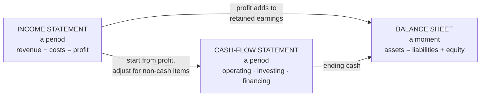
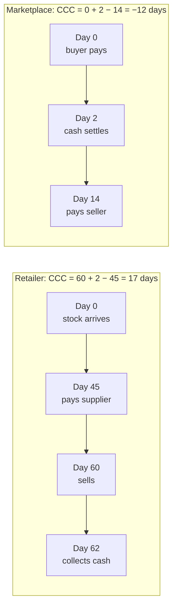

# The language of money: reading the three statements

*Part of [Business acumen for the product leader](./README.md)*

## TL;DR

Finance speaks through three statements. The **income statement** shows performance over a period: revenue, costs and profit. The **balance sheet** shows position at one moment: what the company owns, owes and keeps for its owners. The **cash-flow statement** shows how cash moved. A product decision touches all three, often in different ways and at different times.

The core tradeoff is between profit and cash. A product can raise profit and drain cash. Longer payment terms, a growing loan book and a wider product range all do this. A product can also bring in cash before it earns a cent of revenue. Annual prepaid plans, insurance premiums and marketplace payouts all do that.

This lesson teaches you to read the statements as a product leader. You will learn which line each product decision lands on. You will learn how revenue is recognized, and why the same sale can be $100 of revenue or $15. You will learn working capital, float and the bridge from EBITDA to free cash flow. The scale of the stakes is large. A payment-terms change at a mid-sized distributor can tie up more cash than the whole product budget.

> 🎯 **For the product leader**
>
> **Why it matters** — Every serious bet is approved in the CFO's language. "Users love it" does not survive a budget review. "This adds $2 million of gross profit a year, ties up $4 million of working capital, and turns cash-positive in month 14" does.
>
> **What it changes in your decisions** — You know which line of which statement your product moves. You price features that hold or release cash, such as payment terms, payout speed and stock depth. You compare competitors on gross profit, not revenue. You stop calling a promotion a marketing cost.
>
> **Ask your team** — *"If we ship this, how much cash does it tie up at year end, and who funds that cash?"*
>
> **Risk if ignored** — A feature that looks profitable on the income statement and drains the bank account. Or a growth plan that reports "revenue" Finance will restate as a fraction of the number. Finance finds the hole, and your credibility goes with it.

## Decision rules in this lesson

- Compare companies and products on gross profit, not revenue.
- Before you ship a feature that changes when money moves, ask how much cash it ties up and who funds it.
- Treat a discount, a promo code or a cash-back offer as lower revenue, not as marketing spend.
- When a lender grows fast, expect reported profit to fall first. Judge the book on lifetime contribution per loan.
- Price instant payouts and faster settlement against the float you give up.
- Never accept "EBITDA-positive" as proof a business funds itself. Ask for free cash flow.
- When you are not sure where a cost lands, ask Finance before you build the case.

## Mental model: one story, three views



The three statements tell one story from three angles. Profit from the income statement flows into equity on the balance sheet. The cash-flow statement starts from that profit. It then adjusts for everything that was not cash. Its ending cash is the cash line on the balance sheet. So a change to one statement always shows up in another.

**What the diagram hides.** Companies use **accrual accounting**. Revenue is recorded when it is earned. Costs are recorded when they are incurred. Neither waits for cash to move. That one rule is why profit and cash can differ so much. Most of this lesson is about the gap between them.

## Mechanics

### The income statement, line by line

The income statement runs from the top line (revenue) to the bottom line (net income). Each line subtracts one kind of cost.

| Line | What it means | A product decision that lands here |
| --- | --- | --- |
| Gross revenue | The value of what the company sold, at list terms | A new paid tier |
| Contra-revenue | Discounts, refunds, rebates and incentives paid to customers | A promo code, a cash-back offer, a returns policy |
| **Net revenue** | Gross revenue minus contra-revenue | |
| Cost of revenue | The direct cost of delivering what was sold | A data vendor charged per check, free delivery, support for paying customers |
| **Gross profit** | Net revenue minus cost of revenue | |
| Research and development (R&D) | Building and improving products | Your engineering team, unless its work is capitalized |
| Sales and marketing (S&M) | Winning and keeping customers | Paid ads, sales salaries, partner commissions |
| General and administrative (G&A) | Running the company | Legal, finance, compliance staff |
| **Operating income** | Gross profit minus operating expenses | |
| Interest, tax and other | Financing costs, tax, one-off items | Borrowing to fund receivables or loans |
| **Net income** | What is left for the owners | |

**Gross margin** is gross profit as a share of net revenue. It tells you how much each sale contributes before overheads. **Operating margin** is operating income as a share of net revenue. It tells you whether the business as a whole earns money from its operations.

**Contra-revenue** is any amount that reduces revenue directly instead of appearing as a cost. Under the main accounting standards, most payments a company makes to its own customers count as a price cut. So a 20%-off code lowers revenue. A $10 sign-up bonus paid into a customer's wallet lowers revenue. A paid search ad does not, because the money goes to a third party. Expected refunds and returns also reduce revenue when the sale is made. The company books a reserve for them at that time.

**Cost of revenue** looks different in each domain. The table shows the typical parts. Each company draws its own lines, so check your company's policy.

| Domain | What usually sits in cost of revenue |
| --- | --- |
| Payments | Interchange and card-network fees (if revenue is reported gross), processing, transaction and fraud losses, hosting |
| Lending | Funding costs and credit losses (some lenders show these lower down), servicing, payment processing |
| Insurance | Insurers do not use "cost of revenue". They report losses and loss-adjustment expense (LAE), the cost of handling claims, then acquisition and other expenses |
| eCommerce | The cost of goods, inbound and outbound shipping, payment processing, often fulfilment |
| Retail | The cost of goods sold, freight, shrink (stock lost to theft and damage), markdowns |
| Neobank | Card processing, customer support, identity checks, hosting |

**Operating expenses** split three ways: R&D, S&M and G&A. Their split matters to investors. A high S&M share says growth is bought. A high G&A share says overhead is heavy.

**How a product decision lands.** The same idea can land on three different lines. Take a "free delivery over $50" offer.

- The courier cost lands in cost of revenue. Gross margin falls.
- If you fund it by raising prices on small baskets, net revenue changes too.
- The banner that advertises it is the only part that lands in S&M.

**Decision rule.** When you model a feature, put each cost on its real line. Then show the effect on gross margin, not only on operating income.

**The common misreading.** "Free delivery is a marketing cost." It is not, even if Marketing proposed it. It is a cost of delivering the order, so it lowers gross margin. The same is true of a promo code. It is a price cut, so it lowers net revenue. A team that books these as marketing will overstate gross margin. Finance will correct it in the review.

### Revenue recognition: when and how much

**Revenue recognition** is the set of rules that decides when revenue is booked and how much. US generally accepted accounting principles (GAAP) and International Financial Reporting Standards (IFRS) use the same core model. In US GAAP it is Accounting Standards Codification (ASC) Topic 606. In IFRS it is IFRS 15. Both use five steps.

1. **Identify the contract** with the customer.
2. **Identify the performance obligations.** These are the distinct promises in the contract, such as a device, a year of service and an installation.
3. **Set the transaction price.** This is what the company expects to receive. It includes variable parts, such as expected refunds, rebates and usage fees.
4. **Allocate the price** to each obligation, in proportion to what each would sell for alone.
5. **Recognize revenue** when (or as) each obligation is satisfied. A good is usually recognized at handover. A service is usually recognized over time.

Most product leaders meet these rules in four places: gross versus net, deferred revenue, contra-revenue and take rate.

#### Gross versus net: principal or agent

When a company sells something a third party provides, it must decide whether it is the **principal** or the **agent**. A principal reports the full sale as revenue and the supplier's share as cost. An agent reports only its fee as revenue.

The test is **control**. Does the company control the good or service before the customer gets it? The standards give indicators.

- **Primary responsibility.** Who is responsible for delivering it and for its quality?
- **Inventory risk.** Who owns the good before the sale, or bears the cost of returns?
- **Pricing discretion.** Who sets the price the customer pays?

A retailer that buys stock and sets prices is a principal. A marketplace that connects buyers and sellers, and takes a commission, is usually an agent.

**How to compute it.** Take a $100 item sold through a platform. The platform keeps $15. The seller gets $85.

| | Reported as principal (gross) | Reported as agent (net) |
| --- | --- | --- |
| Revenue | $100 | $15 |
| Cost of revenue | $85 | $0 |
| Gross profit | $15 | $15 |
| Gross margin | 15% | 100% |

Gross profit is the same $15 either way. Revenue differs nearly sevenfold. Gross margin moves from 15% to 100%. Nothing about the business changed. Only the reporting changed.

**Domain application.** A payments processor faces the same choice for interchange. Interchange is the fee the merchant's side pays to the card issuer on each card payment. Some processors report the full merchant fee as revenue and interchange as cost. Others report revenue net of interchange. Two processors with the same economics can show very different revenue and margins.

**Decision rule.** Compare competitors on gross profit, not revenue. Compare products inside your company the same way. If you must use revenue, convert both sides to the same basis first.

**The common misreading.** "Their margin is 70% and ours is 20%, so they are more efficient." Check the basis first. One may report net and the other gross.

#### Deferred revenue

**Deferred revenue** (also called unearned revenue) is cash received for something not yet delivered. It sits on the balance sheet as a liability. The company owes the customer the service, or the money back.

**How it works.** A customer pays a $1,200 annual insurance premium on 1 January. The insurer earns it evenly over the year, as it carries the risk.

| Date | Cash received to date | Revenue earned to date | Liability (unearned premium) |
| --- | --- | --- | --- |
| 1 January | $1,200 | $0 | $1,200 |
| 31 March (end of Q1) | $1,200 | $300 | $900 |
| 30 June | $1,200 | $600 | $600 |
| 31 December | $1,200 | $1,200 | $0 |

At the end of the first quarter, the insurer has all the cash and has earned only a quarter of it. The same pattern holds for an annual software plan paid up front.

**Decision rule.** When you change billing from monthly to annual, expect cash to jump and revenue to stay the same. Do not let the cash jump be reported as growth.

**The common misreading.** "Bookings went up, so revenue went up." A booking is a signed commitment. Revenue arrives only as the service is delivered.

#### Contra-revenue in practice

Contra-revenue is where many product incentives end up.

- **Incentives to customers.** Promo codes, cash back, sign-up bonuses and referral credits paid to the customer usually reduce revenue. An incentive can count as an expense instead when the company gets a distinct good or service back for it.
- **Refunds and returns.** A merchant books a reserve for expected returns when it makes the sale. Revenue is shown net of that reserve.
- **Chargebacks.** A chargeback is a forced refund. The cardholder disputes a payment through the card issuer. For a merchant, it reverses a sale, much like a refund. For a payments processor, it is different. A processor that must cover a chargeback its merchant cannot pay usually books that as a loss, a cost.

**How to compute it.** A neobank pays a $20 bonus to each new customer. It signs 100,000 customers this quarter. It earns $3 million of interchange from them in the quarter. Its reported revenue from these customers is $3 million minus $2 million = $1 million, not $3 million. (Illustrative; all inputs assumed.)

**Decision rule.** Model every incentive as a price cut first. Then ask whether the extra volume pays for it.

#### Take rate

**Take rate** is the share of volume a platform keeps as revenue. Volume is gross merchandise value (GMV) for a marketplace. It is total payment volume (TPV) for a payments company.

- **Gross take rate** = gross revenue ÷ volume.
- **Net take rate** = (revenue minus pass-through costs) ÷ volume.

**How to compute it.** A marketplace processes $1 billion of GMV. It earns $120 million of commissions and fees. Its take rate is 12%. A payments company processes $10 billion of TPV. It bills merchants $290 million, a gross take rate of 2.9%. It passes $180 million to issuers and networks. Its net take rate is $110 million ÷ $10 billion = 1.1%. (Illustrative; all inputs assumed.)

**Decision rule.** Report and target net take rate. Gross take rate rises when you pass on a fee increase. That rise is not value you created.

The full per-transaction waterfall, from gross fee to contribution, lives in [unit economics](./unit-economics.md).

### What counts as revenue: the domain traps

Each domain has its own trap.

- **eCommerce marketplaces.** GMV is the value of goods sold through the platform. It is not revenue. Shopify's 10-K defines GMV and states that GMV does not represent revenue earned by Shopify. Shopify's revenue comes from subscriptions and from merchant services such as payment processing.
- **Payments.** A processor collects a fee on each payment. Much of that fee passes to card issuers and networks. Accounting rules decide whether the company reports the full fee as revenue (and the pass-through as cost) or only its net share. Ask which one your company does before you compare margins with a competitor.
- **Fintech with trading products.** Block reports bitcoin sales to Cash App customers as revenue, with the cost of the bitcoin as a cost. That makes revenue large and the margin on it thin. So **gross profit** is the more useful number to watch. Block's 10-K for 2025 reports gross profit of $10.4 billion, of which Cash App was $6.3 billion and Square $3.9 billion.
- **Lending.** A lender earns interest over the life of a loan. It must also book an allowance for expected losses. Affirm reports **revenue less transaction costs**: total revenue minus loss on loan purchase commitments, provision for credit losses, funding costs, and processing and servicing costs. It is a measure of what each transaction is worth after its direct costs.
- **Insurance.** A customer pays a year's premium up front. The insurer earns it month by month. The unearned part sits on the balance sheet as a liability.
- **Retail.** Revenue is product sales. The trap is inventory. A product bought but not sold is on the balance sheet, not in cost of goods sold. Profit can look fine while cash is stuck in stock.

### The balance sheet

**Assets = liabilities + equity.** Assets are what the company owns or is owed. Liabilities are what it owes. Equity is what is left for the owners. The equation always balances, because every transaction touches two lines.

| Domain | A product-driven asset | A product-driven liability |
| --- | --- | --- |
| Lending | Loans to customers | Funding borrowed to make those loans |
| Payments | Money due from card networks | Money owed to merchants |
| InsurTech | Investments bought with premium | Claims reserves and unearned premium |
| Retail | Inventory | Money owed to suppliers |
| eCommerce | Cash from buyers | Money owed to sellers |

A lender that grows its loan book grows its assets. It must fund them with debt, deposits or equity. Upstart's 10-K for 2022 shows this tension. When institutional investors bought fewer loans, Upstart used its own balance sheet to fund some of them. How lenders fund themselves is covered in [business cases, capital and valuation](./business-cases-and-valuation.md#funding-and-capital-in-regulated-businesses).

#### The allowance for credit losses

A lender does not carry its loans at face value. It subtracts an **allowance for credit losses**: its estimate of the loans it will not collect. The allowance is a negative asset. When it grows, the cost flows through the income statement as a **provision for credit losses**.

**How it works under US GAAP.** US rules use the **current expected credit loss** model (CECL). A lender books the expected loss for the whole life of a loan on the day it makes the loan. Large public companies adopted CECL in 2020. Most other US companies followed by 2023.

**How it works under IFRS.** IFRS 9 uses stages. For a loan that is performing normally, the lender books 12 months of expected loss. If credit risk rises a lot, it books lifetime expected loss.

**How to compute it.** Expected loss per loan is the probability of default (PD) × loss given default (LGD) × exposure at default (EAD). [Unit economics](./unit-economics.md) works through a full per-loan example. Here we take its number: a $10,000, 36-month loan with PD 8%, LGD 85% and EAD $6,000. Expected loss is 0.08 × 0.85 × $6,000 = $408.

A lender makes 10,000 of these loans in the last month of a quarter. (Illustrative; all inputs assumed.)

- **Day-one provision under CECL:** 10,000 × $408 = **$4.08 million**, booked at once.
- **Interest earned in that quarter:** about one month at 1.5% a month on $10,000 = $150 per loan, or **$1.5 million**.
- **Effect on the quarter:** a loss of about $2.58 million from these loans before any other cost.

Yet the same loans earn about $3,015 of interest each over three years. They make money over their life. The accounting front-loads the cost and spreads the income.

**Domain application.** A lending product that doubles originations will often report lower profit that quarter. A buy now, pay later (BNPL) product shows the same effect on a shorter cycle.

**Decision rule.** When a lender grows fast, expect reported profit to fall first. Judge the book on lifetime contribution per loan and on cohort loss curves. Do not slow a good book because the quarter looks bad.

**The common misreading.** "Our credit got worse, the provision doubled." Check volume first. A bigger provision can simply mean more new loans.

### The cash-flow statement

Cash flow has three parts.

- **Operating**: cash from running the business. It starts from net income. It adds back non-cash costs, such as depreciation and the provision for credit losses. It subtracts increases in working capital.
- **Investing**: cash spent on long-term assets, such as equipment, acquisitions or capitalized software. For a lender, new loans held on the balance sheet also usually appear here.
- **Financing**: cash raised or repaid through debt and equity.

A growing retailer often has strong profit and weak operating cash, because cash goes into inventory before peak season. A fast-growing subscription business can be the opposite. Customers pay a year up front, so cash arrives before revenue is earned.

### Working capital and the cash conversion cycle

**Working capital** is the money tied up in running the business day to day. In practice it is current assets minus current liabilities. The parts a product leader moves are three.

- **Receivables**: money customers owe you.
- **Inventory**: goods you bought and have not sold.
- **Payables**: money you owe suppliers.

Receivables and inventory use cash. Payables provide cash, because you hold the supplier's money until you pay.

**How it works.** The **cash conversion cycle** (CCC) measures how many days your cash is tied up. It runs from the day you pay a supplier to the day a customer pays you.

**CCC = DIO + DSO − DPO**

- **Days inventory outstanding** (DIO) = inventory ÷ cost of goods sold × 365. It is how long stock sits before it sells.
- **Days sales outstanding** (DSO) = receivables ÷ revenue × 365. It is how long customers take to pay.
- **Days payables outstanding** (DPO) = payables ÷ cost of goods sold × 365. It is how long you take to pay suppliers.

**How to compute it.** Two illustrative businesses, with all inputs assumed:

- **A retailer.** Stock sits 60 days. Card payments settle in 2 days. It pays suppliers in 45 days. CCC = 60 + 2 − 45 = **17 days**.
- **A marketplace.** It holds no stock. Buyers' card payments settle in 2 days. It pays sellers 14 days after the sale. CCC = 0 + 2 − 14 = **−12 days**.



The retailer funds 17 days of its own cost of goods. The marketplace holds 12 days of other people's money. That is why marketplaces can grow with little capital. And it is why retailers watch stock like a hawk.

**Turning days into dollars.** Cash tied up ≈ CCC × daily cost of goods sold. Suppose the retailer's cost of goods is $730 million a year, or $2 million a day. Its 17-day cycle ties up about **$34 million**. Cut stock by 10 days and it frees about **$20 million** of cash, once. (Illustrative; all inputs assumed.)

**How product decisions move each term.**

| Decision | Term it moves | Direction |
| --- | --- | --- |
| Offer B2B buyers net-60 payment terms | DSO | Up: cash in later |
| Add a pay-by-invoice option at checkout | DSO | Up |
| Pay marketplace sellers daily instead of weekly | DPO (payout lag) | Down: cash out sooner |
| Add 2,000 slow-selling items to the range | DIO | Up |
| Move suppliers to consignment stock | DIO | Down |
| Negotiate 60-day supplier terms | DPO | Up: cash out later |
| Accept a payment method that settles in 5 days, not 2 | DSO | Up |

**Domain application.** In payments, the "inventory" is zero and the cycle is all about settlement timing. Money comes from the card networks a day or two after the purchase. It goes to merchants on the payout schedule. In lending, the loan book is the working capital. In retail, inventory dominates.

**Decision rule.** When a feature changes when money moves, convert the change into days, then into dollars. Put the dollars in the business case as an investment, with a funding cost.

**The common misreading.** "Working capital is Finance's problem." Product decisions set most of these terms. Payment terms, payout schedules, range breadth and supplier deals are product choices.

### Float: earning on other people's money

**Float** is money a company holds that belongs to someone else, for a while. Payments companies hold merchants' money between settlement and payout. Marketplaces hold sellers' money. Wallets hold customers' balances. Insurers hold premiums until they pay claims.

**How it works.** Float ≈ daily flow × the lag in days. The company can earn interest on it, within the limits of its licences and its customer terms. Many regulated money transmitters must keep customer funds in safe, liquid assets. So the yield is close to short-term interest rates.

**How to compute it.** A marketplace processes $1 billion of GMV a year. It pays sellers 12 days after each sale. (Illustrative; all inputs assumed.)

- Daily flow = $1 billion ÷ 365 = $2.74 million.
- Float = $2.74 million × 12 = **$32.9 million**.
- At a 4% yield, float earns about **$1.3 million a year**.

That income depends on interest rates. US short-term rates were near zero in 2020 and 2021. They were above 5% from mid-2023 into late 2024. The same float earned almost nothing in one period and a lot in the other.

**Insurance float.** An insurer collects premium first and pays claims later, sometimes years later. It invests the money in between. For lines where claims settle slowly, such as liability insurance, the float is large. Investment income can turn an underwriting loss into an overall profit. [Unit economics](./unit-economics.md) shows this on one policy.

**Decision rule.** Price instant payouts and faster settlement against the float you give up. Paying $100 out 12 days early costs $100 × 4% × 12 ÷ 365 = **$0.13** of lost float. A 1% instant-payout fee ($1.00) covers that about 7.6 times. The rest must cover the extra fraud and credit risk of paying before funds settle.

**The common misreading.** "Float is free money." It is income you lose the moment you speed up payouts or rates fall. Treat it as a revenue line with interest-rate risk, not as a permanent margin.

### From profit to cash: the EBITDA → free cash flow bridge

Many companies report earnings before interest, taxes, depreciation and amortization (EBITDA). It is popular because it removes financing and accounting choices. It is also the metric most often misused.

**How it works.** Each step adds back or takes away one item.

1. **Net income** is the bottom line.
2. **Add interest and taxes** to get operating profit before financing.
3. **Add depreciation and amortization** to get **EBITDA**. These are non-cash charges that spread the cost of past investments.
4. **Add stock-based compensation** to get **adjusted EBITDA**. Stock pay is not cash. It is a real cost to shareholders, because it dilutes them.
5. Go back to cash. **Operating cash flow** = net income + non-cash costs − the increase in working capital.
6. **Free cash flow** (FCF) = operating cash flow − capital expenditure − capitalized software.

**How to compute it.** An illustrative company, in $ million, with all inputs assumed. First, climb from net income to adjusted EBITDA.

| Step | Item | Amount | Running total |
| --- | --- | --- | --- |
| | Net income | | 5 |
| + | Interest expense | 3 | 8 |
| + | Tax expense | 2 | 10 |
| + | Depreciation and amortization | 8 | 18 = EBITDA |
| + | Stock-based compensation | 7 | **25 = adjusted EBITDA** |

Then walk down from adjusted EBITDA to free cash flow. Assume interest and tax were paid in cash during the year.

| Step | Item | Amount | Running total |
| --- | --- | --- | --- |
| | Adjusted EBITDA | | 25 |
| − | Interest paid | 3 | 22 |
| − | Tax paid | 2 | 20 |
| − | Increase in working capital | 4 | 16 = operating cash flow |
| − | Capital expenditure | 3 | 13 |
| − | Capitalized software development | 6 | **7 = free cash flow** |

Check the operating cash flow another way. Net income 5 + depreciation and amortization 8 + stock-based compensation 7 − working capital 4 = 16. Stock pay stays added back, because no cash left the company. Adjusted EBITDA is $25 million. Free cash flow is $7 million. The company also issued $7 million of stock to staff, which shareholders pay for through dilution.

**Capitalized software.** Some software development cost can be put on the balance sheet as an asset, instead of being expensed. It is then amortized over a few years. Amortization sits below EBITDA. So the more a company capitalizes, the higher its EBITDA, with no change in cash. The US GAAP rules on which development costs may be capitalized changed recently. Ask Finance which rules your company applies, and what share of your team's cost it capitalizes.

**Domain application.** For a lender, EBITDA hides the funding cost, which is the main cost of the business. Lenders are judged on net interest margin, credit losses and return on equity instead. For a retailer, working capital and store capex dominate the bridge.

**Decision rule.** Never accept "EBITDA-positive" as proof that a business funds itself. Ask for free cash flow, and for stock-based compensation as a share of revenue.

**The common misreading.** "We are EBITDA-positive, so we are self-funding." Interest, tax, working capital, capex and capitalized software all sit between adjusted EBITDA and cash. In the example they consume $18 million of $25 million. Stock pay is a further cost, paid through dilution.

### Where the rest of this topic lives

This lesson covers reading the statements. Turning them into decisions is spread across three lessons. [Unit economics](./unit-economics.md) covers cost structure, contribution margin and break-even. [Business cases, capital and valuation](./business-cases-and-valuation.md) covers present value, NPV and how a bet is funded. [Pricing and business models](./monetization-and-business-models.md) covers pricing.

## Worked example: offering net-60 payment terms

*This example is invented, to show the method. The company is illustrative and every input is assumed.*

A B2B eCommerce distributor sells office supplies. Today, every buyer pays by card at checkout. Sales are $120 million a year at a 30% gross margin. The sales team wants to offer **net-60 terms**: approved business buyers pay 60 days after delivery. They expect sales to rise 10%, to $132 million. They expect 60% of all sales to move to terms.

The product leader must answer three questions. Does it make money? How much cash does it need? Who funds that cash?

**Step 1: extra gross profit.** Extra sales are $12 million. At 30% gross margin, that is **$3.6 million** of extra gross profit.

**Step 2: sales on terms.** 60% × $132 million = **$79.2 million** a year.

**Step 3: receivables.** At any moment, buyers owe about 60 days of terms sales. Receivables = $79.2 million × 60 ÷ 365 = **$13.02 million**. The company's DSO rises from about 2 days to about 36 days.

**Step 4: bad debt.** Some buyers will not pay. Assume 1% of terms sales: **$0.79 million** a year.

**Step 5: funding cost.** The company borrows against its receivables at 8% a year. To keep it simple, charge a full year of interest on the year-end balance: $13.02 million × 8% = **$1.04 million**.

**Step 6: profit.** $3.6 million − $0.79 million − $1.04 million = **+$1.77 million** a year, before tax.

**Step 7: cash in year 1.** Operating cash = profit − the rise in receivables = $1.77 million − $13.02 million = **−$11.25 million**. The company needs a credit line of about $13 million.

**Step 8: the three statements, side by side (change from today, year 1).**

| Statement | Line | Change |
| --- | --- | --- |
| Income statement | Gross profit | +$3.60M |
| | Bad debt | −$0.79M |
| | Interest | −$1.04M |
| | Profit before tax | **+$1.77M** |
| Cash-flow statement | Operating cash | **−$11.25M** |
| | Financing (credit line drawn) | +$13.02M |
| | Net change in cash | +$1.77M |
| Balance sheet | Receivables (asset) | +$13.02M |
| | Cash (asset) | +$1.77M |
| | Debt (liability) | +$13.02M |
| | Retained earnings (equity) | +$1.77M |

The balance sheet balances: assets rise $14.79 million, and liabilities plus equity rise $14.79 million.

**Step 9: test the key assumption.** Without the 10% sales lift, the terms cost $1.83 million a year and earn nothing. The lift needed just to break even is about $6.1 million of extra sales, or about 5%. This is approximate, because it holds the cost of terms at the $132 million level. So the whole case rests on the sales lift being real.

**What the leader does with this.** Year 2 looks good. If sales hold at $132 million, receivables stay flat and operating cash is +$1.77 million. The return on the receivables before funding cost is about 21.6%. That beats an 8% borrowing rate.

But the 10% lift is the sales team's guess. She proposes a test: offer terms to a random half of eligible buyers for one quarter. She also proposes two product controls. One is a credit check that sets a limit per buyer. The other is automatic dunning on day 61. She shows Treasury the $13 million funding need before launch, not after. And she asks Finance whether a third-party B2B terms provider could carry the receivables for a fee. That would turn a balance-sheet decision into a cost-per-transaction decision. [Business cases, capital and valuation](./business-cases-and-valuation.md) shows how to compare those two options.

## Tradeoffs and decisions

- **Profit vs. cash.** Payment terms, a loan book or a deeper range raise future profit and use cash now. The cost is funding, and the risk is running short. Choose terms when the return on the tied-up cash beats your cost of funds, and when you can fund the peak.
- **Growth vs. reported profit in lending.** Under CECL, fast growth depresses this quarter's profit. Slowing growth flatters it. The cost of managing to the quarter is giving up good loans.
- **Payout speed vs. float.** Faster payouts win sellers and merchants. You give up float income and take more risk. Charge for speed, or fund it from a clear retention gain.
- **Gross vs. net revenue.** Reporting gross revenue looks bigger. It makes margins look thinner and harder to compare. You rarely get to choose. The control test decides.
- **Annual vs. monthly billing.** Annual billing brings cash forward and lowers churn. You give up some conversion at sign-up, and you take on a refund liability.
- **Capitalizing vs. expensing development.** Capitalizing raises EBITDA and operating income now. You pay for it later through amortization. Cash is the same either way.

## Failure modes

- **GMV called revenue.** A team reports marketplace volume as revenue in a planning deck. Finance corrects it in the review, in front of the leadership team.
- **Cash surprise.** A product that sells on long payment terms or holds stock raises profit and drains cash. Treasury finds out first, when the credit line nears its limit.
- **Incentives in the wrong line.** A team books referral bonuses as marketing. Gross margin looks healthy. Finance moves them to contra-revenue at quarter end and the product's margin falls overnight.
- **The day-one loss panic.** A lending team doubles originations. The quarter shows a loss from the day-one provision. Leadership cuts volume, and the good loans go to a competitor.
- **Float that vanishes.** A wallet's business case assumes 5% interest on balances. Rates fall. The product goes from profitable to loss-making with no change in usage.
- **The EBITDA story.** A unit reports positive adjusted EBITDA for a year while burning cash on capitalized development and working capital. The funding request arrives as a surprise.
- **Ignored losses.** A lending or terms case counts interest or margin and leaves out expected credit losses and funding cost.

## Under the hood

A three-statement mini-model for the net-60 worked example. It reproduces every number above and checks that the balance sheet balances.

```python
# Worked example A: offering net-60 terms to B2B buyers (illustrative, all inputs assumed).
# Year 1 is shown as the change against the old policy (all sales paid at checkout).
# Simplifications: no tax; bad debts written off within the year; the year-end
# receivables balance is funded by a credit line at a full year's interest.

M = 1_000_000
old_sales, new_sales = 120 * M, 132 * M
gross_margin = 0.30
terms_share, terms_days = 0.60, 60
bad_debt_rate, borrow_rate = 0.01, 0.08

terms_sales = new_sales * terms_share
receivables = terms_sales * terms_days / 365           # year-end balance
extra_gross_profit = (new_sales - old_sales) * gross_margin
bad_debt = terms_sales * bad_debt_rate
interest = receivables * borrow_rate

# Income statement (change)
profit = extra_gross_profit - bad_debt - interest
# Cash-flow statement (change)
operating_cash = profit - receivables          # profit minus the rise in receivables
financing_cash = receivables                   # draw on the credit line
net_cash = operating_cash + financing_cash
# Balance sheet (change): assets = liabilities + equity
assets = receivables + net_cash
liabilities, equity = receivables, profit
assert abs(assets - (liabilities + equity)) < 1

# Context numbers
dso = receivables / new_sales * 365
pre_finance_return = (extra_gross_profit - bad_debt) / receivables
breakeven_lift = (bad_debt + interest) / gross_margin   # extra sales needed for zero profit

for name, v in [("terms sales", terms_sales), ("receivables", receivables),
                ("extra gross profit", extra_gross_profit), ("bad debt", bad_debt),
                ("interest", interest), ("profit change", profit),
                ("operating cash, year 1", operating_cash), ("financing cash", financing_cash),
                ("net cash", net_cash), ("break-even sales lift", breakeven_lift)]:
    print(f"{name:24s} ${v / M:7.2f}M")
print(f"company DSO {dso:.0f} days; return on receivables before financing {pre_finance_return:.1%}")
print(f"year 2 operating cash if sales stay flat: ${profit / M:.2f}M")
```

Output:

```text
terms sales              $  79.20M
receivables              $  13.02M
extra gross profit       $   3.60M
bad debt                 $   0.79M
interest                 $   1.04M
profit change            $   1.77M
operating cash, year 1   $ -11.25M
financing cash           $  13.02M
net cash                 $   1.77M
break-even sales lift    $   6.11M
company DSO 36 days; return on receivables before financing 21.6%
year 2 operating cash if sales stay flat: $1.77M
```

The same formulas give the other numbers in this lesson.

```python
ccc = lambda dio, dso, dpo: dio + dso - dpo
print(ccc(60, 2, 45), ccc(0, 2, 14))            # 17 -12
print(17 * 730e6 / 365 / 1e6)                     # 34.0 ($M tied up)
float_ = 1e9 / 365 * 12
print(round(float_ / 1e6, 1), round(float_ * 0.04 / 1e6, 2))   # 32.9 1.32
print(round(100 * 0.04 * 12 / 365, 2))            # 0.13 lost float per $100
print(10_000 * 0.08 * 0.85 * 6_000 / 1e6)         # 4.08 ($M day-one provision)
```

## Practitioner checklist

- [ ] Find your product's net revenue, cost of revenue and gross margin in the last management report.
- [ ] Ask Finance whether your company reports revenue gross or net of pass-through costs, and why.
- [ ] List every incentive your product pays customers. Confirm each is modelled as contra-revenue.
- [ ] Name the balance-sheet line your product grows: loans, inventory, receivables, reserves or customer balances.
- [ ] Compute your product's effect on DSO, DIO or DPO, in days and in dollars.
- [ ] If your product holds customer money, compute the float and its income at today's rate and at a rate 3 points lower.
- [ ] For a lending product, show lifetime contribution per loan next to the day-one provision.
- [ ] Ask for free cash flow, not only adjusted EBITDA, in your unit's monthly review.
- [ ] Ask Finance how much of your team's cost is capitalized.

## Related lessons

- [Unit economics](./unit-economics.md) — cost structure, contribution margin and per-domain waterfalls.
- [Business cases, capital and valuation](./business-cases-and-valuation.md) — net present value, internal rate of return, funding and how the company is valued.
- [Pricing and business models](./monetization-and-business-models.md) — pricing and the business-model map.
- [Performance and growth](./performance-and-growth.md) — the metrics that track these statements month to month.
- [The economics of infrastructure](../technical-product-sense/economics-of-infrastructure.md) — the cost of revenue hidden in infrastructure.
- [Transactional and financial systems](../system-design/transactional-and-financial.md) — ledgers, settlement and reconciliation under the money.
