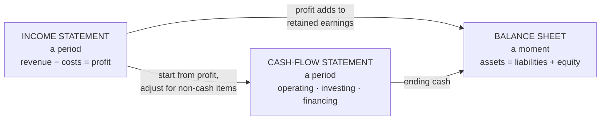

# The language of money: statements, margins and the business case

*Part of [Business acumen for the product leader](./README.md)*

## TL;DR

Finance speaks through three statements. The **income statement** shows performance over a period: revenue, costs and profit. The **balance sheet** shows position at one moment: what the company owns, owes and keeps for its owners. The **cash-flow statement** shows how cash moved. A product decision touches all three, often in different ways and at different times.

The core tradeoff is between profit and cash, and between today and later. A product can raise profit and drain cash, as a fast-growing loan book does. A bet can lose money this year and be worth a lot in present-value terms. The leader who can show both, with a sensitivity table, gets the investment.

> 🎯 **For the product leader**
>
> **Why it matters** — Every serious bet is approved in the CFO's language. "Users love it" does not survive a budget review. "This adds $2 million of gross profit a year, pays back in 18 months, and still works if adoption is 30% lower" does.
>
> **What it changes in your decisions** — You write business cases in cash and present value. You show the one or two assumptions the case depends on. You know which line of which statement your product moves.
>
> **Ask your team** — *"What does this case look like if our biggest assumption is 20% worse, and does it still clear the bar?"*
>
> **Risk if ignored** — A case built on revenue that is really pass-through money, or on profit that arrives years after the cash goes out. Finance finds the hole, and your credibility goes with it.

## Mental model: one story, three views



Think of a business as a household. The income statement is this year's salary minus spending. The balance sheet is the house, the savings and the mortgage on one date. The cash-flow statement is the bank account: what came in and went out.

**Where the analogy breaks.** A household counts money when it arrives. Companies use **accrual accounting**. Revenue is recorded when it is earned, and costs when they are incurred, not when cash moves. That is why profit and cash can differ so much.

## The income statement

| Line | What it means |
| --- | --- |
| Revenue | What the company earned from customers in the period |
| Cost of revenue (cost of goods sold) | The direct cost of delivering what was sold |
| **Gross profit** | Revenue minus cost of revenue |
| Operating expenses | Research and development, sales and marketing, general and administrative |
| **Operating income** | Gross profit minus operating expenses |
| Net income | Profit after interest, taxes and other items |

**Gross margin** is gross profit as a share of revenue. It tells you how much each sale contributes before overheads. **Operating margin** is operating income as a share of revenue. It tells you whether the business as a whole earns money from its operations.

Product leaders move gross margin more than they think. A support-heavy feature, a costly data vendor or a free-delivery promise all sit in cost of revenue.

## What counts as revenue: the domain traps

Revenue is not always what it looks like. Each domain has its own trap.

- **eCommerce marketplaces.** Gross merchandise value (GMV) is the value of goods sold through the platform. It is not revenue. Shopify's 10-K defines GMV and states that GMV does not represent revenue earned by Shopify. Shopify's revenue comes from subscriptions and from merchant services such as payment processing.
- **Payments.** A processor collects a fee on each payment. Much of that fee passes to card issuers and networks. Accounting rules decide whether the company reports the full fee as revenue (and the pass-through as cost) or only its net share. Ask which one your company does before you compare margins with a competitor.
- **Fintech with trading products.** Block reports bitcoin sales to Cash App customers as revenue, with the cost of the bitcoin as a cost. That makes revenue large and the margin on it thin. Block leads its reporting with **gross profit**. Its 10-K for 2025 reports gross profit of $10.4 billion, of which Cash App was $6.3 billion and Square $3.9 billion.
- **Lending.** A lender earns interest over the life of a loan. It must also book an allowance for expected losses. Affirm reports **revenue less transaction costs**: total revenue minus loss on loan purchase commitments, provision for credit losses, funding costs, and processing and servicing costs. It is a measure of what each transaction is worth after its direct costs.
- **Insurance.** A customer pays a year's premium up front. The insurer earns it month by month. The unearned part sits on the balance sheet as a liability.
- **Retail.** Revenue is product sales. The trap is inventory. A product bought but not sold is on the balance sheet, not in cost of goods sold. Profit can look fine while cash is stuck in stock.

## The balance sheet

**Assets = liabilities + equity.** Assets are what the company owns or is owed. Liabilities are what it owes. Equity is what is left for the owners.

| Domain | A product-driven asset | A product-driven liability |
| --- | --- | --- |
| Lending | Loans to customers | Funding borrowed to make those loans |
| Payments | Money due from card networks | Money owed to merchants |
| InsurTech | Investments bought with premium | Claims reserves and unearned premium |
| Retail | Inventory | Money owed to suppliers |
| eCommerce | Cash from buyers | Money owed to sellers |

A lender that grows its loan book grows its assets. It must fund them with debt, deposits or equity. Upstart's 10-K for 2022 shows this tension. When institutional investors bought fewer loans, Upstart used its own balance sheet to fund some of them.

## The cash-flow statement

Cash flow has three parts.

- **Operating**: cash from running the business.
- **Investing**: cash spent on long-term assets, such as equipment or acquisitions.
- **Financing**: cash raised or repaid through debt and equity.

A growing retailer often has strong profit and weak operating cash, because cash goes into inventory before peak season. A fast-growing subscription business can be the opposite. Customers pay a year up front, so cash arrives before revenue is earned.

## Time value of money and discounted cash flow

A dollar today is worth more than a dollar next year. You could invest today's dollar and earn a return. So future cash must be **discounted** to compare it with cash today.

- **Present value (PV)** of a future cash flow = cash ÷ (1 + r)^t, where r is the discount rate and t is years from now.
- **Net present value (NPV)** = the sum of the present values of all cash flows, minus the investment today. A positive NPV means the bet earns more than the discount rate.
- The **discount rate** is usually set by Finance. It reflects the company's cost of capital and the risk of the bet.
- **Payback period** is how long until cumulative cash returns equal the investment. It ignores what happens after payback, and it ignores the time value of money unless you discount.

## Budgets, forecasts, business cases and sensitivity

- A **budget** is the plan: what each team may spend and what it must deliver.
- A **forecast** is the current best guess of where the year will land. It changes. The budget usually does not.
- A **business case** asks for money for one bet. It shows costs, benefits, timing, risks and NPV.
- A **sensitivity analysis** changes one input at a time and shows how the result moves. It tells the reader which assumption the case depends on.

## Cost structure and basic pricing

**Fixed costs** do not change with volume in the short run, such as salaries and platform licences. **Variable costs** rise with each unit, such as interchange, delivery or claims handling.

**Contribution margin** is price minus variable cost per unit. It is what each sale contributes to fixed costs and profit. A business with high fixed costs and high contribution margin has **operating leverage**. Profit rises fast once volume passes break-even, and falls fast below it.

There are three basic ways to set a price. **Cost-plus** adds a markup to cost. **Competitor-based** matches the market. **Value-based** prices on what the customer gains. [Lesson 11](./monetization-and-business-models.md) covers pricing in depth.

## Worked example: a business case for a fraud model

*This example is invented, to show the method. The company and all numbers are illustrative.*

A payments company wants a new fraud model. It costs $900,000 to build (year 0). It costs $100,000 a year to run. The team estimates it saves $500,000 a year in fraud losses and dispute costs. Finance sets a 10% discount rate. The model's life is three years.

**Step 1: net cash per year.** Savings $500,000 − running cost $100,000 = $400,000 a year.

**Step 2: discount each year.**

| Year | Net cash | Discount factor 1 ÷ 1.1^t | Present value |
| --- | --- | --- | --- |
| 1 | $400,000 | 0.9091 | $363,636 |
| 2 | $400,000 | 0.8264 | $330,579 |
| 3 | $400,000 | 0.7513 | $300,526 |
| **Total** | | **2.4869** | **$994,741** |

**Step 3: NPV.** $994,741 − $900,000 = **$94,741**. The case is positive.

**Step 4: payback.** $900,000 ÷ $400,000 = 2.25 years, undiscounted.

**Step 5: sensitivity.** Suppose savings are 20% lower: $400,000 a year. Net cash falls to $300,000. PV = $300,000 × 2.4869 = $746,056. NPV = **−$153,944**. The case flips.

**Step 6: find the break-even.** NPV is zero when net cash × 2.4869 = $900,000. That is net cash of about $361,900, or savings of about $461,900. The case survives only if savings are within about 7.6% of the estimate.

**What the leader does with this.** The case is thin. She proposes a pilot on one merchant segment for one quarter to measure real savings before the full build. That turns a fragile bet into a staged one. See real options in [lesson 9](./portfolio-strategy-and-allocation.md).

## Tradeoffs and decisions

- **Profit vs. cash.** Growing a loan book or an inventory raises future profit and uses cash now. The cost is funding, and the risk is running short.
- **NPV vs. payback.** NPV values the whole life of a bet. Payback rewards fast returns. A board under cash pressure may prefer payback. The cost is passing on long-lived bets.
- **Gross vs. net revenue.** Reporting gross revenue looks bigger. It makes margins look thinner and harder to compare.
- **Precision vs. honesty.** A case with one precise number looks confident. A case with a range and a sensitivity table is more honest and easier to trust.

## Failure modes

- **GMV called revenue.** A team reports marketplace volume as revenue. Finance corrects it in the review, in public.
- **Cash surprise.** A product that sells on long payment terms or holds stock raises profit and drains cash. Treasury finds out first.
- **The single-number case.** No sensitivity. The first question about an assumption sinks it.
- **Ignored losses.** A lending case counts interest and leaves out expected credit losses and funding cost.
- **Wrong discount rate.** The team picks a low rate to make NPV positive. Finance uses its own rate, and the case fails.

## Under the hood

The NPV and sensitivity above, in a few lines of Python:

```python
def npv(rate, cash_flows, invest):
    return sum(cf / (1 + rate) ** t for t, cf in enumerate(cash_flows, start=1)) - invest

base = npv(0.10, [400_000] * 3, 900_000)      # 94,741
low  = npv(0.10, [300_000] * 3, 900_000)      # -153,944

annuity = sum(1 / 1.10 ** t for t in (1, 2, 3))  # 2.4869
breakeven_net = 900_000 / annuity                # ~361,900
breakeven_savings = breakeven_net + 100_000      # ~461,900
print(round(base), round(low), round(breakeven_savings))
```

## Practitioner checklist

- [ ] Find your product's revenue, cost of revenue and gross margin in the last management report.
- [ ] Ask Finance whether your company reports revenue gross or net of pass-through costs.
- [ ] Name the balance-sheet line your product grows: loans, inventory, receivables or reserves.
- [ ] Rewrite your next business case with NPV, payback and a sensitivity table.
- [ ] Find the break-even value of the case's biggest assumption.
- [ ] Ask Finance for the discount rate before you build the case.
- [ ] Check whether the case includes losses, funding cost and running cost.

## Related lessons

- [Monetization and business models](./monetization-and-business-models.md) — pricing and unit economics in depth.
- [Portfolio strategy and allocation](./portfolio-strategy-and-allocation.md) — staged bets and real options.
- [The economics of infrastructure](../technical-product-sense/economics-of-infrastructure.md) — the cost of goods sold hidden in infrastructure.
- [Transactional and financial systems](../system-design/transactional-and-financial.md) — ledgers and reconciliation under the money.

## Sources and notes

- The fraud-model case and all its numbers are invented and illustrative. The arithmetic is exact and can be recomputed with the code above.
- Shopify, Form 10-K: GMV definition and the statement that GMV does not represent revenue earned by Shopify. [Filing index](https://www.sec.gov/cgi-bin/browse-edgar?action=getcompany&CIK=1594805&type=10-K). As of 2026-10.
- Block, Form 10-K for fiscal 2025: gross profit of $10.4 billion; Cash App $6.3 billion; Square $3.9 billion. [Filing index](https://www.sec.gov/cgi-bin/browse-edgar?action=getcompany&CIK=1512673&type=10-K). As of 2026-10.
- Affirm, earnings releases filed on Form 8-K: definition of revenue less transaction costs. [Filing index](https://www.sec.gov/cgi-bin/browse-edgar?action=getcompany&CIK=1820953&type=8-K). As of 2026-10.
- Upstart, Form 10-K for fiscal 2022: use of its balance sheet to support funding. [Filing index](https://www.sec.gov/cgi-bin/browse-edgar?action=getcompany&CIK=1647639&type=10-K). As of 2026-10.
- Note: sec.gov could not be opened from the build environment (blocked by the network proxy). The facts were corroborated from search-result excerpts of the filings.
