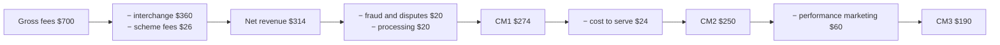
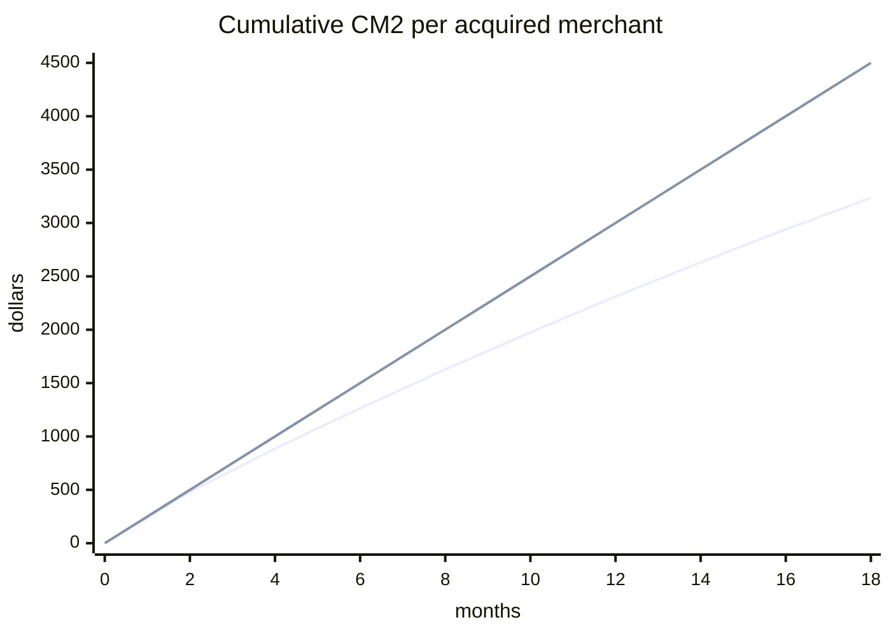

# Unit economics: from one transaction to a cohort

*Part of [Business acumen for the product leader](./README.md)*

## TL;DR

**Unit economics** is the profit or loss on one unit of business. The unit can be one payment, one order, one loan, one policy or one customer. You start with what the unit earns. You subtract every cost that rises with it. What is left is the **contribution margin**. Then you roll the unit up to a customer, and the customers up to a **cohort**: everyone acquired in the same month.

The core tradeoff is growth against proof. Spending to acquire customers speeds growth. It only creates value if each cohort earns back its acquisition cost, with churn and losses counted. Most bad growth decisions do not come from bad arithmetic. They come from the wrong unit, the wrong margin layer, a blended cost, or a lifetime value that assumes customers never leave.

The scale is large. In payments, the merchant's fee can be several times what the processor keeps. In lending, a few points of default turn a profitable loan book into a loss. In retail, the same sales can earn very different returns on the cash tied up in stock. This lesson gives you one method for all of them.

> 🎯 **For the product leader**
>
> **Why it matters** — Every growth plan is a bet that new customers will be worth more than they cost. In FinTech, Payments, Lending and Insurance, that bet also carries risk losses that arrive months after the sale. A product that looks profitable per transaction can lose money per cohort.
>
> **What it changes in your decisions** — You pick the unit before you pick the metric. You steer by the right contribution layer. You approve spend on channel-level acquisition cost and cohort payback, not on blended averages or a lifetime value with no time limit.
>
> **Ask your team** — *"Show me cumulative contribution per acquired customer, by monthly cohort and by channel, against what we paid to acquire them. Which cohorts have paid back, and in which month?"*
>
> **Risk if ignored** — You scale a channel that never pays back. You approve a riskier credit band on average numbers. You report a lifetime value that Finance, investors or a regulator later write down.

## Decision rules in this lesson

1. Measure at the unit where revenue and variable cost are both incurred. Then roll up to the customer.
2. Steer pricing and risk by CM1, operations by CM2, and growth spend by CM3 and cohort payback.
3. Never approve growth spend on blended acquisition cost. Use paid acquisition cost for the channel you are buying.
4. Report lifetime value only with a time limit, a discount rate, and cohort payback next to it.
5. Compare cohorts at the same age, never at the same calendar date.
6. Approve a new credit band, range or segment on its marginal economics, not the portfolio average.
7. Count chargebacks, returns, refunds and defaults inside the unit, not in a separate "losses" bucket.

## Mental model: the contribution waterfall



Picture water poured into the top of a staircase of buckets. Each step pours some water off to someone else. The card issuer takes the largest share. The network takes a little. Fraud, processing, support and marketing each take a little more. Unit economics is the discipline of measuring what reaches each step. The figure shows one small merchant's month from the first worked example below.

**Where the analogy breaks.** Water flows down at once. Money does not. Fees arrive today. Disputes arrive weeks later. Loan defaults arrive months later. Acquisition cost is paid before the first fee. So a waterfall for one period always needs a second view across time: the cohort. The rest of this lesson builds both.

## Mechanics

### Choose the unit

The **unit** is the smallest thing you sell that has its own revenue and its own variable cost. Pick it first. A metric on the wrong unit hides the problem you are trying to see.

**How it works.** List the events that create revenue. List the events that create variable cost. Find the smallest unit where both happen. That is your base unit. Then group base units into the unit a customer buys from you, usually the customer or merchant per month.

| Domain | Base unit | Roll-up unit | Why this base |
| --- | --- | --- | --- |
| Payments | One transaction | Merchant per month | Fees, interchange and fraud are all per transaction |
| Lending | One loan | Borrower over the loan's life | Interest, funding cost and default attach to the loan |
| Insurance | One policy-year | Policyholder over renewals | Premium and claims attach to the policy term |
| Marketplace or eCommerce | One order | Customer per month | Fees, delivery, promotions and returns attach to the order |
| Retail | One category | Store or chain | Margin and stock are managed by category |
| Neobank | One active customer per month | Customer over lifetime | Interchange, deposits and service cost attach to the customer |

**Domain application.** A payments team that measures per merchant only can miss that tiny transactions lose money. A $5 payment at 2.9% + $0.30 pays a fee of $0.445. The processor's own cost has a fixed part per transaction. So a merchant base full of small tickets can look fine in total and lose money per transaction. [Pricing and business models](./monetization-and-business-models.md) shows how the price metric creates this.

**Decision rule.** When revenue and cost happen at different units, measure at the smaller unit and roll up. When a new product changes the unit, rebuild the model before you compare it with the old one.

**Common misreading.** "Per customer" sounds complete. It averages away the fact that some transactions, orders or loans inside the customer lose money.

### Contribution margin in three layers

**Contribution margin (CM)** is what a unit earns after the costs that move with it. It is what the unit contributes toward fixed costs and profit. Teams split it into three layers, because different decisions need different costs.

| Layer | Formula | Costs it subtracts | Decisions it steers |
| --- | --- | --- | --- |
| **CM1** | Net revenue − direct variable cost | Pass-through fees, cost of goods, processing, fraud, credit loss, courier pay | Pricing, risk policy, supplier and partner terms |
| **CM2** | CM1 − variable cost to serve | Support, onboarding, identity checks, servicing, collections | Operations, automation, self-serve design |
| **CM3** | CM2 − performance marketing | Paid acquisition spend that scales with volume | Growth budget, channel mix |

**Net revenue** comes first. It is revenue after amounts you pass straight to others, such as interchange. Whether the books show revenue gross or net is an accounting choice. [The language of money](./the-language-of-money.md) explains it. For unit economics, always start from net revenue. The pass-through was never yours.

**How to compute it.** Write every cost line. Tag each as fixed, variable or step-fixed. Put each variable line in exactly one layer. Agree the tags with Finance once, then keep them stable. A layer that changes definition every quarter cannot be trended.

**CM3 is a period view.** CM3 spreads one period's marketing over the units of that period. It answers "is this month's business, including this month's growth spend, contributing?" It does not say whether a cohort will pay back. The cohort view below does that.

**Domain application.** In the payments example, net revenue is $314 a month for one merchant. Fraud, disputes and processing cost $40, so CM1 is $274. Support and onboarding cost $24, so CM2 is $250. Assume the business has 10,000 active merchants and spends $600,000 a month on performance marketing. That is $60 per active merchant, so CM3 is $190. All of these inputs are assumed.

**Decision rule.** When you change price or risk policy, judge it on CM1. When you change support or onboarding, judge it on CM2. When you change the growth budget, judge it on CM3 and cohort payback together.

**Common misreading.** Calling CM1 "profit". CM1 is before support, marketing, salaries and rent. A product can have a healthy CM1 and still lose money at CM2, because each customer needs a human to onboard or service them.

### Customer acquisition cost done right

**Customer acquisition cost (CAC)** is what you spend to win one new customer. The formula looks simple: acquisition spend ÷ new customers. Every part of it can be bent.

**Three versions you must keep apart:**

- **Blended CAC** divides all acquisition spend by all new customers, including those who came free through word of mouth or brand. It flatters paid channels.
- **Paid CAC** divides paid spend by the customers that paid spend brought in. Use it to decide whether to buy more.
- **Channel CAC** splits paid CAC by channel: search, partners, field sales, referrals. Channels differ widely. The blended number hides a channel that never pays back.

**Fully loaded CAC** adds the costs people forget. Sales and marketing salaries. Sign-up incentives and referral bonuses. Onboarding checks such as identity and know-your-customer (KYC) checks. In lending, it also adds the cost of applicants you decline.

**Domain application: lending.** A lender pays for every application, not only for funded loans. Assume $70 of marketing and $14 of data and verification cost per completed application. Assume 32% of applicants are approved and 75% of those accept the offer. So 24% of applications become loans. CAC per funded loan = $84 ÷ 0.24 = **$350**. Tighten the credit policy so that approval falls to 24%, and CAC per funded loan rises to $84 ÷ 0.18 = $467. Risk policy changes acquisition cost. The two teams must plan together.

**Domain application: payments.** In the worked example below, paid merchants cost $3,000 each through field sales. Organic merchants cost $500 each in onboarding and incentives. With 40% paid and 60% organic, blended CAC is $1,500. The blended number is half the paid number.

**Decision rule.** When you decide whether to spend the next dollar, use paid CAC for that channel, fully loaded. Use blended CAC only to describe the whole business to outsiders.

**Common misreading.** "Our CAC is falling." It often falls because organic growth rose, or because a cheap channel grew while an expensive one held still. Ask which CAC fell, and in which channel.

### Payback: simple and cohort

**Payback** is how long a new customer takes to earn back what you paid to acquire them. It is the single most useful growth number, because it combines CAC, margin and churn in one figure a CFO can act on.

**Simple payback** = CAC ÷ monthly contribution per customer. Use CM2, not revenue. It assumes the customer stays until payback. That is never true.

**Cohort payback** follows a real group. Take every customer acquired in one month. Each month, add up the contribution of those who are still active. Divide by the number originally acquired. Payback is the first month in which that cumulative contribution per acquired customer covers CAC. Churn is built in, because customers who leave stop contributing.



In the figure, the dashed line ignores churn. The solid line counts it. With churn, the merchant cohort pays back blended CAC in month 8 rather than month 6, and paid CAC in month 17 rather than month 12. The first worked example below shows every step.

**How to run it.** You need three tables: acquisition spend by channel and month, customers acquired by channel and month, and contribution by customer and month. Most data teams can build the cohort table in a day. Ask for it by channel, because each channel has its own churn as well as its own CAC.

**Heuristics, labelled as heuristics.** A widely repeated rule of thumb says payback should be under about 12 months for small-business products and under about 24 months for enterprise products. These are rules of thumb, not sourced benchmarks or laws. A lender or insurer with cheap long-term funding can accept longer payback. A startup with 18 months of cash cannot.

**Decision rule.** When cohort payback is longer than your cash runway or your planning horizon, slow the channel, whatever the lifetime value says.

**Common misreading.** "Payback is 6 months." Ask: simple or cohort? On which margin layer? On blended or paid CAC? The answers can turn 6 months into 17.

### Lifetime value, and six ways it lies

**Lifetime value (LTV)** is the contribution a customer brings over their whole relationship with you. It is the number most often used to justify growth spend. It is also the number most often wrong.

**The formulas.**

- **Undiscounted:** LTV = monthly CM ÷ monthly churn. With CM2 of $250 and churn of 3%, LTV = $8,333. The term 1 ÷ churn is the expected lifetime in months.
- **Discounted:** LTV = monthly CM ÷ (monthly churn + monthly discount rate). At a 1% monthly discount rate, LTV = $250 ÷ 0.04 = $6,250. Discounting counts a dollar in year 3 as worth less than a dollar today.
- **Cohort LTV with a horizon:** sum the actual cohort contribution, month by month, discounted, up to a cap such as 36 months. In the worked example, this gives $4,648. That is 44% less than the simple $8,333.

**Six ways LTV lies:**

1. **Front-loaded churn.** Most customers who leave do so in the first months. A single average churn rate spreads that loss evenly and overstates early value.
2. **Extrapolated expansion.** Teams assume customers will grow their spend for years because the best cohort did. Young cohorts have not proved it.
3. **Revenue, not contribution.** LTV built on revenue ignores interchange, losses and cost to serve. In payments, that can overstate value several times.
4. **No discounting.** A dollar in year 5 is worth less than a dollar now, and much less to a company that is short of cash.
5. **Young cohorts.** A cohort that is 6 months old says little about month 36. Extrapolating it is a guess with a decimal point.
6. **Survivorship.** Measuring "average customer lifetime" from customers who are still active ignores those who already left.

**Domain application: lending.** A loan has a contractual life. The "lifetime" is the loan term plus any repeat loans. Repeat borrowing is real value, but it depends on the borrower not defaulting on the first loan. Model it only from observed repeat rates by vintage.

**Decision rule.** When someone shows you LTV ÷ CAC, ask for cohort payback beside it, and for the horizon and discount rate behind it. Approve spend only if both look healthy.

**Common misreading.** "LTV to CAC is above 3, so we should spend more." The 3:1 ratio is a widely repeated rule of thumb, not a sourced benchmark or a law. A 3:1 ratio that pays back in 40 months can still sink a company that runs out of cash in 24.

### Cohort curves

A **cohort curve** plots what a group of customers does by **months on book**: the months since they were acquired. It is the most honest picture of a product's economics. It shows retention, expansion and loss in one place.

**Two kinds of retention.**

- **Logo retention** counts customers still active. "Logo" means one account, whatever its size.
- **Revenue or volume retention** tracks money. In payments it is often total payment volume (TPV) retention: the cohort's processed volume this month versus its first months.

They can tell opposite stories. A merchant cohort can lose 35% of its merchants and still keep 100% of its volume, because the survivors grow. Revenue retention across a whole book is covered in [performance and growth](./performance-and-growth.md), which defines net revenue retention.

**Three shapes to recognise.**

- **Flattening.** Early loss, then a stable base. Healthy. The flat level is what you are really buying.
- **Smiling.** Logo retention flattens while volume retention turns up, because survivors grow. Strong. Common in payments and B2B software.
- **Decaying.** The curve never flattens. Every cohort eventually disappears. The product has no lasting hold, and LTV based on any churn average is too high.

**How to read it.** Put cohorts on one chart with months on book on the horizontal axis. Compare them at the same age. A January cohort at month 6 is comparable to a March cohort at month 6. It is not comparable to the March cohort in the same calendar month. Lenders call the same idea a **vintage curve**: cumulative losses by months on book, by origination month.

**Domain application: eCommerce.** A promotion brings a large cohort. Its month-1 orders look great. By month 4, its repeat rate is half that of organic cohorts. The cohort curve shows it. A monthly dashboard of total orders hides it inside the growth.

**Decision rule.** When a new cohort's curve sits below older cohorts at the same age, stop scaling the source of that cohort until you know why.

**Common misreading.** Comparing this month's active-customer total with last month's. That mixes old and new cohorts. Growth in new customers can hide decay in every cohort.

### Unit waterfalls by domain

Each domain has its own waterfall. The method is the same: start with what the customer pays, subtract what passes to others, subtract each variable cost, and name the layer at each step. The figures here are illustrative unless a source is given.

#### Payments: per transaction

| Step | What it is | Who keeps it |
| --- | --- | --- |
| Gross fee | What the merchant pays the acquirer | — |
| − Interchange | Paid to the card issuer, set by the card network | Issuer |
| − Scheme fees | Paid to the card network | Network |
| = Net revenue | What the acquirer keeps | Acquirer |
| − Fraud and disputes | Losses the acquirer cannot pass on to the merchant | — |
| − Processing | Gateway, risk checks, hosting, settlement | — |
| = CM1 | Per-transaction contribution | Acquirer |

**Gross and net take rate.** The **take rate** is revenue as a share of the payment value. The **gross take rate** uses the full fee. The **net take rate** uses net revenue. In the worked example, gross take is 3.5% and net take is 1.57%. Compare competitors on net take. Gross take mostly measures the issuer's share. How interchange is regulated and passed on to merchants is in [pricing and business models](./monetization-and-business-models.md).

**Chargeback and dispute economics.** A cardholder can dispute a payment with their card issuer. If the dispute succeeds, the money goes back to the cardholder. This reversal is a **chargeback**. The merchant usually bears the lost sale. The acquirer usually charges the merchant a dispute fee. The merchant can fight with evidence. Fighting costs staff time and wins only some of the time.

The expected cost of one dispute has four parts:

- **Lost funds**: the payment amount × (1 − win rate), if you fight. The full amount, if you do not.
- **The dispute fee.**
- **Operations cost** to gather and submit evidence.
- **The goods**, if they shipped and do not come back.

*Illustrative, inputs assumed:* a $120 disputed payment, a $15 fee, $12 of staff time to fight, and a 30% win rate. Accepting costs $120 + $15 = $135. Fighting costs 0.7 × $120 + $15 + $12 = $111. Fighting saves $24. On a $25 payment, the expected recovery is 0.3 × $25 = $7.50, below the $12 cost to fight. So you accept.

**Decision rule.** Fight a dispute when win rate × amount is more than the cost to fight. Otherwise accept it, and spend the effort on preventing the next one.

**Where the acquirer carries the loss.** The acquirer is exposed when the merchant cannot pay the chargeback back. That happens when a merchant fails after taking payment for goods it never delivers, such as tickets, travel or pre-orders. This is **merchant credit risk**. Acquirers manage it with reserves, which hold back part of a risky merchant's payouts, and with slower payouts. These tools cost the merchant cash flow. They are a pricing and product decision, not only a risk one.

**Network monitoring.** Card networks monitor merchants' dispute rates against thresholds. A merchant above them faces remediation requirements and escalating consequences. Thresholds differ by network and change over time. Ask your risk team for the current ones.

#### Lending: per loan

A loan earns interest and fees. It pays for its funding, its expected credit loss, its servicing and its acquisition.

**Contribution per loan** = interest + fees − cost of funds − expected loss − servicing − acquisition.

- **Interest** follows the annual percentage rate (APR) and the amortization schedule. On an amortizing loan the balance falls each month, so interest falls too.
- **Cost of funds** is what the lender pays for the money it lends: deposits, credit lines or investors. It moves with interest rates. [Business cases, capital and valuation](./business-cases-and-valuation.md) explains how lenders fund loans.
- **Expected loss (EL)** = probability of default (PD) × loss given default (LGD) × exposure at default (EAD). PD is the chance the borrower defaults over the loan's life. LGD is the share of the balance lost after recoveries. EAD is the balance owed when default happens.
- **Servicing** covers payment processing, statements, support and collections.
- **Acquisition** is CAC per funded loan, as computed above.

**Marginal versus average borrower.** A lender's average contribution includes its best borrowers. The decision to approve one more risk band depends only on that band. In the worked example, the average loan contributes $1,301 and a band with 15% PD contributes $944. Both are positive. But the marginal band also carries more uncertainty, more fraud and worse recoveries than the model may show.

**Decision rule.** When you widen the approval criteria, compute the contribution of the new band alone. Compare it with the band's own uncertainty, not with the portfolio average.

**Common misreading.** "Losses are 5% and our rate is 18%, so we earn 13%." That ignores the cost of funds, servicing, acquisition and the interest lost after default. The worked example shows how much each one takes.

#### Insurance: per policy

An insurer collects premium first and pays claims later. Its unit is one policy for one term.

- **Loss ratio** = claims incurred ÷ earned premium. Earned premium is the part of the premium for cover already provided.
- **Loss adjustment expense (LAE)** is the cost of handling claims: adjusters, investigation, legal. Some insurers report it inside the loss ratio, and some report it apart. Check which.
- **Expense ratio** = acquisition and other underwriting expenses ÷ premium. Acquisition includes commissions, marketing and policy setup.
- **Combined ratio** = loss ratio + LAE ratio + expense ratio. Under 100% means an underwriting profit. Over 100% means an underwriting loss.
- **Investment income** comes from the premium held between collection and claim payment. This held money is called **float**. It lets an insurer run a combined ratio slightly over 100% and still make money. It shrinks when interest rates fall.

Reinsurance changes the unit too. An insurer that passes part of each policy to a reinsurer gives up part of the premium and part of the claims. [Business cases, capital and valuation](./business-cases-and-valuation.md) covers how that trades margin for capital.

**Domain application.** In InsurTech, product decisions move each ratio. A faster digital claims flow lowers LAE. Paying claims too fast without checks raises the loss ratio through fraud. A cheap acquisition channel lowers the expense ratio. It may also bring riskier customers who raise the loss ratio.

**Decision rule.** When a product change lowers one ratio, check the other two before you claim the win.

**Common misreading.** Judging a new insurance product on its first year's loss ratio. Claims are reported and settled late. The first year's loss ratio is almost always too low. [Performance and growth](./performance-and-growth.md) shows how insurers correct for this with loss development.

#### Marketplaces and eCommerce: per order

**Contribution per order** = fees and margin − fulfilment or courier cost − payment cost − promotions − refunds and returns.

*Illustrative food-delivery order, inputs assumed:* a $40 basket. The restaurant pays 20% commission ($8). The customer pays $5 in delivery and service fees. Revenue is $13. The courier is paid $7. Payment processing is 3% of the $45 charged, which is $1.35. Promotions cost $1.50. Refunds and credits average $0.60. Support averages $0.40. Contribution per order is $13 − $7 − $1.35 − $1.50 − $0.60 − $0.40 = **$2.15**. A $2 delivery-fee waiver removes almost all of it.

**Returns economics.** In online fashion and electronics, returns can be one of the largest costs. The expected cost of returns per order is:

**return rate × (lost margin + reverse logistics + unsellable share × cost of goods)**

*Illustrative apparel order, inputs assumed:* an $80 order, a $40 cost of goods, so a $40 gross margin. Outbound shipping and fulfilment cost $10. Payment cost is 3%, or $2.40. Contribution before returns is $80 − $40 − $10 − $2.40 = $27.60. The return rate is 30%. Reverse shipping and handling cost $12 per return. Of returned items, 15% cannot be resold, which loses their $40 cost: $6 expected per return. Each return costs $40 + $12 + $6 = $58. Per order, returns cost 0.30 × $58 = $17.40. Contribution after returns is **$10.20**. Returns take 63% of the contribution.

**Decision rule.** Price a return policy, a size guide or a better product photo against this formula. Here, each point of return rate is worth $0.58 per order.

**Common misreading.** Booking "free returns" as a marketing cost. It is a cost of every order, and it scales with volume.

#### Retail: per category

A retailer manages margin and stock together. Its key unit metric is **gross margin return on inventory investment (GMROI)**.

- **GMROI** = gross margin ÷ average inventory at cost. It says how many dollars of gross margin each dollar of stock earns in a year.
- **Inventory turns** = cost of goods sold ÷ average inventory at cost. It says how often the stock sells through in a year.
- **Markdown** is a price cut to clear stock. It lowers gross margin.
- **Shrink** is stock lost to theft, damage or error. It lowers gross margin too.

GMROI combines margin and speed. A high-margin category that sells slowly can earn less on its stock than a low-margin one that turns fast.

**Domain application.** A wider range brings more choice and more sales. It also ties up cash in slower stock and raises markdown risk. GMROI tells you whether the extra range earns its place. The worked example below runs the numbers.

**Decision rule.** Add range only if the new range clears the category's GMROI, not merely if it adds sales.

**Common misreading.** "The new range added $150,000 of sales." Sales are not the test. The test is margin earned per dollar of stock.

#### Neobanks: per customer

A neobank earns from card interchange, from the spread on deposits, and from fees and lending. It pays for support, cards, processing, compliance and fraud. Its unit is one active customer per month.

Nubank publishes two of the inputs. It reports monthly average revenue per active customer and monthly cost to serve per active customer. In Q2 2023 it reported the first as $9.3 and the second as $0.8. A low cost to serve is what lets a digital bank profit from customers with small balances. A bank with a cost to serve several times higher could not serve these customers profitably.

**Worked example: a neobank's debit card economics.** *Illustrative. The neobank, its partner bank and all rates are assumed.*

A US neobank issues debit cards through a partner bank. The partner is exempt from the US debit interchange cap. [Pricing and business models](./monetization-and-business-models.md) explains the cap and the exemption.

**Assumed inputs, per active customer per month:**

- Card spend $1,000. Interchange rate 1.2%. The neobank keeps 75% of interchange. The partner bank keeps 25%.
- Average balance $800, earning a net 3% a year for the neobank.
- Cost to serve $4: support, card, processing and compliance. Fraud and other losses $1.
- CAC $90. Monthly churn 2%.

**Step 1: revenue.** Interchange: $1,000 × 1.2% = $12. Neobank share: $12 × 75% = $9. Interest: $800 × 3% ÷ 12 = $2. Total: **$11 a month**.

**Step 2: contribution margin.** $11 − $4 − $1 = **$6 a month**.

**Step 3: payback.** $90 ÷ $6 = **15 months**. This is simple payback. With early churn, cohort payback is longer.

**Step 4: LTV.** Expected lifetime = 1 ÷ 2% = 50 months. LTV = $6 × 50 = **$300**, undiscounted. LTV to CAC = $300 ÷ $90 = **3.3**.

**Step 5: stress test.** Suppose interchange halves. The partner bank might grow past the asset threshold for the cap, or renegotiate its share. Interchange becomes $6. Neobank share: $4.50. Revenue: $6.50. Contribution: $1.50. Payback: $90 ÷ $1.50 = **60 months**. LTV: $1.50 × 50 = **$75**. LTV to CAC: **0.8**. Each new customer now loses money.

**What the leader does with this.** The model depends on one revenue line that a partner and a rule control. The team adds a second revenue line, such as a paid tier or a lending product. It caps acquisition spend until the second line proves out.

**Decision rule.** When more than half of contribution depends on one rule or one partner, stress-test that line at half, and set the acquisition budget on the stressed number.

### Operating leverage and break-even

Unit economics covers variable cost. A business also has fixed cost: salaries, platform, licences, compliance teams, rent. **Operating leverage** is how much profit moves when volume moves. High fixed cost and low variable cost mean high leverage. Profit grows fast with volume, and falls fast without it.

Costs come in three kinds:

- **Variable** costs move with each unit: interchange, courier pay, credit losses.
- **Fixed** costs do not move with volume in the planning period: the core platform team.
- **Step-fixed** costs stay flat until a threshold, then jump. One fraud analyst may cover 400 merchants. Merchant 401 needs a second analyst.

**Break-even volume** = fixed cost ÷ contribution per unit.

*Illustrative, inputs assumed:* a merchant-acquiring product carries $2.4 million a year of fixed cost. Each merchant contributes CM2 of $250 a month, or $3,000 a year. Break-even = $2,400,000 ÷ $3,000 = **800 merchants**. If a pricing change lifts CM2 by 10% to $275 a month, break-even falls to about 727 merchants.

**Decision rule.** When a product has high fixed cost, protect contribution per unit first. A small margin change moves break-even volume a lot.

**Common misreading.** Treating a step-fixed cost as variable, or as fixed. Both mislead. Model the steps.

## Worked examples

### Worked example: an SMB acquiring cohort, from one payment to payback

*Illustrative. A payments company sells card acceptance to small and medium-sized businesses (SMBs). Every input is assumed.*

**Step 1: one transaction.** The average payment is $50. The merchant pays 2.9% + $0.30.

- Gross fee: $50 × 2.9% + $0.30 = **$1.75**.
- Interchange at 1.8%: $50 × 1.8% = $0.90.
- Scheme fees: $0.065.
- Net revenue: $1.75 − $0.90 − $0.065 = **$0.785**.
- Gross take rate: $1.75 ÷ $50 = 3.5%. Net take rate: $0.785 ÷ $50 = 1.57%.
- Fraud and disputes the acquirer cannot pass on: $0.05. Processing: $0.05.
- CM1: $0.785 − $0.05 − $0.05 = **$0.685** per transaction.

**Step 2: one merchant month.** The merchant makes 400 payments a month.

- CM1: 400 × $0.685 = **$274**.
- Cost to serve, for support, onboarding amortized and risk review: $24.
- CM2: $274 − $24 = **$250** a month.

**Step 3: acquisition cost.** 40% of merchants come through field sales at $3,000 each. 60% come organically at $500 each in onboarding and incentives.

- Paid CAC: **$3,000**.
- Blended CAC: 0.4 × $3,000 + 0.6 × $500 = **$1,500**.

**Step 4: simple payback.** Blended: $1,500 ÷ $250 = **6 months**. Paid: $3,000 ÷ $250 = **12 months**.

**Step 5: cohort payback.** Merchants churn 8% a month for the first 3 months, then 2% a month. After 3 months, 77.9% remain. After 12 months, 64.9% remain. After 36 months, 40.0% remain. A merchant active at the start of a month earns that month's CM2. Add the cohort's contribution month by month, per acquired merchant.

- Blended CAC of $1,500 is covered in **month 8**.
- Paid CAC of $3,000 is covered in **month 17**.

**Step 6: lifetime value.** The team's dashboard shows a book-wide average churn of 3% a month.

- Naive LTV: $250 ÷ 0.03 = **$8,333**. Against paid CAC, LTV to CAC is 2.8.
- Discounted at 1% a month: $250 ÷ 0.04 = **$6,250**.
- Cohort LTV over 36 months, undiscounted: **$5,428**.
- Cohort LTV over 36 months, discounted at 1% a month: **$4,648**. Against paid CAC, LTV to CAC is 1.5.

**What the leader does with this.** The pitch said "6-month payback and LTV to CAC near 6". That used blended CAC against naive LTV: $8,333 ÷ $1,500 = 5.6. The truth for the channel being funded is 17-month payback and about 1.5 times CAC over 3 years. The leader does two things. She funds the field-sales channel only for merchant segments whose cohort payback is under 12 months. And she funds a project to cut first-quarter churn, because churn costs 5 months of payback on the paid channel (month 12 with no churn, month 17 with it). The 8% early churn alone adds 3 of those months: with a flat 2% churn from the start, paid CAC would be covered in month 14.

### Worked example: one personal loan

*Illustrative. An online lender makes unsecured personal loans. Every input is assumed.*

**The loan.** $10,000 over 36 months at 18% APR, repaid in equal monthly payments.

**Step 1: interest.** The monthly payment is **$361.52**. Over 36 months the borrower pays $13,015, so total interest is **$3,015**. The average balance over the life is **$5,583**, because the balance falls as it is repaid.

**Step 2: other income.** An origination fee of 3%: **$300**.

**Step 3: cost of funds.** The lender pays 6% a year on the money it lends. $5,583 × 6% × 3 years = **$1,005**.

**Step 4: servicing.** 1.5% a year of the average balance: $5,583 × 1.5% × 3 = **$251**.

**Step 5: acquisition.** CAC per funded loan: **$350**, from the lending CAC example above.

**Step 6: expected loss.** PD 8% over the life. LGD 85%. EAD $6,000, an assumed average balance at the time of default. EL = 8% × 85% × $6,000 = **$408**.

**Step 7: contribution.** $3,015 + $300 − $1,005 − $251 − $350 − $408 = **$1,301** per loan.

**Step 8: the marginal band.** The lender considers approving a riskier band with PD 15%, on the same terms. EL = 15% × 85% × $6,000 = $765. Contribution = **$944**.

**Step 9: timing.** Steps 1 to 8 assume every borrower pays all the interest, then a lump of loss is subtracted. That is a simplification. A borrower who defaults in month 10 stops paying interest in month 10. The balance lost depends on when they default. The script in Under the hood models defaults month by month and gives these results:

| Model | PD 8% | PD 15% | Break-even PD |
| --- | --- | --- | --- |
| Simple (steps 1 to 8) | $1,301 | $944 | 33.5% |
| Monthly defaults, evenly spread | $1,269 | $874 | 29.8% |
| Monthly defaults, twice as likely in year 1 | $1,201 | $746 | 26.1% |

The script assumes defaults cluster early in the loan's life. Check that against your own vintage curves. If your defaults do cluster early, the front-loaded row is the closest of the three. In it, the marginal band earns $746, 38% less than the average loan's $1,201.

**What the leader does with this.** The band is still profitable on these numbers. But the estimate of its PD is the least certain number in the model, because the lender has never approved that band. The leader approves a small, capped test of the band, with its own vintage curve. She also asks for the band's own price. Charging the same APR to both bands means the safer borrowers subsidize the riskier ones. In many places, the law limits how high the APR can go. See [pricing and business models](./monetization-and-business-models.md).

### Worked example: GMROI for a range extension

*Illustrative. A retailer reviews one category. Every input is assumed.*

**Step 1: today.** The category sells $1.2 million a year at a 40% gross margin, after markdowns and shrink. Gross margin is **$480,000**. Cost of goods sold is $720,000. Average inventory at cost is $200,000.

- GMROI = $480,000 ÷ $200,000 = **2.4**.
- Turns = $720,000 ÷ $200,000 = **3.6** a year.

**Step 2: the proposal.** The buyer wants to add a wider range. It needs $100,000 more average inventory at cost. It is expected to sell $150,000 a year at a 35% margin, because it carries more markdown risk.

- New gross margin: $150,000 × 35% = $52,500.
- GMROI of the new range alone: $52,500 ÷ $100,000 = **0.53**.
- Category GMROI after: ($480,000 + $52,500) ÷ $300,000 = **1.78**.

**Step 3: the test.** The new range adds sales and gross margin. But it earns 53 cents of margin per dollar of stock, against 2.40 for the category. The category's return on its stock falls by a quarter.

**What the leader does with this.** She does not approve the full range. She asks for a smaller test with a sell-through target and a markdown limit. She also asks the buyer to show which existing lines the new range would replace, so that inventory does not simply grow. If the range draws customers who then buy other high-GMROI items, that halo must be measured, not assumed.

### Worked example: one renters policy

*Illustrative. An InsurTech sells renters insurance. Every input is assumed.*

**Step 1: the premium.** An annual policy costs **$180**.

**Step 2: the ratios.**

| Line | Ratio | Per policy |
| --- | --- | --- |
| Claims (loss ratio) | 60% | $108.00 |
| Loss adjustment expense | 10% | $18.00 |
| Acquisition expense | 20% | $36.00 |
| Other underwriting expense | 12% | $21.60 |
| **Combined ratio** | **102%** | **$183.60** |

**Step 3: underwriting result.** $180 − $183.60 = **−$3.60**. The policy loses money on underwriting.

**Step 4: investment income.** Assume the insurer holds the premium for half a year on average before it pays claims and costs. At 4% a year, that earns $180 × 0.5 × 4% = **$3.60**. That is 2 points of premium.

**Step 5: the result.** The policy breaks even. The insurer depends on interest rates staying near 4%.

**What the leader does with this.** Two product moves each beat waiting for rates. Cutting acquisition from 20% to 15% through a renewal and referral flow saves $9 a policy. Cutting LAE from 10% to 7% through self-serve claims saves $5.40. Either one turns the policy profitable at today's rates, without relying on investment income. Before claiming either win, the team checks that the loss ratio did not rise as a result.

## Tradeoffs and decisions

- **Growth vs. payback.** Spending on a channel with long payback grows the customer count today. The cost is cash tied up for longer and more exposure to churn you have not yet seen.
- **Precision vs. speed.** A full cohort model takes weeks to build and trust. A simple payback takes minutes. Use the simple one to screen ideas, and the cohort one to approve budgets. The cost of skipping the cohort model is approving channels that never pay back.
- **Average vs. marginal.** Average economics are easy to compute and to defend. Marginal economics are what each decision changes. The cost of using averages is that the last band, range or channel you add looks better than it is.
- **Fight vs. accept.** Fighting disputes and chasing returns recovers money. It also costs staff time and can annoy good customers. Use the expected-value test, and accept the rest.
- **Credit approval vs. loss.** Approving more applicants grows volume and lowers CAC per funded loan. The cost is higher expected loss, with less certainty about its size.
- **Range vs. stock return.** A wider range wins sales and loyalty. The cost is cash in slower stock and more markdowns.
- **Fixed cost vs. variable cost.** Building in-house raises fixed cost and lowers variable cost. It pays off at high volume. It hurts if volume does not arrive.

## Failure modes

- **Blended CAC approves a bad channel.** Organic growth hides the paid channel's true cost. You see it when total CAC rises sharply after organic growth slows.
- **LTV with no horizon.** The plan shows LTV to CAC of 5. The cohorts show payback beyond 30 months. You see it as cash burn that stays high while LTV to CAC looks fine.
- **CM1 called profit.** The team celebrates a strong CM1. Support and onboarding cost per customer double as the product reaches less able customers. You see it as falling CM2 with stable CM1.
- **Gross take rate reported as revenue quality.** Take rate rises because the card mix moved to premium cards with higher interchange. Net revenue does not move. You see it as rising gross take with flat net take.
- **Losses outside the unit.** Fraud, chargebacks and returns sit in a central budget. Each product looks profitable. The company does not. You see it when Finance cannot reconcile product contribution to company profit.
- **Young cohorts extrapolated.** Six months of a lending vintage look clean, so the team grows the band. Losses arrive in months 9 to 18. You see it as a vintage curve that crosses older vintages.
- **Calendar comparisons.** A dashboard compares this month's active customers with last month's. New cohorts hide the decay of older ones. You see it when growth slows and active customers suddenly fall.
- **Single-point revenue.** One rule, partner or rate supports most of the contribution. You see it as a sudden drop in contribution after a renegotiation, a rate cut or a regulation.

## Under the hood

The script below reproduces every number in the worked examples. It uses only the standard library. The cohort model assumes a customer active at the start of a month earns that month's contribution. The loan model ignores prepayment and discounting. Both would lower the numbers further.

```python
# Unit economics: reproduces the numbers in this lesson. Python 3, standard library only.

def payments_waterfall(ticket, pct, fixed, ic_rate, scheme, fraud, processing):
    gross = ticket * pct + fixed                    # what the merchant pays
    net = gross - ticket * ic_rate - scheme         # what the acquirer keeps
    cm1 = net - fraud - processing                  # after direct variable cost
    return gross, net, cm1

def survival(month, early_churn=0.08, early_months=3, late_churn=0.02):
    """Share of the cohort still active at the END of `month` (0 = acquisition)."""
    s = 1.0
    for m in range(1, month + 1):
        s *= 1 - (early_churn if m <= early_months else late_churn)
    return s

def cohort_payback(cac, cm_per_month, max_months=120):
    """First month in which cumulative contribution per ACQUIRED customer covers CAC.
    A customer active at the start of a month earns that month's contribution."""
    cum = 0.0
    for t in range(1, max_months + 1):
        cum += survival(t - 1) * cm_per_month
        if cum >= cac:
            return t
    return None

def cohort_ltv(cm_per_month, horizon, monthly_discount=0.0):
    return sum(survival(t - 1) * cm_per_month / (1 + monthly_discount) ** t
               for t in range(1, horizon + 1))

# Example B: one SMB merchant, assumed inputs
gross, net, cm1 = payments_waterfall(50, 0.029, 0.30, 0.018, 0.065, 0.05, 0.05)
print(f"per tx: gross ${gross:.3f}  net ${net:.3f}  CM1 ${cm1:.3f}")
print(f"gross take {gross/50:.2%}  net take {net/50:.2%}")
cm1_m = cm1 * 400
cm2_m = cm1_m - 24
blended = 0.4 * 3000 + 0.6 * 500
print(f"CM1/month ${cm1_m:.0f}  CM2/month ${cm2_m:.0f}  blended CAC ${blended:.0f}")
print(f"simple payback, blended / paid: {blended / cm2_m:.0f} / {3000 / cm2_m:.0f} months")
print(f"cohort payback, blended / paid: {cohort_payback(blended, cm2_m)} / {cohort_payback(3000, cm2_m)} months")
flat = next(t for t in range(1, 121) if sum(cm2_m * 0.98 ** (m - 1) for m in range(1, t + 1)) >= 3000)
print(f"paid payback with a flat 2% churn: {flat} months")
print("survival at month 3, 12, 36:", [round(survival(m), 3) for m in (3, 12, 36)])
print(f"naive LTV ${cm2_m/0.03:,.0f}   discounted naive ${cm2_m/(0.03+0.01):,.0f}")
print(f"cohort LTV, 36 months: ${cohort_ltv(cm2_m, 36):,.0f} undiscounted, "
      f"${cohort_ltv(cm2_m, 36, 0.01):,.0f} at 1%/month")

# Example C: one personal loan, assumed inputs
def amortize(principal, apr, months):
    r = apr / 12
    pay = principal * r / (1 - (1 + r) ** -months)
    bal, rows = principal, []
    for _ in range(months):
        interest = bal * r
        rows.append((bal, interest, pay - interest))   # opening balance, interest, principal
        bal -= pay - interest
    return pay, rows

def loan_simple(principal=10_000, apr=0.18, months=36, fee_pct=0.03, cof=0.06,
                servicing=0.015, acquisition=350, pd=0.08, lgd=0.85, ead=6_000):
    pay, rows = amortize(principal, apr, months)
    interest = sum(r[1] for r in rows)
    avg_bal = sum(r[0] for r in rows) / months
    years = months / 12
    el = pd * lgd * ead
    contribution = (interest + principal * fee_pct - avg_bal * cof * years
                    - avg_bal * servicing * years - acquisition - el)
    return pay, interest, avg_bal, el, contribution

def loan_monthly(principal=10_000, apr=0.18, months=36, fee_pct=0.03, cof=0.06,
                 servicing=0.015, acquisition=350, pd=0.08, lgd=0.85, front=1.0):
    """Same loan, but defaults happen month by month. The monthly default rate in
    months 1-12 is `front` times the rate after that, scaled so that a share `pd`
    of loans default over the life. A defaulted loan pays nothing more, and the
    lender loses `lgd` of the balance owed at that moment."""
    lo, hi = 0.0, 1.0
    for _ in range(60):                            # solve for the base monthly rate
        h = (lo + hi) / 2
        lifetime = 1 - (1 - front * h) ** 12 * (1 - h) ** (months - 12)
        lo, hi = (lo, h) if lifetime > pd else (h, hi)
    _, rows = amortize(principal, apr, months)
    alive = 1.0
    interest = funding = serv = loss = 0.0
    for t, (bal, intr, _) in enumerate(rows, 1):
        rate = front * h if t <= 12 else h
        funding += alive * bal * cof / 12          # performing loans need funding
        serv += alive * bal * servicing / 12
        loss += alive * rate * lgd * bal           # loans that default this month
        alive *= 1 - rate
        interest += alive * intr                   # survivors pay this month
    contribution = interest + principal * fee_pct - funding - serv - acquisition - loss
    return interest, loss, contribution

pay, interest, avg_bal, el, c = loan_simple()
print(f"payment ${pay:.2f}  interest ${interest:,.0f}  avg balance ${avg_bal:,.0f}  EL ${el:.0f}  contribution ${c:,.0f}")
print(f"marginal band PD 15%: contribution ${loan_simple(pd=0.15)[4]:,.0f}")
for pd in (0.08, 0.15):
    for front in (1, 2):
        i, l, c = loan_monthly(pd=pd, front=front)
        print(f"PD {pd:.0%}, front-load x{front}: interest ${i:,.0f}  loss ${l:,.0f}  contribution ${c:,.0f}")

def breakeven_pd(model):
    lo, hi = 0.0, 0.9
    for _ in range(60):
        mid = (lo + hi) / 2
        lo, hi = (mid, hi) if model(mid) > 0 else (lo, mid)
    return mid

print("break-even PD: simple {:.1%}, monthly {:.1%}, front-loaded {:.1%}".format(
    breakeven_pd(lambda p: loan_simple(pd=p)[4]),
    breakeven_pd(lambda p: loan_monthly(pd=p)[2]),
    breakeven_pd(lambda p: loan_monthly(pd=p, front=2)[2])))

# Example H: GMROI
def gmroi(gross_margin, avg_inventory_cost):
    return gross_margin / avg_inventory_cost
print("GMROI now", gmroi(480_000, 200_000), " turns", (1_200_000 - 480_000) / 200_000)
print("GMROI with new range", round(gmroi(480_000 + 150_000 * 0.35, 300_000), 3),
      " new range alone", gmroi(150_000 * 0.35, 100_000))

# Example I: insurance per policy
prem = 180
ratios = dict(loss=0.60, lae=0.10, acquisition=0.20, other=0.12)
combined = sum(ratios.values())
inv = prem * 0.5 * 0.04
print(f"combined {combined:.0%}  underwriting result ${prem*(1-combined):.2f}  "
      f"investment income ${inv:.2f} ({inv/prem:.0%} of premium)")

# Neobank debit card customer, assumed inputs (simple payback, as in the lesson)
def neobank(spend, ic_rate, share, balance, nim, cost, loss, cac, churn):
    revenue = spend * ic_rate * share + balance * nim / 12
    cm = revenue - cost - loss
    payback = cac / cm if cm > 0 else float("inf")
    ltv = cm / churn
    return round(revenue, 2), round(cm, 2), round(payback, 1), round(ltv), round(ltv / cac, 2)

print(neobank(1000, 0.012, 0.75, 800, 0.03, 4, 1, 90, 0.02))  # (11.0, 6.0, 15.0, 300, 3.33)
print(neobank(1000, 0.006, 0.75, 800, 0.03, 4, 1, 90, 0.02))  # (6.5, 1.5, 60.0, 75, 0.83)
```

Output:

```text
per tx: gross $1.750  net $0.785  CM1 $0.685
gross take 3.50%  net take 1.57%
CM1/month $274  CM2/month $250  blended CAC $1500
simple payback, blended / paid: 6 / 12 months
cohort payback, blended / paid: 8 / 17 months
paid payback with a flat 2% churn: 14 months
survival at month 3, 12, 36: [0.779, 0.649, 0.4]
naive LTV $8,333   discounted naive $6,250
cohort LTV, 36 months: $5,428 undiscounted, $4,648 at 1%/month
payment $361.52  interest $3,015  avg balance $5,583  EL $408  contribution $1,301
marginal band PD 15%: contribution $944
PD 8%, front-load x1: interest $2,925  loss $384  contribution $1,269
PD 8%, front-load x2: interest $2,902  loss $439  contribution $1,201
PD 15%, front-load x1: interest $2,843  loss $729  contribution $874
PD 15%, front-load x2: interest $2,799  loss $830  contribution $746
break-even PD: simple 33.5%, monthly 29.8%, front-loaded 26.1%
GMROI now 2.4  turns 3.6
GMROI with new range 1.775  new range alone 0.525
combined 102%  underwriting result $-3.60  investment income $3.60 (2% of premium)
(11.0, 6.0, 15.0, 300, 3.33)
(6.5, 1.5, 60.0, 75, 0.83)
```

To use it on your own product, replace `survival()` with your observed cohort retention by month, and replace the constant CM with contribution by month on book.

## Practitioner checklist

- [ ] Name the base unit and the roll-up unit for your product, and agree them with Finance.
- [ ] Tag every cost line as variable, step-fixed or fixed, and assign each variable line to CM1 or CM2.
- [ ] Get paid CAC by channel, fully loaded, for the last 6 cohorts.
- [ ] Get cumulative CM2 per acquired customer by monthly cohort and channel, and mark the payback month.
- [ ] Check that every LTV figure you present has a horizon, a discount rate and cohort payback beside it.
- [ ] Check that chargebacks, returns, refunds and credit losses sit inside your unit, not in a central budget.
- [ ] For any new credit band, range or segment, compute its marginal economics alone.
- [ ] List each revenue line that depends on one rule, one partner or one rate, and stress-test it at half.
- [ ] Compare cohorts only at equal months on book.

## Related lessons

- [The language of money](./the-language-of-money.md): gross versus net revenue, and how unit economics shows up in the statements.
- [Business cases, capital and valuation](./business-cases-and-valuation.md): turning contribution into a business case, and how lenders and insurers fund themselves.
- [Pricing and business models](./monetization-and-business-models.md): price metrics, interchange rules and the business-model table.
- [Performance and growth](./performance-and-growth.md): net revenue retention, vintage curves and loss development.
- [Metrics and experimentation](../technical-product-management/metrics-and-experimentation.md): metric trees and guardrails that sit on top of these numbers.
- [The economics of infrastructure](../technical-product-sense/economics-of-infrastructure.md): the processing and hosting lines inside CM1.
- [Transactional and financial systems](../system-design/transactional-and-financial.md): how payments, ledgers and disputes are built.
