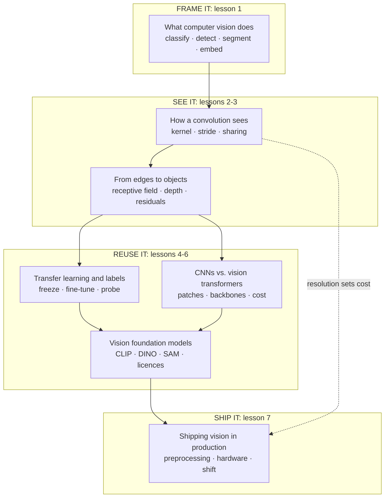

# Convolutional networks for the product and technology leader

*Part of the [foundation modules](../MACHINE_LEARNING_ROADMAP.md). It follows [machine learning](../machine-learning/README.md) and [tensors](../tensors/README.md).*

Computer vision is the part of AI that reads images. It counts stock on shelves, checks parts on a production line, sorts uploaded photos and reads documents. Much of it runs on the **convolutional neural network (CNN)**. The CS231n course notes credit AlexNet, entered in the 2012 ImageNet challenge, as the first work that popularized CNNs in computer vision. Vision transformers and large pre-trained "foundation" models now sit beside them.

Product and technology leaders make vision decisions often. What should the model output: a label, a box or a mask? What resolution do we need, and what does it cost? Do we label thousands of images, or start from someone else's model? CNN or transformer? Can we ship this pre-trained model under its licence? Why did accuracy drop when we changed cameras? These decisions do not need the mathematics. They need a clear picture of what a convolution does, what depth buys, how transfer works and where vision systems break.

This module gives that picture. Every lesson has two layers. The body is for the leader who decides. A short **Under the hood** section is for the engineer who builds. Lessons 2, 3 and 5 include code that runs on the Python standard library alone and ends in `assert` lines, so their numbers are checked.

**A note on scope.** This module does not teach tensors, shapes, matrix multiplication, broadcasting or automatic differentiation. The [Tensors module](../tensors/README.md) does, and these lessons link to it. It does not teach attention either. [Inside the model: attention](../llms/what-is-an-llm.md#inside-the-model-attention) in the LLMs track does, and the lesson on vision transformers adds only the image-specific part. Image generation is covered in [The modalities](../generative-ai/the-modalities.md).

## Where the depth lives

Each lesson summarizes an idea and points to the lesson that covers it in full.

| If you want the full depth on | Read |
| --- | --- |
| How an image batch is stored: shape, channel order, bytes | [What a tensor is](../tensors/what-a-tensor-is.md) |
| Why a convolution becomes a matrix multiplication, and how to count its cost | [Matrix multiplication](../tensors/matrix-multiplication.md) |
| Memory for training and the number formats a model can use | [Batching, memory and precision](../tensors/batching-memory-and-precision.md) |
| How the kernels' weights get their gradients, and what freezing a layer means | [Automatic differentiation](../tensors/automatic-differentiation.md) |
| How attention works, and why its cost grows with the square of the length | [Inside the model: attention](../llms/what-is-an-llm.md#inside-the-model-attention) |
| Labels, splits and leakage for any model | [Data: features, labels, splits and leakage](../machine-learning/data-features-labels-and-leakage.md) |
| Precision, recall and thresholds for any classifier | [Measuring a model](../machine-learning/measuring-a-model.md) |
| Training-serving skew, drift and monitoring for any model | [ML in production](../machine-learning/ml-in-production.md) |
| Lower-precision formats for serving | [Quantization formats](../content/01-inference-internals/quantization-formats.md) |
| Searching by vector similarity | [Embeddings and semantic search](../rag-vector-databases/embeddings-and-semantic-search.md) |

## The knowledge graph



Read it as a path from question to production. You **frame** the product question as one of four vision jobs. You learn how a network **sees**: one small kernel, then many layers. You **reuse** someone else's model instead of training from scratch, and pick a backbone family and a foundation model. Then you **ship** it, where preprocessing, hardware and changing images decide whether it keeps working.

## The lessons

1. [What computer vision does: the four jobs](./what-computer-vision-does.md) — classification, detection, segmentation and embeddings, and what each costs to label and measure.
2. [How a convolution sees: one small grid, used everywhere](./how-a-convolution-sees.md) — kernels, stride, padding, weight sharing, and why resolution sets the cost.
3. [From edges to objects: what depth buys](./from-edges-to-objects.md) — receptive fields, what layers learn, residual connections, and which layer to reuse.
4. [Transfer learning and labels: start from someone else's model](./transfer-learning-and-labels.md) — frozen features, fine-tuning, linear probes and the labelling budget.
5. [CNNs vs. vision transformers: picking a backbone](./cnns-vs-vision-transformers.md) — patches as tokens, built-in assumptions, and a backbone table.
6. [Vision foundation models: CLIP, DINO and SAM](./vision-foundation-models.md) — zero-shot classification, reusable pre-trained features, promptable segmentation, and licences.
7. [Shipping vision in production](./shipping-vision-in-production.md) — the preprocessing contract, hardware sizing and image shift.

Then the [recap and real-world examples](./recap.md), with a self-test.

## Run the code

The examples for lessons 2, 3 and 5 are in `cnns/code/`. Run them all with one command.

```bash
python3 cnns/code/test_examples.py
```

The files are `lesson2_convolution.py`, `lesson3_receptive_field.py` and `lesson5_patches.py`. Each ends in `assert` lines that check the numbers quoted in its lesson. Run a file on its own to see the numbers printed.

## Sources

- CS231n course notes, *Convolutional Neural Networks* ([GitHub source, master branch](https://github.com/cs231n/cs231n.github.io/blob/master/convolutional-networks.md)): AlexNet as "the first work that popularized Convolutional Networks in Computer Vision", submitted to the ImageNet ILSVRC challenge in 2012. Read 2026-10.
