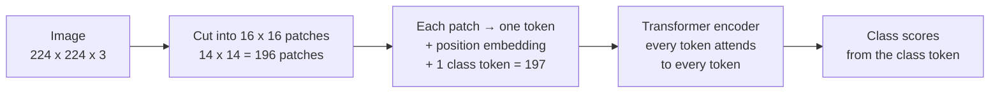

# CNNs vs. vision transformers: picking a backbone

*Part of [Convolutional networks for the product and technology leader](./README.md)*

## TL;DR

A **vision transformer (ViT)** reads an image the way a language model reads text. It cuts the image into square **patches**, turns each patch into a token, and lets every token attend to every other token. A convolutional network (CNN) instead slides small kernels over the image, so it builds in two assumptions: nearby pixels matter most, and the same pattern matters everywhere.

Those built-in assumptions are the core tradeoff. A CNN starts with them, which tends to help when data is limited. A ViT must learn them from data, and the ViT authors' recommended checkpoints are pre-trained on ImageNet-21k. In return it can relate any two parts of the image from the first layer.

Neither family wins outright. In torchvision's own ImageNet tables (as of 2026-10), a modern CNN (ConvNeXt-Tiny) and a ViT (ViT-B/16) land within 1.5 points of accuracy. The ViT needs about four times the listed compute. So pick the backbone by your data, your hardware and your resolution, not by fashion.

This lesson does not explain attention. [Inside the model: attention](../llms/what-is-an-llm.md#inside-the-model-attention) in the LLMs track does. Here we add only the part that is specific to images: patches as tokens.

> 🎯 **For the product leader**
>
> **Why it matters** — The backbone sets cost per image, the hardware you can run on, and how resolution changes the bill. A ViT's cost grows faster than a CNN's when you raise resolution.
>
> **What it changes in your decisions** — You ask for a comparison on your data and your resolution, with compute per image, not a headline accuracy. You treat "transformers are better" as a claim to test.
>
> **Ask your eng team** — *"At the resolution we need, what do a CNN and a ViT each score on our test set, and what does each cost per image on our hardware?"*
>
> **Risk if ignored** — A team picks a ViT for a small, specialised dataset and an edge device. It trains poorly without heavy pre-training and runs too slowly on the device. A smaller CNN would have met the bar.

## The mental model: patches become tokens



Think of a jigsaw puzzle. A CNN looks at each piece and its neighbours, then at bigger groups, layer by layer. A ViT lays all the pieces out at once and lets each piece check every other piece.

The analogy breaks because a ViT does not know where a piece came from unless you tell it. Each token gets a learned **position embedding** for that reason. Without it, the pieces would be an unordered pile.

## Mechanics

### Patches as tokens

Google's ViT repository describes the model in one sentence: "we split an image into fixed-size patches, linearly embed each of them, add position embeddings, and feed the resulting sequence of vectors to a standard Transformer encoder." For classification it adds "an extra learnable 'classification token'".

Torchvision's implementation shows the details. The patch embedding is a convolution whose kernel and stride both equal the patch size, so the windows never overlap. The token count is `(image_size // patch_size) ** 2`, plus 1 for the class token. For ViT-B/16 the patch is 16 pixels, with 12 layers and 12 attention heads.

### Built-in assumptions

A CNN builds in locality and weight sharing ([How a convolution sees](./how-a-convolution-sees.md)). A ViT builds in neither. Its attention can link any two patches from the first layer, and it learns from data which links matter. That is more flexible. It also means the model must learn from examples what a CNN gets for free.

The ViT authors' repository shows what its models were trained on. Its README says the models were pre-trained on the ImageNet and ImageNet-21k datasets, and its recommended checkpoints are AugReg ones pre-trained on ImageNet-21k. It also lists two follow-up papers, titled *How to train your ViT? Data, Augmentation, and Regularization in Vision Transformers* and *When Vision Transformers Outperform ResNets without Pretraining or Strong Data Augmentations*.

### The modern CNN

ConvNeXt, from Facebook AI Research and the University of California, Berkeley, is "a pure ConvNet model constructed entirely from standard ConvNet modules." In torchvision's tables it scores 82.5% top-1 on ImageNet at a compute figure of 4.456 that torchvision labels "GFLOPS". In the same tables, the transformer Swin-T scores 81.5% at 4.491 GFLOPS, and ViT-B/16 scores 81.1% at 17.564. At similar or higher compute, both are slightly less accurate than ConvNeXt-Tiny.

### Resolution costs a ViT more

A convolution layer's compute grows with the pixel count: double the side and it does four times the work. A ViT's token count also grows with the pixel count. Its attention scores grow with the square of the token count, as the [attention section](../llms/what-is-an-llm.md#inside-the-model-attention) explains. So raising resolution costs a ViT more than four times in its attention layers.

Torchvision also asserts that a ViT's input matches the size it was built for. To use a pre-trained ViT at another resolution, its position embeddings must be resized. Torchvision ships a helper, `interpolate_embeddings`, for this. A CNN is more flexible here. The CS231n transfer-learning notes say a pre-trained ConvNet can run on images of a different spatial size, as long as each layer's stride steps "fit" the new size.

## Worked example: two resolutions, two families

*This example is illustrative in its framing. The token and score counts are computed in `cnns/code/lesson5_patches.py`. The model figures come from torchvision's weight tables (as of 2026-10).*

**Step 1: count the tokens.** At 224 pixels with 16-pixel patches: 224 ÷ 16 = 14 patches a side, 14 × 14 = 196 patches, plus 1 class token: **197 tokens**. At 448 pixels: 28 × 28 = 784, plus 1: **785 tokens**.

**Step 2: count the attention scores.** Each head in each layer scores every token against every token. At 224: 197 × 197 = **38,809**. At 448: 785 × 785 = **616,225**. That is about **15.9 times** as many. Across ViT-B/16's 12 layers and 12 heads, that is 5,588,496 against 88,736,400.

**Step 3: compare a convolution layer.** The 64-kernel layer from lesson 2 does 4 times the work at 448 as at 224.

**Step 4: read the vendor table.** Torchvision lists these ImageNet-1K classifiers:

| Model | Family | Parameters | Compute (GFLOPS, as listed) | ImageNet top-1 | Input size |
| --- | --- | --- | --- | --- | --- |
| MobileNetV3-Large (IMAGENET1K_V2) | CNN | 5.5 million | 0.217 | 75.3% | 224 |
| EfficientNet-B0 | CNN | 5.3 million | 0.386 | 77.7% | 224 |
| ResNet-50 (IMAGENET1K_V2) | CNN | 25.6 million | 4.089 | 80.9% | 224 |
| ConvNeXt-Tiny | CNN | 28.6 million | 4.456 | 82.5% | 224 |
| ViT-B/16 (IMAGENET1K_V1) | Transformer | 86.6 million | 17.564 | 81.1% | 224, fixed |
| ViT-B/16 (IMAGENET1K_SWAG_E2E_V1) | Transformer | 86.9 million | 55.484 | 85.3% | 384, fixed |

All compute figures in this table are torchvision's own, so they compare with each other. They are not on the same scale as the FLOPs counted in [lesson 2](./how-a-convolution-sees.md), which may be twice a torchvision figure for the same work.

Read across. ConvNeXt-Tiny and ViT-B/16 at 224 are within 1.5 points. The ViT lists about 3.9 times the compute (17.564 ÷ 4.456). The 384-pixel ViT lists 3.16 times the compute of the 224-pixel one, while the pixel count grows 2.94 times. That gap is the attention term. The 384 model is also more accurate, but it is a different weights set. Torchvision says it was made by "end-to-end fine-tuning the original SWAG weights on ImageNet-1K data", so not all of that gain comes from resolution.

**The decision.** A team with 5,000 labelled images and a mobile target starts with MobileNetV3 or EfficientNet-B0. A team with a server graphics processing unit (GPU) and a broad task tries ConvNeXt-Tiny and ViT-B/16 on its own test set, at its own resolution, and picks on accuracy per unit of cost.

## Tradeoffs and decisions

- **Built-in assumptions vs. flexibility.** A CNN's locality helps with limited data. A ViT's global attention is more flexible. Its authors' recommended checkpoints are pre-trained on ImageNet-21k, so plan to start from pre-trained weights.
- **Compute vs. accuracy.** At similar accuracy in torchvision's tables, the ViT lists about four times the compute of ConvNeXt-Tiny. You pay that on every image.
- **Resolution growth.** CNN compute grows with pixels. ViT attention grows with pixels squared. High-resolution products feel this most.
- **Fixed vs. flexible input size.** Torchvision's ViT expects one size and needs its position embeddings resized for another. A CNN is easier to run at new sizes.
- **Ecosystem.** DINOv2 and most DINOv3 checkpoints are ViTs ([Vision foundation models](./vision-foundation-models.md)). Choosing a ViT can make it easier to reuse them. DINOv3 also ships ConvNeXt versions.

## Failure modes

- **Choosing by headline accuracy.** The table's best model lists about 12 times the compute of ConvNeXt-Tiny (55.484 ÷ 4.456) for 2.8 more points on ImageNet. That may not repeat on your data.
- **A ViT on a small dataset with no pre-training.** It underfits or overfits. Start from pre-trained weights.
- **Raising resolution on a ViT without re-costing.** Attention cost grows with the square of the token count. The latency target breaks.
- **Serving at a size the model was not built for.** Torchvision's ViT raises an error. A custom stack may resize silently and lose accuracy.
- **Mixed compute labels.** Torchvision's tables label compute "GFLOPS". TensorFlow's MobileNet page reports multiply-accumulates (MACs). For MobileNetV3-Large the two sources give the same number: torchvision lists 0.217 "GFLOPS" and the MobileNet page lists 217 million MACs. So torchvision's figure may be a multiply-accumulate count, whatever its label says. Find out how each source counts before you compare or convert. A count that treats a multiply and an add as two FLOPs is twice a multiply-accumulate count.

## Under the hood

The file is `cnns/code/lesson5_patches.py`. The token count is one line, and it mirrors torchvision's `seq_length = (image_size // patch_size) ** 2` plus one class token.

```python
def vit_tokens(image, patch, class_token=True):
    assert image % patch == 0
    return (image // patch) ** 2 + (1 if class_token else 0)

assert (vit_tokens(224, 16), vit_tokens(448, 16)) == (197, 785)
assert (197 ** 2, 785 ** 2) == (38_809, 616_225)
```

The file also checks that the patch embedding is a convolution. Flattening each 4 by 4 patch of an 8 by 8 image and multiplying by one weight table gives the same tokens as a convolution with kernel 4 and stride 4, to within 10⁻¹². Torchvision builds it that way: `nn.Conv2d(in_channels=3, out_channels=hidden_dim, kernel_size=patch_size, stride=patch_size)`. A 16 by 16 colour patch holds 16 × 16 × 3 = 768 numbers. ViT-B/16's token width is also 768.

The reshape from patches to a token sequence is ordinary tensor work. [Operations and broadcasting](../tensors/operations-and-broadcasting.md) and [What a tensor is](../tensors/what-a-tensor-is.md) cover reshapes and views.

## Practitioner checklist

- [ ] Did we compare at least one CNN and one ViT on our own test set at our resolution?
- [ ] Do we know compute per image for each, in the same unit?
- [ ] For a ViT, are we starting from pre-trained weights?
- [ ] Have we re-costed the model for any change in resolution?
- [ ] Does our serving stack feed the exact input size the model expects?
- [ ] Is the backbone small enough for our target hardware?

## Related lessons

- [Inside the model: attention](../llms/what-is-an-llm.md#inside-the-model-attention) — the attention step a ViT reuses, and why its cost grows with the square of the length.
- [How a convolution sees](./how-a-convolution-sees.md) — locality and weight sharing.
- [Vision foundation models](./vision-foundation-models.md) — large pre-trained backbones you can reuse.
- [Matrix multiplication](../tensors/matrix-multiplication.md) — counting compute for both families.
- [Choosing a model](../llms/choosing-a-model.md) — the same cost-versus-capability choice for language models.

## Sources

- Google Research, *Vision Transformer and MLP-Mixer Architectures* README ([GitHub, main branch](https://github.com/google-research/vision_transformer/blob/main/README.md)): the model overview quoted above, including the extra learnable classification token, in the overview paragraph under the model figure; models pre-trained on the ImageNet and ImageNet-21k datasets; AugReg checkpoints pre-trained on ImageNet-21k; two further checkpoint sets pre-trained on ImageNet only; the listed follow-up papers *How to train your ViT? Data, Augmentation, and Regularization in Vision Transformers* and *When Vision Transformers Outperform ResNets without Pretraining or Strong Data Augmentations*. Read 2026-10.
- PyTorch torchvision source, `torchvision/models/vision_transformer.py` ([GitHub, main branch](https://github.com/pytorch/vision/blob/main/torchvision/models/vision_transformer.py)): `conv_proj` as `nn.Conv2d` with `kernel_size=patch_size, stride=patch_size`; `seq_length = (image_size // patch_size) ** 2` plus a class token; the input-size assertions; `interpolate_embeddings` for other resolutions; `vit_b_16` with patch size 16, 12 layers, 12 heads, hidden size 768; weight tables for `IMAGENET1K_V1` (86,567,656 parameters, 81.072% top-1, 17.564 GFLOPS) and `IMAGENET1K_SWAG_E2E_V1` (86,859,496, 85.304%, 55.484, 384 pixels), documented as "learnt via transfer learning by end-to-end fine-tuning the original SWAG weights on ImageNet-1K data". Read 2026-10.
- PyTorch torchvision source, `convnext.py`, `resnet.py`, `mobilenetv3.py` and `efficientnet.py` ([GitHub, main branch](https://github.com/pytorch/vision/tree/main/torchvision/models)): ConvNeXt-Tiny 28,589,128 parameters, 82.520%, 4.456 GFLOPS; ResNet-50 `IMAGENET1K_V2` 25,557,032, 80.858%, 4.089; MobileNetV3-Large `IMAGENET1K_V2` 5,483,032, 75.274%, 0.217; EfficientNet-B0 5,288,548, 77.692%, 0.386; the compute figure is the `_ops` field, which torchvision's documentation build (`docs/source/conf.py`) labels "GFLOPS" without defining it; and, from `swin_transformer.py`, Swin-T 81.474% at 4.491. Read 2026-10.
- Meta AI Research, *DINOv2* and *DINOv3* READMEs ([DINOv2](https://github.com/facebookresearch/dinov2/blob/main/README.md), [DINOv3](https://github.com/facebookresearch/dinov3/blob/main/README.md), GitHub, main branch): DINOv2 backbones are ViTs; DINOv3 lists ViT and ConvNeXt models pre-trained on its web dataset. Read 2026-10.
- Facebook AI Research and the University of California, Berkeley, *ConvNeXt* README ([GitHub, main branch](https://github.com/facebookresearch/ConvNeXt/blob/main/README.md)): "a pure ConvNet model constructed entirely from standard ConvNet modules"; released under the MIT licence. Read 2026-10.
- TensorFlow Models, *MobileNet* README ([GitHub, master branch](https://github.com/tensorflow/models/blob/master/research/slim/nets/mobilenet/README.md)): efficiency reported in MACs, the number of multiply-accumulates needed for one image; 217 million MACs for MobileNetV3-Large ("Large dm=1 (float)"). Read 2026-10.
- CS231n course notes, *Transfer learning* ([GitHub source, master branch](https://github.com/cs231n/cs231n.github.io/blob/master/transfer-learning.md)): a pre-trained ConvNet can run on images of a different spatial size when the stride steps "fit". Read 2026-10.
- The token counts, score counts and ratios are computed by `cnns/code/lesson5_patches.py` or shown as arithmetic in the lesson. The two team scenarios are illustrative.
