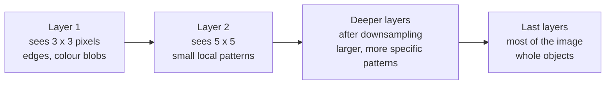

# From edges to objects: what depth buys

*Part of [Convolutional networks for the product and technology leader](./README.md)*

*Last reviewed: 2026-10 · Volatility: medium*

## TL;DR

One convolution layer sees a 3 by 3 window. A network that recognises a dog must see the whole dog. Depth closes the gap. Each layer looks at a small window of the layer before it, so the patch of the original image that a value depends on grows with every layer. That patch is the **receptive field**. Downsampling makes it grow faster.

What the layers learn follows the same path. Early layers respond to simple local patterns such as edges and colour blobs. Later layers respond to larger, more specific patterns. The CS231n course notes describe early features as generic and useful for many tasks, and later features as specific to the data the network was trained on.

Depth has a cost. A deeper network is slower per image. **Residual connections**, the "skip" paths in ResNet, are one well-known design for deep networks. They let each block add a correction to its input instead of replacing it. ResNet, built on them, won the 2015 ImageNet challenge.

For a product leader, this decides two things: how much model you need, and which layers of a pre-trained model to reuse for your data.

> 🎯 **For the product leader**
>
> **Why it matters** — The layer you reuse decides what you inherit. Early layers carry more generic features, such as edges, that are useful for many tasks. Late layers carry the original dataset's ideas of what matters, which may not fit your images.
>
> **What it changes in your decisions** — You stop treating a pre-trained model as one block. You ask which layers the team keeps, which it retrains, and why. You also treat "this neuron detects X" pictures as illustrations, not proof.
>
> **Ask your eng team** — *"Our images look nothing like the pre-training data. Which layer are we taking features from, and did we compare it with an earlier one?"*
>
> **Risk if ignored** — A medical or industrial team bolts a classifier onto the last layer of an everyday-photo model. The features describe pets and cars, not defects. The model plateaus, and the team blames the labels.

## The mental model: a growing view



Think of a team reading a large map through small windows. The first reader sees a few streets. The next reads summaries from several first readers, so covers a neighbourhood. A few levels up, one reader covers the city.

The analogy breaks in one way. Nobody assigns the readers their topics. The network learns what each layer responds to, and a single unit often has no clean meaning on its own. The CS231n notes warn that individual neurons "do not necessarily have any semantic meaning by themselves."

## Mechanics

### The receptive field grows with depth

A 3 by 3 layer sees 3 pixels across. A second 3 by 3 layer on top sees 3 values of the first, which together cover 5 pixels. A third covers 7. With stride 1, n layers of 3 by 3 kernels see 2n + 1 pixels.

The CS231n notes compare three 3 by 3 layers with one 7 by 7 layer. Both see 7 by 7. The stack has three non-linear steps instead of one, so it can express more. It also needs fewer weights: 27C² against 49C², where C is the number of channels.

### Downsampling makes it grow faster

A stride of 2 or a pooling layer halves the grid. After that, a 3 by 3 window spans twice as much of the original image. Torchvision's ResNet starts with a 7 by 7 convolution at stride 2 and a 3 by 3 max pool at stride 2. After those two steps each value sees 11 by 11 pixels. One more 3 by 3 layer takes it to 19 by 19. Four 3 by 3 layers without downsampling reach only 9 by 9.

By the last stage, a 224 by 224 input has become a 7 by 7 grid, 32 times smaller on each side. Each of those 49 positions summarises a large part of the image.

### What the layers respond to

The CS231n notes on visualising networks describe the first-layer weights of a trained network as "very nice and smooth". In deeper layers, they show images that most strongly activate single units of AlexNet's fifth pooling layer. Those units respond to things like upper bodies, text and specular highlights, and each one depends on a large part of the image. The transfer-learning notes draw the practical conclusion. Early features are generic, such as edge and colour-blob detectors. Later features are more specific to the classes of the original dataset.

### Residual connections

A plain block replaces its input: y = F(x). A residual block adds to it: y = x + F(x). Torchvision's ResNet code shows this as one line, `out += identity`. If a residual block's weights are all zero, it passes its input through unchanged. A plain block with zero weights passes nothing. So a residual block can keep its input and learn only a correction on top of it.

The ResNet family, from Kaiming He and colleagues at Microsoft Research Asia, won the ImageNet challenge (ILSVRC) in 2015, according to the CS231n notes. Its authors' repository releases the original ResNet-50, ResNet-101 and ResNet-152 models.

## Worked example: how far each layer sees

*This example is illustrative. The layer stacks are common patterns. The code is in `cnns/code/lesson3_receptive_field.py`.*

**Step 1: small stacks.** Three 3 by 3 layers at stride 1 see 3, then 5, then 7 pixels.

**Step 2: the weight bill.** With 64 channels in and out, three 3 by 3 layers need 3 × 64 × 3 × 3 × 64 = 110,592 weights. One 7 by 7 layer with the same view needs 64 × 7 × 7 × 64 = 200,704. The stack sees as far for 55% of the weights.

**Step 3: add downsampling.** The ResNet stem (7 by 7 at stride 2, then a 3 by 3 pool at stride 2) reaches 11 pixels. One more 3 by 3 layer reaches 19. Without downsampling, four 3 by 3 layers reach only 9.

**Step 4: the grid shrinks.** Through torchvision's ResNet layout, a 224-pixel side becomes 112, then 56, 28, 14 and 7.

**Step 5: the end of the first stage.** In ResNet-50, the first stage (`layer1`) adds three blocks after the stem. Each block has one 3 by 3 convolution, and its 1 by 1 convolutions do not widen the view. At that point the grid has a step of 4 pixels, so each 3 by 3 layer adds 2 × 4 = 8 pixels. The view grows from 11 to 19, 27 and then 35 pixels. The map is still 56 by 56, so each position covers 4 by 4 pixels of the image.

**The decision.** A defect-inspection team has 30-pixel scratches on 224-pixel images. After the stem and one layer, each value sees only 19 pixels, less than a scratch. By the end of the first stage it sees 35, enough to cover one, on a 56 by 56 map. At the last stage one cell of the 7 by 7 grid spans 32 pixels, so a scratch fills about one cell and is mixed with everything else in it. The team takes features from an early or middle stage of a pre-trained ResNet, not the last one. This choice is a hypothesis. The team tests features from both stages on a held-out set before it commits.

## Tradeoffs and decisions

- **Depth vs. speed.** More layers see more and cost more time per image. A 50-layer model is slower than an 18-layer one on the same hardware. In torchvision's tables, ResNet-18 lists a compute figure of 1.814 and ResNet-50 lists 4.089, in a column labelled "GFLOPS" (as of 2026-10). Compare them with each other, not with the FLOPs counted in [lesson 2](./how-a-convolution-sees.md); torchvision's figure may be a multiply-accumulate count.
- **Early features vs. late features.** Early features are more generic and useful for many tasks. Late layers carry the original task's ideas. For images unlike the pre-training data, an earlier layer may serve better, at the cost of training more on top.
- **Downsampling vs. small detail.** Each halving speeds up every later layer and blurs small objects. If the product must find small objects, ask how the model keeps a higher-resolution map for them.
- **Interpretability pictures vs. evidence.** Feature visualisations help a team debug. They are not a guarantee of what the model relies on. Test behaviour on your data instead.

## Failure modes

- **Features from the wrong depth.** The team uses only the final layer on images unlike the pre-training set. Accuracy stalls.
- **Small objects lost to downsampling.** The defect fits in one cell of the last grid, next to a large background. The signal is diluted.
- **"This neuron detects wheels."** A team builds a product claim on one visualised unit. The unit also fires on other round things.
- **Dead filters.** The CS231n notes warn that activation maps that stay at zero for many inputs can mean dead filters, sometimes from too high a learning rate. Part of the network does nothing.
- **Depth added, nothing gained.** A deeper backbone is slower and the accuracy gain is within noise. Measure before you pay for the bigger model.

## Under the hood

The file is `cnns/code/lesson3_receptive_field.py`. The receptive field follows a short recurrence. Each layer adds (kernel − 1) times the current step between neighbouring values, and each stride multiplies that step.

```python
def receptive_field(layers):
    r, jump = 1, 1
    for k, s in layers:          # (kernel size, stride) per layer
        r += (k - 1) * jump
        jump *= s
    return r

assert receptive_field([(3, 1)] * 3) == 7
assert receptive_field([(7, 2), (3, 2)]) == 11          # ResNet stem
assert receptive_field([(7, 2), (3, 2), (3, 1)]) == 19
```

This counts every pixel that can affect a value. It does not say how much each pixel matters.

The residual block is one addition. Torchvision's ResNet code ends each block with `out += identity`, then a ReLU. The file checks the arithmetic: with all-zero weights, `x + F(x)` returns `x`, and a plain block returns zeros.

To reuse a middle stage, take the output of a named layer instead of the last one. In torchvision's ResNet these stages are `layer1` to `layer4`. Their outputs for a 224-pixel input are 56, 28, 14 and 7 positions on a side.

## Practitioner checklist

- [ ] Do we know the receptive field at the layer we take features from, compared with the size of what we detect?
- [ ] Have we compared features from more than one depth on our own held-out images?
- [ ] For small objects, do we keep a higher-resolution feature map?
- [ ] Do we treat feature visualisations as debugging aids, not as evidence?
- [ ] Have we measured whether a deeper backbone pays for its extra latency?

## Related lessons

- [How a convolution sees](./how-a-convolution-sees.md) — one layer, the window and the stride.
- [Transfer learning and labels](./transfer-learning-and-labels.md) — choosing what to freeze and what to retrain.
- [Automatic differentiation](../tensors/automatic-differentiation.md) — how gradients flow back through these layers.
- [Batching, memory and precision](../tensors/batching-memory-and-precision.md) — why deeper networks cost more memory to train.
- [Model families](../machine-learning/model-families.md) — neural networks next to linear models and trees.

## Sources

- CS231n course notes, *Convolutional Neural Networks* ([GitHub source, master branch](https://github.com/cs231n/cs231n.github.io/blob/master/convolutional-networks.md)): three stacked 3 by 3 layers see 7 by 7, with 27C² parameters against 49C² for one 7 by 7 layer; ResNet "developed by Kaiming He et al. was the winner of ILSVRC 2015", with skip connections. Read 2026-10.
- CS231n course notes, *Visualizing what ConvNets learn* ([GitHub source, master branch](https://github.com/cs231n/cs231n.github.io/blob/master/understanding-cnn.md)): first-layer weights described as "very nice and smooth"; AlexNet POOL5 units responding to upper bodies, text and specular highlights over large parts of the image; neurons without semantic meaning on their own; all-zero activation maps as a sign of dead filters. Read 2026-10.
- CS231n course notes, *Transfer learning* ([GitHub source, master branch](https://github.com/cs231n/cs231n.github.io/blob/master/transfer-learning.md)): early features are generic (edge and colour-blob detectors) "that should be useful to many tasks", later features are specific to the original dataset. Read 2026-10.
- Kaiming He et al., *Deep Residual Networks* README ([GitHub, master branch](https://github.com/KaimingHe/deep-residual-networks/blob/master/README.md)): the original ResNet-50, ResNet-101 and ResNet-152 models from the paper "Deep Residual Learning for Image Recognition", Microsoft Research Asia. Read 2026-10.
- PyTorch torchvision source, `torchvision/models/resnet.py` ([GitHub, main branch](https://github.com/pytorch/vision/blob/main/torchvision/models/resnet.py)): `out += identity` in each block; the 7 by 7 stride-2 first convolution and 3 by 3 stride-2 max pool; stride 2 at the start of `layer2` to `layer4`; listed compute of 1.814 GFLOPS for ResNet-18 and 4.089 for ResNet-50. Read 2026-10.
- The layer stacks, the scratch example and every computed figure are illustrative. They come from `cnns/code/lesson3_receptive_field.py`, which ends in `assert` lines.
