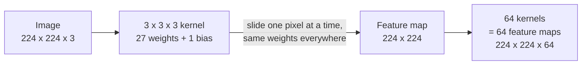

# How a convolution sees: one small grid, used everywhere

*Part of [Convolutional networks for the product and technology leader](./README.md)*

## TL;DR

A **convolution** slides one small grid of weights across an image. The grid is the **kernel**, often 3 by 3 pixels. At each position it multiplies the pixels under it by its weights and adds them up. The result is one number per position: a new grid called a **feature map**. A kernel that has learned "dark on the left, bright on the right" lights up wherever a vertical edge is.

Two ideas make this work. Each output looks only at a small local window. And the same weights are used at every position, so a detector learned in one corner works in every corner. Together they cut the number of weights by a huge factor compared with connecting every pixel to every output.

The cost is compute. A few weights are reused at every pixel, so the work grows with the image area. Double the width and height of the input and a convolution layer does four times the work, with the same weights. That makes input resolution one of the biggest cost levers in a vision product.

This lesson does not re-teach tensors, shapes, matrix multiplication or broadcasting. The [Tensors module](../tensors/README.md) covers them. Here we add only what a convolution changes.

> 🎯 **For the product leader**
>
> **Why it matters** — Resolution decides cost. A request to "use the full-resolution photo" can multiply compute per image. Weight sharing is also why a convolution layer needs so few weights.
>
> **What it changes in your decisions** — You treat input resolution as a product decision with a price. You ask for the smallest resolution that still shows the detail the product needs.
>
> **Ask your eng team** — *"What input resolution do we run at, what is the smallest detail we must see at that resolution, and what would doubling it cost per image?"*
>
> **Risk if ignored** — A team raises resolution to catch small defects and the serving bill quadruples. Or it lowers resolution to save money and the defects shrink below one pixel, so the model cannot see them.

## The mental model: a stamp moved across a page



Picture a rubber stamp with a small pattern cut into it. You press it on every spot of the page and note how well the page matches the pattern there. The stamp never changes as it moves. That is weight sharing.

The analogy breaks in two places. A real layer uses many stamps at once, one per output channel, and the model learns their patterns from data. Nobody carves them by hand. And each stamp spans every colour channel of the input, not one flat page.

## Mechanics

### The window, the stride and the padding

A kernel of size F covers an F by F window. The **stride** S is how far the window moves between positions. **Padding** P adds a border of zeros so the window can sit on the edge pixels. The CS231n course notes give the output width as:

`(W − F + 2P) / S + 1`

For a 7 by 7 input and a 3 by 3 kernel with no padding, stride 1 gives a 5 by 5 output and stride 2 gives 3 by 3. A 3 by 3 kernel with padding 1 and stride 1 keeps the size: 224 in, 224 out. A stride of 2 roughly halves each side, which cuts the work for every layer after it.

### Channels and filters

A colour image has 3 channels: red, green and blue. A kernel spans all of them, so a 3 by 3 kernel on a colour image has 3 × 3 × 3 = 27 weights plus 1 bias. A layer runs many kernels side by side. Each kernel makes one feature map. 64 kernels give 64 maps, so the output has 64 channels. The next layer's kernels then span those 64 channels.

### Weight sharing

Without sharing, every output position would need its own weights. The CS231n notes work this out for the first layer of AlexNet, which the notes say "significantly outperformed the second runner-up" in the 2012 ImageNet challenge. It has 55 × 55 × 96 = 290,400 outputs, each with 363 weights and 1 bias. Without sharing that is 105,705,600 parameters. With sharing, each of the 96 kernels is used everywhere. The layer has 34,944 parameters.

Sharing rests on one assumption: a pattern worth detecting in one place is worth detecting everywhere. It also means a shifted input gives a shifted output. The CS231n notes point out where the assumption is weak, for example on centred faces where different positions should learn different features.

### Pooling

A pooling layer shrinks a feature map without weights. Max pooling with a 2 by 2 window and stride 2 keeps the largest value in each window. The CS231n notes say this setting discards 75% of the values and is the most common. Torchvision's ResNet uses one max pool near the input and strided convolutions after that.

### Where the weights come from

Nobody writes the kernels. They start random and training adjusts them with the gradient, as with any layer. The Tensors lesson on [automatic differentiation](../tensors/automatic-differentiation.md) covers how a library computes that gradient. Because one kernel is used at every position, its gradient is the sum of the gradients from every position.

## Worked example: one layer, counted

*This example is illustrative. The layer sizes are a common choice, not a specific product. The code is in `cnns/code/lesson2_convolution.py`.*

The input is a 224 by 224 colour image. The layer has 64 kernels of size 3 by 3, stride 1, padding 1.

1. **Output size.** (224 − 3 + 2 × 1) ÷ 1 + 1 = 224. The output is 224 × 224 × 64.
2. **Parameters.** Each kernel has 3 × 3 × 3 = 27 weights. 64 kernels give 1,728 weights, plus 64 biases: **1,792 parameters**.
3. **Compute.** Each output value needs 27 multiplies and 27 adds. There are 224 × 224 × 64 = 3,211,264 output values. That is 2 × 3,211,264 × 27 = **173,408,256 FLOPs**, about 0.17 billion, with the bias ignored.
4. **The dense alternative.** A fully connected layer with the same input and output would join 150,528 inputs to 3,211,264 outputs. That is **483,385,147,392 weights**. It is 269,746,176 times the convolution's 1,792 parameters.
5. **Double the resolution.** At 448 by 448 the same layer still has 1,792 parameters. The compute is four times as much: 2 × 448 × 448 × 64 × 27 = 693,633,024 FLOPs.

Step 5 is the product lesson. The Tensors module says that [parameters understate compute](../tensors/matrix-multiplication.md) for a convolution. Here is by how much. Each of the 1,728 weights is used once per output position, 224 × 224 = 50,176 times, at 2 FLOPs per use: 1,728 × 50,176 × 2 = 173,408,256.

**A note on counting.** This lesson counts a multiply and an add as two FLOPs. Model tables label compute in different ways. The TensorFlow MobileNet page reports multiply-accumulates (MACs). Torchvision's tables label their column "GFLOPS". Check how each table defines its unit before you compare two of them.

## Tradeoffs and decisions

- **Resolution vs. cost.** Doubling width and height costs about four times the compute per layer and four times the activation memory. Halving them saves the same, and small details may vanish.
- **Local view vs. global view.** One 3 by 3 kernel sees only its neighbours. The network needs depth to relate distant parts of the image. [From edges to objects](./from-edges-to-objects.md) shows how depth grows the view.
- **Built-in assumptions vs. flexibility.** Weight sharing is an assumption about images. It saves data when it holds. When position matters, such as on centred faces or fixed forms, the assumption costs accuracy.
- **Stride vs. detail.** A stride of 2 cuts later work by about four times and discards fine detail early.

## Failure modes

- **Detail smaller than the window.** A crack two pixels wide on a phone photo shrunk to 224 pixels becomes less than one pixel. No kernel can find it.
- **Resolution changed late.** A team trains at 224 and serves at 512 to "see more". The cost per image rises about five times and accuracy may fall, because the model never saw objects at that scale.
- **Parameter count used as a cost proxy.** A small model with large inputs can cost more per image than a bigger model on small inputs. Ask for FLOPs at your resolution.
- **Mixed compute units.** One table reports multiply-accumulates, another reports "GFLOPS", and neither number is converted. The comparison is wrong by an unknown factor.
- **Padding at the border.** At the edge, the window sees a border of padded zeros that is not in the scene. Objects cut by the frame edge are a separate case. Test them on their own.

## Under the hood

The file is `cnns/code/lesson2_convolution.py`. The core is four loops: slide, multiply, add.

```python
def conv2d(img, kernel, stride=1, padding=0, bias=0.0):
    x = pad(img, padding) if padding else img
    f = len(kernel)
    oh = out_size(len(img), f, stride, padding)
    ow = out_size(len(img[0]), f, stride, padding)
    out = []
    for i in range(oh):
        row = []
        for j in range(ow):
            total = bias
            for a in range(f):
                for b in range(f):
                    total += kernel[a][b] * x[i * stride + a][j * stride + b]
            row.append(total)
        out.append(row)
    return out
```

A common way to implement it, which the CS231n notes describe, is **im2col**. Stretch every window into one column, then do one large matrix multiplication of the kernel weights against all the columns. The file checks that both give the same answer to within 10⁻¹². From there, the cost is the matrix-multiplication cost covered in [Tensors lesson 3](../tensors/matrix-multiplication.md).

The file also checks the edge detector. A 6 by 6 image, dark on the left and bright on the right, under the kernel `[-1, 0, 1]` in each row, gives the row `[0, 3, 3, 0]`. It fires only at the edge. Shift the image one pixel right and the response shifts one place right. The weights did not change.

In PyTorch the worked example layer is one line: `nn.Conv2d(3, 64, kernel_size=3, stride=1, padding=1)`. PyTorch's `Conv2d` documents its input shape as `(N, C_in, H_in, W_in)`, here `(N, 3, 224, 224)`, as covered in [What a tensor is](../tensors/what-a-tensor-is.md).

## Practitioner checklist

- [ ] Do we know our input resolution, and the smallest detail the product must see at it?
- [ ] Have we priced a change in resolution as roughly the square of the change in side length?
- [ ] Do we compare models by FLOPs at our resolution, not by parameter count?
- [ ] When we compare vendor tables, do we know how each one defines its compute unit?
- [ ] Do we train and serve at the same resolution?
- [ ] Do we test objects at the edge of the frame?

## Related lessons

- [What computer vision does](./what-computer-vision-does.md) — the four jobs these layers serve.
- [From edges to objects](./from-edges-to-objects.md) — what stacking these layers builds.
- [Matrix multiplication](../tensors/matrix-multiplication.md) — the operation a convolution becomes, and how to count it.
- [What a tensor is](../tensors/what-a-tensor-is.md) — image shapes and bytes.
- [Model families](../machine-learning/model-families.md) — where convolutional networks sit among other models.

## Sources

- CS231n course notes, *Convolutional Neural Networks* ([GitHub source, master branch](https://github.com/cs231n/cs231n.github.io/blob/master/convolutional-networks.md)): the output-size formula `(W − F + 2P)/S + 1` with the 7 by 7 examples; parameter sharing with the AlexNet figures (290,400 neurons, 363 weights and 1 bias each, 105,705,600 parameters without sharing, 34,944 with); where sharing does not make sense; max pooling at 2 by 2 and stride 2 discarding 75% of activations; im2col turning a convolution into one matrix multiply; relaxing sharing for centred faces; AlexNet, submitted to the ImageNet challenge in 2012, "significantly outperformed the second runner-up". Read 2026-10.
- PyTorch source, `torch/nn/modules/conv.py` ([GitHub, main branch](https://github.com/pytorch/pytorch/blob/main/torch/nn/modules/conv.py)): `Conv2d(in_channels, out_channels, kernel_size, stride=1, padding=0, ...)`, with input shape `(N, C_in, H_in, W_in)` and output size rounded down. Read 2026-10.
- PyTorch torchvision source, `torchvision/models/resnet.py` ([GitHub, main branch](https://github.com/pytorch/vision/blob/main/torchvision/models/resnet.py)): one `MaxPool2d(kernel_size=3, stride=2, padding=1)` after the first convolution, and `stride=2` at the start of `layer2`, `layer3` and `layer4`. Read 2026-10.
- TensorFlow Models, *MobileNet* README ([GitHub, master branch](https://github.com/tensorflow/models/blob/master/research/slim/nets/mobilenet/README.md)): efficiency reported in MACs, the number of multiply-accumulates needed for one image. Read 2026-10.
- The layer sizes, the edge image and every computed figure are illustrative. They come from `cnns/code/lesson2_convolution.py`, which ends in `assert` lines.
